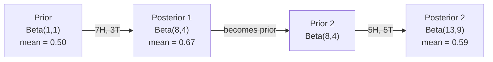

# 贝叶斯定理

> 概率关乎你的预期。贝叶斯定理关乎你的所学。

**Type:** Build
**Language:** Python
**Prerequisites:** Phase 1, Lesson 06 (Probability Fundamentals)
**Time:** ~75 minutes

## 学习目标

- 应用贝叶斯定理，从先验、似然和证据计算出后验概率
- 从零构建一个朴素贝叶斯文本分类器，包含拉普拉斯平滑和对数空间计算
- 比较 MLE 与 MAP 估计，并解释 MAP 如何对应 L2 正则化
- 使用 Beta-Binomial 共轭先验实现顺序贝叶斯更新，用于 A/B 测试

## 问题

一项医学检测有 99% 的准确率。你的检测结果呈阳性。你真正患上这种疾病的概率有多大？

大多数人会说 99%。真实答案取决于这种疾病有多罕见。如果 1 万人里只有 1 人患病，那么阳性结果只给你大约 1% 的患病概率。其余 99% 的阳性结果都是来自健康人的误报。

这不是一道脑筋急转弯。它就是贝叶斯定理。每一个垃圾邮件过滤器、每一套医学诊断、每一个量化不确定性的机器学习模型，都在使用完全相同的推理。你从一个信念出发。你看到证据。你进行更新。

如果你在不懂这些的情况下构建 ML 系统，你就会误解模型输出、设定错误的阈值，并交付过于自信的预测。

## 概念

### 从联合概率到贝叶斯

你从第 06 课已经知道条件概率是：

```
P(A|B) = P(A and B) / P(B)
```

对称地：

```
P(B|A) = P(A and B) / P(A)
```

两个式子共享同一个分子：P(A and B)。令它们相等并重新整理：

```
P(A and B) = P(A|B) * P(B) = P(B|A) * P(A)

Therefore:

P(A|B) = P(B|A) * P(A) / P(B)
```

这就是贝叶斯定理。四个量，一个等式。

### 四个部分

| 部分 | 名称 | 含义 |
|------|------|------|
| P(A\|B) | 后验（Posterior） | 看到证据 B 后，你对 A 更新后的信念 |
| P(B\|A) | 似然（Likelihood） | 若 A 为真，证据 B 出现的概率有多高 |
| P(A) | 先验（Prior） | 在看到任何证据之前你对 A 的信念 |
| P(B) | 证据（Evidence） | 在所有可能性下看到 B 的总概率 |

证据项 P(B) 充当归一化因子。你可以用全概率公式把它展开：

```
P(B) = P(B|A) * P(A) + P(B|not A) * P(not A)
```

### 医学检测示例

一种疾病影响 1 万人中的 1 人。检测有 99% 的准确率（能检出 99% 的患病者，在 1% 的情况下给出假阳性）。

```
P(sick)          = 0.0001     (prior: disease is rare)
P(positive|sick) = 0.99       (likelihood: test catches it)
P(positive|healthy) = 0.01    (false positive rate)

P(positive) = P(positive|sick) * P(sick) + P(positive|healthy) * P(healthy)
            = 0.99 * 0.0001 + 0.01 * 0.9999
            = 0.000099 + 0.009999
            = 0.010098

P(sick|positive) = P(positive|sick) * P(sick) / P(positive)
                 = 0.99 * 0.0001 / 0.010098
                 = 0.0098
                 = 0.98%
```

不到 1%。先验占据主导。当一种疾病很罕见时，即便是准确的检测也大多产生假阳性。这就是医生要做确认检测的原因。

### 垃圾邮件过滤器示例

你收到一封包含单词 "lottery" 的邮件。它是垃圾邮件吗？

```
P(spam)                = 0.3      (30% of email is spam)
P("lottery"|spam)      = 0.05     (5% of spam emails contain "lottery")
P("lottery"|not spam)  = 0.001    (0.1% of legitimate emails contain "lottery")

P("lottery") = 0.05 * 0.3 + 0.001 * 0.7
             = 0.015 + 0.0007
             = 0.0157

P(spam|"lottery") = 0.05 * 0.3 / 0.0157
                  = 0.955
                  = 95.5%
```

一个词就把概率从 30% 推到了 95.5%。真正的垃圾邮件过滤器会同时在数百个词上应用贝叶斯。

### 朴素贝叶斯：独立性假设

朴素贝叶斯通过假设所有特征在给定类别下条件独立，把这一思想扩展到多个特征：

```
P(class | feature_1, feature_2, ..., feature_n)
  = P(class) * P(feature_1|class) * P(feature_2|class) * ... * P(feature_n|class)
    / P(feature_1, feature_2, ..., feature_n)
```

「朴素」之处就在于独立性假设。在文本中，词的出现并非独立（"New" 和 "York" 是相关的）。但这个假设在实践中出奇地好用，因为分类器只需要给类别排序，而不需要产出校准过的概率。

由于分母对所有类别都相同，你可以跳过它，只比较分子：

```
score(class) = P(class) * product of P(feature_i | class)
```

选择得分最高的类别。

### 最大似然估计（MLE）

如何从训练数据得到 P(feature|class)？数数。

```
P("free"|spam) = (number of spam emails containing "free") / (total spam emails)
```

这就是 MLE：选择使观测数据最可能出现的参数值。你在最大化似然函数，对于离散计数，它退化为相对频率。

问题：如果一个词在训练时从未出现在垃圾邮件中，MLE 会给它概率零。一个未见过的词就能让整个乘积归零。用拉普拉斯平滑来修复：

```
P(word|class) = (count(word, class) + 1) / (total_words_in_class + vocabulary_size)
```

给每个计数加 1，确保任何概率都不会是零。

### 最大后验估计（MAP）

MLE 问：什么参数能最大化 P(data|parameters)？

MAP 问：什么参数能最大化 P(parameters|data)？

根据贝叶斯定理：

```
P(parameters|data) proportional to P(data|parameters) * P(parameters)
```

MAP 在参数本身上加了一个先验。如果你认为参数应当较小，你就把它编码成一个惩罚大数值的先验。这与 ML 中的 L2 正则化完全相同。岭回归中的「岭」惩罚实际上就是权重上的高斯先验。

| 估计方法 | 优化目标 | ML 对应物 |
|------------|-----------|---------------|
| MLE | P(data\|params) | 无正则化训练 |
| MAP | P(data\|params) * P(params) | L2 / L1 正则化 |

### 贝叶斯与频率学派：实际差异

频率学派把参数当作固定的未知量。他们问：「如果我把这个实验重复很多次，会发生什么？」

贝叶斯学派把参数当作分布。他们问：「给定我已观测到的内容，我对参数相信什么？」

对构建 ML 系统而言，实际差异是：

| 方面 | 频率学派 | 贝叶斯学派 |
|--------|-------------|----------|
| 输出 | 点估计 | 值上的分布 |
| 不确定性 | 置信区间（关于过程） | 可信区间（关于参数） |
| 小数据 | 可能过拟合 | 先验充当正则化 |
| 计算 | 通常更快 | 往往需要采样（MCMC） |

大多数生产 ML 是频率学派的（SGD、点估计）。当你需要校准过的不确定性（医疗决策、安全关键系统）或数据稀缺（少样本学习、冷启动）时，贝叶斯方法大放异彩。

### 为什么贝叶斯思维对 ML 重要

这种关联比类比更深刻：

**先验就是正则化。** 权重上的高斯先验就是 L2 正则化。拉普拉斯先验就是 L1。每当你加一个正则化项，你就是在用贝叶斯语言陈述你期望的参数值。

**后验就是不确定性。** 一个单一的预测概率不会告诉你模型对这个估计有多自信。贝叶斯方法给你一个分布：「我认为 P(spam) 介于 0.8 到 0.95 之间。」

**贝叶斯更新就是在线学习。** 今天的后验成为明天的先验。当模型看到新数据时，它会增量地更新信念，而不是从头重新训练。

**模型比较是贝叶斯的。** 贝叶斯信息准则（BIC）、边际似然和贝叶斯因子都使用贝叶斯推理在不过拟合的情况下选择模型。

```figure
bayes-update
```

## Build It

### 步骤 1：贝叶斯定理函数

```python
def bayes(prior, likelihood, false_positive_rate):
    evidence = likelihood * prior + false_positive_rate * (1 - prior)
    posterior = likelihood * prior / evidence
    return posterior

result = bayes(prior=0.0001, likelihood=0.99, false_positive_rate=0.01)
print(f"P(sick|positive) = {result:.4f}")
```

### 步骤 2：朴素贝叶斯分类器

```python
import math
from collections import defaultdict

class NaiveBayes:
    def __init__(self, smoothing=1.0):
        self.smoothing = smoothing
        self.class_counts = defaultdict(int)
        self.word_counts = defaultdict(lambda: defaultdict(int))
        self.class_word_totals = defaultdict(int)
        self.vocab = set()

    def train(self, documents, labels):
        for doc, label in zip(documents, labels):
            self.class_counts[label] += 1
            words = doc.lower().split()
            for word in words:
                self.word_counts[label][word] += 1
                self.class_word_totals[label] += 1
                self.vocab.add(word)

    def predict(self, document):
        words = document.lower().split()
        total_docs = sum(self.class_counts.values())
        vocab_size = len(self.vocab)
        best_class = None
        best_score = float("-inf")
        for cls in self.class_counts:
            score = math.log(self.class_counts[cls] / total_docs)
            for word in words:
                count = self.word_counts[cls].get(word, 0)
                total = self.class_word_totals[cls]
                score += math.log((count + self.smoothing) / (total + self.smoothing * vocab_size))
            if score > best_score:
                best_score = score
                best_class = cls
        return best_class
```

对数概率可以防止下溢。连乘许多小概率会产生对浮点数来说过小的数字。而对数概率求和数值稳定，且在数学上等价。

### 步骤 3：在垃圾邮件数据上训练

```python
train_docs = [
    "win free money now",
    "free lottery ticket winner",
    "claim your prize today free",
    "urgent offer free cash",
    "congratulations you won free",
    "meeting tomorrow at noon",
    "project update attached",
    "can we schedule a call",
    "quarterly report review",
    "lunch on thursday sounds good",
    "team standup notes attached",
    "please review the pull request",
]

train_labels = [
    "spam", "spam", "spam", "spam", "spam",
    "ham", "ham", "ham", "ham", "ham", "ham", "ham",
]

classifier = NaiveBayes()
classifier.train(train_docs, train_labels)

test_messages = [
    "free money waiting for you",
    "meeting rescheduled to friday",
    "you won a free prize",
    "please review the attached report",
]

for msg in test_messages:
    print(f"  '{msg}' -> {classifier.predict(msg)}")
```

### 步骤 4：查看学习到的概率

```python
def show_top_words(classifier, cls, n=5):
    vocab_size = len(classifier.vocab)
    total = classifier.class_word_totals[cls]
    probs = {}
    for word in classifier.vocab:
        count = classifier.word_counts[cls].get(word, 0)
        probs[word] = (count + classifier.smoothing) / (total + classifier.smoothing * vocab_size)
    sorted_words = sorted(probs.items(), key=lambda x: x[1], reverse=True)
    for word, prob in sorted_words[:n]:
        print(f"    {word}: {prob:.4f}")

print("\nTop spam words:")
show_top_words(classifier, "spam")
print("\nTop ham words:")
show_top_words(classifier, "ham")
```

## Use It

Scikit-learn 提供了生产级的朴素贝叶斯实现：

```python
from sklearn.feature_extraction.text import CountVectorizer
from sklearn.naive_bayes import MultinomialNB
from sklearn.metrics import classification_report

vectorizer = CountVectorizer()
X_train = vectorizer.fit_transform(train_docs)
clf = MultinomialNB()
clf.fit(X_train, train_labels)

X_test = vectorizer.transform(test_messages)
predictions = clf.predict(X_test)
for msg, pred in zip(test_messages, predictions):
    print(f"  '{msg}' -> {pred}")
```

同一个算法。CountVectorizer 负责分词和构建词表。MultinomialNB 在内部处理平滑和对数概率。你从零实现的版本用 40 行就做了同样的事。

## Ship It

这里构建的 NaiveBayes 类展示了完整流程：分词、带拉普拉斯平滑的概率估计、对数空间预测。`code/bayes.py` 中的代码端到端运行，除了 Python 标准库外不依赖任何东西。

### 共轭先验

当先验和后验属于同一分布族时，这个先验被称为「共轭」。这让贝叶斯更新在代数上很干净——你无需数值积分就能得到闭式后验。

| 似然 | 共轭先验 | 后验 | 示例 |
|-----------|----------------|-----------|---------|
| Bernoulli | Beta(a, b) | Beta(a + successes, b + failures) | 硬币抛掷的偏差估计 |
| Normal (known variance) | Normal(mu_0, sigma_0) | Normal(weighted mean, smaller variance) | 传感器校准 |
| Poisson | Gamma(a, b) | Gamma(a + sum of counts, b + n) | 到达率建模 |
| Multinomial | Dirichlet(alpha) | Dirichlet(alpha + counts) | 主题建模、语言模型 |

为什么这很重要：没有共轭先验，你就需要蒙特卡洛采样或变分推断来近似后验。有了共轭先验，你只需要更新两个数。

Beta 分布是实践中最常见的共轭先验。Beta(a, b) 表示你对某个概率参数的信念。均值是 a/(a+b)。a+b 越大，分布越集中（越自信）。

Beta 先验的特例：

- Beta(1, 1) = 均匀分布。你对参数没有看法。
- Beta(10, 10) = 峰值在 0.5。你强烈相信参数接近 0.5。
- Beta(1, 10) = 向 0 倾斜。你相信参数较小。

更新规则简单到不能再简单：

```
Prior:     Beta(a, b)
Data:      s successes, f failures
Posterior: Beta(a + s, b + f)
```

没有积分。没有采样。只有加法。

### 顺序贝叶斯更新

贝叶斯推断天然是顺序的。今天的后验成为明天的先验。真实系统就是这样增量学习，而无需重新处理全部历史数据。

具体例子：估计一枚硬币是否公平。

**第 1 天：还没有数据。** 从 Beta(1, 1) 开始——一个均匀先验。你没有看法。

- 先验均值：0.5
- 先验在 [0, 1] 上平坦

**第 2 天：观察到 7 次正面、3 次反面。** 后验 = Beta(1 + 7, 1 + 3) = Beta(8, 4)

- 后验均值：8/12 = 0.667
- 证据表明硬币偏向正面

**第 3 天：再观察到 5 次正面、5 次反面。** 用昨天的后验作为今天的先验。后验 = Beta(8 + 5, 4 + 5) = Beta(13, 9)

- 后验均值：13/22 = 0.591
- 均衡的新数据把估计拉回到 0.5 附近



观测的顺序无关紧要。Beta(1,1) 一次性用全部 12 次正面和 8 次反面更新，得到 Beta(13, 9)——同样的结果。顺序更新和批量更新在数学上等价。但顺序更新让你每一步都能做决策，而无需存储原始数据。

这是生产 ML 系统在线学习的基础。多臂老虎机的 Thompson 采样、增量推荐系统、流式异常检测器都用这个模式。

### 与 A/B 测试的关联

A/B 测试是披着外衣的贝叶斯推断。

设定：你在测试两种按钮颜色。变体 A（蓝色）和变体 B（绿色）。你想知道哪个能获得更多点击。

贝叶斯 A/B 测试：

1. **先验。** 两个变体都从 Beta(1, 1) 开始。没有先验偏好。
2. **数据。** 变体 A：1000 次展示中 50 次点击。变体 B：1000 次展示中 65 次点击。
3. **后验。**
   - A：Beta(1 + 50, 1 + 950) = Beta(51, 951)。均值 = 0.051
   - B：Beta(1 + 65, 1 + 935) = Beta(66, 936)。均值 = 0.066
4. **决策。** 计算 P(B > A)——B 的真实转化率高于 A 的概率。

解析地计算 P(B > A) 很难。但蒙特卡洛让它变得轻而易举：

```
1. Draw 100,000 samples from Beta(51, 951)  -> samples_A
2. Draw 100,000 samples from Beta(66, 936)  -> samples_B
3. P(B > A) = fraction of samples where B > A
```

如果 P(B > A) > 0.95，就上线变体 B。如果它介于 0.05 和 0.95 之间，就继续收集数据。如果 P(B > A) < 0.05，就上线变体 A。

相比频率学派 A/B 测试的优势：

- 你得到直接的命题陈述：「B 更好的概率是 97%」
- 没有 p 值的困惑。没有「无法拒绝原假设」的含糊其辞。
- 你可以随时查看结果而不会抬高假阳性率（没有「偷看问题」）
- 你可以融入先验知识（例如，此前的测试表明转化率通常在 3-8%）

| 方面 | 频率学派 A/B | 贝叶斯学派 A/B |
|--------|----------------|--------------|
| 输出 | p 值 | P(B > A) |
| 解释 | 「若 A=B，这组数据有多令人意外？」 | 「B 比 A 更好的可能性有多大？」 |
| 提前停止 | 会抬高假阳性率 | 任意时点都安全（前提是先验选择得当且模型设定正确） |
| 先验知识 | 不使用 | 编码为 Beta 先验 |
| 决策规则 | p < 0.05 | P(B > A) > 阈值 |

## 练习

1. **多次检测。** 一位患者两次独立检测都呈阳性（两次都是 99% 准确率，患病率为 1/10000）。两次检测后的 P(sick) 是多少？把第一次检测的后验作为第二次的先验。

2. **平滑的影响。** 分别用平滑值 0.01、0.1、1.0 和 10.0 运行垃圾邮件分类器。高频词概率如何变化？当 smoothing=0 且某个词只出现在 ham 中时会发生什么？

3. **增加特征。** 扩展 NaiveBayes 类，除了词频外还把消息长度（短/长）作为一个特征。从训练数据估计 P(short|spam) 和 P(short|ham)，并把它并入预测得分。

4. **手算 MAP。** 给定观测数据（10 次抛硬币中 7 次正面），用 Beta(2,2) 先验计算偏差的 MAP 估计。把它与 MLE 估计（7/10）比较。

## 关键术语

| 术语 | 人们怎么说 | 它实际是什么意思 |
|------|----------------|----------------------|
| Prior | 「我最初的猜测」 | 观察证据之前的 P(hypothesis)。在 ML 中：即正则化项。 |
| Likelihood | 「数据拟合得有多好」 | 在特定假设下观测数据出现的概率 P(evidence\|hypothesis)。 |
| Posterior | 「我更新后的信念」 | 先验乘以似然后再归一化得到的 P(hypothesis\|evidence)。 |
| Evidence | 「归一化常数」 | 跨所有假设的 P(data)。确保后验之和为 1。 |
| Naive Bayes | 「那个简单的文本分类器」 | 一个假设特征在给定类别下相互独立的分类器。尽管假设不成立，效果依然很好。 |
| Laplace smoothing | 「加一平滑」 | 给每个特征加上一个小的计数，防止未见数据产生零概率。 |
| MLE | 「直接用频率」 | 选择使 P(data\|parameters) 最大化的参数。没有先验。数据量小时可能过拟合。 |
| MAP | 「带先验的 MLE」 | 选择使 P(data\|parameters) * P(parameters) 最大化的参数。等价于带正则化的 MLE。 |
| Log-probability | 「在对数空间工作」 | 用 log(P) 代替 P，避免连乘许多小数时浮点数下溢。 |
| False positive | 「错误的警报」 | 检测结果为阳性，但真实状态是阴性。它导致了基础比率谬误。 |

## 延伸阅读

- [3Blue1Brown: Bayes' theorem](https://www.youtube.com/watch?v=HZGCoVF3YvM) - 带医学检测示例的可视化讲解
- [Stanford CS229: Generative Learning Algorithms](https://cs229.stanford.edu/main_notes.pdf) - 朴素贝叶斯及其与判别式模型的关联
- [Think Bayes](https://greenteapress.com/wp/think-bayes/) - 免费书籍，用 Python 代码讲解贝叶斯统计
- [scikit-learn Naive Bayes](https://scikit-learn.org/stable/modules/naive_bayes.html) - 生产级实现及何时使用每种变体
