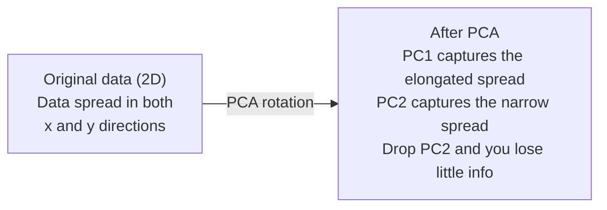

# 降维

> 高维数据自有结构。你只要从正确的角度看，就能找到它。

**Type:** Build
**Language:** Python
**Prerequisites:** Phase 1, Lessons 01 (Linear Algebra Intuition), 02 (Vectors, Matrices & Operations), 03 (Eigenvalues & Eigenvectors), 06 (Probability & Distributions)
**Time:** ~90 minutes

## 学习目标

- 从零实现 PCA：数据中心化、计算协方差矩阵、特征分解并投影
- 使用可解释方差比和肘部法来选择主成分的数量
- 比较 PCA、t-SNE 和 UMAP 在将 MNIST 数字可视化到 2D 时的表现，并解释它们的权衡
- 应用带 RBF 核的核 PCA 来分离标准 PCA 无法处理的非线性数据结构

## 问题

你有一个每个样本 784 个特征的数据集。可能是手写数字的像素值。可能是基因表达水平。可能是用户行为信号。你无法可视化 784 个维度。你无法把它们画出来。你甚至无法思考它们。

但这 784 个特征中的大多数是冗余的。真正信息活在一个小得多的曲面上。一个手写的「7」并不需要 784 个独立的数字来描述它。它只需要几个：笔画的倾斜角、横杠的长度、它有多倾斜。其余都是噪声。

降维就是找到那个更小的曲面。它把你的 784 维数据压缩到 2、10 或 50 维，同时保留真正重要的结构。

## 概念

### 维度灾难

高维空间是反直觉的。随着维度的增长，有三件事会崩溃。

**距离变得没有意义。** 在高维空间里，任意两个随机点之间的距离会收敛到同一个值。如果每个点到其他每个点的距离都大致相同，最近邻搜索就失效了。

```
Dimension    Avg distance ratio (max/min between random points)
2            ~5.0
10           ~1.8
100          ~1.2
1000         ~1.02
```

**体积集中到角落。** 一个 d 维的单位超立方体有 2^d 个角。在 100 维里，几乎所有的体积都在角落里，远离中心。数据点蔓延到边缘，你的模型在内部空间里为数据稀缺而发愁。

**你需要指数级更多的数据。** 要在空间中维持相同的样本密度，从 2D 到 20D 意味着你需要多 10^18 倍的数据。你永远不够用。降低维度能把数据密度拉回到可处理的水平。

### PCA：找到真正重要的方向

主成分分析（PCA）找到你的数据变化最大的那些轴。它旋转你的坐标系，使第一个轴捕捉最多的方差，第二个捕捉次多的，依此类推。

算法：

```
1. Center the data        (subtract the mean from each feature)
2. Compute covariance     (how features move together)
3. Eigendecomposition     (find the principal directions)
4. Sort by eigenvalue     (biggest variance first)
5. Project               (keep top k eigenvectors, drop the rest)
```

为什么用特征分解？协方差矩阵是对称且半正定的。它的特征向量是特征空间中相互正交的方向。特征值告诉你每个方向捕捉了多少方差。特征值最大的那个特征向量指向方差最大的方向。



- **PCA 之前：** 数据云沿 x 轴和 y 轴两个方向呈对角线摊开
- **PCA 之后：** 坐标系被旋转，使 PC1 对齐方差最大的方向（拉长的散布），PC2 对齐方差最小的方向（狭窄的散布）
- **降维：** 丢掉 PC2 就把数据投影到 PC1 上，只损失极少的信息

### 可解释方差比

每个主成分捕捉总方差的一部分。可解释方差比告诉你这部分有多大。

```
Component    Eigenvalue    Explained ratio    Cumulative
PC1          4.73          0.473              0.473
PC2          2.51          0.251              0.724
PC3          1.12          0.112              0.836
PC4          0.89          0.089              0.925
...
```

当累积可解释方差达到 0.95 时，你就知道这些成分捕捉了 95% 的信息。这之后的基本都是噪声。

### 选择成分的数量

三种策略：

1. **阈值。** 保留足够多的成分以解释 90-95% 的方差。
2. **肘部法。** 绘制每个成分的可解释方差。寻找急剧的下降点。
3. **下游性能。** 把 PCA 用作预处理。扫描 k 并度量模型的精度。最佳 k 就是精度趋于平台的地方。

### t-SNE：保留邻域

t 分布随机邻域嵌入（t-SNE）是为可视化而设计的。它把高维数据映射到 2D（或 3D），同时保留哪些点彼此靠近。

直觉：在原始空间中，根据点对的距离计算一个概率分布。近的点得到高概率。远的点得到低概率。然后找到一个 2D 排列，使同样的概率分布成立。在 784 维里是邻居的点，在 2D 里仍然是邻居。

t-SNE 的关键性质：
- 非线性。它能展开 PCA 无法展开的复杂流形。
- 随机性。不同的运行产生不同的布局。
- perplexity 参数控制考虑多少个邻居（典型范围：5-50）。
- 输出中簇之间的距离没有意义。只有簇本身才有意义。
- 在大型数据集上很慢。默认 O(n^2)。

### UMAP：更快、全局结构更好

统一流形近似与投影（UMAP）的工作原理与 t-SNE 相似，但有两个优势：
- 更快。它使用近似最近邻图，而不是计算所有两两距离。
- 全局结构更好。输出中簇的相对位置往往比 t-SNE 更有意义。

UMAP 在高维空间中构建一个加权图（「模糊拓扑表示」），然后找到一个尽可能好地保留这个图的低维布局。

关键参数：
- `n_neighbors`：有多少邻居定义局部结构（类似 perplexity）。值越高保留越多的全局结构。
- `min_dist`：输出中点的紧密程度。值越低簇越密集。

### 何时用哪个

| 方法 | 适用场景 | 保留什么 | 速度 |
|--------|----------|-----------|-------|
| PCA | 训练前的预处理 | 全局方差 | 快（精确），可处理数百万样本 |
| PCA | 快速探索性可视化 | 线性结构 | 快 |
| t-SNE | 出版级 2D 图 | 局部邻域 | 慢（理想情况下 < 10k 样本） |
| UMAP | 规模化的 2D 可视化 | 局部 + 部分全局结构 | 中等（可处理数百万） |
| PCA | 为模型减少特征 | 按方差排序的特征 | 快 |
| t-SNE / UMAP | 理解簇结构 | 簇的分离 | 中等偏慢 |

经验法则：预处理和数据压缩用 PCA。需要在 2D 中可视化结构时用 t-SNE 或 UMAP。

### 核 PCA

标准 PCA 寻找线性子空间。它旋转你的坐标系并丢掉轴。但如果数据位于非线性流形上呢？2D 中的一个圆无法被任何直线分开。标准 PCA 帮不上忙。

核 PCA 在由核函数诱导的高维特征空间中应用 PCA，而无需显式计算该空间中的坐标。这就是核技巧——与 SVM 背后的想法相同。

算法：
1. 计算核矩阵 K，其中 K_ij = k(x_i, x_j)
2. 在特征空间中将核矩阵中心化
3. 对中心化后的核矩阵做特征分解
4. 前几个特征向量（按 1/sqrt(eigenvalue) 缩放）就是投影

常见核函数：

| 核 | 公式 | 适合 |
|--------|---------|----------|
| RBF（高斯） | exp(-gamma * \|\|x - y\|\|^2) | 大多数非线性数据、平滑流形 |
| 多项式 | (x . y + c)^d | 多项式关系 |
| Sigmoid | tanh(alpha * x . y + c) | 类似神经网络的映射 |

何时用核 PCA、何时用标准 PCA：

| 标准 | 标准 PCA | 核 PCA |
|-----------|-------------|------------|
| 数据结构 | 线性子空间 | 非线性流形 |
| 速度 | O(min(n^2 d, d^2 n)) | O(n^2 d + n^3) |
| 可解释性 | 成分是特征的线性组合 | 成分缺乏直接的特征解释 |
| 可扩展性 | 可处理数百万样本 | 核矩阵是 n x n，受内存限制 |
| 重构 | 直接逆变换 | 需要原像近似 |

经典例子：2D 中的同心圆。两圈点，一圈在另一圈里面。标准 PCA 把两者都投影到同一条线上——对分类毫无用处。带 RBF 核的核 PCA 把内圈和外圈映射到不同区域，使它们线性可分。

### 重构误差

你的降维效果有多好？你把 784 维压缩到了 50 维。你损失了什么？

度量重构误差：
1. 把数据投影到 k 维：X_reduced = X @ W_k
2. 重构：X_hat = X_reduced @ W_k^T
3. 计算 MSE：mean((X - X_hat)^2)

对于 PCA，重构误差与可解释方差之间有一个干净的关系：

```
Reconstruction error = sum of eigenvalues NOT included
Total variance = sum of ALL eigenvalues
Fraction lost = (sum of dropped eigenvalues) / (sum of all eigenvalues)
```

每个成分的可解释方差比是：

```
explained_ratio_k = eigenvalue_k / sum(all eigenvalues)
```

把累积可解释方差相对成分数量画出来，就得到「肘部」曲线。正确的成分数量在以下位置：
- 曲线趋于平坦（边际收益递减）
- 累积方差越过你的阈值（通常是 0.90 或 0.95）
- 下游任务性能进入平台

重构误差在选择 k 之外也很有用。你可以用它做异常检测：重构误差高的样本是不符合所学子空间的离群点。这就是生产系统中基于 PCA 的异常检测的基础。

```figure
pca-axes
```

## Build It

### 步骤 1：从零实现 PCA

```python
import numpy as np

class PCA:
    def __init__(self, n_components):
        self.n_components = n_components
        self.components = None
        self.mean = None
        self.eigenvalues = None
        self.explained_variance_ratio_ = None

    def fit(self, X):
        self.mean = np.mean(X, axis=0)
        X_centered = X - self.mean

        cov_matrix = np.cov(X_centered, rowvar=False)

        eigenvalues, eigenvectors = np.linalg.eigh(cov_matrix)

        sorted_idx = np.argsort(eigenvalues)[::-1]
        eigenvalues = eigenvalues[sorted_idx]
        eigenvectors = eigenvectors[:, sorted_idx]

        self.components = eigenvectors[:, :self.n_components].T
        self.eigenvalues = eigenvalues[:self.n_components]
        total_var = np.sum(eigenvalues)
        self.explained_variance_ratio_ = self.eigenvalues / total_var

        return self

    def transform(self, X):
        X_centered = X - self.mean
        return X_centered @ self.components.T

    def fit_transform(self, X):
        self.fit(X)
        return self.transform(X)
```

### 步骤 2：在合成数据上测试

```python
np.random.seed(42)
n_samples = 500

t = np.random.uniform(0, 2 * np.pi, n_samples)
x1 = 3 * np.cos(t) + np.random.normal(0, 0.2, n_samples)
x2 = 3 * np.sin(t) + np.random.normal(0, 0.2, n_samples)
x3 = 0.5 * x1 + 0.3 * x2 + np.random.normal(0, 0.1, n_samples)

X_synthetic = np.column_stack([x1, x2, x3])

pca = PCA(n_components=2)
X_reduced = pca.fit_transform(X_synthetic)

print(f"Original shape: {X_synthetic.shape}")
print(f"Reduced shape:  {X_reduced.shape}")
print(f"Explained variance ratios: {pca.explained_variance_ratio_}")
print(f"Total variance captured: {sum(pca.explained_variance_ratio_):.4f}")
```

### 步骤 3：把 MNIST 数字降到 2D

```python
from sklearn.datasets import fetch_openml

mnist = fetch_openml("mnist_784", version=1, as_frame=False, parser="auto")
X_mnist = mnist.data[:5000].astype(float)
y_mnist = mnist.target[:5000].astype(int)

pca_mnist = PCA(n_components=50)
X_pca50 = pca_mnist.fit_transform(X_mnist)
print(f"50 components capture {sum(pca_mnist.explained_variance_ratio_):.2%} of variance")

pca_2d = PCA(n_components=2)
X_pca2d = pca_2d.fit_transform(X_mnist)
print(f"2 components capture {sum(pca_2d.explained_variance_ratio_):.2%} of variance")
```

### 步骤 4：与 sklearn 比较

```python
from sklearn.decomposition import PCA as SklearnPCA
from sklearn.manifold import TSNE

sklearn_pca = SklearnPCA(n_components=2)
X_sklearn_pca = sklearn_pca.fit_transform(X_mnist)

print(f"\nOur PCA explained variance:     {pca_2d.explained_variance_ratio_}")
print(f"Sklearn PCA explained variance: {sklearn_pca.explained_variance_ratio_}")

diff = np.abs(np.abs(X_pca2d) - np.abs(X_sklearn_pca))
print(f"Max absolute difference: {diff.max():.10f}")

tsne = TSNE(n_components=2, perplexity=30, random_state=42)
X_tsne = tsne.fit_transform(X_mnist)
print(f"\nt-SNE output shape: {X_tsne.shape}")
```

### 步骤 5：UMAP 对比

```python
try:
    from umap import UMAP

    reducer = UMAP(n_components=2, n_neighbors=15, min_dist=0.1, random_state=42)
    X_umap = reducer.fit_transform(X_mnist)
    print(f"UMAP output shape: {X_umap.shape}")
except ImportError:
    print("Install umap-learn: pip install umap-learn")
```

## Use It

把 PCA 用作分类器之前的预处理：

```python
from sklearn.decomposition import PCA as SklearnPCA
from sklearn.linear_model import LogisticRegression
from sklearn.model_selection import train_test_split
from sklearn.metrics import accuracy_score

X_train, X_test, y_train, y_test = train_test_split(
    X_mnist, y_mnist, test_size=0.2, random_state=42
)

results = {}
for k in [10, 30, 50, 100, 200]:
    pca_k = SklearnPCA(n_components=k)
    X_tr = pca_k.fit_transform(X_train)
    X_te = pca_k.transform(X_test)

    clf = LogisticRegression(max_iter=1000, random_state=42)
    clf.fit(X_tr, y_train)
    acc = accuracy_score(y_test, clf.predict(X_te))
    var_captured = sum(pca_k.explained_variance_ratio_)
    results[k] = (acc, var_captured)
    print(f"k={k:>3d}  accuracy={acc:.4f}  variance={var_captured:.4f}")
```

性能远在 784 维之前就进入平台期。那个平台就是你的工作点。

## Ship It

本课产出：
- `outputs/skill-dimensionality-reduction.md` - 一个用于为给定任务选择正确降维技术的技能

## 练习

1. 修改 PCA 类以支持 `inverse_transform`。分别从 10、50 和 200 个成分重构 MNIST 数字。打印每一种的重构误差（与原始数据的均方差）。

2. 在同一个 MNIST 子集上用 perplexity 值 5、30 和 100 运行 t-SNE。描述输出如何变化。为什么 perplexity 会影响簇的紧密程度？

3. 取一个 50 个特征、其中只有 5 个有信息量的数据集（用 `sklearn.datasets.make_classification` 生成）。应用 PCA，检查可解释方差曲线是否正确地识别出数据实际上是 5 维的。

## 关键术语

| 术语 | 人们怎么说 | 它实际是什么意思 |
|------|----------------|----------------------|
| Curse of dimensionality | 「特征太多了」 | 随着维度增长，距离、体积和数据密度都变得反直觉。模型需要指数级更多的数据来补偿。 |
| PCA | 「降低维度」 | 旋转坐标系使轴对齐方差最大的方向，然后丢掉低方差的轴。 |
| Principal component | 「一个重要的方向」 | 协方差矩阵的一个特征向量。特征空间中数据变化最大的方向。 |
| Explained variance ratio | 「这个成分有多少信息」 | 一个主成分所捕捉的总方差占比。把前 k 个比率相加，可看出 k 个成分保留了多寡。 |
| Covariance matrix | 「特征如何相关」 | 一个对称矩阵，其中 (i,j) 项度量特征 i 和特征 j 如何一起变动。对角项是个别特征的方差。 |
| t-SNE | 「那个簇图」 | 一种通过保留两两邻域概率把高维数据映射到 2D 的非线性方法。适合可视化，不适合预处理。 |
| UMAP | 「更快的 t-SNE」 | 一种基于拓扑数据分析的非线性方法。同时保留局部和部分全局结构。比 t-SNE 更易扩展。 |
| Perplexity | 「t-SNE 的旋钮」 | 控制每个点考虑的有效邻居数。低 perplexity 聚焦于非常局部的结构。高 perplexity 捕捉更宽泛的模式。 |
| Manifold | 「数据所在的曲面」 | 嵌入在高维空间中的一个低维曲面。一张在 3D 中被揉皱的纸就是一个 2D 流形。 |

## 延伸阅读

- [A Tutorial on Principal Component Analysis](https://arxiv.org/abs/1404.1100) (Shlens) - 从头清晰推导 PCA
- [How to Use t-SNE Effectively](https://distill.pub/2016/misread-tsne/) (Wattenberg et al.) - 关于 t-SNE 陷阱和参数选择的交互式指南
- [UMAP documentation](https://umap-learn.readthedocs.io/) - 来自 UMAP 作者的理论与实践指导