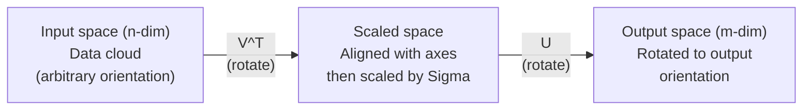
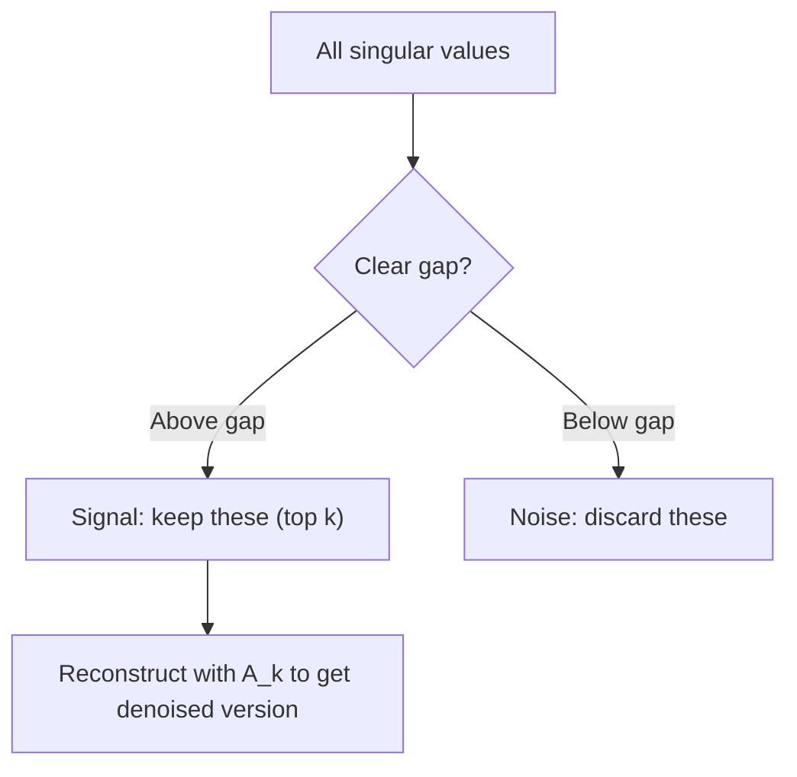

# 奇异值分解

> SVD 是线性代数的瑞士军刀。每个矩阵都有它，每个数据科学家都需要它。

**Type:** Build
**Languages:** Python, Julia
**Prerequisites:** Phase 1, Lessons 01 (Linear Algebra Intuition), 02 (Vectors & Matrices Operations), 03 (Matrix Transformations)
**Time:** ~120 minutes

## 学习目标

- 通过幂迭代实现 SVD，并解释 U、Sigma 和 V^T 的几何含义
- 应用截断 SVD 进行图像压缩，并度量压缩比与重构误差的关系
- 通过 SVD 计算 Moore-Penrose 伪逆，以求解超定最小二乘系统
- 将 SVD 与 PCA、推荐系统（潜在因子）以及 NLP 中的潜在语义分析联系起来

## 问题

你有一个 1000x2000 的矩阵。也许是用户-电影评分。也许是文档-词项频率表。也许是一张图像的像素值。你需要压缩它、去噪它、在它里面寻找隐藏结构，或者用它求解一个最小二乘系统。特征分解只能作用于方阵。即便如此，它还要求矩阵具有一组完整的线性无关特征向量。

SVD 作用于任何矩阵。任何形状。任何秩。没有条件限制。它把矩阵分解为三个因子，这些因子揭示了这个矩阵对空间所做之事的几何结构。它是整个线性代数中最通用、最有用的因式分解。

## 概念

### SVD 在几何上做了什么

每一个矩阵，无论形状如何，都依次执行三种操作：旋转、缩放、再旋转。SVD 把这个分解变得显式。

```
A = U * Sigma * V^T

      m x n     m x m    m x n    n x n
     (any)    (rotate)  (scale)  (rotate)
```

给定任意矩阵 A，SVD 把它分解为：
- V^T 旋转输入空间（n 维）中的向量
- Sigma 沿每个轴缩放（拉伸或压缩）
- U 把结果旋转到输出空间（m 维）



可以这样想。你递给 SVD 一个矩阵。它告诉你：「这个矩阵拿一个由输入组成的球体，先用 V^T 旋转它，再用 Sigma 把它拉伸成一个椭球，然后用 U 旋转这个椭球。」奇异值就是这个椭球各轴的长度。

### 完整分解

对于一个形状为 m x n 的矩阵 A：

```
A = U * Sigma * V^T

where:
  U     is m x m, orthogonal (U^T U = I)
  Sigma is m x n, diagonal (singular values on the diagonal)
  V     is n x n, orthogonal (V^T V = I)

The singular values sigma_1 >= sigma_2 >= ... >= sigma_r > 0
where r = rank(A)
```

U 的列叫做左奇异向量。V 的列叫做右奇异向量。Sigma 的对角项叫做奇异值。它们总是非负的，并约定按降序排列。

### 左奇异向量、奇异值、右奇异向量

SVD 的每一个组成部分都有各自明确的几何含义。

**右奇异向量（V 的列）：** 它们构成输入空间（R^n）的一组标准正交基。它们是输入空间中、被矩阵映射到输出空间中正交方向的那些方向。可以把它们看作定义域的自然坐标系。

**奇异值（Sigma 的对角线）：** 这些是缩放因子。第 i 个奇异值告诉你矩阵沿第 i 个右奇异向量方向拉伸向量多少。奇异值为零意味着矩阵完全压扁了那个方向。

**左奇异向量（U 的列）：** 它们构成输出空间（R^m）的一组标准正交基。第 i 个左奇异向量是输出空间中、第 i 个右奇异向量（缩放后）落到的方向。

它们之间的关系：

```
A * v_i = sigma_i * u_i

The matrix A takes the i-th right singular vector v_i,
scales it by sigma_i, and maps it to the i-th left singular vector u_i.
```

这给了你一幅逐坐标理解任意矩阵行为的图景。

### 外积形式

SVD 可以写成秩 1 矩阵的和：

```
A = sigma_1 * u_1 * v_1^T + sigma_2 * u_2 * v_2^T + ... + sigma_r * u_r * v_r^T

Each term sigma_i * u_i * v_i^T is a rank-1 matrix (an outer product).
The full matrix is the sum of r such matrices, where r is the rank.
```

这种形式是低秩近似的基础。每一项增加一层结构。第一项捕捉唯一最重要的模式。第二项捕捉次重要的。依此类推。截断这个求和，你就能在任意给定的秩上得到尽可能好的近似。

```
Rank-1 approx:    A_1 = sigma_1 * u_1 * v_1^T
                  (captures the dominant pattern)

Rank-2 approx:    A_2 = sigma_1 * u_1 * v_1^T + sigma_2 * u_2 * v_2^T
                  (captures the two most important patterns)

Rank-k approx:    A_k = sum of top k terms
                  (optimal by the Eckart-Young theorem)
```

### 与特征分解的关系

SVD 和特征分解有着深刻的联系。A 的奇异值和奇异向量直接来自 A^T A 和 A A^T 的特征值和特征向量。

```
A^T A = V * Sigma^T * U^T * U * Sigma * V^T
      = V * Sigma^T * Sigma * V^T
      = V * D * V^T

where D = Sigma^T * Sigma is a diagonal matrix with sigma_i^2 on the diagonal.

So:
- The right singular vectors (V) are eigenvectors of A^T A
- The singular values squared (sigma_i^2) are eigenvalues of A^T A

Similarly:
A A^T = U * Sigma * V^T * V * Sigma^T * U^T
      = U * Sigma * Sigma^T * U^T

So:
- The left singular vectors (U) are eigenvectors of A A^T
- The eigenvalues of A A^T are also sigma_i^2
```

这个联系告诉你三件事：
1. 奇异值总是实数且非负（它们是半正定矩阵特征值的平方根）。
2. 你可以通过对 A^T A 做特征分解来计算 SVD，但这样会平方条件数并损失数值精度。专用的 SVD 算法会避免这一点。
3. 当 A 是方阵且对称半正定时，SVD 和特征分解是同一个东西。

### 截断 SVD：低秩近似

Eckart-Young-Mirsky 定理指出，A 的最佳秩 k 近似（无论是在 Frobenius 范数还是谱范数下）是通过只保留前 k 个奇异值及其对应向量得到的：

```
A_k = U_k * Sigma_k * V_k^T

where:
  U_k     is m x k  (first k columns of U)
  Sigma_k is k x k  (top-left k x k block of Sigma)
  V_k     is n x k  (first k columns of V)

Approximation error = sigma_{k+1}  (in spectral norm)
                    = sqrt(sigma_{k+1}^2 + ... + sigma_r^2)  (in Frobenius norm)
```

这不只是「一个不错」的近似。它是可证明的秩 k 最优近似。没有任何其他秩 k 矩阵比它更接近 A。

| 分量 | 相对大小 | 保留在秩 3 近似中？ |
|-----------|-------------------|------------------------|
| sigma_1 | 最大 | 是 |
| sigma_2 | 大 | 是 |
| sigma_3 | 中大 | 是 |
| sigma_4 | 中 | 否（误差） |
| sigma_5 | 中小 | 否（误差） |
| sigma_6 | 小 | 否（误差） |
| sigma_7 | 很小 | 否（误差） |
| sigma_8 | 极小 | 否（误差） |

保留前 3 个：A_3 捕捉三个最大的奇异值。误差 = 剩余的值（sigma_4 到 sigma_8）。

如果奇异值衰减得快，一个小的 k 就能捕捉矩阵的大部分。如果它们衰减得慢，矩阵就没有低秩结构。

### 用 SVD 做图像压缩

一张灰度图像就是一个像素强度矩阵。一张 800x600 的图像有 480,000 个值。SVD 让你用少得多的值来近似它。

```
Original image: 800 x 600 = 480,000 values

SVD with rank k:
  U_k:      800 x k values
  Sigma_k:  k values
  V_k:      600 x k values
  Total:    k * (800 + 600 + 1) = k * 1401 values

  k=10:   14,010 values   (2.9% of original)
  k=50:   70,050 values  (14.6% of original)
  k=100: 140,100 values  (29.2% of original)

  The compression ratio improves as k gets smaller,
  but visual quality degrades.
```

关键洞察：自然图像的奇异值衰减得很快。前几个奇异值捕捉大致结构（形状、渐变）。后面的捕捉细节和噪声。截断到秩 50 往往能得到一张与原图几乎看不出差别的图像，同时少用 85% 的存储。

### 用于推荐系统的 SVD

Netflix Prize 让这一点闻名于世。你有一个用户-电影评分矩阵，其中大多数条目缺失。

```
             Movie1  Movie2  Movie3  Movie4  Movie5
  User1      [  5      ?       3       ?       1  ]
  User2      [  ?      4       ?       2       ?  ]
  User3      [  3      ?       5       ?       ?  ]
  User4      [  ?      ?       ?       4       3  ]

  ? = unknown rating
```

想法：这个评分矩阵是低秩的。用户的品味并非完全独立。有少数几个潜在因子（动作 vs. 剧情、老片 vs. 新片、烧脑 vs. 感官）解释了大部分偏好。

对（填充后的）评分矩阵做 SVD 分解为：
- U：潜在因子空间中的用户画像
- Sigma：每个潜在因子的重要性
- V^T：潜在因子空间中的电影画像

用户对某部电影的预测评分，就是其用户画像与电影画像（用奇异值加权后）的点积。低秩近似填补了缺失的条目。

在实践中，你会使用 Simon Funk 的增量 SVD 或 ALS（交替最小二乘）这类能直接处理缺失数据的变体。但核心想法是一样的：通过 SVD 做潜在因子分解。

### NLP 中的 SVD：潜在语义分析

潜在语义分析（LSA），也叫潜在语义索引（LSI），把 SVD 应用到一个词项-文档矩阵上。

```
             Doc1   Doc2   Doc3   Doc4
  "cat"      [  3      0      1      0  ]
  "dog"      [  2      0      0      1  ]
  "fish"     [  0      4      1      0  ]
  "pet"      [  1      1      1      1  ]
  "ocean"    [  0      3      0      0  ]

After SVD with rank k=2:

  Each document becomes a point in 2D "concept space."
  Each term becomes a point in the same 2D space.
  Documents about similar topics cluster together.
  Terms with similar meanings cluster together.

  "cat" and "dog" end up near each other (land pets).
  "fish" and "ocean" end up near each other (water concepts).
  Doc1 and Doc3 cluster if they share similar topics.
```

LSA 是最早成功从原始文本中捕捉语义相似性的方法之一。它之所以有效，是因为同义词往往出现在相似的文档中，所以 SVD 把它们归到同一个潜在维度里。现代词嵌入（Word2Vec、GloVe）可以看作这一想法的后继者。

### 用 SVD 去噪

有噪声的数据把信号集中在前几个奇异值上，而噪声散布在所有奇异值上。截断就能去掉噪声基底。

**干净信号的奇异值：**

| 分量 | 大小 | 类型 |
|-----------|-----------|------|
| sigma_1 | 非常大 | 信号 |
| sigma_2 | 大 | 信号 |
| sigma_3 | 中 | 信号 |
| sigma_4 | 接近零 | 可忽略 |
| sigma_5 | 接近零 | 可忽略 |

**带噪信号的奇异值（噪声加到所有分量上）：**

| 分量 | 大小 | 类型 |
|-----------|-----------|------|
| sigma_1 | 非常大 | 信号 |
| sigma_2 | 大 | 信号 |
| sigma_3 | 中 | 信号 |
| sigma_4 | 小 | 噪声 |
| sigma_5 | 小 | 噪声 |
| sigma_6 | 小 | 噪声 |
| sigma_7 | 小 | 噪声 |



这被用于信号处理、科学测量和数据清洗。任何时候你有一个被加性噪声污染的矩阵，截断 SVD 就是把信号和噪声分开的一个有原则的方法。

### 通过 SVD 计算伪逆

Moore-Penrose 伪逆 A+ 把矩阵求逆推广到非方阵和奇异矩阵。SVD 让计算它变得轻而易举。

```
If A = U * Sigma * V^T, then:

A+ = V * Sigma+ * U^T

where Sigma+ is formed by:
  1. Transpose Sigma (swap rows and columns)
  2. Replace each non-zero diagonal entry sigma_i with 1/sigma_i
  3. Leave zeros as zeros

For A (m x n):      A+ is (n x m)
For Sigma (m x n):  Sigma+ is (n x m)
```

伪逆求解最小二乘问题。如果 Ax = b 没有精确解（超定系统），那么 x = A+ b 就是最小二乘解（最小化 ||Ax - b||）。

```
Overdetermined system (more equations than unknowns):

  [1  1]         [3]
  [2  1] x   =   [5]       No exact solution exists.
  [3  1]         [6]

  x_ls = A+ b = V * Sigma+ * U^T * b

  This gives the x that minimizes the sum of squared residuals.
  Same result as the normal equations (A^T A)^(-1) A^T b,
  but numerically more stable.
```

### 数值稳定性的优势

对 A^T A 做特征分解会平方奇异值（A^T A 的特征值是 sigma_i^2）。这会平方条件数，放大数值误差。

```
Example:
  A has singular values [1000, 1, 0.001]
  Condition number of A: 1000 / 0.001 = 10^6

  A^T A has eigenvalues [10^6, 1, 10^{-6}]
  Condition number of A^T A: 10^6 / 10^{-6} = 10^{12}

  Computing SVD directly: works with condition number 10^6
  Computing via A^T A:     works with condition number 10^{12}
                           (6 extra digits of precision lost)
```

现代 SVD 算法（Golub-Kahan 双对角化）直接作用于 A，从不构造 A^T A。这就是为什么你应该始终优先用 `np.linalg.svd(A)` 而不是 `np.linalg.eig(A.T @ A)`。

### 与 PCA 的联系

PCA 就是对中心化数据做 SVD。这不是类比，而是字面上完全相同的计算。

```
Given data matrix X (n_samples x n_features), centered (mean subtracted):

Covariance matrix: C = (1/(n-1)) * X^T X

PCA finds eigenvectors of C. But:

  X = U * Sigma * V^T    (SVD of X)

  X^T X = V * Sigma^2 * V^T

  C = (1/(n-1)) * V * Sigma^2 * V^T

So the principal components are exactly the right singular vectors V.
The explained variance for each component is sigma_i^2 / (n-1).

In sklearn, PCA is implemented using SVD, not eigendecomposition.
It is faster and more numerically stable.
```

这意味着你在第 10 课学到的关于降维的一切，底层都是 SVD。PCA 是机器学习中 SVD 最常见的应用。

```figure
svd-rank-reconstruction
```

## Build It

### 步骤 1：用幂迭代从零实现 SVD

想法：要找到最大的奇异值及其向量，就在 A^T A（或 A A^T）上使用幂迭代。然后把矩阵「收缩」（deflate），再对下一个奇异值重复。

```python
import numpy as np

def power_iteration(M, num_iters=100):
    n = M.shape[1]
    v = np.random.randn(n)
    v = v / np.linalg.norm(v)

    for _ in range(num_iters):
        Mv = M @ v
        v = Mv / np.linalg.norm(Mv)

    eigenvalue = v @ M @ v
    return eigenvalue, v

def svd_from_scratch(A, k=None):
    m, n = A.shape
    if k is None:
        k = min(m, n)

    sigmas = []
    us = []
    vs = []

    A_residual = A.copy().astype(float)

    for _ in range(k):
        AtA = A_residual.T @ A_residual
        eigenvalue, v = power_iteration(AtA, num_iters=200)

        if eigenvalue < 1e-10:
            break

        sigma = np.sqrt(eigenvalue)
        u = A_residual @ v / sigma

        sigmas.append(sigma)
        us.append(u)
        vs.append(v)

        A_residual = A_residual - sigma * np.outer(u, v)

    U = np.column_stack(us) if us else np.empty((m, 0))
    S = np.array(sigmas)
    V = np.column_stack(vs) if vs else np.empty((n, 0))

    return U, S, V
```

### 步骤 2：测试并与 NumPy 比较

```python
np.random.seed(42)
A = np.random.randn(5, 4)

U_ours, S_ours, V_ours = svd_from_scratch(A)
U_np, S_np, Vt_np = np.linalg.svd(A, full_matrices=False)

print("Our singular values:", np.round(S_ours, 4))
print("NumPy singular values:", np.round(S_np, 4))

A_reconstructed = U_ours @ np.diag(S_ours) @ V_ours.T
print(f"Reconstruction error: {np.linalg.norm(A - A_reconstructed):.8f}")
```

### 步骤 3：图像压缩演示

```python
def compress_image_svd(image_matrix, k):
    U, S, Vt = np.linalg.svd(image_matrix, full_matrices=False)
    compressed = U[:, :k] @ np.diag(S[:k]) @ Vt[:k, :]
    return compressed

image = np.random.seed(42)
rows, cols = 200, 300
image = np.random.randn(rows, cols)

for k in [1, 5, 10, 20, 50]:
    compressed = compress_image_svd(image, k)
    error = np.linalg.norm(image - compressed) / np.linalg.norm(image)
    original_size = rows * cols
    compressed_size = k * (rows + cols + 1)
    ratio = compressed_size / original_size
    print(f"k={k:>3d}  error={error:.4f}  storage={ratio:.1%}")
```

### 步骤 4：去噪

```python
np.random.seed(42)
clean = np.outer(np.sin(np.linspace(0, 4*np.pi, 100)),
                 np.cos(np.linspace(0, 2*np.pi, 80)))
noise = 0.3 * np.random.randn(100, 80)
noisy = clean + noise

U, S, Vt = np.linalg.svd(noisy, full_matrices=False)
denoised = U[:, :5] @ np.diag(S[:5]) @ Vt[:5, :]

print(f"Noisy error:    {np.linalg.norm(noisy - clean):.4f}")
print(f"Denoised error: {np.linalg.norm(denoised - clean):.4f}")
print(f"Improvement:    {(1 - np.linalg.norm(denoised - clean) / np.linalg.norm(noisy - clean)):.1%}")
```

### 步骤 5：伪逆

```python
A = np.array([[1, 1], [2, 1], [3, 1]], dtype=float)
b = np.array([3, 5, 6], dtype=float)

U, S, Vt = np.linalg.svd(A, full_matrices=False)
S_inv = np.diag(1.0 / S)
A_pinv = Vt.T @ S_inv @ U.T

x_svd = A_pinv @ b
x_lstsq = np.linalg.lstsq(A, b, rcond=None)[0]
x_pinv = np.linalg.pinv(A) @ b

print(f"SVD pseudoinverse solution:  {x_svd}")
print(f"np.linalg.lstsq solution:   {x_lstsq}")
print(f"np.linalg.pinv solution:    {x_pinv}")
```

## Use It

完整可运行的演示在 `code/svd.py` 中。运行它，即可看到 SVD 被应用于图像压缩、推荐系统、潜在语义分析和去噪。

```bash
python svd.py
```

`code/svd.jl` 中的 Julia 版本使用 Julia 原生的 `svd()` 函数和 `LinearAlgebra` 包演示同样的概念。

```bash
julia svd.jl
```

## Ship It

本课产出：
- `outputs/skill-svd.md` - 一个用于了解何时以及如何在真实项目中应用 SVD 的技能

## 练习

1. 不使用幂迭代，从零实现完整 SVD。改为计算 A^T A 的特征分解以得到 V 和奇异值，然后计算 U = A V Sigma^{-1}。与你的幂迭代版本以及 NumPy 比较数值精度。

2. 加载一张真实的灰度图像（或把一张图转成灰度）。分别以秩 1、5、10、25、50、100 压缩它。对每个秩，计算压缩比和相对误差。找出图像在视觉上可接受的秩。

3. 构建一个迷你的推荐系统。创建一个 10x8 的、带一些已知条目的用户-电影评分矩阵。用行均值填补缺失条目。计算 SVD 并重构一个秩 3 近似。用重构矩阵预测缺失的评分。验证预测是否合理。

4. 创建一个带 3 个合成主题的 100x50 文档-词项矩阵。每个主题有 5 个关联词项。加入噪声。应用 SVD，验证前 3 个奇异值远大于其余。把文档投影到 3D 潜在空间，检查同主题的文档是否聚在一起。

5. 生成一个干净的低秩矩阵（秩 3，大小 50x40），并加入不同水平的高斯噪声（sigma = 0.1, 0.5, 1.0, 2.0）。对每个噪声水平，把 k 从 1 扫到 40 并度量相对干净矩阵的重构误差，从而找出最优截断秩。画出最优 k 随噪声水平的变化。

## 关键术语

| 术语 | 人们怎么说 | 它实际是什么意思 |
|------|----------------|----------------------|
| SVD | 「分解任意矩阵」 | 把 A 分解为 U Sigma V^T，其中 U 和 V 是正交的，Sigma 是对角矩阵且项非负。适用于任意形状的任意矩阵。 |
| Singular value | 「这个分量有多重要」 | Sigma 的第 i 个对角项。度量矩阵沿第 i 个主方向拉伸了多少。总是非负，按降序排列。 |
| Left singular vector | 「输出方向」 | U 的一列。输出空间中、第 i 个右奇异向量（按 sigma_i 缩放后）映射到的方向。 |
| Right singular vector | 「输入方向」 | V 的一列。输入空间中、被矩阵映射到第 i 个左奇异向量（按 sigma_i 缩放后）的方向。 |
| Truncated SVD | 「低秩近似」 | 只保留前 k 个奇异值及其向量。产生可证明最优的秩 k 近似（Eckart-Young 定理）。 |
| Rank | 「真实的维度」 | 非零奇异值的个数。告诉你矩阵实际使用了多少个独立方向。 |
| Pseudoinverse | 「广义逆」 | V Sigma+ U^T。对非零奇异值取倒数，零保持为零。为非方阵或奇异矩阵求解最小二乘问题。 |
| Condition number | 「对误差有多敏感」 | sigma_max / sigma_min。大的条件数意味着小的输入变化导致大的输出变化。SVD 直接揭示这一点。 |
| Latent factor | 「隐藏变量」 | SVD 发现的低秩空间中的一个维度。在推荐系统中，一个潜在因子可能对应类型偏好。在 NLP 中，它可能对应一个主题。 |
| Frobenius norm | 「矩阵的总大小」 | 所有元素平方和的平方根。等于奇异值平方之和的平方根。用于度量近似误差。 |
| Eckart-Young theorem | 「SVD 给出最佳压缩」 | 对于任意目标秩 k，截断 SVD 在所有可能的秩 k 矩阵中最小化近似误差。 |
| Power iteration | 「找最大的特征向量」 | 反复用一个随机向量乘以矩阵并归一化。收敛到特征值最大的特征向量。许多 SVD 算法的构建基石。 |

## 延伸阅读

- [Gilbert Strang: Linear Algebra and Its Applications, Chapter 7](https://math.mit.edu/~gs/linearalgebra/) - 对 SVD 及其应用的透彻讲解
- [3Blue1Brown: But what is the SVD?](https://www.youtube.com/watch?v=vSczTbgc8Rc) - SVD 的几何直觉
- [We Recommend a Singular Value Decomposition](https://www.ams.org/publicoutreach/feature-column/fcarc-svd) - 来自美国数学学会的通俗概览
- [Netflix Prize and Matrix Factorization](https://sifter.org/~simon/journal/20061211.html) - Simon Funk 关于用 SVD 做推荐的原始博客文章
- [Latent Semantic Analysis](https://en.wikipedia.org/wiki/Latent_semantic_analysis) - SVD 最早的 NLP 应用
- [Numerical Linear Algebra by Trefethen and Bau](https://people.maths.ox.ac.uk/trefethen/text.html) - 理解 SVD 算法及其数值性质的金标准