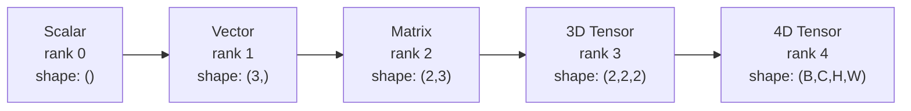
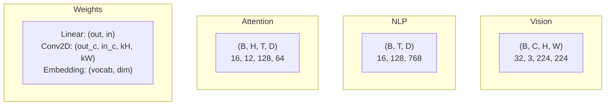
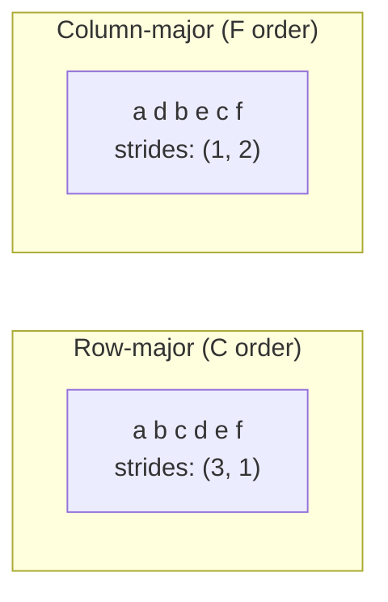
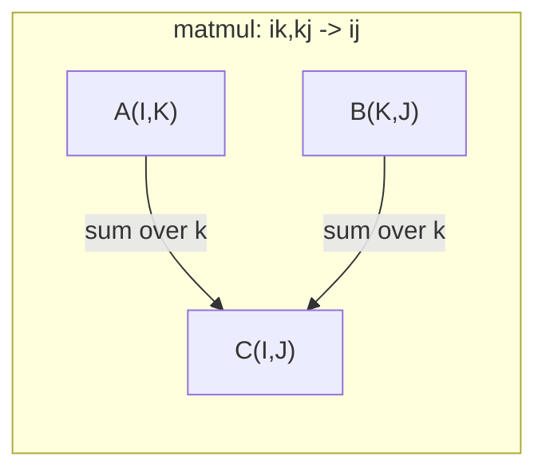

# 张量运算

> 张量是数据与深度学习之间的共同语言。每一张图像、每一个句子、每一个梯度都流经它们。

**Type:** Build
**Language:** Python
**Prerequisites:** Phase 1, Lessons 01 (Linear Algebra Intuition), 02 (Vectors, Matrices & Operations)
**Time:** ~90 minutes

## 学习目标

- 从零实现一个具备 shape、strides、reshape、transpose 和逐元素运算的张量类
- 应用广播规则在不复制数据的情况下对不同形状的张量进行运算
- 为点积、矩阵乘法、外积以及批量操作编写 einsum 表达式
- 追踪多头注意力每一步的精确张量形状

## 问题

你构建了一个 Transformer。前向传播看起来很干净。你一运行，得到：`RuntimeError: mat1 and mat2 shapes cannot be multiplied (32x768 and 512x768)`。你盯着这些形状。你试了一次转置。现在它说 `Expected 4D input (got 3D input)`。你加了一个 unsqueeze。别的地方又出错了。

形状错误是深度学习代码里最常见的 bug。它们在概念上并不难——每个运算都有一个形状契约——但它们会迅速成倍扩散。一个 Transformer 有几十个 reshape、transpose 和 broadcast 串在一起。一个轴弄错，错误就会连锁蔓延。更糟的是，有些形状错误根本不会抛出错误。它们会沿着错误的维度广播、或者对错误的轴求和，悄无声息地产生垃圾结果。

矩阵处理的是两组事物之间的两两关系。真实数据装不进两个维度。一批 32 张 224x224 的 RGB 图像是一个 4D 张量：`(32, 3, 224, 224)`。带 12 个头部的自注意力也是 4D：`(batch, heads, seq_len, head_dim)`。你需要一个能推广到任意维度、并且其运算能在所有维度上干净地组合的数据结构。这个结构就是张量。掌握了它的运算，形状错误就变得可以轻而易举地调试。

## 概念

### 张量是什么

张量是一个具有统一数据类型的多维数字数组。维度的个数叫做**秩**（rank，也叫**阶** order）。每个维度是一个**轴**（axis）。**形状**（shape）是一个列出每个轴大小的元组。



元素总数 = 所有大小的乘积。形状 `(2, 3, 4)` 容纳 `2 * 3 * 4 = 24` 个元素。

### 深度学习中的张量形状

不同的数据类型按惯例映射到特定的张量形状。



PyTorch 使用 NCHW（通道优先）。TensorFlow 默认 NHWC（通道靠后）。布局不匹配会导致静默的减速或错误。

### 内存布局如何工作

内存中的一个 2D 数组是一段 1D 的字节序列。**步长**（strides）告诉你沿每个轴前进一步要跳过多少个元素。



转置并不移动数据。它交换步长，使张量变成**非连续**的（non-contiguous）——一行的元素在内存中不再相邻。

### 广播规则

广播让你在不复制数据的情况下对不同形状的张量做运算。从右往左对齐形状。当两个维度相等、或者其中一个为 1 时，它们是兼容的。维度更少的张量在左侧用 1 补齐。

```
Tensor A:     (8, 1, 6, 1)
Tensor B:        (7, 1, 5)
Padded B:     (1, 7, 1, 5)
Result:       (8, 7, 6, 5)
```

### Einsum：万能的张量运算

爱因斯坦求和为每个轴标一个字母。出现在输入中但不在输出中的轴被求和。两边都出现的轴被保留。



关键模式：`i,i->`（点积）、`i,j->ij`（外积）、`ii->`（迹）、`ij->ji`（转置）、`bij,bjk->bik`（批量矩阵乘法）、`bhtd,bhsd->bhts`（注意力得分）。

```figure
tensor-broadcast
```

## Build It

代码在 `code/tensors.py` 中。每个步骤都引用那里的实现。

### 步骤 1：张量存储与步长

一个张量存储一个扁平的数字列表，外加形状元数据。步长告诉索引逻辑如何把多维索引映射到扁平位置。

```python
class Tensor:
    def __init__(self, data, shape=None):
        if isinstance(data, (list, tuple)):
            self._data, self._shape = self._flatten_nested(data)
        elif isinstance(data, np.ndarray):
            self._data = data.flatten().tolist()
            self._shape = tuple(data.shape)
        else:
            self._data = [data]
            self._shape = ()

        if shape is not None:
            total = reduce(lambda a, b: a * b, shape, 1)
            if total != len(self._data):
                raise ValueError(
                    f"Cannot reshape {len(self._data)} elements into shape {shape}"
                )
            self._shape = tuple(shape)

        self._strides = self._compute_strides(self._shape)

    @staticmethod
    def _compute_strides(shape):
        if len(shape) == 0:
            return ()
        strides = [1] * len(shape)
        for i in range(len(shape) - 2, -1, -1):
            strides[i] = strides[i + 1] * shape[i + 1]
        return tuple(strides)
```

对于形状 `(3, 4)`，步长是 `(4, 1)`——前进一行要跳过 4 个元素，前进一列要跳过 1 个元素。

### 步骤 2：Reshape、squeeze、unsqueeze

Reshape 在不改变元素顺序的前提下改变形状。元素总数必须保持不变。对一个维度使用 `-1` 来推断其大小。

```python
t = Tensor(list(range(12)), shape=(2, 6))
r = t.reshape((3, 4))
r = t.reshape((-1, 3))
```

Squeeze 移除大小为 1 的轴。Unsqueeze 插入一个。Unsqueeze 对广播至关重要——一个偏置向量 `(D,)` 要加到一个批量 `(B, T, D)` 上，需要先 unsqueeze 成 `(1, 1, D)`。

```python
t = Tensor(list(range(6)), shape=(1, 3, 1, 2))
s = t.squeeze()
v = Tensor([1, 2, 3])
u = v.unsqueeze(0)
```

### 步骤 3：Transpose 与 permute

Transpose 交换两个轴。Permute 重排所有轴。这就是你在 NCHW 和 NHWC 之间转换的方式。

```python
mat = Tensor(list(range(6)), shape=(2, 3))
tr = mat.transpose(0, 1)

t4d = Tensor(list(range(24)), shape=(1, 2, 3, 4))
perm = t4d.permute((0, 2, 3, 1))
```

转置或 permute 之后，张量在内存中是非连续的。在 PyTorch 中，`view` 对非连续张量会失败——请使用 `reshape`，或者先调用 `.contiguous()`。

### 步骤 4：逐元素运算与规约

逐元素运算（加、乘、减）独立地作用于每个元素并保持形状。规约（sum、mean、max）坍缩一个或多个轴。

```python
a = Tensor([[1, 2], [3, 4]])
b = Tensor([[10, 20], [30, 40]])
c = a + b
d = a * 2
s = a.sum(axis=0)
```

CNN 中的全局平均池化：`(B, C, H, W).mean(axis=[2, 3])` 产生 `(B, C)`。NLP 中的序列平均池化：`(B, T, D).mean(axis=1)` 产生 `(B, D)`。

### 步骤 5：用 NumPy 做广播

`tensors.py` 中的 `demo_broadcasting_numpy()` 函数展示了核心模式。

```python
activations = np.random.randn(4, 3)
bias = np.array([0.1, 0.2, 0.3])
result = activations + bias

images = np.random.randn(2, 3, 4, 4)
scale = np.array([0.5, 1.0, 1.5]).reshape(1, 3, 1, 1)
result = images * scale

a = np.array([1, 2, 3]).reshape(-1, 1)
b = np.array([10, 20, 30, 40]).reshape(1, -1)
outer = a * b
```

用广播实现两两距离：把 `(M, 2)` reshape 成 `(M, 1, 2)`、把 `(N, 2)` reshape 成 `(1, N, 2)`，相减、平方、沿最后一个轴求和、开平方。结果：`(M, N)`。

### 步骤 6：Einsum 运算

`demo_einsum()` 和 `demo_einsum_gallery()` 函数遍历了每一种常见模式。

```python
a = np.array([1.0, 2.0, 3.0])
b = np.array([4.0, 5.0, 6.0])
dot = np.einsum("i,i->", a, b)

A = np.array([[1, 2], [3, 4], [5, 6]], dtype=float)
B = np.array([[7, 8, 9], [10, 11, 12]], dtype=float)
matmul = np.einsum("ik,kj->ij", A, B)

batch_A = np.random.randn(4, 3, 5)
batch_B = np.random.randn(4, 5, 2)
batch_mm = np.einsum("bij,bjk->bik", batch_A, batch_B)
```

一次缩并的计算开销是所有索引大小（保留的和求和的）的乘积。对于 `bij,bjk->bik`、B=32、I=128、J=64、K=128：`32 * 128 * 64 * 128 = 33,554,432` 次乘加。

### 步骤 7：用 einsum 实现注意力机制

`demo_attention_einsum()` 函数端到端地实现了多头注意力。

```python
B, H, T, D = 2, 4, 8, 16
E = H * D

X = np.random.randn(B, T, E)
W_q = np.random.randn(E, E) * 0.02

Q = np.einsum("bte,ek->btk", X, W_q)
Q = Q.reshape(B, T, H, D).transpose(0, 2, 1, 3)

scores = np.einsum("bhtd,bhsd->bhts", Q, K) / np.sqrt(D)
weights = softmax(scores, axis=-1)
attn_output = np.einsum("bhts,bhsd->bhtd", weights, V)

concat = attn_output.transpose(0, 2, 1, 3).reshape(B, T, E)
output = np.einsum("bte,ek->btk", concat, W_o)
```

每一步都是一个张量运算：投影（通过 einsum 做矩阵乘法）、切分头部（reshape + transpose）、注意力得分（通过 einsum 做批量矩阵乘法）、加权求和（通过 einsum 做批量矩阵乘法）、合并头部（transpose + reshape）、输出投影（通过 einsum 做矩阵乘法）。

## Use It

### 从零实现 vs NumPy

| 运算 | 从零实现（Tensor 类） | NumPy |
|---|---|---|
| 创建 | `Tensor([[1,2],[3,4]])` | `np.array([[1,2],[3,4]])` |
| Reshape | `t.reshape((3,4))` | `a.reshape(3,4)` |
| Transpose | `t.transpose(0,1)` | `a.T` 或 `a.transpose(0,1)` |
| Squeeze | `t.squeeze(0)` | `np.squeeze(a, 0)` |
| Sum | `t.sum(axis=0)` | `a.sum(axis=0)` |
| Einsum | 不适用 | `np.einsum("ij,jk->ik", a, b)` |

### 从零实现 vs PyTorch

```python
import torch

t = torch.tensor([[1, 2, 3], [4, 5, 6]], dtype=torch.float32)
t.shape
t.stride()
t.is_contiguous()

t.reshape(3, 2)
t.unsqueeze(0)
t.transpose(0, 1)
t.transpose(0, 1).contiguous()

torch.einsum("ik,kj->ij", A, B)
```

PyTorch 增加了 autograd、GPU 支持和优化过的 BLAS 内核。但其形状语义是完全相同的。如果你理解了从零版本，PyTorch 的形状错误就变得可读了。

### 每一个神经网络层都是一个张量运算

| 运算 | 张量形式 | Einsum |
|---|---|---|
| 线性层 | `Y = X @ W.T + b` | `"bd,od->bo"` + 偏置 |
| 注意力 QKV | `Q = X @ W_q` | `"btd,dh->bth"` |
| 注意力得分 | `Q @ K.T / sqrt(d)` | `"bhtd,bhsd->bhts"` |
| 注意力输出 | `softmax(scores) @ V` | `"bhts,bhsd->bhtd"` |
| 批归一化 | `(X - mu) / sigma * gamma` | 逐元素 + 广播 |
| Softmax | `exp(x) / sum(exp(x))` | 逐元素 + 规约 |

## Ship It

本课产出两个可复用的提示词：

1. **`outputs/prompt-tensor-shapes.md`** -- 一个用于调试张量形状不匹配的系统性提示词。包含每种常见运算（matmul、broadcast、cat、Linear、Conv2d、BatchNorm、softmax）的决策表和修复速查表。

2. **`outputs/prompt-tensor-debugger.md`** -- 一个逐步调试的提示词，当形状错误卡住你时，把它粘贴进任何 AI 助手。把错误信息和你的张量形状喂给它，拿回确切的修复方法。

## 练习

1. **简单 -- Reshape 往返。** 取一个形状为 `(2, 3, 4)` 的张量。把它 reshape 成 `(6, 4)`，再变成 `(24,)`，再变回 `(2, 3, 4)`。通过在每一步打印扁平数据，验证元素顺序始终被保留。

2. **中等 -- 实现广播。** 给 `Tensor` 类加一个 `broadcast_to(shape)` 方法，把大小为 1 的维度扩展以匹配目标形状。然后修改 `_elementwise_op`，在运算之前自动广播。用形状 `(3, 1)` 和 `(1, 4)` 测试，产生 `(3, 4)`。

3. **困难 -- 从零构建 einsum。** 实现一个基础的 `einsum(subscripts, *tensors)` 函数，至少要处理：点积（`i,i->`）、矩阵乘法（`ij,jk->ik`）、外积（`i,j->ij`）和转置（`ij->ji`）。解析下标字符串，识别缩并索引，遍历所有索引组合。把你的结果与 `np.einsum` 对比。

4. **困难 -- 注意力形状追踪器。** 写一个函数，接受 `batch_size`、`seq_len`、`embed_dim` 和 `num_heads` 作为输入，打印多头注意力每一步的精确形状：输入、Q/K/V 投影、头部切分、注意力得分、softmax 权重、加权求和、头部合并、输出投影。对照 `demo_attention_einsum()` 的输出验证。

## 关键术语

| 术语 | 人们怎么说 | 它实际是什么意思 |
|---|---|---|
| Tensor | 「多几个维度的矩阵」 | 一个具有统一类型、以及确定的形状、步长和运算的多维数组 |
| Rank | 「维度的个数」 | 轴的个数。一个矩阵的秩是 2，而不是等于它的矩阵秩 |
| Shape | 「张量的大小」 | 列出每个轴大小的元组。`(2, 3)` 表示 2 行、3 列 |
| Stride | 「内存如何排布」 | 沿每个轴前进一步要跳过的元素个数 |
| Broadcasting | 「形状不同时也能自动算」 | 一套严格的规则：从右对齐，维度必须相等或其中一个为 1 |
| Contiguous | 「这个张量是正常的」 | 元素在内存中按序存储，与逻辑布局之间没有空隙或重排 |
| Einsum | 「一种花哨的 matmul 写法」 | 一种可以用一行表达任意张量缩并、外积、迹或转置的通用记号 |
| View | 「和 reshape 一样」 | 共享同一块内存缓冲区、只是形状/步长元数据不同的张量。对非连续数据会失败 |
| Contraction | 「对一个索引求和」 | 把张量间共享的索引相乘并求和、产生更低秩结果的一般运算 |
| NCHW / NHWC | 「PyTorch vs TensorFlow 格式」 | 图像张量的内存布局惯例。NCHW 把通道放在空间维度之前，NHWC 放在之后 |

## 延伸阅读

- [NumPy Broadcasting](https://numpy.org/doc/stable/user/basics.broadcasting.html) -- 带可视化示例的权威规则
- [PyTorch Tensor Views](https://pytorch.org/docs/stable/tensor_view.html) -- 视图何时生效、何时会复制
- [einops](https://github.com/arogozhnikov/einops) -- 一个让张量 reshape 变得可读且安全的库
- [The Illustrated Transformer](https://jalammar.github.io/illustrated-transformer/) -- 可视化流经注意力的张量形状
- [Einstein Summation in NumPy](https://numpy.org/doc/stable/reference/generated/numpy.einsum.html) -- 带示例的 einsum 完整文档