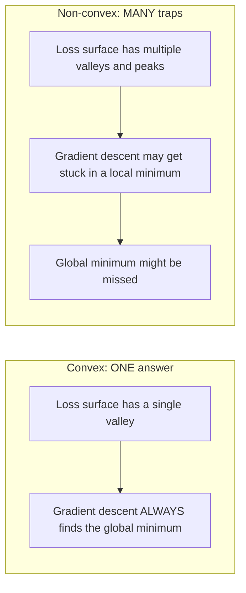
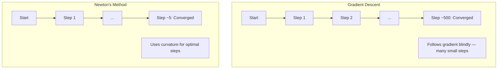
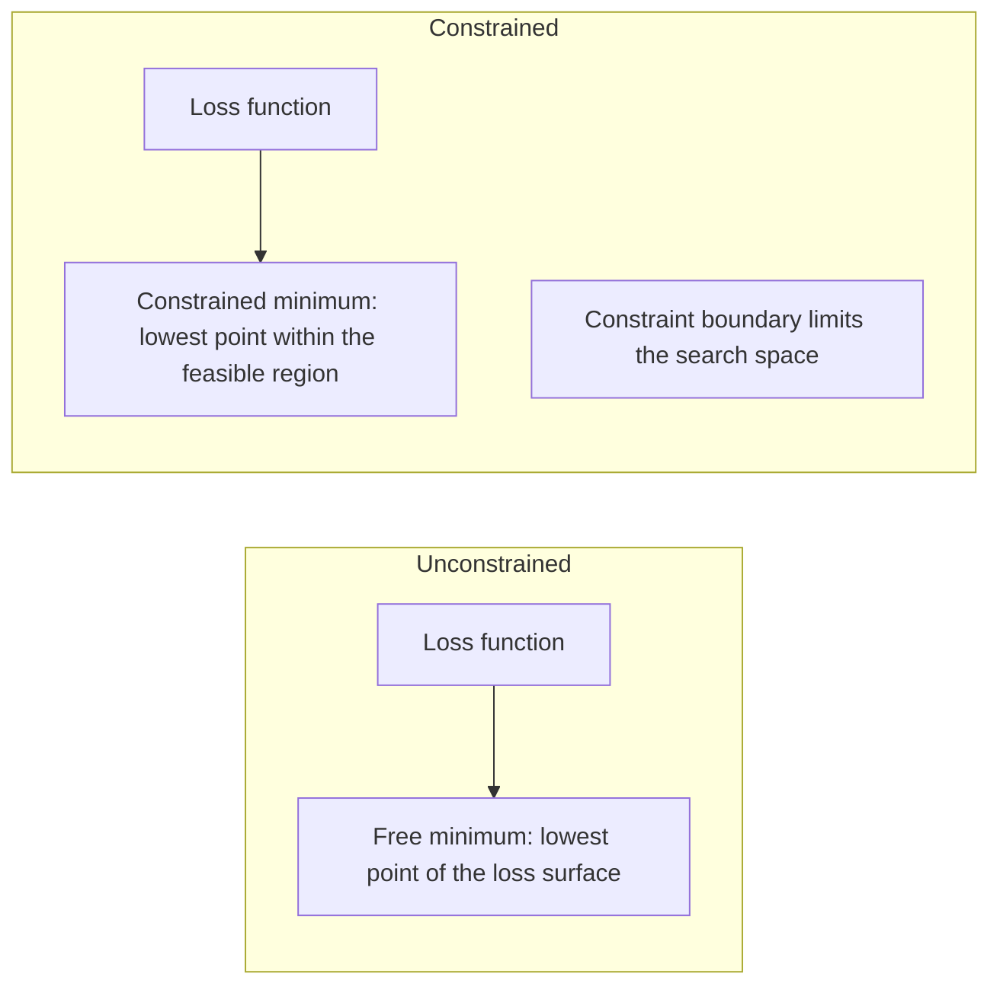
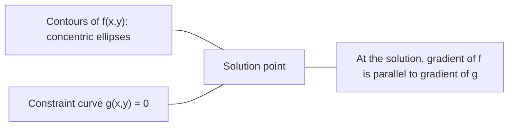

# 凸优化

> 凸问题只有一个山谷。神经网络有几百万个。知道其中的区别很重要。

**Type:** Build
**Language:** Python
**Prerequisites:** Phase 1, Lessons 04 (Calculus for ML), 08 (Optimization)
**Time:** ~90 minutes

## 学习目标

- 使用定义、二阶导数和 Hessian 判据检验一个函数是否为凸
- 实现牛顿法，并比较它与梯度下降之间的二次收敛速度
- 使用拉格朗日乘子求解带约束优化问题，并解释 KKT 条件
- 解释为什么神经网络的损失曲面是非凸的，但 SGD 仍能找到好的解

## 问题

第 08 课教了你梯度下降、动量和 Adam。这些优化器能在任何曲面上向山下走。但它们不提供任何保证。在非凸曲面上做梯度下降，可能会落入一个糟糕的局部最小值、卡在鞍点，或者永远震荡下去。你之所以仍然用它，是因为神经网络是非凸的，没有别的选择。

但机器学习中的许多问题都是凸的。线性回归、逻辑回归、SVM、LASSO、岭回归。对这些问题，存在更强的东西：带有数学保证的优化。一个凸问题恰好只有一个山谷。任何向山下走的算法都会到达全局最小值。不需要重启，不需要学习率调度，不需要祈祷。

理解凸性有三重作用。第一，它告诉你什么时候你的问题是容易的（凸）还是困难的（非凸）。第二，它给你更快的工具，比如用于凸问题的牛顿法。第三，它解释了贯穿机器学习的若干概念：作为约束的正则化、SVM 中的对偶性，以及为什么深度学习在违反凸性所赋予的一切优良性质的情况下依然有效。

## 概念

### 凸集

如果一个集合 S 中任意两点之间的线段也完全落在 S 内，则 S 是凸集。

| 凸集 | 非凸集 |
|---|---|
| **矩形**：内部任意两点都可以用一条仍留在内部的线段连接 | **星形/月牙形**：两个内部点之间的直线可能穿过集合外部 |
| **三角形**：对所有内部点该性质都成立 | **甜甜圈/圆环**：洞意味着某些线段会离开集合 |
| 任意两点之间的线段都保持在集合内 | 某些点对之间的线段会离开集合 |

形式化检验：对 S 中任意点 x、y 以及任意 t ∈ [0, 1]，点 tx + (1-t)y 也仍在 S 中。

凸集的例子：
- 一条直线、一个平面、整个 R^n
- 一个球（圆、球面、超球面）
- 一个半空间：{x : a^T x <= b}
- 任意多个凸集的交集

非凸集的例子：
- 甜甜圈（圆环）
- 两个不相交圆的并集
- 任何带有“凹陷”或“洞”的集合

### 凸函数

如果函数 f 的定义域是凸集，并且对定义域中任意两点 x、y 以及任意 t ∈ [0, 1]，满足：

```
f(tx + (1-t)y) <= t*f(x) + (1-t)*f(y)
```

则 f 是凸函数。

几何意义：图上任意两点之间的线段都位于图的**上方或重合**。

| 性质 | 凸函数 | 非凸函数 |
|---|---|---|
| **线段检验** | 图上任意两点之间的线段位于曲线的**上方或重合** | 图上某些点之间的线段会**落到**曲线下方 |
| **形状** | 单个向上弯的碗状/山谷 | 多个峰和谷，曲率混合 |
| **局部最小值** | 每个局部最小值都是全局最小值 | 可能存在多个高度不同的局部最小值 |

常见的凸函数：
- f(x) = x^2（抛物线）
- f(x) = |x|（绝对值）
- f(x) = e^x（指数）
- f(x) = max(0, x)（ReLU，不过是分段线性的）
- f(x) = -log(x)，x > 0（负对数）
- 任意线性函数 f(x) = a^T x + b（既凸又凹）

### 检验凸性

三种实用检验，从最简单到最严格排列。

**检验 1：二阶导数检验（一维）。** 如果对所有 x 都有 f''(x) >= 0，则 f 是凸的。

- f(x) = x^2：f''(x) = 2 >= 0，凸。
- f(x) = x^3：f''(x) = 6x，当 x < 0 时为负，非凸。
- f(x) = e^x：f''(x) = e^x > 0，凸。

**检验 2：Hessian 检验（多元）。** 如果对所有 x，Hessian 矩阵 H(x) 都是半正定的，则 f 是凸的。Hessian 是二阶偏导数组成的矩阵。

**检验 3：定义检验。** 直接检验不等式 f(tx + (1-t)y) <= t*f(x) + (1-t)*f(y)。适用于导数难以计算的函数。

### 为什么凸性重要

凸优化的核心定理：

**对于凸函数，每个局部最小值都是全局最小值。**

这意味着梯度下降不可能被困住。任何下山的路径都会通向同一个答案。算法被保证收敛到最优解。



推论：
- 不需要随机重启
- 不需要复杂的学习率调度
- 收敛性证明是可能的（速率取决于函数性质）
- 解是唯一的（直到平坦区域）

### 机器学习中的凸 vs 非凸

| 问题 | 凸吗？ | 为什么 |
|---------|---------|-----|
| 线性回归（MSE） | 是 | 损失关于权重是二次的 |
| 逻辑回归 | 是 | 对数损失关于权重是凸的 |
| SVM（hinge 损失） | 是 | 线性函数的最大值 |
| LASSO（L1 回归） | 是 | 凸函数之和是凸的 |
| 岭回归（L2） | 是 | 二次 + 二次 = 凸 |
| 神经网络（任意损失） | 否 | 非线性激活造成非凸曲面 |
| k-means 聚类 | 否 | 离散的分配步骤 |
| 矩阵分解 | 否 | 未知量的乘积 |

带凸损失的线性模型是凸的。一旦你加入带非线性激活的隐藏层，凸性就被打破。

### Hessian 矩阵

函数 f: R^n -> R 的 Hessian H 是一个 n x n 的二阶偏导数矩阵。

```
H[i][j] = d^2 f / (dx_i dx_j)
```

对 f(x, y) = x^2 + 3xy + y^2：

```
df/dx = 2x + 3y       d^2f/dx^2 = 2      d^2f/dxdy = 3
df/dy = 3x + 2y       d^2f/dydx = 3      d^2f/dy^2 = 2

H = [ 2  3 ]
    [ 3  2 ]
```

Hessian 告诉你关于曲率的信息：
- 特征值全为正：函数在每个方向都向上弯（在该点凸）
- 特征值全为负：每个方向都向下弯（凹，局部最大值）
- 符号混合：鞍点（某些方向向上弯，某些方向向下弯）
- 零特征值：该方向是平坦的（退化）

对于凸性，Hessian 必须在**处处**（而不只是某一点）都是半正定的（所有特征值 >= 0）。

### 牛顿法

梯度下降使用一阶信息（梯度）。牛顿法使用二阶信息（Hessian）。它在当前点拟合一个二次近似，并直接跳到该二次函数的最小值。

```
更新规则：
  x_new = x - H^(-1) * gradient

与梯度下降对比：
  x_new = x - lr * gradient
```

牛顿法用 Hessian 的逆取代了标量学习率。它根据局部曲率自动调整步长和方向。



优点：
- 在最小值附近二次收敛（每一步误差都平方）
- 无需调节学习率
- 尺度不变（无论你如何参数化问题都能工作）

缺点：
- 计算 Hessian 需要 O(n^2) 内存，求逆需要 O(n^3) 时间
- 对一个有 100 万个权重的神经网络，那就是 10^12 个元素和 10^18 次运算
- 对深度学习不实用

### 带约束优化

无约束优化：在所有 x 上最小化 f(x)。
带约束优化：在满足约束条件下最小化 f(x)。

真实问题都有约束。你想最小化成本，但预算有限。你想最小化误差，但模型复杂度有上界。



### 拉格朗日乘子

拉格朗日乘子法把一个带约束问题转化为无约束问题。

问题：在 g(x) = 0 的约束下最小化 f(x)。

解法：引入一个新变量（拉格朗日乘子 lambda），并求解无约束问题：

```
L(x, lambda) = f(x) + lambda * g(x)
```

在解处，L 的梯度为零：

```
dL/dx = df/dx + lambda * dg/dx = 0
dL/dlambda = g(x) = 0
```

几何直觉：在带约束最小值处，f 的梯度必须与约束 g 的梯度平行。如果它们不平行，你可以沿着约束曲面移动，进一步减小 f。



例子：在 x + y = 1 的约束下最小化 f(x,y) = x^2 + y^2。

```
L = x^2 + y^2 + lambda(x + y - 1)

dL/dx = 2x + lambda = 0  =>  x = -lambda/2
dL/dy = 2y + lambda = 0  =>  y = -lambda/2
dL/dlambda = x + y - 1 = 0

由前两个方程： x = y
代入： 2x = 1，所以 x = y = 0.5，lambda = -1
```

直线 x + y = 1 上离原点最近的点是 (0.5, 0.5)。

### KKT 条件

Karush-Kuhn-Tucker 条件把拉格朗日乘子推广到不等式约束。

问题：对于 i = 1, ..., m，在 g_i(x) <= 0 的约束下最小化 f(x)。

KKT 条件（最优性的必要条件）：

```
1. 平稳性（Stationarity）：    df/dx + sum(lambda_i * dg_i/dx) = 0
2. 原始可行性（Primal feasibility）：  g_i(x) <= 0  对所有 i
3. 对偶可行性（Dual feasibility）：    lambda_i >= 0  对所有 i
4. 互补松弛（Complementary slackness）：  lambda_i * g_i(x) = 0  对所有 i
```

互补松弛是关键洞察：要么约束是活跃的（g_i = 0，解位于边界上），要么乘子为零（约束无关紧要）。一个不影响解的约束有 lambda = 0。

KKT 条件对 SVM 至关重要。支持向量就是那些约束活跃（lambda > 0）的数据点。所有其他数据点都有 lambda = 0，不影响决策边界。

### 作为带约束优化的正则化

L1 和 L2 正则化不是任意的技巧。它们是伪装成带约束优化的问题。

**L2 正则化（岭回归）：**

```
最小化  Loss(w)  约束条件  ||w||^2 <= t

等价的无约束形式：
最小化  Loss(w) + lambda * ||w||^2
```

约束 ||w||^2 <= t 定义了一个球（二维是圆，三维是球体）。解位于损失等高线首次触及该球的位置。

**L1 正则化（LASSO）：**

```
最小化  Loss(w)  约束条件  ||w||_1 <= t

等价的无约束形式：
最小化  Loss(w) + lambda * ||w||_1
```

约束 ||w||_1 <= t 定义了一个菱形（二维中旋转的正方形）。

| 性质 | L2 约束（圆） | L1 约束（菱形） |
|---|---|---|
| **约束形状** | 圆（更高维中是球体） | 菱形（二维中旋转的正方形） |
| **损失等高线触及处** | 光滑边界——圆上任意点 | 角——与某条轴对齐 |
| **解的行为** | 权重很小但非零 | 某些权重恰好为零（稀疏） |
| **结果** | 权重收缩 | 特征选择 |

这解释了为什么 L1 产生稀疏模型（特征选择），而 L2 只是收缩权重。菱形有与轴对齐的角。损失等高线更可能触及某个角，从而把一个或多个权重恰好设为零。

### 对偶性

每个带约束优化问题（原始问题）都有一个伴随问题（对偶问题）。对凸问题，原始问题和对偶问题有相同的最优值，这被称为强对偶。

拉格朗日对偶函数：

```
原始问题：最小化 f(x)  约束条件 g(x) <= 0
拉格朗日函数：L(x, lambda) = f(x) + lambda * g(x)
对偶函数：d(lambda) = min_x L(x, lambda)
对偶问题：最大化 d(lambda)  约束条件 lambda >= 0
```

为什么对偶性重要：
- 对偶问题有时比原始问题更容易求解
- SVM 以其对偶形式求解，此时问题只依赖数据点之间的点积（从而启用核技巧）
- 对偶提供原始最优值的下界，可用于检验解的质量

对 SVM 而言，具体为：

```
原始问题：求 w、b 使间隔 2/||w|| 最大化，约束条件为
        y_i(w^T x_i + b) >= 1  对所有 i

对偶问题：最大化 sum(alpha_i) - 0.5 * sum_ij(alpha_i * alpha_j * y_i * y_j * x_i^T x_j)
        约束条件为 alpha_i >= 0 且 sum(alpha_i * y_i) = 0

对偶问题只涉及点积 x_i^T x_j。
将 x_i^T x_j 替换为 K(x_i, x_j) 即可得到核技巧。
```

### 为什么深度学习在非凸的情况下依然有效

神经网络的损失函数是严重非凸的。按所有经典标准，优化它们应当失败。然而随机梯度下降却可靠地找到好的解。有几个因素可以解释这一点。

**大多数局部最小值已经足够好。** 在高维空间中，随机的临界点（梯度为零处）绝大多数是鞍点，而不是局部最小值。少数存在的局部最小值，其损失值往往接近全局最小值。当参数空间有几百万个维度时，被困在一个糟糕的局部最小值是极不可能的。

**真正的障碍是鞍点，而非局部最小值。** 在一个有 n 个参数的函数中，鞍点混合了正曲率和负曲率方向。在高维中，对一个随机临界点，所有 n 个特征值都为正（局部最小值）的概率大约为 2^(-n)。几乎所有临界点都是鞍点。SGD 的噪声有助于逃离它们。

**过参数化使曲面平滑。** 参数比训练样本还多的网络，其损失曲面更平滑、更连通。更宽的网络有更少的糟糕局部最小值。这反直觉，但在经验上是一致的。

**损失曲面结构：**

| 性质 | 低维空间 | 高维空间 |
|---|---|---|
| **曲面** | 许多孤立的峰和谷 | 平滑连通的山谷 |
| **最小值** | 许多孤立的局部最小值 | 糟糕的局部最小值很少；大多数接近最优 |
| **导航** | 难以找到全局最小值 | 许多路径通往好的解 |
| **临界点** | 局部最小值和鞍点混合 | 绝大多数是鞍点，而非局部最小值 |

**随机噪声充当隐式正则化。** mini-batch SGD 加入的噪声阻止了陷入尖锐最小值。尖锐最小值会过拟合；平坦最小值泛化更好。噪声使优化偏向损失曲面的平坦区域。

### 实践中的二阶方法

纯牛顿法对大型模型不实用。有几种近似让二阶信息变得可用。

**L-BFGS（有限内存 BFGS）：** 用最近 m 个梯度差近似 Hessian 的逆。只需 O(mn) 内存而非 O(n^2)。对多达约 10,000 个参数的问题效果良好。用于经典机器学习（逻辑回归、CRF），但不用在深度学习中。

**自然梯度：** 使用 Fisher 信息矩阵（对数似然的期望 Hessian）而非标准 Hessian。这考虑了概率分布的几何。K-FAC（Kronecker 分解近似曲率）把 Fisher 矩阵近似为 Kronecker 乘积，使其对神经网络变得实用。

**无 Hessian 优化：** 用共轭梯度求解 Hx = g，而无需显式构造 H。只需要 Hessian-向量乘积，可通过自动微分在 O(n) 时间内计算。

**对角近似：** Adam 的二阶矩是对 Hessian 对角线的对角近似。AdaHessian 通过 Hutchinson 估计量使用真实 Hessian 对角线元素对此做了扩展。

| 方法 | 内存 | 每步代价 | 何时使用 |
|--------|--------|--------------|-------------|
| 梯度下降 | O(n) | O(n) | 基线，大型模型 |
| 牛顿法 | O(n^2) | O(n^3) | 小型凸问题 |
| L-BFGS | O(mn) | O(mn) | 中型凸问题 |
| Adam | O(n) | O(n) | 深度学习默认 |
| K-FAC | O(n) | 每层 O(n) | 研究，大批量训练 |

```figure
convex-vs-nonconvex
```

## Build It

### 第 1 步：凸性检查器

构建一个函数，通过采样点并检验定义来经验地检验凸性。

```python
import random
import math

def check_convexity(f, dim, bounds=(-5, 5), samples=1000):
    violations = 0
    for _ in range(samples):
        x = [random.uniform(*bounds) for _ in range(dim)]
        y = [random.uniform(*bounds) for _ in range(dim)]
        t = random.uniform(0, 1)
        mid = [t * xi + (1 - t) * yi for xi, yi in zip(x, y)]
        lhs = f(mid)
        rhs = t * f(x) + (1 - t) * f(y)
        if lhs > rhs + 1e-10:
            violations += 1
    return violations == 0, violations
```

### 第 2 步：二维牛顿法

使用显式 Hessian 实现牛顿法。把它与梯度下降的收敛速度作比较。

```python
def newtons_method(f, grad_f, hessian_f, x0, steps=50, tol=1e-12):
    x = list(x0)
    history = [x[:]]
    for _ in range(steps):
        g = grad_f(x)
        H = hessian_f(x)
        det = H[0][0] * H[1][1] - H[0][1] * H[1][0]
        if abs(det) < 1e-15:
            break
        H_inv = [
            [H[1][1] / det, -H[0][1] / det],
            [-H[1][0] / det, H[0][0] / det],
        ]
        dx = [
            H_inv[0][0] * g[0] + H_inv[0][1] * g[1],
            H_inv[1][0] * g[0] + H_inv[1][1] * g[1],
        ]
        x = [x[0] - dx[0], x[1] - dx[1]]
        history.append(x[:])
        if sum(gi ** 2 for gi in g) < tol:
            break
    return history
```

### 第 3 步：拉格朗日乘子求解器

用对拉格朗日函数做梯度下降来求解带约束优化。

```python
def lagrange_solve(f_grad, g_val, g_grad, x0, lr=0.01,
                   lr_lambda=0.01, steps=5000):
    x = list(x0)
    lam = 0.0
    history = []
    for _ in range(steps):
        fg = f_grad(x)
        gv = g_val(x)
        gg = g_grad(x)
        x = [
            xi - lr * (fgi + lam * ggi)
            for xi, fgi, ggi in zip(x, fg, gg)
        ]
        lam = lam + lr_lambda * gv
        history.append((x[:], lam, gv))
    return history
```

### 第 4 步：比较一阶与二阶

在同一个二次函数上运行梯度下降和牛顿法。统计收敛所需的步数。

```python
def quadratic(x):
    return 5 * x[0] ** 2 + x[1] ** 2

def quadratic_grad(x):
    return [10 * x[0], 2 * x[1]]

def quadratic_hessian(x):
    return [[10, 0], [0, 2]]
```

牛顿法会在 1 步内收敛（对二次函数它是精确的）。梯度下降会花数百步，因为 Hessian 的特征值相差 5 倍，形成一个狭长的山谷。

## Use It

凸性分析在选择机器学习模型和求解器时直接适用。

对凸问题（逻辑回归、SVM、LASSO）：
- 使用专用求解器（liblinear、CVXPY、`method='L-BFGS-B'` 的 scipy.optimize.minimize）
- 期待唯一的全局解
- 二阶方法既实用又快

对非凸问题（神经网络）：
- 使用一阶方法（SGD、Adam）
- 接受解依赖于初始化和随机性
- 用过参数化、噪声和学习率调度作为隐式正则化
- 不要浪费时间寻找全局最小值。一个好的局部最小值就足够了。

```python
from scipy.optimize import minimize

result = minimize(
    fun=lambda w: sum((y - X @ w) ** 2) + 0.1 * sum(w ** 2),
    x0=np.zeros(d),
    method='L-BFGS-B',
    jac=lambda w: -2 * X.T @ (y - X @ w) + 0.2 * w,
)
```

对 SVM，对偶形式让你可以使用核技巧：

```python
from sklearn.svm import SVC

svm = SVC(kernel='rbf', C=1.0)
svm.fit(X_train, y_train)
print(f"Support vectors: {svm.n_support_}")
```

## 练习

1. **凸性图鉴。** 用检查器检验这些函数的凸性：f(x) = x^4、f(x) = sin(x)、f(x,y) = x^2 + y^2、f(x,y) = x*y、f(x) = max(x, 0)。解释为什么每个结果都合理。

2. **牛顿法 vs 梯度下降竞速。** 在 f(x,y) = 50*x^2 + y^2 上从起点 (10, 10) 运行这两种方法。各自需要多少步才能达到损失 < 1e-10？当条件数（Hessian 最大与最小特征值之比）增大时，梯度下降会怎样？

3. **拉格朗日乘子几何。** 在 x + 2y = 4 的约束下最小化 f(x,y) = (x-3)^2 + (y-3)^2。通过检验解处 f 的梯度是否与 g 的梯度平行来验证解。

4. **正则化约束。** 实现 L1 约束优化：在 |x| + |y| <= 1 的约束下最小化 (x-3)^2 + (y-2)^2。证明解有一个坐标等于零（来自菱形约束的稀疏性）。

5. **Hessian 特征值分析。** 计算 Rosenbrock 函数在 (1,1) 和 (-1,1) 处的 Hessian。计算两点处的特征值。这些特征值告诉你关于最小值附近与远离最小值处的曲率的什么信息？

## 关键术语

| 术语 | 含义 |
|------|------|
| Convex set | 集合中任意两点之间的线段都保持在集合内的集合 |
| Convex function | 图上任意两点之间的线段都位于图的上方或重合的函数。等价地，Hessian 处处半正定 |
| Local minimum | 比所有邻近点都低的点。对凸函数，每个局部最小值都是全局最小值 |
| Global minimum | 函数在整个定义域上的最低点 |
| Hessian matrix | 所有二阶偏导数组成的矩阵。编码曲率信息 |
| Positive semidefinite | 特征值全部非负的矩阵。“二阶导数 >= 0”的多维类比 |
| Condition number | Hessian 最大与最小特征值之比。条件数大意味着狭长的山谷和缓慢的梯度下降 |
| Newton's method | 用 Hessian 的逆来确定步长方向和步长大小的二阶优化器。在最小值附近二次收敛 |
| Lagrange multiplier | 为把带约束优化问题转化为无约束问题而引入的变量 |
| KKT conditions | 带不等式约束时最优性的必要条件。是拉格朗日乘子的推广 |
| Complementary slackness | 在解处，要么约束活跃，要么其乘子为零。二者不会同时非零 |
| Duality | 每个带约束问题都有一个伴随的对偶问题。对凸问题，两者有相同的最优值 |
| Strong duality | 原始问题和对偶问题的最优值相等。对满足 Slater 条件的凸问题成立 |
| L-BFGS | 存储最近 m 个梯度差而非完整 Hessian 的近似二阶方法 |
| Saddle point | 梯度为零，但在某些方向是极小、在某些方向是极大的点 |
| Overparameterization | 使用比训练样本更多的参数。使损失曲面平滑并减少糟糕的局部最小值 |

## 延伸阅读

- [Boyd & Vandenberghe: Convex Optimization](https://web.stanford.edu/~boyd/cvxbook/) - 标准教材，可在线免费获取
- [Bottou, Curtis, Nocedal: Optimization Methods for Large-Scale Machine Learning (2018)](https://arxiv.org/abs/1606.04838) - 连接凸优化理论与深度学习实践
- [Choromanska et al.: The Loss Surfaces of Multilayer Networks (2015)](https://arxiv.org/abs/1412.0233) - 为什么非凸神经网络曲面没有看起来那么糟
- [Nocedal & Wright: Numerical Optimization](https://link.springer.com/book/10.1007/978-0-387-40065-5) - 牛顿法、L-BFGS 和带约束优化的综合参考