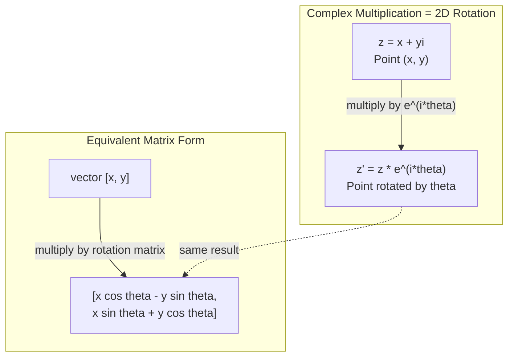
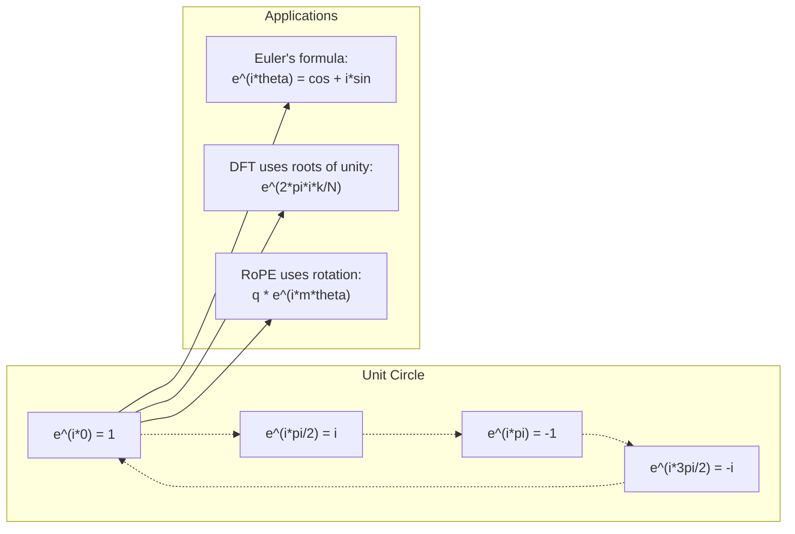

# 面向 AI 的复数

> -1 的平方根并不虚幻。它是旋转、频率，以及半个信号处理领域的钥匙。

**Type:** Learn
**Language:** Python
**Prerequisites:** Phase 1, Lessons 01-04 (linear algebra, calculus)
**Time:** ~60 minutes

## 学习目标

- 在直角坐标形式和极坐标形式下完成复数运算（加、乘、除、共轭）
- 运用欧拉公式在复指数与三角函数之间转换
- 使用单位复数根实现离散傅里叶变换（DFT）
- 解释复数旋转如何支撑 Transformer 中的 RoPE 和正弦位置编码

## 问题

你翻开一篇关于傅里叶变换的论文，满眼都是 `i`。你看 Transformer 的位置编码，看到的是不同频率下的 `sin` 和 `cos`——它们正是复指数的实部与虚部。你阅读量子计算，发现一切都用复向量空间来表达。

复数看起来很抽象。一个建立在 -1 的平方根之上的数系，听起来像是一种数学把戏。但它不是把戏。它是旋转与振荡的自然语言。每当有东西在旋转、振动或振荡时，复数就是对的工具。

不理解复数，你就无法理解离散傅里叶变换。无法理解 FFT。无法理解现代语言模型中的 RoPE（旋转位置编码）是如何工作的。也无法理解原始 Transformer 论文里的正弦位置编码为什么会采用那些特定的频率。

本课从零搭建复数运算，把它与几何联系起来，并精确地展示复数在机器学习中的出场位置。

## 概念

### 什么是复数？

复数有两部分：实部和虚部。

```
z = a + bi

其中：
  a 是实部
  b 是虚部
  i 是虚数单位，定义为 i^2 = -1
```

就是这样。你把数轴扩展成一个平面。实数落在一根轴上，虚数落在另一根轴上。每个复数都是这个平面上的一个点。

### 复数运算

**加法。** 实部与实部相加，虚部与虚部相加。

```
(a + bi) + (c + di) = (a + c) + (b + d)i

例子：(3 + 2i) + (1 + 4i) = 4 + 6i
```

**乘法。** 使用分配律，并牢记 i^2 = -1。

```
(a + bi)(c + di) = ac + adi + bci + bdi^2
                 = ac + adi + bci - bd
                 = (ac - bd) + (ad + bc)i

例子：(3 + 2i)(1 + 4i) = 3 + 12i + 2i + 8i^2
                        = 3 + 14i - 8
                        = -5 + 14i
```

**共轭。** 把虚部的符号取反。

```
(a + bi) 的共轭 = a - bi
```

一个复数与其共轭的乘积恒为实数：

```
(a + bi)(a - bi) = a^2 + b^2
```

**除法。** 分子分母同乘以分母的共轭。

```
(a + bi) / (c + di) = (a + bi)(c - di) / (c^2 + d^2)
```

这样就把分母里的虚部消掉了，得到一个干净的复数。

### 复平面

复平面把每个复数映射为一个二维点。水平轴是实轴，竖直轴是虚轴。

```
z = 3 + 2i  对应点 (3, 2)
z = -1 + 0i 对应实轴上的点 (-1, 0)
z = 0 + 4i  对应虚轴上的点 (0, 4)
```

一个复数同时是一个点，也是一个从原点出发的向量。这种双重解释正是复数对几何有用的原因。

### 极坐标形式

平面上的任何点都可以用它到原点的距离、以及它与正实轴的夹角来描述。

```
z = r * (cos(theta) + i*sin(theta))

其中：
  r = |z| = sqrt(a^2 + b^2)     （幅值，或模）
  theta = atan2(b, a)             （相位，或幅角）
```

直角坐标形式 (a + bi) 适合做加法。极坐标形式 (r, theta) 适合做乘法。

**极坐标形式下的乘法。** 幅值相乘，角度相加。

```
z1 = r1 * e^(i*theta1)
z2 = r2 * e^(i*theta2)

z1 * z2 = (r1 * r2) * e^(i*(theta1 + theta2))
```

这就是复数天然适合旋转的原因。乘以一个幅值为 1 的复数，就是一次纯旋转。

### 欧拉公式

连接复指数与三角函数的桥梁：

```
e^(i*theta) = cos(theta) + i*sin(theta)
```

这是本课最重要的公式。当 theta = pi 时：

```
e^(i*pi) = cos(pi) + i*sin(pi) = -1 + 0i = -1

因此：e^(i*pi) + 1 = 0
```

五个基本常数（e、i、pi、1、0）被一条等式串在了一起。

### 为什么欧拉公式对机器学习重要

欧拉公式说的是，当 theta 变化时，`e^(i*theta)` 会描出单位圆。在 theta = 0 时你在 (1, 0)；在 theta = pi/2 时你在 (0, 1)；在 theta = pi 时你在 (-1, 0)；在 theta = 3*pi/2 时你在 (0, -1)。完整旋转一圈对应 theta = 2*pi。

这意味着复指数就是旋转。而旋转在信号处理与机器学习中无处不在。

### 与二维旋转的联系

把复数 (x + yi) 乘以 e^(i*theta)，相当于把点 (x, y) 绕原点旋转角度 theta。

```
通过复数乘法旋转：
  (x + yi) * (cos(theta) + i*sin(theta))
  = (x*cos(theta) - y*sin(theta)) + (x*sin(theta) + y*cos(theta))i

通过矩阵乘法旋转：
  [cos(theta)  -sin(theta)] [x]   [x*cos(theta) - y*sin(theta)]
  [sin(theta)   cos(theta)] [y] = [x*sin(theta) + y*cos(theta)]
```

两者产生完全相同的结果。复数乘法就是二维旋转。旋转矩阵只是用矩阵记号写出来的复数乘法。



### 相量与旋转信号

复指数 e^(i*omega*t) 是以角频率 omega 绕单位圆旋转的一个点。随着 t 增大，这个点描出圆周。

这个旋转点的实部是 cos(omega*t)，虚部是 sin(omega*t)。正弦信号是一个旋转复数投下的影子。

```
e^(i*omega*t) = cos(omega*t) + i*sin(omega*t)

实部：      cos(omega*t)    -- 一条余弦波
虚部： sin(omega*t)    -- 一条正弦波
```

这就是相量（phasor）表示。与其追踪一条摆动的正弦波，你追踪一根平滑旋转的箭头。相移变成角度偏移，幅度变化变成幅值变化，信号的相加变成向量相加。

### 单位根

N 次单位根是单位圆上等距分布的 N 个点：

```
w_k = e^(2*pi*i*k/N)    对于 k = 0, 1, 2, ..., N-1
```

当 N = 4 时，根为：1、i、-1、-i（四个罗盘方位点）。当 N = 8 时，你得到四个罗盘方位点再加上四个对角线方向。

单位根是离散傅里叶变换的基础。DFT 把一个信号分解到这 N 个等距频率上。

### 与 DFT 的联系

信号 x[0], x[1], ..., x[N-1] 的离散傅里叶变换是：

```
X[k] = sum_{n=0}^{N-1} x[n] * e^(-2*pi*i*k*n/N)
```

每个 X[k] 度量信号与第 k 个单位根——即频率 k 处的复正弦——的相关程度。DFT 把一个信号拆成 N 个旋转相量，并告诉你每一个的幅度与相位。

### 为什么 i 并不"虚"

「虚数」这个词是个历史偶然。笛卡尔用它时带着轻蔑。但 i 并不比负数当年刚被人拒绝时更「虚」。负数回答的问题是「从 3 里减去 5 会得到什么？」虚数单位回答的问题是「什么数的平方会得到 -1？」

更有用的说法是：i 是一个 90 度旋转算子。把一个实数乘以 i 一次，你旋转 90 度到虚轴；再乘以 i（i^2），你再旋转 90 度——现在你指向负实轴方向。这就是 i^2 = -1 的原因。它并不神秘，它是两个四分之一圈构成的半圈。

这就是复数在工程中无处不在的原因。任何会旋转的东西——电磁波、量子态、信号振荡、位置编码——都能自然地用复数来描述。

### 复指数与三角函数

在欧拉公式之前，工程师把信号写成 A*cos(omega*t + phi)——幅度 A、频率 omega、相位 phi。这可行，但让运算变得痛苦。把两个不同相位的余弦相加需要三角恒等式。

用复指数，同一个信号是 A*e^(i*(omega*t + phi))。把两个信号相加只是把两个复数相加；相乘（调制）只是幅值相乘、角度相加；相移变成角度相加；频移变成与相量相乘。

整个信号处理领域之所以转向复指数记号，是因为数学更干净。「真实信号」始终只是复数表示的实部。虚部作为簿记一路携带，让所有代数自然成立。

### 与 Transformer 的联系

**正弦位置编码**（原始 Transformer 论文）：

```
PE(pos, 2i) = sin(pos / 10000^(2i/d))
PE(pos, 2i+1) = cos(pos / 10000^(2i/d))
```

这些 sin 与 cos 成对出现，是不同频率下复指数的实部与虚部。每个频率为编码位置提供不同的「分辨率」：低频变化慢（粗粒度位置），高频变化快（细粒度位置）。它们合在一起给每个位置一个独一无二的频率指纹。

**RoPE（旋转位置编码，Rotary Position Embedding）** 更进一步。它显式地把 query 和 key 向量乘以复数旋转矩阵。两个 token 之间的相对位置变成一个旋转角。注意力用这些旋转后的向量来计算，从而通过复数乘法使模型对相对位置敏感。

| 运算 | 代数形式 | 几何意义 |
|-----------|---------------|-------------------|
| 加法 | (a+c) + (b+d)i | 平面上的向量加法 |
| 乘法 | (ac-bd) + (ad+bc)i | 旋转与缩放 |
| 共轭 | a - bi | 关于实轴反射 |
| 幅值 | sqrt(a^2 + b^2) | 到原点的距离 |
| 相位 | atan2(b, a) | 与正实轴的夹角 |
| 除法 | 乘以共轭 | 反向旋转并重新缩放 |
| 幂 | r^n * e^(i*n*theta) | 旋转 n 次，按 r^n 缩放 |



```figure
roots-of-unity
```

## Build It

### 第 1 步：Complex 类

构建一个 Complex 数类，支持算术运算、幅值、相位，以及直角坐标与极坐标形式之间的转换。

```python
import math

class Complex:
    def __init__(self, real, imag=0.0):
        self.real = real
        self.imag = imag

    def __add__(self, other):
        return Complex(self.real + other.real, self.imag + other.imag)

    def __mul__(self, other):
        r = self.real * other.real - self.imag * other.imag
        i = self.real * other.imag + self.imag * other.real
        return Complex(r, i)

    def __truediv__(self, other):
        denom = other.real ** 2 + other.imag ** 2
        r = (self.real * other.real + self.imag * other.imag) / denom
        i = (self.imag * other.real - self.real * other.imag) / denom
        return Complex(r, i)

    def magnitude(self):
        return math.sqrt(self.real ** 2 + self.imag ** 2)

    def phase(self):
        return math.atan2(self.imag, self.real)

    def conjugate(self):
        return Complex(self.real, -self.imag)
```

### 第 2 步：极坐标转换与欧拉公式

```python
def to_polar(z):
    return z.magnitude(), z.phase()

def from_polar(r, theta):
    return Complex(r * math.cos(theta), r * math.sin(theta))

def euler(theta):
    return Complex(math.cos(theta), math.sin(theta))
```

验证：`euler(theta).magnitude()` 应始终为 1.0。`euler(0)` 应给出 (1, 0)。`euler(pi)` 应给出 (-1, 0)。

### 第 3 步：旋转

将点 (x, y) 旋转角度 theta，就是一次复数乘法：

```python
point = Complex(3, 4)
rotated = point * euler(math.pi / 4)
```

幅值保持不变，只有角度改变。

### 第 4 步：用复数运算实现 DFT

```python
def dft(signal):
    N = len(signal)
    result = []
    for k in range(N):
        total = Complex(0, 0)
        for n in range(N):
            angle = -2 * math.pi * k * n / N
            total = total + Complex(signal[n], 0) * euler(angle)
        result.append(total)
    return result
```

这是 O(N^2) 的 DFT。每个输出 X[k] 都是信号采样点乘以单位根之后的和。

### 第 5 步：逆 DFT

逆 DFT 从频谱重构原始信号。与正向 DFT 相比仅有的两处变化：指数中的符号取反，并除以 N。

```python
def idft(spectrum):
    N = len(spectrum)
    result = []
    for n in range(N):
        total = Complex(0, 0)
        for k in range(N):
            angle = 2 * math.pi * k * n / N
            total = total + spectrum[k] * euler(angle)
        result.append(Complex(total.real / N, total.imag / N))
    return result
```

这给了你完美重构。先做 DFT，再做 IDFT，你能以机器精度拿回原始信号。没有信息丢失。

### 第 6 步：单位根

```python
def roots_of_unity(N):
    return [euler(2 * math.pi * k / N) for k in range(N)]
```

验证两个性质：
- 每个根的幅值都恰好为 1。
- 所有 N 个根之和为零（它们因对称性互相抵消）。

这些性质正是 DFT 可逆的原因。单位根构成频域的一组正交基。

## Use It

Python 内建了复数支持。字面量 `j` 表示虚数单位。

```python
z = 3 + 2j
w = 1 + 4j

print(z + w)
print(z * w)
print(abs(z))

import cmath
print(cmath.phase(z))
print(cmath.exp(1j * cmath.pi))
```

对于数组，numpy 原生支持复数：

```python
import numpy as np

z = np.array([1+2j, 3+4j, 5+6j])
print(np.abs(z))
print(np.angle(z))
print(np.conj(z))
print(np.real(z))
print(np.imag(z))

signal = np.sin(2 * np.pi * 5 * np.linspace(0, 1, 128))
spectrum = np.fft.fft(signal)
freqs = np.fft.fftfreq(128, d=1/128)
```

## Ship It

运行 `code/complex_numbers.py` 来生成 `outputs/skill-complex-arithmetic.md`。

## 练习

1. **手算复数运算。** 计算 (2 + 3i) * (4 - i) 并用代码验证。然后计算 (5 + 2i) / (1 - 3i)。把两个结果都画在复平面上，检查乘法是否旋转并缩放了第一个数。

2. **旋转序列。** 从点 (1, 0) 出发。用 e^(i*pi/6) 乘以它十二次。验证 12 次乘法后你回到 (1, 0)。打印每一步的坐标，确认它们勾勒出一个正十二边形。

3. **已知信号的 DFT。** 构造一个信号，它是 sin(2*pi*3*t) 与 0.5*sin(2*pi*7*t) 之和，采样 32 个点。运行你的 DFT。验证幅值谱在频率 3 和 7 处有峰，且 7 处的峰是 3 处峰高的一半。

4. **单位根可视化。** 计算 8 次单位根。验证它们之和为零。验证用原始根 e^(2*pi*i/8) 乘以任意一个根会得到下一个根。

5. **旋转矩阵等价性。** 对 10 个随机角度和 10 个随机点，验证复数乘法与 2×2 旋转矩阵的矩阵-向量乘法给出相同结果。打印最大数值误差。

## 关键术语

| 术语 | 它是什么意思 |
|------|---------------|
| Complex number | 形如 a + bi 的数，其中 a 是实部，b 是虚部，且 i^2 = -1 |
| Imaginary unit | 数 i，定义为 i^2 = -1。哲学意义上并不「虚」——它是一个旋转算子 |
| Complex plane | x 轴为实轴、y 轴为虚轴的二维平面。又称 Argand 平面 |
| Magnitude (modulus) | 到原点的距离：sqrt(a^2 + b^2)。记作 \|z\| |
| Phase (argument) | 与正实轴的夹角：atan2(b, a)。记作 arg(z) |
| Conjugate | 关于实轴的镜像：a + bi 的共轭是 a - bi |
| Polar form | 用 r * e^(i*theta) 而不是 a + bi 表示 z。使乘法变得简单 |
| Euler's formula | e^(i*theta) = cos(theta) + i*sin(theta)。把指数与三角联系起来 |
| Phasor | 一个旋转的复数 e^(i*omega*t)，表示一个正弦信号 |
| Roots of unity | 对 k = 0 到 N-1 的 N 个复数 e^(2*pi*i*k/N)。单位圆上等距分布的 N 个点 |
| DFT | 离散傅里叶变换。利用单位根把信号分解为复正弦分量 |
| RoPE | 旋转位置编码（Rotary Position Embedding）。在 Transformer 注意力中用复数乘法编码相对位置 |

## 延伸阅读

- [Visual Introduction to Euler's Formula](https://betterexplained.com/articles/intuitive-understanding-of-eulers-formula/)——用少量符号建立几何直觉
- [Su et al.: RoFormer (2021)](https://arxiv.org/abs/2104.09864)——提出使用复数旋转的旋转位置编码（RoPE）的论文
- [Vaswani et al.: Attention Is All You Need (2017)](https://arxiv.org/abs/1706.03762)——提出正弦位置编码的原始 Transformer 论文
- [3Blue1Brown: Euler's formula with introductory group theory](https://www.youtube.com/watch?v=mvmuCPvRoWQ)——对为什么 e^(i*pi) = -1 的直观解释
- [Needham: Visual Complex Analysis](https://global.oup.com/academic/product/visual-complex-analysis-9780198534464)——复数最好的可视化讲解，充满几何洞见
- [Strang: Introduction to Linear Algebra, Ch. 10](https://math.mit.edu/~gs/linearalgebra/)——线性代数与特征值语境下的复数
