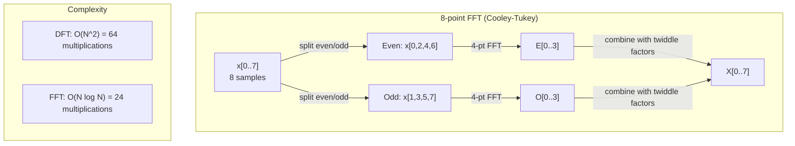
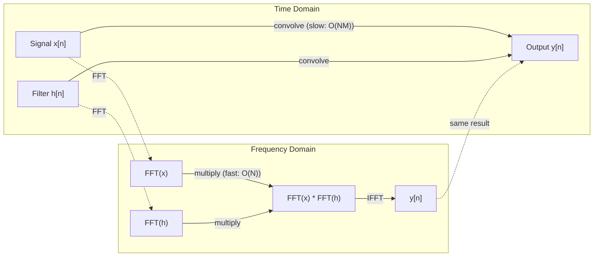

# 傅里叶变换

> 每个信号都是一堆正弦波之和。傅里叶变换告诉你究竟是哪些正弦波。

**Type:** Build
**Language:** Python
**Prerequisites:** Phase 1, Lessons 01-04, 19 (complex numbers)
**Time:** ~90 minutes

## 学习目标

- 从零实现 DFT，并与 O(N log N) 的 Cooley-Tukey FFT 交叉验证
- 解读频率系数：从信号中提取幅度、相位和功率谱
- 应用卷积定理，通过 FFT 乘法完成卷积
- 把傅里叶频率分解与 Transformer 位置编码以及 CNN 卷积层联系起来

## 问题

一段音频录音是随时间变化的压强测量序列。一只股票价格是逐日的一个数值序列。一幅图像是空间中一片像素强度的网格。这些都是时域（或空域）里的数据。你看到的是数值随某个下标而变化。

但许多模式在时域里是不可见的。这段音频是纯音还是一个和弦？这只股票价格是否有每周一次的周期？这幅图像是否有重复的纹理？这些问题都是关于频率内容的，而时域把它藏了起来。

傅里叶变换把数据从时域转换到频域。它取一个信号，把它分解成不同频率的正弦波。每个正弦波有一个幅度（它有多强）和一个相位（它从哪里开始）。傅里叶变换两者都告诉你。

这对机器学习很重要，因为频域思维无处不在。卷积神经网络做卷积，而卷积就是频域里的乘法。Transformer 的位置编码用频率分解来表示位置。音频模型（语音识别、音乐生成）工作在频谱图——声音的频率表示——之上。时间序列模型寻找周期性模式。理解傅里叶变换给了你处理所有这些的工具词汇。

## 概念

### DFT 的定义

给定 N 个采样点 x[0], x[1], ..., x[N-1]，离散傅里叶变换产生 N 个频率系数 X[0], X[1], ..., X[N-1]：

```
X[k] = sum_{n=0}^{N-1} x[n] * e^(-2*pi*i*k*n/N)

其中 k = 0, 1, ..., N-1
```

每个 X[k] 都是一个复数。它的幅值 |X[k]| 告诉你频率 k 的振幅；它的相位 angle(X[k]) 告诉你该频率的相位偏移。

关键洞见：`e^(-2*pi*i*k*n/N)` 是频率 k 处的一个旋转相量。DFT 计算信号与 N 个等距频率中每一个之间的相关性。如果信号在频率 k 处含有能量，相关性就大；否则接近零。

### 每个系数意味着什么

**X[0]：直流分量。** 它是所有采样点之和——与均值成正比。它代表信号的常数（零频率）偏移。

```
X[0] = sum_{n=0}^{N-1} x[n] * e^0 = 所有采样点之和
```

**1 <= k <= N/2 的 X[k]：正频率。** X[k] 表示每 N 个采样点 k 个周期的频率。k 越大意味着频率越高（振荡越快）。

**X[N/2]：奈奎斯特频率。** 用 N 个采样点所能表示的最高频率。超出它，就会出现混叠——高频冒充成低频。

**N/2 < k < N 的 X[k]：负频率。** 对于实值信号，有 X[N-k] = conj(X[k])。负频率是正频率的镜像。这就是为什么有用信息都在前 N/2 + 1 个系数里。

### 逆 DFT

逆 DFT 从频率系数重构原始信号：

```
x[n] = (1/N) * sum_{k=0}^{N-1} X[k] * e^(2*pi*i*k*n/N)

其中 n = 0, 1, ..., N-1
```

与正向 DFT 仅有的差异：指数中的符号为正（而非负），且有一个 1/N 的归一化因子。

逆 DFT 是完美重构。没有任何信息丢失。你可以从时域到频域再回来，而毫无误差。DFT 是一次基变换——它在另一套坐标系里重新表达同一份信息。

### FFT：让它变快

上面定义的 DFT 是 O(N^2) 的：对 N 个输出系数中的每一个，你都要遍历 N 个输入采样点求和。当 N = 1 百万时，就是 10^12 次运算。

快速傅里叶变换（FFT）用 O(N log N) 算出同样的结果。当 N = 1 百万时，大约只有 2000 万次运算，而不是一万亿次。这正是频率分析得以实用的原因。

Cooley-Tukey 算法（最常见的 FFT）通过分治来工作：

1. 把信号分成偶数下标和奇数下标的采样点。
2. 递归地计算每一半的 DFT。
3. 用「旋转因子」e^(-2*pi*i*k/N) 把两个半尺寸的 DFT 合并起来。

```
X[k] = E[k] + e^(-2*pi*i*k/N) * O[k]          其中 k = 0, ..., N/2 - 1
X[k + N/2] = E[k] - e^(-2*pi*i*k/N) * O[k]    其中 k = 0, ..., N/2 - 1

其中 E = 偶数下标采样点的 DFT
      O = 奇数下标采样点的 DFT
```

对称性意味着每一层递归做 O(N) 的工作，而总共有 log2(N) 层。合计：O(N log N)。



FFT 要求信号长度为 2 的幂。实践中，信号会被补零到下一个 2 的幂。

### 频谱分析

**功率谱**是 |X[k]|^2——每个频率系数的幅值平方。它显示每个频率上有多少能量。

**相位谱**是 angle(X[k])——每个频率的相位偏移。对大多数分析任务，你关心功率谱而忽略相位。

```
频率 k 处的功率：  P[k] = |X[k]|^2 = X[k].real^2 + X[k].imag^2
频率 k 处的相位：  phi[k] = atan2(X[k].imag, X[k].real)
```

### 频率分辨率

DFT 的频率分辨率取决于采样点数 N 和采样率 fs。

```
第 k 个频点的频率：  f_k = k * fs / N
频率分辨率：    delta_f = fs / N
最高频率：       f_max = fs / 2  （奈奎斯特频率）
```

要分辨两个靠得很近的频率，你需要更多采样点。要捕捉高频，你需要更高的采样率。

### 卷积定理

这是信号处理中最重要的结论之一，并且与 CNN 直接相关。

**时域中的卷积等于频域中的逐点相乘。**

```
x * h = IFFT(FFT(x) . FFT(h))

其中 * 是卷积，. 是逐元素相乘
```

为什么这重要：

- 直接对长度为 N 和 M 的两个信号做卷积需要 O(N*M) 次运算。
- 基于 FFT 的卷积是 O(N log N)：两者都变换、相乘、再变换回来。
- 对大型卷积核，FFT 卷积要快得多。
- 这正是感受野很大的卷积层里发生的事。

注意：DFT 计算的是循环卷积（信号会环绕回卷）。对于线性卷积（无回卷），先给两个信号补零到长度 N + M - 1 再计算。



### 加窗

DFT 假设信号是周期性的——它把 N 个采样点当作一个无限重复信号的一个周期。如果信号在起点和终点不取相同的值，就会在边界处产生不连续，表现为虚假的高频内容。这叫做频谱泄漏。

加窗通过在计算 DFT 之前把信号两端渐缩到零来减小泄漏。

常见的窗函数：

| 窗函数 | 形状 | 主瓣宽度 | 旁瓣电平 | 适用场景 |
|--------|-------|----------------|-----------------|----------|
| Rectangular | 平坦（无窗） | 最窄 | 最高（-13 dB） | 信号在 N 个采样点内恰好严格周期时 |
| Hann | 升余弦 | 中等 | 低（-31 dB） | 通用频谱分析 |
| Hamming | 修正余弦 | 中等 | 更低（-42 dB） | 音频处理、语音分析 |
| Blackman | 三重余弦 | 宽 | 非常低（-58 dB） | 旁瓣抑制至关重要时 |

```
Hann 窗：    w[n] = 0.5 * (1 - cos(2*pi*n / (N-1)))
Hamming 窗： w[n] = 0.54 - 0.46 * cos(2*pi*n / (N-1))
```

在 DFT 之前把窗函数与信号逐元素相乘即可施加窗函数：`X = DFT(x * w)`。

### DFT 性质

| 性质 | 时域 | 频域 |
|----------|-------------|-----------------|
| 线性 | a*x + b*y | a*X + b*Y |
| 时移 | x[n - k] | X[f] * e^(-2*pi*i*f*k/N) |
| 频移 | x[n] * e^(2*pi*i*f0*n/N) | X[f - f0] |
| 卷积 | x * h | X * H（逐点） |
| 相乘 | x * h（逐点） | X * H（循环卷积，按 1/N 缩放） |
| 帕塞瓦尔定理 | sum \|x[n]\|^2 | (1/N) * sum \|X[k]\|^2 |
| 共轭对称性（实输入） | x[n] 为实数 | X[k] = conj(X[N-k]) |

帕塞瓦尔定理说的是总能量在两个域中相同。能量在变换中守恒。

### 与位置编码的联系

原始 Transformer 使用正弦位置编码：

```
PE(pos, 2i)   = sin(pos / 10000^(2i/d_model))
PE(pos, 2i+1) = cos(pos / 10000^(2i/d_model))
```

每一对维度 (2i, 2i+1) 以不同的频率振荡。这些频率从高（第 0、1 维）到低（最后几维）按几何级数排布。这让每个位置在所有频带上都有一个独特的模式——类似于傅里叶系数唯一地标识一个信号。

这带来的关键性质：

- **唯一性：** 没有两个位置拥有相同的编码。
- **有界取值：** sin 和 cos 始终落在 [-1, 1]。
- **相对位置：** 位置 p+k 的编码可以表示为位置 p 编码的线性函数。模型可以学会关注相对位置。

### 与 CNN 的联系

卷积层通过让一个学习得到的滤波器（卷积核）在信号或图像上滑动，把它施加到输入上。数学上，这就是卷积运算。

根据卷积定理，这等价于：
1. 对输入做 FFT
2. 对卷积核做 FFT
3. 在频域中相乘
4. 对结果做 IFFT

标准 CNN 实现使用直接卷积（对小型的 3×3 卷积核更快）。但对大型卷积核或全局卷积，基于 FFT 的方法要快得多。一些架构（如 FNet）完全用 FFT 取代注意力，以 O(N log N) 而非 O(N^2) 的复杂度获得具备竞争力的准确率。

### 频谱图与短时傅里叶变换

单次 FFT 给你整个信号的频率内容，却不会告诉你这些频率何时出现。一个啾啾声（频率随时间升高的信号）与一个和弦（所有频率同时出现）可以有相同的幅度谱。

短时傅里叶变换（STFT）通过在信号的重叠窗口上计算 FFT 来解决这个问题。结果是一张频谱图：一个二维表示，一根轴是时间，另一根轴是频率。每个点的强度显示该时间该频率处的能量。

```
STFT 步骤：
1. 选择一个窗口大小（例如 1024 个采样点）
2. 选择一个跳跃大小（例如 256 个采样点——75% 重叠）
3. 对每个窗口位置：
   a. 取出加窗后的一段
   b. 施加 Hann/Hamming 窗
   c. 计算 FFT
   d. 把幅度谱存为频谱图的一列
```

频谱图是音频机器学习模型的标准输入表示。语音识别模型（Whisper、DeepSpeech）工作在梅尔频谱图——频率被映射到梅尔刻度的频谱图，后者更贴合人类的音高感知。

### 混叠

如果信号含有高于 fs/2（奈奎斯特频率）的频率，以速率 fs 采样就会产生混叠副本。以 100 Hz 采样一个 90 Hz 的信号，看起来与一个 10 Hz 的信号别无二致。仅凭采样点无法区分二者。

```
例子：
  真实信号：90 Hz 正弦波
  采样率：100 Hz
  视在频率：100 - 90 = 10 Hz

  以 100 Hz 采样率对 90 Hz 信号采样得到的采样点，
  与对 10 Hz 信号采样得到的采样点完全相同。
  再多的数学也无法恢复出原始的 90 Hz。
```

这就是模数转换器会包含抗混叠滤波器、在采样前去除高于奈奎斯特频率的分量的原因。在机器学习中，当你在没有适当低通滤波的情况下对特征图下采样时，就会出现混叠——一些架构用抗混叠的池化层来应对这一点。

### 补零不会提高分辨率

一个常见的误解：在 FFT 之前给信号补零能提高频率分辨率。并不会。补零只是在现有频点之间插值，给你一个看起来更平滑的频谱。但它无法揭示原始采样点中并不存在的频率细节。

真正的频率分辨率只取决于观测时间 T = N / fs。要分辨相差 delta_f 的两个频率，你至少需要 T = 1 / delta_f 秒的数据。再多的补零也无法改变这个根本极限。

```figure
fourier-synthesis
```

## Build It

### 第 1 步：从零实现 DFT

O(N^2) 的 DFT 直接由定义得出。

```python
import math

class Complex:
    ...

def dft(x):
    N = len(x)
    result = []
    for k in range(N):
        total = Complex(0, 0)
        for n in range(N):
            angle = -2 * math.pi * k * n / N
            w = Complex(math.cos(angle), math.sin(angle))
            xn = x[n] if isinstance(x[n], Complex) else Complex(x[n])
            total = total + xn * w
        result.append(total)
    return result
```

### 第 2 步：逆 DFT

结构相同，指数为正，除以 N。

```python
def idft(X):
    N = len(X)
    result = []
    for n in range(N):
        total = Complex(0, 0)
        for k in range(N):
            angle = 2 * math.pi * k * n / N
            w = Complex(math.cos(angle), math.sin(angle))
            total = total + X[k] * w
        result.append(Complex(total.real / N, total.imag / N))
    return result
```

### 第 3 步：FFT（Cooley-Tukey）

递归 FFT 要求长度为 2 的幂。拆成偶数和奇数、递归、再用旋转因子合并。

```python
def fft(x):
    N = len(x)
    if N <= 1:
        return [x[0] if isinstance(x[0], Complex) else Complex(x[0])]
    if N % 2 != 0:
        return dft(x)

    even = fft([x[i] for i in range(0, N, 2)])
    odd = fft([x[i] for i in range(1, N, 2)])

    result = [Complex(0)] * N
    for k in range(N // 2):
        angle = -2 * math.pi * k / N
        twiddle = Complex(math.cos(angle), math.sin(angle))
        t = twiddle * odd[k]
        result[k] = even[k] + t
        result[k + N // 2] = even[k] - t
    return result
```

### 第 4 步：频谱分析辅助函数

```python
def power_spectrum(X):
    return [xk.real ** 2 + xk.imag ** 2 for xk in X]

def convolve_fft(x, h):
    N = len(x) + len(h) - 1
    padded_N = 1
    while padded_N < N:
        padded_N *= 2

    x_padded = x + [0.0] * (padded_N - len(x))
    h_padded = h + [0.0] * (padded_N - len(h))

    X = fft(x_padded)
    H = fft(h_padded)

    Y = [xk * hk for xk, hk in zip(X, H)]

    y = idft(Y)
    return [y[n].real for n in range(N)]
```

## Use It

做实际工作时，使用 numpy 的 FFT，它背后是高度优化的 C 库。

```python
import numpy as np

signal = np.sin(2 * np.pi * 5 * np.arange(256) / 256)
spectrum = np.fft.fft(signal)
freqs = np.fft.fftfreq(256, d=1/256)

power = np.abs(spectrum) ** 2

positive_freqs = freqs[:len(freqs)//2]
positive_power = power[:len(power)//2]
```

对于加窗和更高级的频谱分析：

```python
from scipy.signal import windows, stft

window = windows.hann(256)
windowed = signal * window
spectrum = np.fft.fft(windowed)
```

对于卷积：

```python
from scipy.signal import fftconvolve

result = fftconvolve(signal, kernel, mode='full')
```

对于频谱图：

```python
from scipy.signal import stft

frequencies, times, Zxx = stft(signal, fs=sample_rate, nperseg=256)
spectrogram = np.abs(Zxx) ** 2
```

频谱图矩阵的形状是 (n_frequencies, n_time_frames)。每一列是一个时间窗口处的功率谱。这就是音频机器学习模型消费的输入。

## Ship It

运行 `code/fourier.py` 来生成 `outputs/prompt-spectral-analyzer.md`。

## 练习

1. **纯音识别。** 构造一个信号，含有一条频率未知（1 到 50 Hz 之间）的单一正弦波，以 128 Hz 采样 1 秒。用你的 DFT 识别频率，验证答案吻合。现在加入标准差为 0.5 的高斯噪声并重复。噪声对频谱有何影响？

2. **FFT 与 DFT 交叉验证。** 生成长度为 64 的随机信号。同时计算 DFT（O(N^2)）和 FFT。验证所有系数在 1e-10 以内吻合。在长度为 256、512、1024、2048 的信号上分别计时这两个函数。画出 DFT 耗时与 FFT 耗时之比。

3. **用例子证明卷积定理。** 构造信号 x = [1, 2, 3, 4, 0, 0, 0, 0] 和滤波器 h = [1, 1, 1, 0, 0, 0, 0, 0]。直接计算它们的循环卷积（嵌套循环）。然后用 FFT 计算（变换、相乘、逆变换）。验证结果吻合。现在通过适当补零来做线性卷积。

4. **加窗效果。** 构造一个信号，它是一条 10 Hz 和一条 12 Hz（非常接近）正弦波之和。以 128 Hz 采样 1 秒。分别用无窗、Hann 窗、Hamming 窗计算功率谱。哪种窗最容易区分这两个峰？为什么？

5. **位置编码分析。** 生成 d_model = 128、max_pos = 512 的正弦位置编码。对每对位置 (p1, p2)，计算它们编码的点积。证明点积只取决于 |p1 - p2|，而不取决于绝对位置。随着距离增大，点积会怎样变化？

## 关键术语

| 术语 | 它是什么意思 |
|------|---------------|
| DFT (Discrete Fourier Transform) | 把 N 个时域采样点转换为 N 个频域系数。每个系数是该频率处与一个复正弦的相关性 |
| FFT (Fast Fourier Transform) | 计算 DFT 的 O(N log N) 算法。Cooley-Tukey 算法递归地拆分偶/奇下标 |
| Inverse DFT | 从频率系数重构时域信号。公式与 DFT 相同，但指数符号取反且乘以 1/N 缩放 |
| Frequency bin | DFT 输出中每个下标 k 表示频率 k*fs/N Hz。「bin」就是离散的频率槽位 |
| DC component | X[0]，零频率系数。与信号均值成正比 |
| Nyquist frequency | fs/2，在采样率 fs 下可表示的最高频率。高于它的频率会发生混叠 |
| Power spectrum | \|X[k]\|^2，每个频率系数的幅值平方。显示能量在频率上的分布 |
| Phase spectrum | angle(X[k])，每个频率分量的相位偏移。分析中常常被忽略 |
| Spectral leakage | 把非周期信号当作周期信号处理而产生的虚假频率内容。可通过加窗减小 |
| Window function | 在 DFT 前施加的渐缩函数（Hann、Hamming、Blackman），用于减小频谱泄漏 |
| Twiddle factor | 复指数 e^(-2*pi*i*k/N)，用于在 FFT 蝶形运算中合并子 DFT |
| Convolution theorem | 时域卷积等于频域逐点相乘。对信号处理和 CNN 都很根本 |
| Circular convolution | 信号发生回卷的卷积。这是 DFT 天然计算的卷积 |
| Linear convolution | 无回卷的标准卷积。通过在 DFT 前补零实现 |
| Parseval's theorem | 总能量在傅里叶变换中守恒。sum \|x[n]\|^2 = (1/N) sum \|X[k]\|^2 |
| Aliasing | 采样率不足时，高于奈奎斯特频率的频率表现为更低频率 |

## 延伸阅读

- [Cooley & Tukey: An Algorithm for the Machine Calculation of Complex Fourier Series (1965)](https://www.ams.org/journals/mcom/1965-19-090/S0025-5718-1965-0178586-1/)——改变计算的原始 FFT 论文
- [3Blue1Brown: But what is the Fourier Transform?](https://www.youtube.com/watch?v=spUNpyF58BY)——傅里叶变换最好的可视化入门
- [Lee-Thorp et al.: FNet: Mixing Tokens with Fourier Transforms (2021)](https://arxiv.org/abs/2105.03824)——在 Transformer 中用 FFT 取代自注意力
- [Smith: The Scientist and Engineer's Guide to Digital Signal Processing](http://www.dspguide.com/)——免费的在线教材，深入覆盖 FFT、加窗与频谱分析
- [Vaswani et al.: Attention Is All You Need (2017)](https://arxiv.org/abs/1706.03762)——由傅里叶频率分解推导出的正弦位置编码
- [Radford et al.: Whisper (2022)](https://arxiv.org/abs/2212.04356)——以梅尔频谱图作为输入表示的语音识别