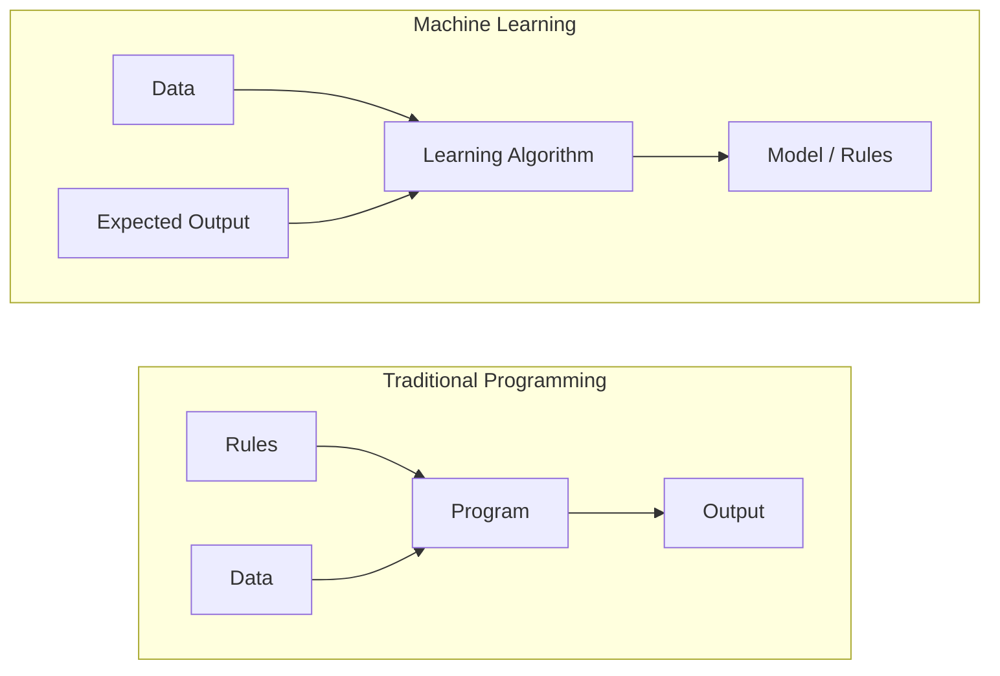
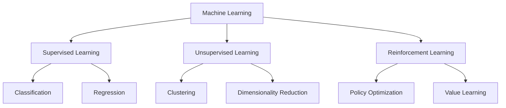
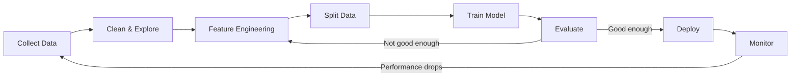
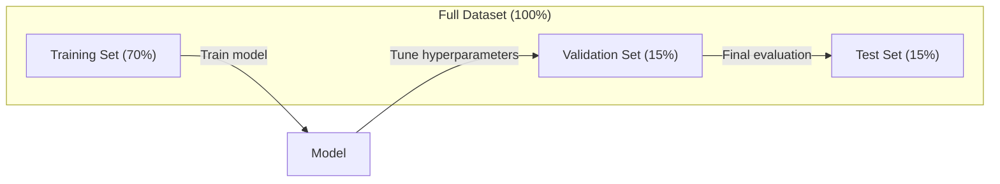
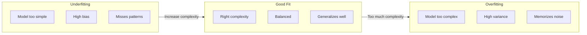
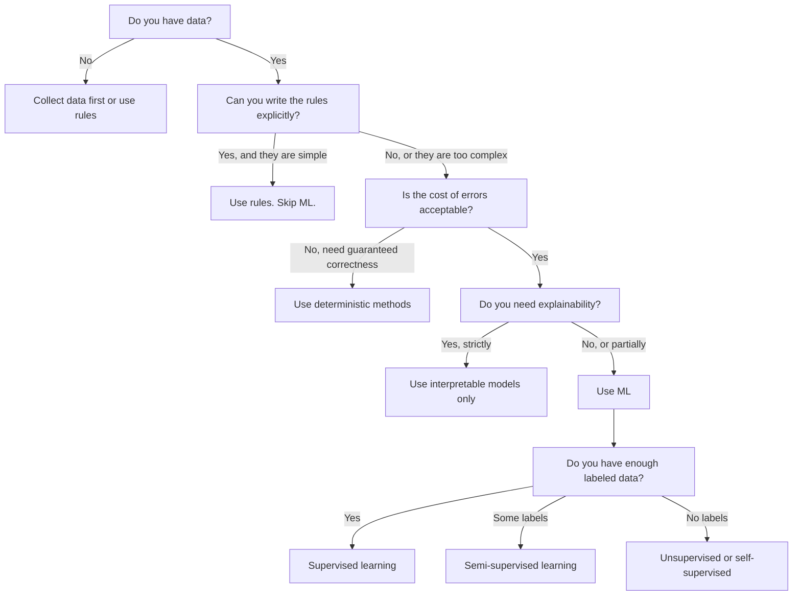

# What Is Machine Learning

> 机器学习是让计算机自己从数据中寻找规律，而不是由人手工编写规则。

**Type:** Learn
**Languages:** Python
**Prerequisites:** Phase 1 (Math Foundations)
**Time:** ~45 minutes

## Learning Objectives

- 解释监督学习、无监督学习和强化学习之间的区别，并能识别给定问题属于哪一类
- 从零实现一个最近质心分类器，并与随机基线对比评估
- 区分分类任务和回归任务，并为各自选择合适的损失函数
- 评估给定的业务问题是否适合使用 ML，还是用确定性规则就能更好地解决

## 问题场景

你要做一个垃圾邮件过滤器。传统做法：坐下来写几百条规则。"如果邮件包含 'FREE MONEY'，标记为垃圾邮件。如果有超过 3 个感叹号，标记为垃圾邮件。" 你花几周时间写规则。然后垃圾邮件发送者换了措辞，你的规则失效了，你又写更多规则。这个循环永不结束。

机器学习反过来做。你不写规则，而是给计算机成千上万封带标签的邮件（"垃圾" 或 "非垃圾"），让它自己去发现规则。计算机能找到你永远想不到的模式。当垃圾邮件发送者改变策略时，你用新数据重新训练，而不是改写代码。

这种从 "编写规则" 到 "从数据中学习" 的转变，就是机器学习的核心。每个推荐引擎、语音助手、自动驾驶汽车和语言模型都以这种方式工作。

## 核心概念

### 从数据学习，而不是写规则

传统编程和机器学习以相反的方向解决问题。



传统编程：你写规则。程序把规则应用到数据上得到输出。

机器学习：你提供数据和期望输出。算法自己发现规则。

训练出来的 "模型" **就是** 那些规则，只不过编码成了数字（权重、参数）。它从见过的例子中泛化，对从未见过的数据做出预测。

### 机器学习的三大类型



**监督学习**：你有输入-输出对。模型学习把输入映射到输出。
- "这里有 10,000 张标注了猫或狗的照片。学会区分它们。"
- "这里有房子的特征和价格。学会预测价格。"

**无监督学习**：你只有输入，没有标签。模型自己发现结构。
- "这里有 10,000 条客户购买历史。找出自然的分组。"
- "这里有 1000 条高维数据点。在保持结构的同时降到 2 维。"

**强化学习**：智能体在环境中采取行动，获得奖励或惩罚。它学习一个策略（policy）来最大化总奖励。
- "玩这个游戏。赢 +1，输 -1。自己想策略。"
- "控制这条机械臂。拿到物体 +1，每浪费一秒 -0.01。"

你在实践中构建的大多数东西都用监督学习。无监督学习常用于预处理和探索。强化学习驱动游戏 AI、机器人，以及语言模型的 RLHF。

### 不止三大类

上面三类划分很清晰，但真实世界中的 ML 常常边界模糊。

**半监督学习** 使用少量带标签数据和大量无标签数据。你可能有 100 张带标签的医学图像和 100,000 张无标签图像。技术包括：

- **标签传播**：构建一个连接相似数据点的图，标签从有标签的节点通过图扩散到无标签的邻居。
- **伪标签**：在带标签数据上训练一个模型，用它给无标签数据打标签，然后在全部数据上重新训练。模型用自己的输出自举训练集。
- **一致性正则化**：模型应该对同一个输入及其轻微扰动版本给出相同的预测。这甚至不需要标签。

**自监督学习** 从数据本身创造监督信号。完全不需要人工标签。模型从数据结构中自己构造预测任务。

- **掩码语言建模 (BERT)**：把句子里 15% 的词遮住，训练模型预测缺失的词。"标签" 来自原始文本。
- **对比学习 (SimCLR)**：取一张图像，生成两个增强版本。训练模型识别它们来自同一张图，同时区分其他图像的增强版本。
- **下一 token 预测 (GPT)**：给定所有之前的词，预测下一个词。每一篇文本都成了一个训练样本。

这些不是和三大类并列的独立类别，而是结合监督和无监督思想的策略。自监督学习严格来说属于监督学习（模型在预测东西），但标签是自动生成的，而非人工标注的。

### 分类 vs 回归

这是监督学习的两个主要任务。

| 方面 | 分类 | 回归 |
|------|------|------|
| 输出 | 离散类别 | 连续数值 |
| 例子 | "这封邮件是不是垃圾邮件？" | "这栋房子价格会是多少？" |
| 输出空间 | {猫, 狗, 鸟} | 任意实数 |
| 损失函数 | 交叉熵、准确率 | 均方误差、MAE |
| 决策 | 类之间的边界 | 拟合数据的一条曲线 |

分类回答 "属于哪一类？" 回归回答 "是多少？"

有些问题可以两种方式框架化。预测股票涨跌是分类，预测精确价格是回归。

### ML 工作流

每个机器学习项目都遵循相同的流水线，跟算法无关。



**Collect Data**：收集原始数据。更多数据几乎总是更好，但质量比数量更重要。

**Clean & Explore**：处理缺失值、去重、可视化分布、发现异常。这一步通常占项目总时间的 60–80%。

**Feature Engineering**：把原始数据变换成模型能用的特征。把日期变成星期几。归一化数值列。对类别变量做编码。好的特征比花哨的算法更重要。

**Split Data**：分成训练集、验证集和测试集。模型在训练数据上训练，你用验证集调超参数，最终性能在测试集上报。

**Train Model**：把训练数据喂给算法。算法调整内部参数来最小化损失函数。

**Evaluate**：在验证/测试数据上衡量性能。如果性能不可接受，回去换特征、换算法或换超参数。

**Deploy**：把模型投入生产，让它对新数据做预测。

**Monitor**：持续追踪性能。数据分布会变（数据漂移），模型会退化。性能下降时重新训练。

### 训练集、验证集和测试集的划分

这是初学者最容易搞错的关键概念。你必须在模型训练时从未见过的数据上评估它。否则你测到的是记忆能力，不是学习能力。



| 划分 | 用途 | 何时使用 | 典型大小 |
|------|------|----------|----------|
| 训练集 | 模型从这里学习 | 训练过程中 | 60–80% |
| 验证集 | 调超参数、比较模型 | 每次训练后 | 10–20% |
| 测试集 | 最终无偏性能估计 | 只在最后用一次 | 10–20% |

测试集是神圣的，你只看它一次。如果你根据测试集表现不停地调整模型，实际上你就在测试集上训练，报出来的数字毫无意义。

对于小数据集，用 k 折交叉验证：把数据分成 k 份，在 k-1 份上训练，在剩下那份上验证，循环轮换后取平均。

### 过拟合 vs 欠拟合



**欠拟合**：模型太简单，捕获不了数据里的模式。比如用一条直线去拟合弯曲的关系。训练误差高，测试误差也高。

**过拟合**：模型太复杂，把训练数据里的噪声一起记住了。比如一条弯弯曲曲的曲线穿过每个训练点，但在新数据上表现很差。训练误差低，测试误差高。

**良好拟合**：模型捕获了真实模式，但没有记住噪声。训练误差和测试误差都合理地低。

过拟合的征兆：
- 训练准确率远高于验证准确率
- 模型在训练数据上表现很好，但在新数据上表现很差
- 增加更多训练数据能提升表现（模型之前在记忆，不是在学习）

过拟合的修复：
- 获取更多训练数据
- 降低模型复杂度（减少参数、简化架构）
- 正则化（对大权重加惩罚项）
- Dropout（训练时随机把部分神经元置零）
- 早停（验证误差开始上升时停止训练）

欠拟合的修复：
- 使用更复杂的模型
- 添加更多特征
- 减少正则化
- 训练更久

### 偏差-方差权衡

这是过拟合和欠拟合背后的数学框架。

**偏差**：来自模型假设错误的误差。当真实关系是非线性的，线性模型就有高偏差。高偏差导致欠拟合。

**方差**：来自对训练数据中小波动敏感的误差。一个高方差的模型在不同数据子集上训练会给出差异很大的预测。高方差导致过拟合。

| 模型复杂度 | 偏差 | 方差 | 结果 |
|------------|------|------|------|
| 太低（用线性模型拟合弯曲数据） | 高 | 低 | 欠拟合 |
| 刚刚好 | 中 | 中 | 良好泛化 |
| 太高（用 20 次多项式拟合 10 个点） | 低 | 高 | 过拟合 |

总误差 = Bias² + Variance + 不可约噪声

不可约噪声你降不了（它是数据本身自带的随机性）。你要找的是 Bias² + Variance 最小的那个甜点。

### 无免费午餐定理

没有任何一个算法能在每个问题上都表现最好。某个算法在一类问题上表现好，在另一类上就会差。这也是为什么数据科学家要试多个算法然后比较结果。

实践中，选择取决于：
- 你有多少数据
- 有多少特征
- 关系是线性还是非线性
- 你是否需要可解释性
- 你能承受多少算力

### 什么时候**不该**用机器学习

ML 很强大，但不总是合适的工具。伸手找模型之前，先问自己是否真的需要。

**以下情况不要用 ML**：

- **规则简单且定义明确。** 税务计算、排序算法、单位换算。如果能用几个 if 语句写出逻辑，用模型只会平白增加复杂度。
- **你没有数据或数据极少。** ML 需要从例子中学习。10 个数据点训练不出有意义的东西。先收集数据。
- **犯错代价极高，需要保证正确性。** 医疗剂量计算、核反应堆控制、密码学验证。ML 模型是概率性的，有时会错。如果 "有时会错" 不可接受，就用确定性方法。
- **查表或启发式就能解决。** 如果一个简单阈值或查表覆盖了 99% 的情况，加 ML 只会增加维护成本而不会有有意义的提升。
- **你无法解释决策，且必须可解释。** 受监管的行业（借贷、保险、刑事司法）有时要求每个决策都能完全解释。有些 ML 模型是可解释的（线性回归、小型决策树），但大部分不是。
- **问题变化得比你能重新训练的速度快。** 如果规则每天都变，而重新训练要花一周，模型永远是过时的。

用这个决策流程图：



```figure
f3-learning-boundary
```

## Build It

`code/ml_intro.py` 里的代码从零实现了最近质心分类器——最简单的 ML 算法。它展示了核心思想：从数据中学习，然后在新数据上预测。

### 第 1 步：从零实现最近质心分类器

最近质心分类器计算训练数据中每个类别的中心（均值）。预测时，把新点分到中心距离最近的那个类别。

```python
class NearestCentroid:
    def fit(self, X, y):
        self.classes = np.unique(y)
        self.centroids = np.array([
            X[y == c].mean(axis=0) for c in self.classes
        ])

    def predict(self, X):
        distances = np.array([
            np.sqrt(((X - c) ** 2).sum(axis=1))
            for c in self.centroids
        ])
        return self.classes[distances.argmin(axis=0)]
```

这就是整个算法。Fit 算两个均值，Predict 算距离。没有梯度下降，没有迭代，没有超参数。

### 第 2 步：在合成数据上训练

我们生成一个有两个类别、略有重叠的二维分类数据集。质心分类器会在类中心之间划出一条线性决策边界。

```python
rng = np.random.RandomState(42)
X_class0 = rng.randn(100, 2) + np.array([1.0, 1.0])
X_class1 = rng.randn(100, 2) + np.array([-1.0, -1.0])
X = np.vstack([X_class0, X_class1])
y = np.array([0] * 100 + [1] * 100)
```

### 第 3 步：和基线对比

每个 ML 模型都应该和一个平凡基线对比。这里基线就是随机预测一个类别。如果你的 ML 模型赢不了随机猜，那肯定有问题。

```python
baseline_preds = rng.choice([0, 1], size=len(y_test))
baseline_acc = np.mean(baseline_preds == y_test)
```

质心分类器在这个干净的数据集上应该能达到 90%+ 的准确率，而随机基线大约 50%。

### 为什么这很重要

最近质心分类器简单到微不足道。它没有超参数，没有迭代，没有梯度下降。但它抓住了 ML 的根本模式：

1. **从训练数据中学习** 一个表示（质心）
2. **用这个表示在新数据上预测**（最近距离）
3. **和基线对比评估**（随机猜测）

每个 ML 算法，从逻辑回归到 Transformer，都遵循这个三步模式。表示会越来越复杂，但工作流保持不变。

### 第 4 步：质心分类器做不到什么

最近质心分类器假设每个类别形成一个单簇。它划线性决策边界。它在以下场景会失败：

- 类别有多个簇（比如数字 "1" 可以有好几种写法）
- 决策边界是非线性的（比如一个类环绕着另一个类）
- 特征尺度差异很大（距离会被尺度最大的那个特征主导）

这些局限就是你将要学习的其他算法的动机。K 近邻处理多簇，决策树处理非线性边界，特征缩放修复尺度问题。每一课都在前一课的局限之上构建。

## Use It

sklearn 提供了 `NearestCentroid` 和合成数据生成器：

```python
from sklearn.neighbors import NearestCentroid
from sklearn.datasets import make_classification
from sklearn.model_selection import train_test_split

X, y = make_classification(
    n_samples=500, n_features=2, n_redundant=0,
    n_clusters_per_class=1, random_state=42
)
X_train, X_test, y_train, y_test = train_test_split(X, y, test_size=0.3)

clf = NearestCentroid()
clf.fit(X_train, y_train)
print(f"Accuracy: {clf.score(X_test, y_test):.3f}")
```

## Ship It

本课产出 `outputs/prompt-ml-problem-framer.md`——一个提示词，用来把模糊的业务问题转化为具体的 ML 任务。给它一个问题描述（"我们想降低流失率" 或 "预测下个季度的需求"），它会识别学习类型、定义预测目标、列出候选特征、挑选成功指标、建立基线，并标记数据泄露或类别不平衡等陷阱。在任何 ML 项目开始时都可以用它，避免做错误的事情。

## Key Terms

| 术语 | 人们常说 | 实际含义 |
|------|----------|----------|
| Model | "The AI" | 一个带可学习参数的数学函数，把输入映射到输出 |
| Training | "Teaching the AI" | 运行优化算法来调整模型参数，使预测匹配已知输出 |
| Feature | "An input column" | 数据的一个可度量属性，模型用它来做预测 |
| Label | "The answer" | 训练样本的已知输出，用来计算误差信号 |
| Hyperparameter | "A setting you tweak" | 训练前设定的参数，控制学习过程（学习率、层数） |
| Loss function | "How wrong the model is" | 衡量预测与实际输出差距的函数，训练试图最小化它 |
| Overfitting | "It memorized the test" | 模型学到了训练特有的噪声而非一般规律，所以新数据上失败 |
| Underfitting | "It didn't learn anything" | 模型太简单，捕获不了数据里的真实模式 |
| Generalization | "It works on new data" | 模型在未参与训练的数据上做出准确预测的能力 |
| Cross-validation | "Testing on different chunks" | 反复把数据切成训练/测试折并取平均，给出更稳健的性能估计 |
| Regularization | "Keeping weights small" | 在损失函数上加惩罚项，抑制过于复杂的模型 |
| Data drift | "The world changed" | 输入数据的统计分布随时间变化，导致模型性能下降 |

## Exercises

1. 取任意数据集（比如 Iris、Titanic）。按 70/15/15 切分成训练/验证/测试。解释为什么你不应该在测试集上调超参数。
2. 列出三个真实世界问题。对每个问题，识别它是分类、回归还是聚类，以及属于监督还是无监督。
3. 一个模型在训练数据上有 99% 准确率，但测试数据上只有 60%。诊断问题并列出三个你会尝试的修复方案。

## Further Reading

- [An Introduction to Statistical Learning](https://www.statlearning.com/) — 免费教科书，覆盖所有经典 ML 方法并附实用例子
- [Google's Machine Learning Crash Course](https://developers.google.com/machine-learning/crash-course) — ML 概念的简洁视觉化入门
- [Scikit-learn User Guide](https://scikit-learn.org/stable/user_guide.html) — Python 里实现 ML 的实用参考
