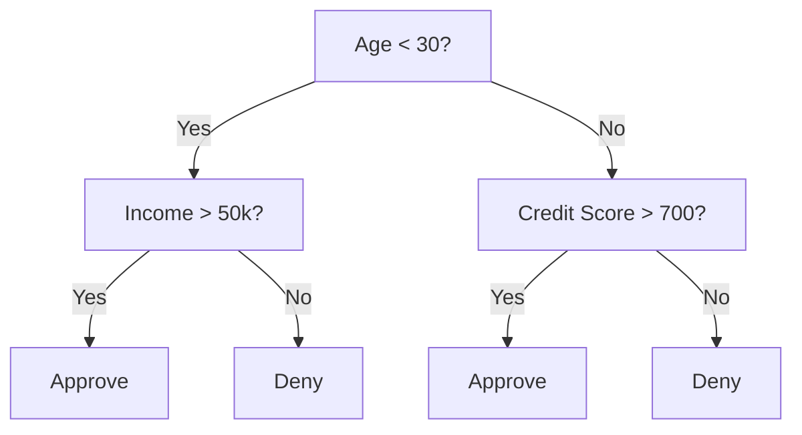
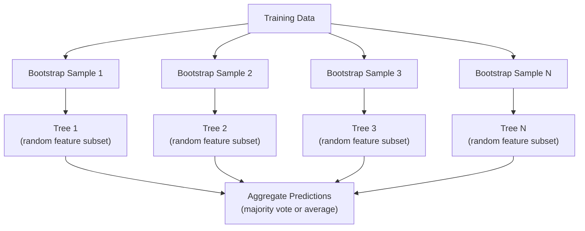

# Decision Trees and Random Forests

> 决策树就是一个流程图。但把很多棵树放在一起，它就成了 ML 里最强大的工具之一。

**Type:** Build
**Language:** Python
**Prerequisites:** Phase 1 (Lessons 09 Information Theory, 06 Probability)
**Time:** ~90 minutes

## Learning Objectives

- 实现 Gini 不纯度、熵和信息增益的计算，来找最优决策树分裂点
- 从零构建带预剪枝控制（最大深度、最小样本数）的决策树分类器
- 用 bootstrap 采样和特征随机化构建随机森林，并解释它为什么能降低方差
- 对比 MDI 特征重要性和置换重要性，并识别 MDI 何时有偏差

## 问题场景

你有表格数据。行是样本，列是特征，还有一个你想预测的目标列。你可以往上面扔个神经网络试试。但对于表格数据，基于树的模型（决策树、随机森林、梯度提升树）稳定地优于深度学习。结构化数据上的 Kaggle 竞赛被 XGBoost 和 LightGBM 主导，而不是 Transformer。

为什么？树能原生处理混合特征类型（数值 + 类别）不需要预处理。能处理非线性关系不需要特征工程。它们是可解释的：你可以看着这棵树，准确知道为什么做出了某个预测。而随机森林——把很多棵树平均起来——在中等大小的数据集上高度抗过拟合。

本课从零构建决策树（用递归分裂），然后在它上面构建随机森林。你会实现分裂准则背后的数学（Gini 不纯度、熵、信息增益），并理解为什么一堆弱学习器的集成会变强。

## 核心概念

### 决策树在做什么

决策树通过提一连串是/否问题，把特征空间划分成矩形区域。



每个内部节点对一个特征做阈值测试。每个叶节点做出一个预测。要给一个新数据点分类，你从根开始，顺着分支走到叶节点。

树是自顶向下构建的：在每个节点，挑选最能把数据分开的特征和阈值。"最能分开"由分裂准则定义。

### 分裂准则：衡量不纯度

在每个节点，我们有一组样本。我们想把它们分裂，使得到的子节点尽可能 "纯"——意思是每个子节点里大部分都是同一个类别。

**Gini 不纯度** 衡量一个随机选出的样本，按照该节点的类别分布打标签后，被分错的概率。

```
Gini(S) = 1 - sum(p_k^2)

其中 p_k 是集合 S 中类别 k 的比例。
```

纯节点（全是同一个类）时 Gini = 0。50/50 二分类时 Gini = 0.5。越低越好。

```
例：6 只猫，4 只狗

Gini = 1 - (0.6² + 0.4²) = 1 - (0.36 + 0.16) = 0.48
```

**熵** 衡量节点里的信息量（无序程度）。Phase 1 Lesson 09 覆盖过。

```
Entropy(S) = -sum(p_k * log2(p_k))
```

纯节点时熵 = 0。50/50 二分类时熵 = 1.0。越低越好。

```
例：6 只猫，4 只狗

Entropy = -(0.6 * log2(0.6) + 0.4 * log2(0.4))
        = -(0.6 * -0.737 + 0.4 * -1.322)
        = 0.442 + 0.529
        = 0.971 bits
```

**信息增益** 是分裂后不纯度（熵或 Gini）的减少量。

```
IG(S, feature, threshold) = Impurity(S) - weighted_avg(Impurity(S_left), Impurity(S_right))

权重是每个子节点中样本的比例。
```

每个节点的贪心算法：试每个特征、每个可能的阈值。挑 (feature, threshold) 对中使信息增益最大的。

### 分裂怎么进行

对于当前节点有 n 个特征和 m 个样本的数据集：

1. 对每个特征 j（j = 1 到 n）：
   - 按特征 j 对样本排序
   - 试每两个相邻不同值之间的中点作为阈值
   - 计算每个阈值的信息增益
2. 选择信息增益最高的特征和阈值
3. 把数据分裂成左（特征 <= 阈值）和右（特征 > 阈值）
4. 对每个子节点递归

这种贪心方法不保证全局最优树。找最优树是 NP-hard。但实践中贪心分裂效果很好。

### 停止条件

没有停止条件的话，树会一直长到每个叶子都是纯的（一个叶子一个样本）。这样就把训练数据完美记住了，泛化极差。

**预剪枝** 在树完全长完之前就停：
- 最大深度：树达到设定深度就停止分裂
- 每个叶子最小样本数：节点样本少于 k 就停
- 最小信息增益：最佳分裂对不纯度的改进低于阈值就停
- 最大叶节点数：限制总叶节点数

**后剪枝** 让树完全长完，再剪掉：
- 成本复杂度剪枝（scikit-learn 用的）：加一个和叶节点数成正比的惩罚项。增大惩罚就得到更小的树
- 降误差剪枝：如果验证误差不上升就移除一棵子树

预剪枝更简单更快。后剪枝通常产生更好的树，因为它不会过早停止那些可能带来有用进一步分裂的节点。

### 回归用的决策树

对于回归问题，叶节点的预测就是该叶节点中目标值的均值。分裂准则也变了：

**方差缩减** 替代信息增益：

```
VR(S, feature, threshold) = Var(S) - weighted_avg(Var(S_left), Var(S_right))
```

选方差缩减最多的分裂。树把输入空间划分成不同区域，每个区域预测一个常数（均值）。

### 随机森林：集成的威力

单棵决策树是高方差的。数据的小变化就能产生完全不同的树。随机森林通过平均很多棵树来修复这个问题。



两种随机性来源让树多样化：

**Bagging（bootstrap aggregating）**：每棵树训练在一个 bootstrap 样本上——从训练数据中**有放回**地随机抽取。原始样本大约 63% 会出现在每个 bootstrap 样本里（剩下的是 out-of-bag 样本，可用于验证）。

**特征随机化**：每次分裂时只考虑一个随机的特征子集。分类问题默认是 sqrt(n_features)。回归是 n_features/3。这防止所有树都在同一个主导特征上分裂。

核心洞察：平均很多去相关的树可以降低方差而不增加偏差。单棵树可能平庸，但集成起来就强。

### 特征重要性

随机森林天然提供特征重要性分数。最常用的方法：

**Mean Decrease in Impurity (MDI)**：对每个特征，累加它在所有树和所有用到它的节点上的总不纯度减少量。在早层分裂上产生更大不纯度减少的特征更重要。

```
importance(feature_j) = sum over all nodes where feature_j is used:
    (n_samples_at_node / n_total_samples) * impurity_decrease
```

这很快（训练时就算好），但偏向高基数特征和有很多可能分裂点的特征。

**置换重要性** 是另一种选择：打乱一个特征的值，看模型准确率下降多少。更可靠但更慢。

### 什么时候树胜过神经网络

树和森林在表格数据上统治神经网络，原因有几个：

| 因素 | 树 | 神经网络 |
|------|------|----------|
| 混合类型（数值 + 类别） | 原生支持 | 需要编码 |
| 小数据集（< 10k 行） | 工作良好 | 过拟合 |
| 特征交互 | 分裂中发现 | 需要架构设计 |
| 可解释性 | 完全透明 | 黑盒 |
| 训练时间 | 分钟 | 小时 |
| 超参数敏感度 | 低 | 高 |

当数据有空间或序列结构（图像、文本、音频）时神经网络才赢。对于扁平的特征表，树是默认选择。

```figure
decision-tree-depth
```

## Build It

### 第 1 步：Gini 不纯度和熵

从零构建两个分裂准则，验证它们对好分裂的看法一致。

```python
import math

def gini_impurity(labels):
    n = len(labels)
    if n == 0:
        return 0.0
    counts = {}
    for label in labels:
        counts[label] = counts.get(label, 0) + 1
    return 1.0 - sum((c / n) ** 2 for c in counts.values())

def entropy(labels):
    n = len(labels)
    if n == 0:
        return 0.0
    counts = {}
    for label in labels:
        counts[label] = counts.get(label, 0) + 1
    return -sum(
        (c / n) * math.log2(c / n) for c in counts.values() if c > 0
    )
```

### 第 2 步：找最佳分裂

试每个特征和每个阈值，返回信息增益最高的那个。

```python
def information_gain(parent_labels, left_labels, right_labels, criterion="gini"):
    measure = gini_impurity if criterion == "gini" else entropy
    n = len(parent_labels)
    n_left = len(left_labels)
    n_right = len(right_labels)
    if n_left == 0 or n_right == 0:
        return 0.0
    parent_impurity = measure(parent_labels)
    child_impurity = (
        (n_left / n) * measure(left_labels) +
        (n_right / n) * measure(right_labels)
    )
    return parent_impurity - child_impurity
```

### 第 3 步：构建 DecisionTree 类

递归分裂、预测和特征重要性追踪。`_build` 是树的核心：当节点纯了或碰到预剪枝限制就停，否则取最佳分裂并递归两个子节点。

```python
import random

class DecisionTree:
    def __init__(self, max_depth=None, min_samples_split=2,
                 min_samples_leaf=1, criterion="gini",
                 max_features=None):
        self.max_depth = max_depth
        self.min_samples_split = min_samples_split
        self.min_samples_leaf = min_samples_leaf
        self.criterion = criterion
        self.max_features = max_features
        self.tree = None
        self.feature_importances_ = None

    def fit(self, X, y):
        self.n_features = len(X[0])
        self.feature_importances_ = [0.0] * self.n_features
        self.n_samples = len(X)
        self.tree = self._build(X, y, depth=0)
        total = sum(self.feature_importances_)
        if total > 0:
            self.feature_importances_ = [
                fi / total for fi in self.feature_importances_
            ]

    def predict(self, X):
        return [self._predict_one(x, self.tree) for x in X]

    def _build(self, X, y, depth):
        if len(set(y)) == 1:
            return {"leaf": True, "value": y[0]}

        if self.max_depth is not None and depth >= self.max_depth:
            return self._make_leaf(y)

        if len(y) < self.min_samples_split:
            return self._make_leaf(y)

        best_feature, best_threshold, best_gain = self._best_split(X, y)

        if best_feature is None or best_gain <= 0:
            return self._make_leaf(y)

        left_X, left_y, right_X, right_y = self._split_data(
            X, y, best_feature, best_threshold
        )

        if len(left_y) < self.min_samples_leaf or len(right_y) < self.min_samples_leaf:
            return self._make_leaf(y)

        weight = len(y) / self.n_samples
        self.feature_importances_[best_feature] += weight * best_gain

        return {
            "leaf": False,
            "feature": best_feature,
            "threshold": best_threshold,
            "left": self._build(left_X, left_y, depth + 1),
            "right": self._build(right_X, right_y, depth + 1),
        }

    def _make_leaf(self, y):
        counts = {}
        for label in y:
            counts[label] = counts.get(label, 0) + 1
        return {"leaf": True, "value": max(counts, key=counts.get)}

    def _best_split(self, X, y):
        best_feature = None
        best_threshold = None
        best_gain = -1.0

        if self.max_features == "sqrt":
            k = max(1, int(math.sqrt(self.n_features)))
            feature_indices = random.sample(range(self.n_features), k)
        elif isinstance(self.max_features, int):
            if self.max_features < 1:
                raise ValueError("max_features must be at least 1 when given as an integer")
            k = min(self.max_features, self.n_features)
            feature_indices = random.sample(range(self.n_features), k)
        else:
            feature_indices = list(range(self.n_features))

        for feature_idx in feature_indices:
            values = sorted(set(X[i][feature_idx] for i in range(len(X))))
            if len(values) <= 1:
                continue

            for i in range(len(values) - 1):
                threshold = (values[i] + values[i + 1]) / 2.0
                left_y = [y[j] for j in range(len(X)) if X[j][feature_idx] <= threshold]
                right_y = [y[j] for j in range(len(X)) if X[j][feature_idx] > threshold]

                if len(left_y) < self.min_samples_leaf or len(right_y) < self.min_samples_leaf:
                    continue

                gain = information_gain(y, left_y, right_y, self.criterion)
                if gain > best_gain:
                    best_gain = gain
                    best_feature = feature_idx
                    best_threshold = threshold

        return best_feature, best_threshold, best_gain

    def _split_data(self, X, y, feature, threshold):
        left_X, left_y, right_X, right_y = [], [], [], []
        for i in range(len(X)):
            if X[i][feature] <= threshold:
                left_X.append(X[i])
                left_y.append(y[i])
            else:
                right_X.append(X[i])
                right_y.append(y[i])
        return left_X, left_y, right_X, right_y

    def _predict_one(self, x, node):
        if node["leaf"]:
            return node["value"]
        if x[node["feature"]] <= node["threshold"]:
            return self._predict_one(x, node["left"])
        return self._predict_one(x, node["right"])
```

### 第 4 步：构建 RandomForest 类

Bootstrap 采样、特征随机化和多数投票。

```python
class RandomForest:
    def __init__(self, n_trees=100, max_depth=None,
                 min_samples_split=2, max_features="sqrt",
                 criterion="gini"):
        self.n_trees = n_trees
        self.max_depth = max_depth
        self.min_samples_split = min_samples_split
        self.max_features = max_features
        self.criterion = criterion
        self.trees = []

    def fit(self, X, y):
        n = len(X)
        for _ in range(self.n_trees):
            indices = [random.randint(0, n - 1) for _ in range(n)]
            X_boot = [X[i] for i in indices]
            y_boot = [y[i] for i in indices]
            tree = DecisionTree(
                max_depth=self.max_depth,
                min_samples_split=self.min_samples_split,
                max_features=self.max_features,
                criterion=self.criterion,
            )
            tree.fit(X_boot, y_boot)
            self.trees.append(tree)

    def predict(self, X):
        all_preds = [tree.predict(X) for tree in self.trees]
        predictions = []
        for i in range(len(X)):
            votes = {}
            for preds in all_preds:
                v = preds[i]
                votes[v] = votes.get(v, 0) + 1
            predictions.append(max(votes, key=votes.get))
        return predictions
```

完整实现带所有辅助方法见 `code/trees.py`。

## Use It

用 scikit-learn，训练一个随机森林只要三行：

```python
from sklearn.ensemble import RandomForestClassifier
from sklearn.datasets import load_iris
from sklearn.model_selection import train_test_split

X, y = load_iris(return_X_y=True)
X_train, X_test, y_train, y_test = train_test_split(X, y, random_state=42)

rf = RandomForestClassifier(n_estimators=100, random_state=42)
rf.fit(X_train, y_train)
print(f"Accuracy: {rf.score(X_test, y_test):.4f}")
print(f"Feature importances: {rf.feature_importances_}")
```

实践中，梯度提升树（XGBoost、LightGBM、CatBoost）通常比随机森林更强，因为它们顺序构建树，每棵纠正前一棵的错误。但随机森林更不容易配坏，几乎不需要超参数调优。

## Ship It

本课产出 `outputs/prompt-tree-interpreter.md`——一个给业务决策者解释决策树分裂的 prompt。把训练好的树结构（深度、特征、分裂阈值、准确率）喂给它，它把模型翻译成通俗规则、排名特征重要性、标记过拟合或泄露、推荐下一步。任何时候你需要向不看代码的人解释树模型时都可以用。

## Exercises

1. 在一个有 3 类的 2D 数据集上训练单棵决策树。手动追踪分裂，画出矩形决策边界。对比 max_depth=2 和 max_depth=10 的边界。
2. 实现回归树用的方差缩减分裂。生成 y = sin(x) + 噪声的 200 个点并拟合你的回归树。画出树的分段常数预测 vs 真实曲线。
3. 构建有 1、5、10、50、200 棵树的随机森林。画出训练准确率和测试准确率 vs 树数量。观察测试准确率上升但不下降（森林抗过拟合）。
4. 在 5 个不同数据集上对比 Gini 不纯度 vs 熵作为分裂准则。测量准确率和树深。大多数情况下它们产生几乎相同的结果。解释为什么。
5. 实现置换重要性。在一个有一个噪声特征但高基数的数据集上，对比它和 MDI 重要性。MDI 会把噪声特征排很高，置换重要性不会。

## Key Terms

| 术语 | 人们常说 | 实际含义 |
|------|----------|----------|
| Decision tree | "A flowchart for predictions" | 模型，通过学习一串 if/else 分裂把特征空间划分成矩形区域 |
| Gini impurity | "How mixed the node is" | 在一个节点上随机样本被分错的概率。0 = 纯，二分类时 0.5 = 最大不纯度 |
| Entropy | "The disorder in a node" | 一个节点上的信息量。0 = 纯，二分类时 1.0 = 最大不确定性。来自信息论 |
| Information gain | "How good a split is" | 分裂后的不纯度减少量。贪心选择分裂的准则 |
| Pre-pruning | "Stop the tree early" | 通过设置最大深度、最小样本数或最小增益阈值提前停止树生长 |
| Post-pruning | "Trim the tree after" | 让树完全长完，再移除不提升验证性能的子树 |
| Bagging | "Train on random subsets" | Bootstrap aggregating。每个模型训练在不同的有放回随机样本上 |
| Random forest | "A bunch of trees" | 决策树的集成，每棵训练在 bootstrap 样本上，每次分裂只用随机特征子集 |
| Feature importance (MDI) | "Which features matter" | 每个特征贡献的总不纯度减少量，跨所有树和节点累加 |
| Permutation importance | "Shuffle and check" | 打乱一个特征的值后模型准确率的下降量。对噪声特征比 MDI 更可靠 |
| Variance reduction | "The regression version of info gain" | 回归树中信息增益的类比。选使目标方差减少最多的分裂 |
| Bootstrap sample | "Random sample with repeats" | 从原始数据集中有放回抽取的随机样本。大小相同，但有重复 |

## Further Reading

- [Breiman: Random Forests (2001)](https://link.springer.com/article/10.1023/A:1010933404324) — 原始随机森林论文
- [Grinsztajn et al.: Why do tree-based models still outperform deep learning on tabular data? (2022)](https://arxiv.org/abs/2207.08815) — 树 vs 神经网络在表格任务上的严谨对比
- [scikit-learn Decision Trees documentation](https://scikit-learn.org/stable/modules/tree.html) — 带可视化工具的实用指南
- [XGBoost: A Scalable Tree Boosting System (Chen & Guestrin, 2016)](https://arxiv.org/abs/1603.02754) — 统治 Kaggle 的梯度提升论文
