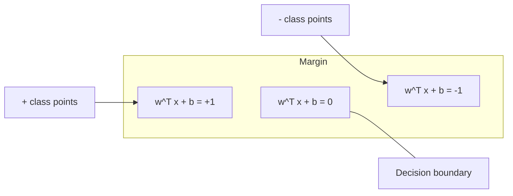
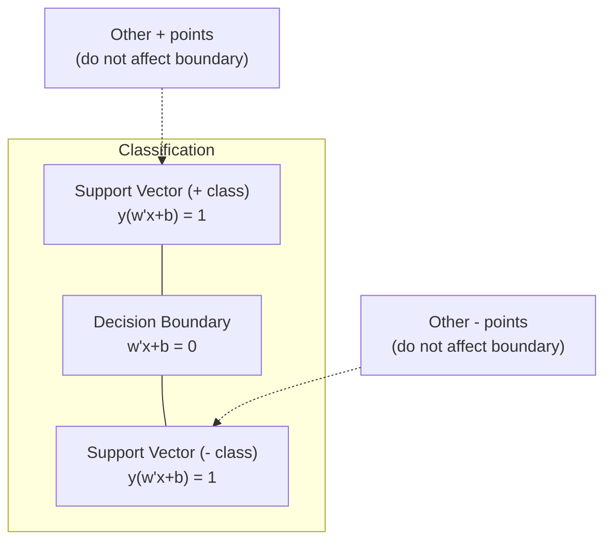
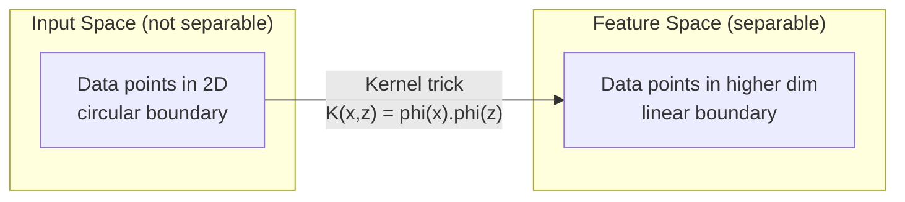

# Support Vector Machines

> 在两类之间找到最宽的那条街——这就是整个思路。

**Type:** Build
**Language:** Python
**Prerequisites:** Phase 1 (Lessons 08 Optimization, 14 Norms and Distances, 18 Convex Optimization)
**Time:** ~90 minutes

## Learning Objectives

- 用 hinge loss 和原问题形式的梯度下降从零实现线性 SVM
- 解释最大边距原理，并从训练好的模型中识别支持向量
- 对比线性、多项式和 RBF 核，解释核技巧如何避免显式的高维映射
- 评估 C 参数控制的边距宽度和分类错误之间的权衡

## 问题场景

你有两类数据点，需要画一条线（或超平面）把它们分开。能分开的线有无穷多条，应该选哪条？

选有**最大边距**那条。边距是决策边界到两侧最近数据点的距离。更宽的边距意味着分类器更自信，对未见数据泛化更好。

这个直觉导出了 Support Vector Machines——ML 中数学上最优雅的算法之一。在深度学习之前，SVM 是分类方法的王者，现在仍然是小数据集、高维数据、以及需要理论保证的原则性模型的最佳选择。

SVM 和 Phase 1 直接相连：优化是凸的（Lesson 18），边距用范数衡量（Lesson 14），核技巧利用点积来处理非线性边界——而不用真的在高维空间里计算。

## 核心概念

### 最大边距分类器

给定线性可分的数据，标签 y_i ∈ {-1, +1}，特征向量 x_i，我们想要一个超平面 w^T x + b = 0 来分隔两类。

点 x_i 到超平面的距离是：

```
distance = |w^T x_i + b| / ||w||
```

对正确分类的点：y_i * (w^T x_i + b) > 0。边距是超平面到每侧最近点距离的两倍。



优化问题：

```
maximize    2 / ||w||     （边距宽度）
subject to  y_i * (w^T x_i + b) >= 1  for all i
```

等价形式（最小化 ||w||² 更容易优化）：

```
minimize    (1/2) ||w||²
subject to  y_i * (w^T x_i + b) >= 1  for all i
```

这是一个凸二次规划问题。它有唯一全局解。恰好站在边距边界上的数据点（y_i * (w^T x_i + b) = 1）就是**支持向量**。只有它们决定决策边界。移动或删除任何非支持向量的点，边界都不变。

### 支持向量：关键的少数



大多数训练点是无关的。只有支持向量重要。这就是为什么 SVM 推理时内存高效：你只需要存支持向量，不需要整个训练集。

支持向量的数量还给出了泛化误差的上界。相对数据集来说越少的支持向量，意味着越好的泛化。

### 软边距：用 C 参数处理噪声

真实数据很少完美可分。有些点可能在错误的一侧，或落在边距里面。软边距形式通过引入松弛变量允许违规。

```
minimize    (1/2) ||w||² + C * sum(xi_i)
subject to  y_i * (w^T x_i + b) >= 1 - xi_i
            xi_i >= 0  for all i
```

松弛变量 xi_i 衡量第 i 个点违反边距的程度。C 控制权衡：

| C 值 | 行为 |
|------|------|
| 大 C | 重罚违规。窄边距，少误分类。过拟合 |
| 小 C | 允许更多违规。宽边距，多误分类。欠拟合 |

C 是正则化强度的倒数。大 C = 弱正则化。小 C = 强正则化。

### Hinge loss：SVM 的损失函数

软边距 SVM 可以改写成无约束优化：

```
minimize    (1/2) ||w||² + C * sum(max(0, 1 - y_i * (w^T x_i + b)))
```

项 max(0, 1 - y_i * f(x_i)) 就是 hinge loss。当点被正确分类且在边距外面时它是零。当点在边距里面或被错分时它线性增大。

```
单样本的 hinge loss：

loss
  |
  | \
  |  \
  |   \
  |    \
  |     \_______________
  |
  +-----|-----|-------->  y * f(x)
       0     1

y*f(x) >= 1 时损失为零（正确分类，边距外）。
y*f(x) < 1 时线性惩罚。
```

对比 logistic regression 的 logistic loss：

```
Hinge:     max(0, 1 - y*f(x))          在边距处硬截断
Logistic:  log(1 + exp(-y*f(x)))        平滑，永不精确为零
```

Hinge loss 产生稀疏解（只有支持向量有非零贡献）。Logistic loss 用所有数据点。这让 SVM 在推理时更省内存。

### 用梯度下降训练线性 SVM

你可以用梯度下降在 hinge loss + L2 正则化上训练线性 SVM，不需要解约束 QP：

```
L(w, b) = (lambda/2) * ||w||² + (1/n) * sum(max(0, 1 - y_i * (w^T x_i + b)))

对 w 的梯度：
  若 y_i * (w^T x_i + b) >= 1：  dL/dw = lambda * w
  若 y_i * (w^T x_i + b) < 1：   dL/dw = lambda * w - y_i * x_i

对 b 的梯度：
  若 y_i * (w^T x_i + b) >= 1：  dL/db = 0
  若 y_i * (w^T x_i + b) < 1：   dL/db = -y_i
```

这叫做**原问题形式**。每轮运行 O(n * d)，其中 n 是样本数，d 是特征数。对于大的、稀疏的、高维的数据（文本分类），这很快。

### 对偶问题和核技巧

SVM 问题的拉格朗日对偶（Phase 1 Lesson 18，KKT 条件）是：

```
maximize    sum(alpha_i) - (1/2) * sum_ij(alpha_i * alpha_j * y_i * y_j * (x_i . x_j))
subject to  0 <= alpha_i <= C
            sum(alpha_i * y_i) = 0
```

对偶形式只涉及数据点之间的点积 x_i . x_j。这就是关键洞察——把每个点积换成核函数 K(x_i, x_j)，SVM 就能学习非线性边界，而不用显式地计算变换。

```
Linear kernel:      K(x, z) = x . z
Polynomial kernel:  K(x, z) = (x . z + c)^d
RBF (Gaussian):     K(x, z) = exp(-gamma * ||x - z||²)
```

RBF 核把数据映射到无限维空间。输入空间里相近的点核值接近 1，很远的点接近 0。它能学习任何平滑的决策边界。



核技巧在不去高维空间的前提下，在里面计算点积。D 维上的 d 次多项式核，显式特征空间有 O(D^d) 维。但 K(x, z) 在 O(D) 时间内就能算出来。

### 回归用的 SVM（SVR）

Support Vector Regression 拟合一条宽度为 epsilon 的管子在数据周围。管子内的点损失为零，外面的点线性惩罚。

```
minimize    (1/2) ||w||² + C * sum(xi_i + xi_i*)
subject to  y_i - (w^T x_i + b) <= epsilon + xi_i
            (w^T x_i + b) - y_i <= epsilon + xi_i*
            xi_i, xi_i* >= 0
```

epsilon 参数控制管子宽度。更宽的管子 = 更少的支持向量 = 更平滑的拟合。更窄的管子 = 更多的支持向量 = 更紧的拟合。

### 为什么 SVM 输给了深度学习（以及什么时候它们仍然赢）

SVM 从 1990 年代末到 2010 年代初统治 ML。深度学习超过它们有几个原因：

| 因素 | SVM | 深度学习 |
|------|------|----------|
| 特征工程 | 需要 | 自己学特征 |
| 可扩展性 | 核 SVM O(n²) 到 O(n³) | SGD 每轮 O(n) |
| 图像/文本/音频 | 需要手工特征 | 从原始数据学习 |
| 大数据集（>100k） | 慢 | 很好扩展 |
| GPU 加速 | 收益有限 | 巨幅提速 |

SVM 在这些场景仍然赢：
- 小数据集（几百到几千样本）
- 高维稀疏数据（TF-IDF 文本）
- 需要数学保证（边距界）
- 训练时间必须很短（线性 SVM 非常快）
- 有清晰边距结构的二分类
- 异常检测（one-class SVM）

```figure
svm-margin
```

## Build It

### 第 1 步：Hinge loss 和梯度

基础。计算一个 batch 的 hinge loss 及其梯度。

```python
def hinge_loss(X, y, w, b):
    n = len(X)
    total_loss = 0.0
    for i in range(n):
        margin = y[i] * (dot(w, X[i]) + b)
        total_loss += max(0.0, 1.0 - margin)
    return total_loss / n
```

### 第 2 步：用梯度下降训练线性 SVM

通过最小化带正则化的 hinge loss 训练。不需要 QP 解算器。

```python
class LinearSVM:
    def __init__(self, lr=0.001, lambda_param=0.01, n_epochs=1000):
        self.lr = lr
        self.lambda_param = lambda_param
        self.n_epochs = n_epochs
        self.w = None
        self.b = 0.0

    def fit(self, X, y):
        n_features = len(X[0])
        self.w = [0.0] * n_features
        self.b = 0.0

        for epoch in range(self.n_epochs):
            for i in range(len(X)):
                margin = y[i] * (dot(self.w, X[i]) + self.b)
                if margin >= 1:
                    self.w = [wj - self.lr * self.lambda_param * wj
                              for wj in self.w]
                else:
                    self.w = [wj - self.lr * (self.lambda_param * wj - y[i] * X[i][j])
                              for j, wj in enumerate(self.w)]
                    self.b -= self.lr * (-y[i])

    def predict(self, X):
        return [1 if dot(self.w, x) + self.b >= 0 else -1 for x in X]
```

### 第 3 步：核函数

实现线性、多项式和 RBF 核。

```python
def linear_kernel(x, z):
    return dot(x, z)

def polynomial_kernel(x, z, degree=3, c=1.0):
    return (dot(x, z) + c) ** degree

def rbf_kernel(x, z, gamma=0.5):
    diff = [xi - zi for xi, zi in zip(x, z)]
    return math.exp(-gamma * dot(diff, diff))
```

### 第 4 步：边距和支持向量识别

训练后，识别哪些点是支持向量，并计算边距宽度。

```python
def find_support_vectors(X, y, w, b, tol=1e-3):
    support_vectors = []
    for i in range(len(X)):
        margin = y[i] * (dot(w, X[i]) + b)
        if abs(margin - 1.0) < tol:
            support_vectors.append(i)
    return support_vectors
```

完整实现带所有 demo 见 `code/svm.py`。

## Use It

用 scikit-learn：

```python
from sklearn.svm import SVC, LinearSVC, SVR
from sklearn.preprocessing import StandardScaler
from sklearn.pipeline import Pipeline

clf = Pipeline([
    ("scaler", StandardScaler()),
    ("svm", SVC(kernel="rbf", C=1.0, gamma="scale")),
])
clf.fit(X_train, y_train)
print(f"Accuracy: {clf.score(X_test, y_test):.4f}")
print(f"Support vectors: {clf['svm'].n_support_}")
```

重要：训练 SVM 之前一定要缩放特征。SVM 对特征尺度敏感，因为边距依赖于 ||w||，未缩放的特征会扭曲几何形状。

对于大数据集，用 `LinearSVC`（原问题形式，每轮 O(n)）而不是 `SVC`（对偶形式，O(n²) 到 O(n³)）：

```python
from sklearn.svm import LinearSVC

clf = Pipeline([
    ("scaler", StandardScaler()),
    ("svm", LinearSVC(C=1.0, max_iter=10000)),
])
```

## Exercises

1. 生成 2D 线性可分的数据集。训练你的 LinearSVM，识别支持向量。验证支持向量就是最靠近决策边界的点。
2. 在有噪声的数据集上，把 C 从 0.001 调到 1000。画出每个 C 值的决策边界。观察从宽边距（欠拟合）到窄边距（过拟合）的过渡。
3. 构造类别边界是圆形（非线性）的数据集。展示线性 SVM 失败。计算 RBF 核矩阵，展示在核诱导的特征空间中类变得可分。
4. 在同一数据集上对比 hinge loss vs logistic loss。训练线性 SVM 和逻辑回归。数一下有多少训练点对每个模型的决策边界有贡献（支持向量 vs 全部点）。
5. 实现 SVR（epsilon 不敏感损失）。拟合 y = sin(x) + 噪声。画出预测周围的 epsilon 管，并高亮支持向量（管子外面的点）。

## Key Terms

| 术语 | 实际含义 |
|------|----------|
| Support vectors | 最靠近决策边界的训练点。唯一决定超平面的点 |
| Margin | 决策边界和最近支持向量之间的距离。SVM 最大化这个 |
| Hinge loss | max(0, 1 - y*f(x))。正确分类且在边距外时为零，否则线性惩罚 |
| C parameter | 边距宽度和分类错误之间的权衡。大 C = 窄边距，小 C = 宽边距 |
| Soft margin | SVM 形式，通过松弛变量允许边距违规。处理不可分数据 |
| Kernel trick | 在高维特征空间中计算点积而不显式映射到那个空间 |
| Linear kernel | K(x, z) = x . z。等价于标准点积。用于线性可分数据 |
| RBF kernel | K(x, z) = exp(-gamma * \|\|x-z\|\|²)。映射到无限维。学习任何平滑边界 |
| Polynomial kernel | K(x, z) = (x . z + c)^d。映射到多项式组合的特征空间 |
| Dual formulation | SVM 问题的重述，只依赖数据点之间的点积。使核技巧成为可能 |
| SVR | Support Vector Regression。在数据周围拟合 epsilon 管。管内点损失为零 |
| Slack variables | xi_i：衡量点违反边距的程度。正确分类且在边距外的点为零 |
| Maximum margin | 选择使到两类最近点的距离最大化的超平面的原则 |

## Further Reading

- [Vapnik: The Nature of Statistical Learning Theory (1995)](https://link.springer.com/book/10.1007/978-1-4757-3264-1) — SVM 和统计学习的奠基文本
- [Cortes & Vapnik: Support-vector networks (1995)](https://link.springer.com/article/10.1007/BF00994018) — 原始 SVM 论文
- [Platt: Sequential Minimal Optimization (1998)](https://www.microsoft.com/en-us/research/publication/sequential-minimal-optimization-a-fast-algorithm-for-training-support-vector-machines/) — 让 SVM 训练变得实用的 SMO 算法
- [scikit-learn SVM documentation](https://scikit-learn.org/stable/modules/svm.html) — 带实现细节的实用指南
- [LIBSVM: A Library for Support Vector Machines](https://www.csie.ntu.edu.tw/~cjlin/libsvm/) — 大多数 SVM 实现背后的 C++ 库
