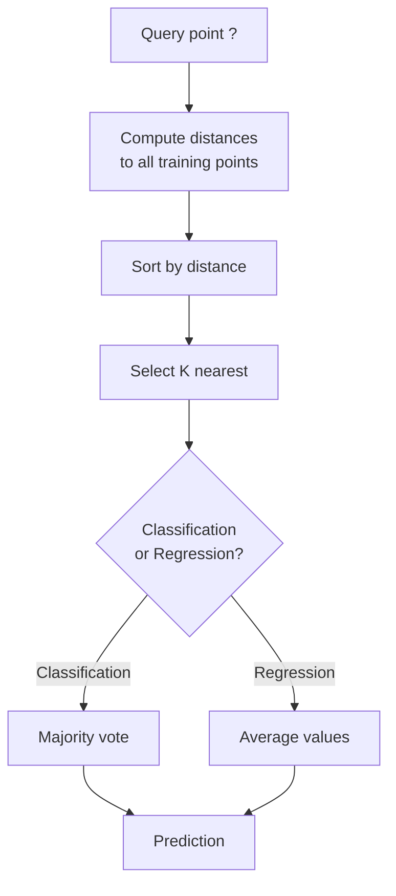
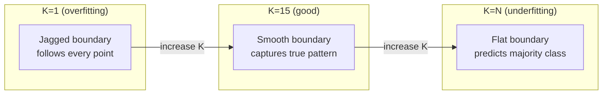
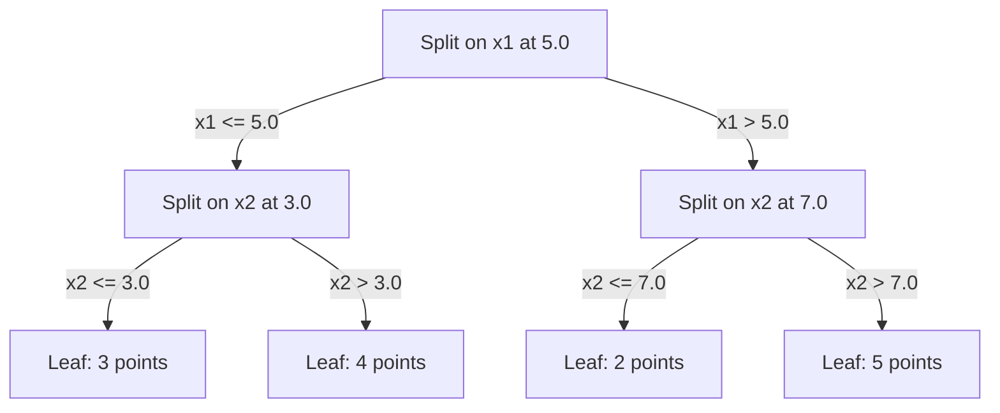

# K-Nearest Neighbors and Distances

> 把所有东西存起来。靠看邻居来预测。最简单的算法却真的能用。

**Type:** Build
**Language:** Python
**Prerequisites:** Phase 1 (Lesson 14 Norms and Distances)
**Time:** ~90 minutes

## Learning Objectives

- 从零实现带可配置 K 和距离加权投票的 KNN 分类器和回归器
- 对比 L1、L2、余弦和 Minkowski 距离度量，并为给定数据类型选择合适的度量
- 解释维度诅咒，并展示为什么 KNN 在高维空间中退化
- 构建 KD-tree 来做高效最近邻搜索，并分析它何时比暴力搜索更优

## 问题场景

你有一个数据集。一个新数据点来了。你需要给它分类或预测它的值。不从中学习参数（像线性回归或 SVM），你就找到离新点最近的 K 个训练点，让它们投票。

这就是 K 近邻。没有训练阶段。没有要学习的参数。没有要最小化的损失函数。你存下整个训练集，预测时才计算距离。

听起来简单得不像话，但 KNN 在很多问题上表现出乎意料地有竞争力，尤其是中小型数据集上。深入理解它会揭示基础概念：距离度量的选择（连到 Phase 1 Lesson 14）、维度诅咒、以及惰性学习和急切学习的区别。

KNN 在现代 AI 里到处都能看见，只是换了名字而已。向量数据库对 embedding 做 KNN 搜索。检索增强生成（RAG）找最近的 K 个文档块。推荐系统找相似用户或物品。算法是同一个，规模和数据结构不同。

## 核心概念

### KNN 怎么工作

给定带标签点的数据集和一个新的查询点：

1. 计算查询到数据集中每个点的距离
2. 按距离排序
3. 取最近的 K 个点
4. 分类：K 个邻居中的多数投票
5. 回归：K 个邻居目标值的平均（或加权平均）



这就是整个算法。不拟合。不梯度下降。不训练轮次。

### 选 K

K 是唯一的超参数。它控制偏差-方差权衡：

| K | 行为 |
|---|------|
| K = 1 | 决策边界跟着每个点走。零训练误差。高方差。过拟合 |
| 小 K（3–5） | 对局部结构敏感。能捕捉复杂边界 |
| 大 K | 边界更平滑。对噪声更鲁棒。可能欠拟合 |
| K = N | 对每个点都预测多数类。最大偏差 |

常见起点是 N 个点的数据集用 K = sqrt(N)。二分类问题用奇数 K 避免平局。



### 距离度量

距离函数定义了什么叫 "近"。不同度量产生不同邻居，不同预测。

**L2（欧几里得）** 是默认的。直线距离。

```
d(a, b) = sqrt(sum((a_i - b_i)²))
```

对特征尺度敏感。用 KNN + L2 之前一定要标准化特征。

**L1（曼哈顿）** 对差异取绝对值求和。比 L2 对异常值更鲁棒，因为它不放大大的差异。

```
d(a, b) = sum(|a_i - b_i|)
```

**余弦距离** 衡量向量之间的夹角，忽略大小。对文本和嵌入数据至关重要。

```
d(a, b) = 1 - (a . b) / (||a|| * ||b||)
```

**Minkowski** 用参数 p 把 L1 和 L2 统一。

```
d(a, b) = (sum(|a_i - b_i|^p))^(1/p)

p=1: 曼哈顿
p=2: 欧几里得
p→∞: 切比雪夫（最大绝对差）
```

用哪个取决于数据：

| 数据类型 | 最佳度量 | 为什么 |
|----------|----------|--------|
| 数值特征、尺度相近 | L2（欧几里得） | 默认，空间数据适用 |
| 数值特征、有异常值 | L1（曼哈顿） | 鲁棒，不放大大差异 |
| 文本嵌入 | 余弦 | 大小是噪声，方向才是意义 |
| 高维稀疏 | 余弦或 L1 | L2 受维度诅咒影响 |
| 混合类型 | 自定义距离 | 按特征类型组合度量 |

### 加权 KNN

标准 KNN 给所有 K 个邻居相同权重。但距离 0.1 的邻居应该比距离 5.0 的更有分量。

**距离加权 KNN** 把每个邻居按距离的倒数加权：

```
weight_i = 1 / (distance_i + epsilon)

分类：加权投票
回归：加权平均 = sum(w_i * y_i) / sum(w_i)
```

epsilon 防止查询点精确匹配训练点时除零。

加权 KNN 对 K 的选择不太敏感，因为远邻居不管怎样贡献很小。

### 维度诅咒

KNN 性能在高维空间退化。这不是模糊的担忧，而是数学事实。

**问题 1：距离收敛。** 维度升高时，最大距离和最小距离之比趋近 1。所有点变得同样 "远" 于查询。

```
随机均匀点在 d 维中：

d=2:    max_dist / min_dist = 变化很大
d=100:  max_dist / min_dist ~ 1.01
d=1000: max_dist / min_dist ~ 1.001

当所有距离几乎相等时，"最近" 就没意义了。
```

**问题 2：体积爆炸。** 要在固定比例的数据内捕获 K 个邻居，你需要把搜索半径扩大到覆盖特征空间的大得多的部分。高维中的 "邻域" 涵盖了空间的大部分。

**问题 3：角落主导。** 在 d 维单位超立方体里，大部分体积集中在角落附近，不是中心。立方体里内切的球随着 d 增大包含的体积趋近于零。

实际后果：KNN 在大约 20–50 个特征内效果不错。超过之后，在应用 KNN 之前需要先降维（PCA、UMAP、t-SNE），或用能利用数据固有低维性的树结构搜索。

### KD-tree：快速最近邻搜索

暴力 KNN 计算查询到每个训练点的距离。每个查询 O(n * d)。大数据集上太慢。

KD-tree 沿特征轴递归地对空间做分区。每一层沿一个维度的中位数分裂。



找最近邻时，先走到包含查询的叶节点，然后回溯，只有当邻居分区里可能有更近的点时才检查。

低维下平均查询时间：O(log n)。但 KD-tree 在高维（d > 20）退化到 O(n)，因为回溯时要跳过的分支越来越少。

### Ball tree：中高维更好

Ball tree 用嵌套超球分区数据，而不是轴对齐的盒子。每个节点定义一个球（中心 + 半径），包含该子树的所有点。

相对 KD-tree 的优势：
- 在中高维（到 ~50）更好用
- 处理非轴对齐的结构
- 更紧凑的包围体积意味着搜索中剪掉更多分支

KD-tree 和 ball tree 都是精确算法。对于真正大规模搜索（百万点、数百维），用近似最近邻方法（HNSW、IVF、product quantization）。Phase 1 Lesson 14 覆盖了这些。

### 惰性学习 vs 急切学习

KNN 是惰性学习器：训练时不做事，预测时做所有事。大多数其他算法（线性回归、SVM、神经网络）是急切学习器：训练时做重型计算来构建紧凑模型，然后预测很快。

| 方面 | 惰性（KNN） | 急切（SVM、神经网络） |
|------|------------|----------------------|
| 训练时间 | O(1) 只是存数据 | O(n * epochs) |
| 预测时间 | 每个查询 O(n * d) | O(d) 或 O(parameters) |
| 预测时内存 | 存整个训练集 | 只存模型参数 |
| 适应新数据 | 直接加点就行 | 重新训练模型 |
| 决策边界 | 隐式，在线计算 | 显式，训练后固定 |

惰性学习适合：
- 数据集频繁变化（加/删点不用重训）
- 只需要很少查询的预测
- 想要零训练时间
- 数据集足够小，暴力搜索很快

### 回归用的 KNN

不是多数投票，KNN 回归对 K 个邻居的目标值取平均。

```
prediction = (1/K) * sum(y_i for i in K nearest neighbors)

或距离加权：
prediction = sum(w_i * y_i) / sum(w_i)
其中 w_i = 1 / distance_i
```

KNN 回归产生分段常数（加权时分段平滑）的预测。它不能外推到训练数据范围之外。如果训练目标都在 0 到 100 之间，KNN 永远不会预测 200。

```figure
knn-smoothness
```

## Build It

### 第 1 步：距离函数

实现 L1、L2、余弦和 Minkowski 距离。这些直接连到 Phase 1 Lesson 14。

```python
import math

def l2_distance(a, b):
    return math.sqrt(sum((ai - bi) ** 2 for ai, bi in zip(a, b)))

def l1_distance(a, b):
    return sum(abs(ai - bi) for ai, bi in zip(a, b))

def cosine_distance(a, b):
    dot_val = sum(ai * bi for ai, bi in zip(a, b))
    norm_a = math.sqrt(sum(ai ** 2 for ai in a))
    norm_b = math.sqrt(sum(bi ** 2 for bi in b))
    if norm_a == 0 or norm_b == 0:
        return 1.0
    return 1.0 - dot_val / (norm_a * norm_b)

def minkowski_distance(a, b, p=2):
    if p == float('inf'):
        return max(abs(ai - bi) for ai, bi in zip(a, b))
    return sum(abs(ai - bi) ** p for ai, bi in zip(a, b)) ** (1 / p)
```

### 第 2 步：KNN 分类器和回归器

构建完整的 KNN，带可配置 K、距离度量和可选距离加权。

```python
class KNN:
    def __init__(self, k=5, distance_fn=l2_distance, weighted=False,
                 task="classification"):
        self.k = k
        self.distance_fn = distance_fn
        self.weighted = weighted
        self.task = task
        self.X_train = None
        self.y_train = None

    def fit(self, X, y):
        self.X_train = X
        self.y_train = y

    def predict(self, X):
        return [self._predict_one(x) for x in X]
```

### 第 3 步：KD-tree 做高效搜索

从零构建 KD-tree，递归地在每个维度的中位数上分裂。

```python
class KDTree:
    def __init__(self, X, indices=None, depth=0):
        # 递归地对数据做分区
        self.axis = depth % len(X[0])
        # 在当前轴的中位数上分裂
        ...

    def query(self, point, k=1):
        # 走到叶节点，然后回溯
        ...
```

完整实现带所有辅助方法和 demo 见 `code/knn.py`。

### 第 4 步：特征缩放

KNN 需要特征缩放，因为距离对特征幅度敏感。一个范围 0 到 1000 的特征会主导范围 0 到 1 的特征。

```python
def standardize(X):
    n = len(X)
    d = len(X[0])
    means = [sum(X[i][j] for i in range(n)) / n for j in range(d)]
    stds = [
        max(1e-10, (sum((X[i][j] - means[j]) ** 2 for i in range(n)) / n) ** 0.5)
        for j in range(d)
    ]
    return [[((X[i][j] - means[j]) / stds[j]) for j in range(d)] for i in range(n)], means, stds
```

## Use It

用 scikit-learn：

```python
from sklearn.neighbors import KNeighborsClassifier
from sklearn.preprocessing import StandardScaler
from sklearn.pipeline import Pipeline

clf = Pipeline([
    ("scaler", StandardScaler()),
    ("knn", KNeighborsClassifier(n_neighbors=5, metric="euclidean")),
])
clf.fit(X_train, y_train)
print(f"Accuracy: {clf.score(X_test, y_test):.4f}")
```

当数据集足够大且维度足够低时，scikit-learn 自动使用 KD-tree 或 ball tree。对高维数据，它回退到暴力搜索。你可以用 `algorithm` 参数控制。

对于大规模最近邻搜索（百万向量），用 FAISS、Annoy 或向量数据库：

```python
import faiss

index = faiss.IndexFlatL2(dimension)
index.add(embeddings)
distances, indices = index.search(query_vectors, k=5)
```

## Exercises

1. 在一个有 3 类的 2D 数据集上实现 KNN 分类。画出 K=1、K=5、K=15、K=N 的决策边界。观察从过拟合到欠拟合的过渡。
2. 在 2、5、10、50、100、500 维中生成 1000 个随机点。对每个维度，计算最大成对距离和最小成对距离的比例。画出比例 vs 维度来可视化维度诅咒。
3. 在文本分类问题上（用 TF-IDF 向量）对比 L1、L2 和余弦距离的 KNN。哪个度量准确率最好？为什么余弦对文本更优？
4. 实现 KD-tree，对 2D、10D、50D 下的 1k、10k、100k 点数据集，测量查询时间 vs 暴力搜索。在什么维度下 KD-tree 不再比暴力快？
5. 构建 y = sin(x) + 噪声的加权 KNN 回归器。对比 K=3、10、30 的未加权 KNN。展示加权能产生更平滑的预测，尤其是大 K 时。

## Key Terms

| 术语 | 实际含义 |
|------|----------|
| K-nearest neighbors | 非参数算法，通过找查询点最近的 K 个训练点来预测 |
| Lazy learning | 训练时不计算，预测时做所有工作。KNN 是典型例子 |
| Eager learning | 训练时做重型计算构建紧凑模型。大多数 ML 算法是急切的 |
| Curse of dimensionality | 高维中距离收敛、邻域扩展覆盖大部分空间，使 KNN 失效 |
| KD-tree | 沿特征轴递归分区空间的二叉树。低维下 O(log n) 查询 |
| Ball tree | 嵌套超球组成的树。中高维（到 ~50）比 KD-tree 更好用 |
| Weighted KNN | 邻居按距离倒数加权。近邻居对预测影响更大 |
| Feature scaling | 把特征归一化到可比范围。距离方法（如 KNN）必需 |
| Majority vote | 通过计数 K 个邻居中哪个类最常见来分类 |
| Brute force search | 计算到每个训练点的距离。每个查询 O(n*d)。精确但大 n 时慢 |
| Approximate nearest neighbor | 算法（HNSW、LSH、IVF）比精确搜索快得多地找近似最近点 |
| Voronoi diagram | 空间的一种分区，每个区域包含所有比任何其他训练点都更近于该训练点的点。K=1 KNN 产生 Voronoi 边界 |

## Further Reading

- [Cover & Hart: Nearest Neighbor Pattern Classification (1967)](https://ieeexplore.ieee.org/document/1053964) — KNN 奠基论文，证明它的错误率最多是贝叶斯最优的两倍
- [Friedman, Bentley, Finkel: An Algorithm for Finding Best Matches in Logarithmic Expected Time (1977)](https://dl.acm.org/doi/10.1145/355744.355745) — 原始 KD-tree 论文
- [Beyer et al.: When Is "Nearest Neighbor" Meaningful? (1999)](https://link.springer.com/chapter/10.1007/3-540-49257-7_15) — 对最近邻维度诅咒的形式化分析
- [scikit-learn Nearest Neighbors documentation](https://scikit-learn.org/stable/modules/neighbors.html) — 带算法选择的实用指南
- [FAISS: A Library for Efficient Similarity Search](https://github.com/facebookresearch/faiss) — Meta 的十亿级近似最近邻搜索库
