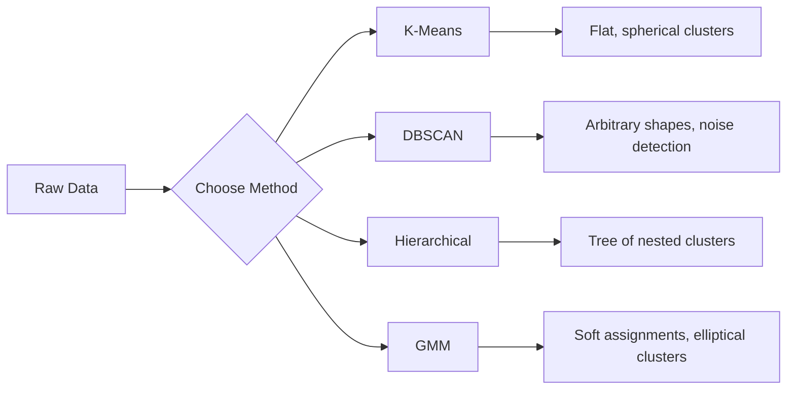

# Unsupervised Learning

> 没有标签，没有老师。算法自己发现结构。

**Type:** Build
**Languages:** Python
**Prerequisites:** Phase 1 (Norms & Distances, Probability & Distributions), Phase 2 Lessons 1-6
**Time:** ~90 minutes

## Learning Objectives

- 从零实现 K-Means、DBSCAN 和高斯混合模型，并对比它们的聚类行为
- 用轮廓分数和肘部法评估簇质量来选择最优 K
- 解释 DBSCAN 何时胜过 K-Means，识别哪个算法处理非球形簇和异常值
- 用聚类方法构建异常检测流水线，标记偏离正常模式的点

## 问题场景

到目前为止每一课都假设有带标签的数据："这是输入，这是正确输出。" 现实中标签很贵。医院有几百万病历但没人手工给每个打上疾病类别标签。电商网站有几百万用户会话但没人给客户细分打标签。安全团队有网络日志但没人标记每个异常。

无监督学习在没有被告诉要找什么的情况下发现模式。它把相似数据点分组、发现隐藏结构、标出异常。如果监督学习是从有答案的教科书学，无监督学习就是盯着原始数据直到模式自己浮现。

问题是：没有标签，你不能直接衡量 "对" 还是 "错"。你需要不同的工具来评估算法找到的结构是否有意义。

## 核心概念

### 聚类：把相似的东西分组

聚类把每个数据点分配到一个组（簇），让同组内的点互相之间比不同组的更相似。问题始终是：什么叫 "相似"？



### K-Means：主力算法

K-Means 把数据精确分成 K 个簇。每个簇有一个质心（质心就是它的质心），每个点属于最近的质心。

Lloyd 算法：

1. 选 K 个随机点作为初始质心
2. 把每个数据点分配给最近的质心
3. 把每个质心重算为其分配点的均值
4. 重复步骤 2–3 直到分配不再变化

目标函数（inertia）衡量每个点到其分配质心的总平方距离。K-Means 最小化这个值，但只找局部最优。不同初始化可能给出不同结果。

### 选 K

两种标准方法：

**肘部法：** 对 K = 1, 2, 3, ..., n 跑 K-Means。画 inertia vs K。找那个 "肘部"——再加簇不再显著减少 inertia 的位置。

**轮廓分数：** 对每个点，衡量它和自己簇（a）的相似度 vs 和最近其他簇（b）的相似度。轮廓系数是 (b - a) / max(a, b)，范围从 -1（簇分错了）到 +1（簇分得好）。所有点取平均就是全局分数。

### DBSCAN：基于密度的聚类

K-Means 假设簇是球形的并且要求你预先选 K。DBSCAN 两个都不假设。它把簇作为被稀疏区域分开的稠密区域来发现。

两个参数：
- **eps**：邻域半径
- **min_samples**：形成稠密区域所需的最少点数

三种点：
- **核心点**：eps 距离内至少有 min_samples 个点
- **边界点**：eps 内有核心点但自己不是核心点
- **噪声点**：既不是核心也不是边界。这些就是异常值。

DBSCAN 把 eps 内的核心点连成同一个簇。边界点加入附近核心点的簇。噪声点不属于任何簇。

优势：发现任意形状的簇、自动确定簇数、识别异常值。劣势：簇密度差异大时会挣扎。

### 层次聚类

构建一棵嵌套簇的树（树状图）。

自底向上（Agglomerative）：
1. 每个点自己当一个簇开始
2. 合并两个最近的簇
3. 重复直到只剩一个簇
4. 在想要的层级切树状图得到 K 个簇

簇之间的 "远近" 可以衡量为：
- **单链接（Single linkage）**：两簇任意两点的最小距离
- **全链接（Complete linkage）**：两簇任意两点的最大距离
- **平均链接（Average linkage）**：所有点对之间的平均距离
- **Ward 方法**：导致簇内总方差增加最少的合并

### 高斯混合模型（GMM）

K-Means 给硬分配：每个点精确属于一个簇。GMM 给软分配：每个点属于每个簇的概率。

GMM 假设数据来自 K 个高斯分布的混合，每个有自己的均值和协方差。Expectation-Maximization（EM）算法交替：

- **E-step**：计算每个点属于每个高斯分布的概率
- **M-step**：更新每个高斯的均值、协方差和混合权重，最大化数据的似然

GMM 能建模椭圆簇（不像 K-Means 只能球形），并且自然处理重叠簇。

### 何时用哪个

| 方法 | 最适合 | 避免当 |
|------|--------|--------|
| K-Means | 大数据集、球形簇、K 已知 | 不规则形状、有异常值 |
| DBSCAN | K 未知、任意形状、异常检测 | 密度变化、维度很高 |
| 层次 | 小数据集、需要树状图、K 未知 | 大数据集（O(n²) 内存） |
| GMM | 重叠簇、需要软分配 | 很大数据集、维度太多 |

### 用聚类做异常检测

聚类天然支持异常检测：
- **K-Means**：离任何质心都远的点就是异常值
- **DBSCAN**：噪声点按定义就是异常值
- **GMM**：所有高斯下概率都低的点就是异常值

```figure
kmeans-step
```

## Build It

### 第 1 步：从零实现 K-Means

```python
import math
import random


def euclidean_distance(a, b):
    return math.sqrt(sum((ai - bi) ** 2 for ai, bi in zip(a, b)))


def kmeans(data, k, max_iterations=100, seed=42):
    random.seed(seed)
    n_features = len(data[0])

    centroids = random.sample(data, k)

    for iteration in range(max_iterations):
        clusters = [[] for _ in range(k)]
        assignments = []

        for point in data:
            distances = [euclidean_distance(point, c) for c in centroids]
            nearest = distances.index(min(distances))
            clusters[nearest].append(point)
            assignments.append(nearest)

        new_centroids = []
        for cluster in clusters:
            if len(cluster) == 0:
                new_centroids.append(random.choice(data))
                continue
            centroid = [
                sum(point[j] for point in cluster) / len(cluster)
                for j in range(n_features)
            ]
            new_centroids.append(centroid)

        if all(
            euclidean_distance(old, new) < 1e-6
            for old, new in zip(centroids, new_centroids)
        ):
            print(f"  Converged at iteration {iteration + 1}")
            break

        centroids = new_centroids

    return assignments, centroids
```

### 第 2 步：肘部法和轮廓分数

```python
def compute_inertia(data, assignments, centroids):
    total = 0.0
    for point, cluster_id in zip(data, assignments):
        total += euclidean_distance(point, centroids[cluster_id]) ** 2
    return total


def silhouette_score(data, assignments):
    n = len(data)
    if n < 2:
        return 0.0

    clusters = {}
    for i, c in enumerate(assignments):
        clusters.setdefault(c, []).append(i)

    if len(clusters) < 2:
        return 0.0

    scores = []
    for i in range(n):
        own_cluster = assignments[i]
        own_members = [j for j in clusters[own_cluster] if j != i]

        if len(own_members) == 0:
            scores.append(0.0)
            continue

        a = sum(euclidean_distance(data[i], data[j]) for j in own_members) / len(own_members)

        b = float("inf")
        for cluster_id, members in clusters.items():
            if cluster_id == own_cluster:
                continue
            avg_dist = sum(euclidean_distance(data[i], data[j]) for j in members) / len(members)
            b = min(b, avg_dist)

        if max(a, b) == 0:
            scores.append(0.0)
        else:
            scores.append((b - a) / max(a, b))

    return sum(scores) / len(scores)


def find_best_k(data, max_k=10):
    print("Elbow method:")
    inertias = []
    for k in range(1, max_k + 1):
        assignments, centroids = kmeans(data, k)
        inertia = compute_inertia(data, assignments, centroids)
        inertias.append(inertia)
        print(f"  K={k}: inertia={inertia:.2f}")

    print("\nSilhouette scores:")
    for k in range(2, max_k + 1):
        assignments, centroids = kmeans(data, k)
        score = silhouette_score(data, assignments)
        print(f"  K={k}: silhouette={score:.4f}")

    return inertias
```

### 第 3 步：从零实现 DBSCAN

```python
def dbscan(data, eps, min_samples):
    n = len(data)
    labels = [-1] * n
    cluster_id = 0

    def region_query(point_idx):
        neighbors = []
        for i in range(n):
            if euclidean_distance(data[point_idx], data[i]) <= eps:
                neighbors.append(i)
        return neighbors

    visited = [False] * n

    for i in range(n):
        if visited[i]:
            continue
        visited[i] = True

        neighbors = region_query(i)

        if len(neighbors) < min_samples:
            labels[i] = -1
            continue

        labels[i] = cluster_id
        seed_set = list(neighbors)
        seed_set.remove(i)

        j = 0
        while j < len(seed_set):
            q = seed_set[j]

            if not visited[q]:
                visited[q] = True
                q_neighbors = region_query(q)
                if len(q_neighbors) >= min_samples:
                    for nb in q_neighbors:
                        if nb not in seed_set:
                            seed_set.append(nb)

            if labels[q] == -1:
                labels[q] = cluster_id

            j += 1

        cluster_id += 1

    return labels
```

### 第 4 步：高斯混合模型（EM 算法）

```python
def gmm(data, k, max_iterations=100, seed=42):
    random.seed(seed)
    n = len(data)
    d = len(data[0])

    indices = random.sample(range(n), k)
    means = [list(data[i]) for i in indices]
    variances = [1.0] * k
    weights = [1.0 / k] * k

    def gaussian_pdf(x, mean, variance):
        d = len(x)
        coeff = 1.0 / ((2 * math.pi * variance) ** (d / 2))
        exponent = -sum((xi - mi) ** 2 for xi, mi in zip(x, mean)) / (2 * variance)
        return coeff * math.exp(max(exponent, -500))

    for iteration in range(max_iterations):
        responsibilities = []
        for i in range(n):
            probs = []
            for j in range(k):
                probs.append(weights[j] * gaussian_pdf(data[i], means[j], variances[j]))
            total = sum(probs)
            if total == 0:
                total = 1e-300
            responsibilities.append([p / total for p in probs])

        old_means = [list(m) for m in means]

        for j in range(k):
            r_sum = sum(responsibilities[i][j] for i in range(n))
            if r_sum < 1e-10:
                continue

            weights[j] = r_sum / n

            for dim in range(d):
                means[j][dim] = sum(
                    responsibilities[i][j] * data[i][dim] for i in range(n)
                ) / r_sum

            variances[j] = sum(
                responsibilities[i][j]
                * sum((data[i][dim] - means[j][dim]) ** 2 for dim in range(d))
                for i in range(n)
            ) / (r_sum * d)
            variances[j] = max(variances[j], 1e-6)

        shift = sum(
            euclidean_distance(old_means[j], means[j]) for j in range(k)
        )
        if shift < 1e-6:
            print(f"  GMM converged at iteration {iteration + 1}")
            break

    assignments = []
    for i in range(n):
        assignments.append(responsibilities[i].index(max(responsibilities[i])))

    return assignments, means, weights, responsibilities
```

### 第 5 步：生成测试数据并跑所有东西

```python
def make_blobs(centers, n_per_cluster=50, spread=0.5, seed=42):
    random.seed(seed)
    data = []
    true_labels = []
    for label, (cx, cy) in enumerate(centers):
        for _ in range(n_per_cluster):
            x = cx + random.gauss(0, spread)
            y = cy + random.gauss(0, spread)
            data.append([x, y])
            true_labels.append(label)
    return data, true_labels


def make_moons(n_samples=200, noise=0.1, seed=42):
    random.seed(seed)
    data = []
    labels = []
    n_half = n_samples // 2
    for i in range(n_half):
        angle = math.pi * i / n_half
        x = math.cos(angle) + random.gauss(0, noise)
        y = math.sin(angle) + random.gauss(0, noise)
        data.append([x, y])
        labels.append(0)
    for i in range(n_half):
        angle = math.pi * i / n_half
        x = 1 - math.cos(angle) + random.gauss(0, noise)
        y = 1 - math.sin(angle) - 0.5 + random.gauss(0, noise)
        data.append([x, y])
        labels.append(1)
    return data, labels


if __name__ == "__main__":
    centers = [[2, 2], [8, 3], [5, 8]]
    data, true_labels = make_blobs(centers, n_per_cluster=50, spread=0.8)

    print("=== K-Means on 3 blobs ===")
    assignments, centroids = kmeans(data, k=3)
    print(f"  Centroids: {[[round(c, 2) for c in cent] for cent in centroids]}")
    sil = silhouette_score(data, assignments)
    print(f"  Silhouette score: {sil:.4f}")

    print("\n=== Elbow Method ===")
    find_best_k(data, max_k=6)

    print("\n=== DBSCAN on 3 blobs ===")
    db_labels = dbscan(data, eps=1.5, min_samples=5)
    n_clusters = len(set(db_labels) - {-1})
    n_noise = db_labels.count(-1)
    print(f"  Found {n_clusters} clusters, {n_noise} noise points")

    print("\n=== GMM on 3 blobs ===")
    gmm_assignments, gmm_means, gmm_weights, _ = gmm(data, k=3)
    print(f"  Means: {[[round(m, 2) for m in mean] for mean in gmm_means]}")
    print(f"  Weights: {[round(w, 3) for w in gmm_weights]}")
    gmm_sil = silhouette_score(data, gmm_assignments)
    print(f"  Silhouette score: {gmm_sil:.4f}")

    print("\n=== DBSCAN on moons (non-spherical clusters) ===")
    moon_data, moon_labels = make_moons(n_samples=200, noise=0.1)
    moon_db = dbscan(moon_data, eps=0.3, min_samples=5)
    n_moon_clusters = len(set(moon_db) - {-1})
    n_moon_noise = moon_db.count(-1)
    print(f"  Found {n_moon_clusters} clusters, {n_moon_noise} noise points")

    print("\n=== K-Means on moons (will fail to separate) ===")
    moon_km, moon_centroids = kmeans(moon_data, k=2)
    moon_sil = silhouette_score(moon_data, moon_km)
    print(f"  Silhouette score: {moon_sil:.4f}")
    print("  K-Means splits moons poorly because they are not spherical")

    print("\n=== Anomaly detection with DBSCAN ===")
    anomaly_data = list(data)
    anomaly_data.append([20.0, 20.0])
    anomaly_data.append([-5.0, -5.0])
    anomaly_data.append([15.0, 0.0])
    anomaly_labels = dbscan(anomaly_data, eps=1.5, min_samples=5)
    anomalies = [
        anomaly_data[i]
        for i in range(len(anomaly_labels))
        if anomaly_labels[i] == -1
    ]
    print(f"  Detected {len(anomalies)} anomalies")
    for a in anomalies[-3:]:
        print(f"    Point {[round(v, 2) for v in a]}")
```

## Use It

用 scikit-learn，同样的算法就是一行：

```python
from sklearn.cluster import KMeans, DBSCAN, AgglomerativeClustering
from sklearn.mixture import GaussianMixture
from sklearn.metrics import silhouette_score as sklearn_silhouette

km = KMeans(n_clusters=3, random_state=42).fit(data)
db = DBSCAN(eps=1.5, min_samples=5).fit(data)
agg = AgglomerativeClustering(n_clusters=3).fit(data)
gmm_model = GaussianMixture(n_components=3, random_state=42).fit(data)
```

从零实现的版本能让你准确看到这些库在算什么。K-Means 在分配和重算之间迭代。DBSCAN 从稠密种子生长簇。GMM 在期望和最大化之间交替。库版本加了数值稳定性、更聪明的初始化（K-Means++）和 GPU 加速，但核心逻辑一样。

## Ship It

本课产出 K-Means、DBSCAN 和 GMM 的完整从零实现。聚类代码可作为更高级无监督方法的基础。

## Exercises

1. 实现 K-Means++ 初始化：不是随机选质心，而是先随机选第一个，后续的质心按与其最近已有质心的距离平方成正比的概率选。把收敛速度和随机初始化对比。
2. 给代码加层次自底向上聚类。实现 Ward linkage，并产出树状图（作为合并的嵌套列表）。在不同层级切，对比 K-Means 结果。
3. 构建简单的异常检测流水线：在同一数据上跑 DBSCAN 和 GMM，标记两者都同意的异常点（DBSCAN 里是噪声，GMM 里是低概率）。测重叠率，讨论两个方法意见不一致的时候。

## Key Terms

| 术语 | 人们常说 | 实际含义 |
|------|----------|----------|
| Clustering | "Grouping similar things" | 把数据划分成子集，使组内相似度超过组间相似度，通过特定距离度量衡量 |
| Centroid | "The center of a cluster" | 分配到簇的所有点的均值；K-Means 把它作为簇的代表 |
| Inertia | "How tight the clusters are" | 每个点到其分配质心的平方距离之和；越小越紧凑 |
| Silhouette score | "How well-separated clusters are" | 对每个点，(b - a) / max(a, b)，其中 a 是簇内平均距离，b 是最近邻簇的平均距离 |
| Core point | "A point in a dense region" | 在 DBSCAN 中，一个点在 eps 距离内至少有 min_samples 个邻居 |
| EM algorithm | "Soft K-Means" | Expectation-Maximization：迭代计算成员概率（E-step）并更新分布参数（M-step） |
| Dendrogram | "A tree of clusters" | 展示层次聚类中簇合并顺序和距离的树图 |
| Anomaly | "An outlier" | 不符合预期模式的数据点，DBSCAN 标为噪声、GMM 标为低概率 |

## Further Reading

- [Stanford CS229 - Unsupervised Learning](https://cs229.stanford.edu/notes2022fall/main_notes.pdf) — Andrew Ng 关于聚类和 EM 的讲义
- [scikit-learn Clustering Guide](https://scikit-learn.org/stable/modules/clustering.html) — 带可视化例子的所有聚类算法实用对比
- [DBSCAN original paper (Ester et al., 1996)](https://www.aaai.org/Papers/KDD/1996/KDD96-037.pdf) — 引入基于密度聚类的论文
