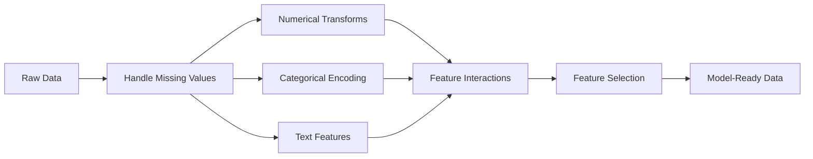

# Feature Engineering & Selection

> 一个好特征抵得上上千个数据点。

**Type:** Build
**Languages:** Python
**Prerequisites:** Phase 1 (Statistics for ML, Linear Algebra), Phase 2 Lessons 1-7
**Time:** ~90 minutes

## Learning Objectives

- 实现数值变换（标准化、min-max 缩放、log 变换、分箱）并解释各自适用的场景
- 为类别特征构建 one-hot、label 和 target 编码，并识别 target 编码中的数据泄露风险
- 从零构建 TF-IDF 向量化器，并解释为什么它对文本分类胜过原始词计数
- 应用基于过滤的特征选择（方差阈值、相关性、互信息）来降维

## 问题场景

你有一个数据集。你选了一个算法。训练它。结果平庸。你换更花哨的算法。还是平庸。你花一周调超参数。边际提升。

然后有人把原始数据变换成更好的特征，简单的逻辑回归就赢过你调过的梯度提升集成。

这经常发生。在经典 ML 里，数据的表示比算法选择更重要。一个带 "面积" 和 "卧室数" 的房价模型会赢过一个带 "原始地址字符串" 的模型，不管学习器多复杂。算法只能用你给它的东西。

特征工程是把原始数据变换成让模式更容易被模型发现的表示的过程。特征选择是丢掉那些加噪声但不加信号的特征的过程。合在一起，它们是经典 ML 中杠杆最高的活动。

## 核心概念

### 特征流水线

### 数值特征

原始数字很少是模型就绪的。常见变换：

**缩放**：把特征放到同一范围，让距离算法（K-Means、KNN、SVM）平等对待所有特征。Min-max 缩放映射到 [0, 1]。标准化（z-score）映射到 mean=0, std=1。

**Log 变换**：压缩右偏分布（收入、人口、词计数）。把乘法关系变成加法。

**分箱**：把连续值切成离散区间（年龄 → 18–29, 30–49, 50+）。捕获非线性关系。

**多项式特征**：x²、x³ 或交互项（x₁·x₂）。让线性模型捕获非线性。

### 类别特征

类别需要编码成数字。三种常见方式：

**Label 编码**：每个唯一值映射到 0, 1, 2, ...。只对有序类别有意义（低 < 中 < 高）。对无序类别（红、绿、蓝）引入虚假顺序，可能误导模型。

**One-hot 编码**：每个值变成一个二元列。对低基数（< 10）最安全。增加列数但信息无损。

**Target 编码**：每个类别替换为该类别中目标的均值。自然利用类别和目标的关系。风险：如果从完整训练集算均值会泄露目标信息。用 out-of-fold 编码防泄露。

### 文本特征

原始文本不能直接喂模型。经典方法：

**Bag of Words**：统计每个词出现多少次。简单但忽略顺序和重要性。

**TF-IDF**：词频 × 逆文档频率。常见词的权重被压低，罕见但有区分度的词权重被抬高。比原始计数好得多。

### 特征选择

三个家族：

**过滤法**：独立于模型，用统计属性选。包括方差阈值、互信息、相关性阈值。

**包装法**：把选择嵌入模型训练。递归特征消除（RFE）从所有特征开始，逐步去掉最差的。

**嵌入法**：特征重要性是训练过程的一部分。L1 正则化自动把不重要的权重驱向零；树模型的 MDI 重要性在训练中计算。

### 数据泄露

整个流水线最重要的事：任何来自测试集的信息都不能流入训练过程。

最常见的泄露方式：
- **切分前缩放/标准化**：缩放参数从完整数据算（包括测试集）
- **目标编码用完整训练集**：每个类别的目标均值从标签算出
- **有目标信息的派生特征**："这个客户上次是付费用户" 在预测是否流失时会泄露答案

规则：所有从训练集计算的参数（缩放均值、编码器映射、填充值）只能用训练集 fit，然后对训练和测试都 transform。

## Build It

### Step 1: 数值变换

### Step 2: 类别编码

### Step 3: TF-IDF 从零

### Step 4: 过滤式特征选择

（详见 `code/feature_engineering.py` 完整实现）

## Use It

## Exercises

## Key Terms

## Further Reading
