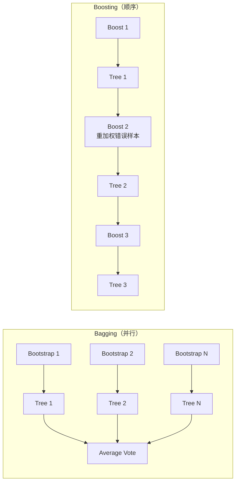

# Ensemble Methods

> 三个臭皮匠，顶个诸葛亮。

**Type:** Build
**Languages:** Python
**Prerequisites:** Phase 2 Lessons 4 (Decision Trees), 10 (Bias-Variance)
**Time:** ~90 minutes

## Learning Objectives

- 从零实现 Bagging 和 Random Forest，解释它们为什么能降低方差
- 从零实现 AdaBoost 和 Gradient Boosting，解释它们的顺序训练逻辑
- 对比 Bagging vs Boosting：并行 vs 顺序、降低方差 vs 降低偏差
- 构建 stacking 集成并解释其两阶段架构

## 核心概念

### 两种范式

**Bagging（并行）**：每棵树独立训练在一个 bootstrap 样本上。平均预测。降低方差。

**Boosting（顺序）**：后一棵树专注修正前一棵的错误。串行。降低偏差。



### AdaBoost

第 t 轮给每个样本一个权重 w_t(i)，初始 w_1(i) = 1/n。每轮训练后：
- 计算树的加权误差 ε_t
- 更新权重：w_{t+1}(i) = w_t(i) * exp(-α_t * y_i * f_t(x_i))，错分样本权重增大
- 最终预测 = sign(sum(α_t * f_t(x)))

### Gradient Boosting

拟合的不是残差而是负梯度（广义上对任意可微损失）。更灵活、更高效。

每棵新树拟合的是当前模型在所有样本上的负梯度方向（残差）。更新公式：

```
F_m(x) = F_{m-1}(x) + lr * γ_m * h_m(x)
```

其中 h_m 是拟合负梯度的树。

### Stacking

两阶段架构：第一层多个基学习器（不同算法），第二层用它们的预测作为特征训练一个元学习器。

注意：必须用 out-of-fold 预测作为第二层的输入，不能用完整训练集（否则泄露）。

## Build It

### Step 1: 从零 Bagging

### Step 2: 从零 AdaBoost

### Step 3: 从零 Gradient Boosting（回归）

（详见 `code/ensemble.py`）

## Use It

```python
from sklearn.ensemble import GradientBoostingClassifier, StackingClassifier
```

## Exercises

## Key Terms

## Further Reading
