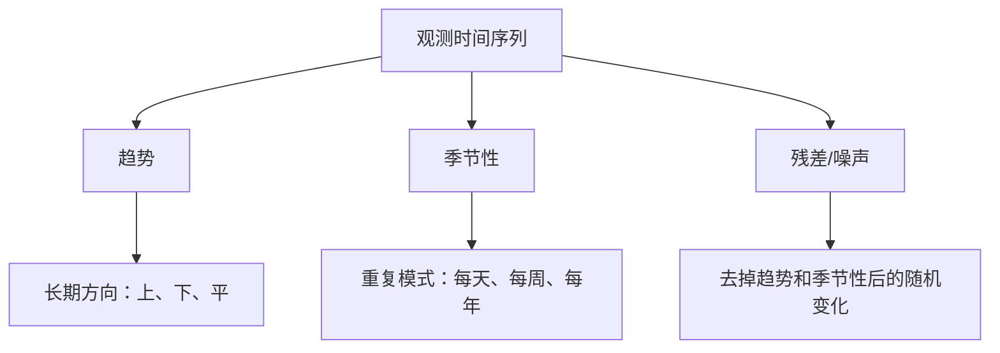

# 时间序列基础

> 过去的表现确实能预测未来——但首先得检查平稳性。

**Type:** Build
**Languages:** Python
**Prerequisites:** Phase 2, Lessons 01-09
**Time:** ~90 minutes

## Learning Objectives

- 把时间序列分解成趋势、季节性和残差分量，并做平稳性检验
- 实现滞后特征和滚动统计，把时间序列转成监督学习问题
- 构建防止未来数据泄露进训练的 walk-forward 验证框架
- 解释为什么随机 train/test 切分对时间序列无效，演示正确时间切分 vs 它的性能差距

## 问题场景

你有按时间排序的数据：日销量、小时温度、分钟 CPU 使用率、周股价。你想预测下一个值、下一周、下一季度。

你伸手拿标准 ML 工具箱：随机 train/test 切分、交叉验证、特征矩阵进、预测出。每一步都是错的。

时间序列打破了标准 ML 依赖的假设。样本不是独立的——今天的温度取决于昨天的。随机切分把未来信息泄露给了过去。回测里看起来很棒的特征在生产上失败，因为它们依赖随时间移动的模式。

随机交叉验证拿到 95% 准确率的模型，用正确时间评估可能只拿到 55%。这个差距不是细节。它是"纸上能跑的模型"和"生产上能跑的模型"之间的差别。

本课覆盖基础：时间数据怎么不同、怎么诚实地评估模型、怎么把时间序列变成标准 ML 模型能吃的特征。

## 核心概念

### 时间序列的独特之处

标准 ML 假设 i.i.d.——独立同分布。每个样本从同一分布独立抽取。时间序列违反两者：

- **不独立**：今天的股价取决于昨天的。这周的销量和上周相关。
- **不同分布**：分布随时间漂移。12 月的销量看起来和 3 月的不同。

这些违反不是小事。它们改变你怎么构建特征、怎么评估模型、用什么算法。

（mermaid 图保留：Standard ML i.i.d. vs Time Series）

标准 ML 里样本可互换。打乱没任何区别。时间序列里顺序就是一切。打乱摧毁信号。

### 时间序列的三个分量



- **趋势**：长期方向。收入每年增 10%。全球温度上升。
- **季节性**：固定间隔的重复模式。零售销量 12 月尖峰。空调使用 7 月峰值。
- **残差**：去掉趋势和季节性后剩下的。如果残差看起来像白噪声，分解就抓住了信号。

### 平稳性

如果时间序列的统计性质（均值、方差、自相关）不随时间变，它就是平稳的。大多数预测方法假设平稳性。

**为什么重要**：非平稳序列的均值会漂移。在 1 月数据上训练的模型学到的均值和 2 月要给它的不一样。它会系统性地错。

**怎么检查**：在窗口上算滚动均值和滚动标准差。如果它们漂移了，序列非平稳。

**怎么修复**：差分。不要建模原始值，建模连续值之间的变化：

```
diff[t] = value[t] - value[t-1]
```

一轮差分没让序列平稳？再应用一次（二阶差分）。真实世界序列最多两轮。

**示例**：
```
原始：[100, 102, 106, 112, 120]
一阶差分：[2, 4, 6, 8]（还在向上趋势）
二阶差分：[2, 2, 2]（常数——平稳了）
```

**正式检验**：增强 Dickey-Fuller (ADF) 检验是平稳性的标准统计检验。零假设"序列非平稳"。p-value < 0.05 可以拒绝零假设，得出平稳。本课从零实现 ADF（它需要渐近分布表），但代码里的滚动统计给了实用的可视化检查。

### 自相关

自相关衡量时间 t 的值和时间 t-k（k 步之前）的值关联多少。自相关函数（ACF）画出每个滞后 k 的这个关联。

**ACF 告诉你**：
- 序列记得多远。如果 ACF 在滞后 5 之后归零，5 步之前的值无关。
- 是否存在季节性。如果 ACF 在滞后 12（月数据）尖峰，有年季节性。
- 创建多少滞后特征。用 ACF 变得可忽略之前的那些滞后。

### 滞后特征：把时间序列转成监督学习

标准 ML 模型需要特征矩阵 X 和目标 y。时间序列只给你一列值。桥梁就是滞后特征。

（具体示例表格：lag_2, lag_1 → target 逐字保留）

现在你有了标准回归问题。任何 ML 模型（线性回归、随机森林、梯度提升）都能从滞后预测目标。

还能工程化更多特征：滚动统计（均值、std、min、max over 最近 k）、日历特征（星期几、月份）、差分值、展开统计、比率特征、交互特征。

**多少滞后？** 用自相关函数。ACF 显著到滞后 10，就至少用 10 个。有周季节性就加滞后 7（可能还有 14）。更多滞后给模型更多历史，但也给更多特征要拟合，增加过拟合风险。

**目标对齐陷阱**：创建滞后特征时，目标必须是时间 t 的值，所有特征必须用时间 t-1 或更早的值。如果你不小心把时间 t 的值作为特征，你就有了完美预测器——和完全没用的模型。这是时间序列特征工程里最常见的 bug。

### Walk-Forward 验证

这是本课最重要的概念。标准 k 折交叉验证随机分配样本到训练和测试。对时间序列，这会泄露未来信息。

（mermaid 图：Random Split 错 vs Walk-Forward 对 逐字保留）

Walk-forward 验证：
1. 在时间 t 之前的数据上训练
2. 预测时间 t+1（或 t+1 到 t+k 多步）
3. 窗口前移
4. 重复

每个测试折只包含所有训练数据之后才来的数据。没有未来泄露。给你一个诚实的估计——部署之后模型会表现得怎么样。

**扩展窗口**用所有历史数据训练（窗口增长）。**滑动窗口**用固定大小训练窗口（窗口滑动）。相信老数据还相关就用扩展窗口。世界变了、老数据有害就用滑动窗口。

### ARIMA 直觉

ARIMA 是经典时间序列模型，有三个分量：
- **AR（自回归）**：从过去值预测。AR(p) 用最后 p 个值。
- **I（整合）**：差分以达成平稳。I(d) 应用 d 轮差分。
- **MA（移动平均）**：从过去预测误差预测。MA(q) 用最后 q 个误差。

ARIMA(p, d, q) 把三者组合。我们不从零实现 ARIMA（它需要数值优化，超出本课范围）。关键是理解每个分量做什么，这样你能解读 ARIMA 结果、知道什么时候用它。

### 什么时候用什么

| 方法 | 最适合 | 处理季节性 | 处理外部特征 |
|------|--------|-----------|-------------|
| 滞后特征 + ML | 有很多外部特征的表格数据 | 加日历特征 | 是 |
| ARIMA | 单变量单序列、短期 | SARIMA 变体 | 否 |
| 指数平滑 | 简单趋势 + 季节性 | 是（Holt-Winters） | 否 |
| Prophet | 商业预测、节假日 | 是（Fourier 项） | 有限 |
| 神经网络（LSTM, Transformer） | 长序列、多序列 | 学出来 | 是 |

对大部分实际问题，滞后特征 + 梯度提升是最强起点。它自然处理外部特征，不要求平稳，容易调试。

### 常见错误

| 错误 | 为什么发生 | 怎么修 |
|------|-----------|--------|
| 随机 train/test 切分 | 标准 ML 的习惯 | 用 walk-forward 或时间切分 |
| 用了未来特征 | 不小心把时间 t 的特征包含了 | 审计每个特征的时间对齐 |
| 对季节性过拟合 | 模型记住了日历模式 | 测试集留出完整季节周期 |
| 忽略尺度变化 | 收入翻倍但模式不变 | 模型百分比变化而不是绝对值 |
| 太多滞后特征 | "更多历史更好" | 用 ACF 确定相关滞后 |

```figure
f3-series-decompose
```

## Build It

`code/time_series.py` 里的代码从零实现核心构件。

### 滞后特征创建器

```python
def make_lag_features(series, n_lags):
    n = len(series)
    X = np.full((n, n_lags), np.nan)
    for lag in range(1, n_lags + 1):
        X[lag:, lag - 1] = series[:-lag]
    valid = ~np.isnan(X).any(axis=1)
    return X[valid], series[valid]
```

### Walk-Forward 交叉验证

```python
def walk_forward_split(n_samples, n_splits=5, min_train=50):
    step = max(1, (n_samples - min_train) // n_splits)
    for i in range(n_splits):
        train_end = min_train + i * step
        test_end = min(train_end + step, n_samples)
        yield slice(0, train_end), slice(train_end, test_end)
```

### 简单自回归模型

纯 AR 模型就是在滞后特征上做线性回归（代码逐字保留）。

### 平稳性检验 + 自相关

（代码逐字保留）

## Use It

sklearn 里用 TimeSeriesSplit：

```python
from sklearn.model_selection import TimeSeriesSplit
tscv = TimeSeriesSplit(n_splits=5)
```

### 必须打败的基线

在构建任何模型之前，建立基线：
1. **最后值（持久性）**：预测明天和今天一样。很多序列上这惊人地难打败。
2. **季节朴素**：预测今天和上周同一天一样（或去年同一天）。如果模型打不过这个，它没学到季节性之外的东西。
3. **移动平均**：预测最近 k 个值的平均。平滑噪声但抓不住突变。

### 实用建议

1. **先画图**。建模之前画原始序列。找趋势、季节性、异常值、结构性断点。30 秒视觉检查告诉你的往往比一小时自动分析多。
2. **先差分，后建模**。有清晰趋势的序列，创建滞后特征之前先差分。
3. **至少留出一个完整季节周期**。周季节性就至少一周，月就至少一月。
4. **生产中监控**。时间序列模型随时间退化。追踪预测误差。开始增长时在近期数据上重训。

## Exercises

1. **平稳性实验**：生成带线性趋势的序列。用滚动统计检查平稳。应用一阶差分。再检查。二次趋势需要几轮差分？
2. **滞后选择**：在季节序列（周期=7）上算 ACF。哪些滞后自相关最高？只用那些滞后创建特征。准确率比用 1 到 7 连续滞后有提升吗？
3. **Walk-Forward vs 随机切分**：在滞后特征上训练 Ridge。用随机 80/20 切分和 walk-forward 验证评估。随机切分高估了多少性能？
4. **多步预测**：修改 AR 模型预测 5 步而不是 1 步。对比两种策略：(a) 预测 1 步，用预测当下一个输入（递归），(b) 为每个 horizon 训练单独模型（直接）。哪个更准？

## Key Terms

| 术语 | 人们常说 | 实际含义 |
|------|----------|----------|
| 平稳性 | "统计不随时间变" | 均值、方差和自相关结构恒定的序列 |
| 差分 | "减相邻值" | 计算 y[t] - y[t-1] 来移除趋势达成平稳 |
| 自相关 (ACF) | "序列和自己的相关性" | 时间序列和滞后副本之间的相关性，作为滞后的函数 |
| 滞后特征 | "过去值当输入" | 用 y[t-1], y[t-2], ..., y[t-k] 当特征预测 y[t] |
| Walk-forward 验证 | "尊重时间的交叉验证" | 训练数据总是时间上先于测试数据的评估 |
| ARIMA | "经典时间序列模型" | AutoRegressive Integrated Moving Average |
| 季节性 | "重复日历模式" | 序列里和日历周期（每天、每周、每年）相关的规律周期 |
| 趋势 | "长期方向" | 序列水平随时间的持续增或减 |

## Further Reading

- [Hyndman & Athanasopoulos, Forecasting: Principles and Practice (3rd)](https://otexts.com/fpp3/)——时间序列预测最好的免费教材
- [M5 Competition (2022)](https://www.sciencedirect.com/science/article/pii/S0169207021001874)——大规模预测竞赛，ML 方法 vs 统计方法
