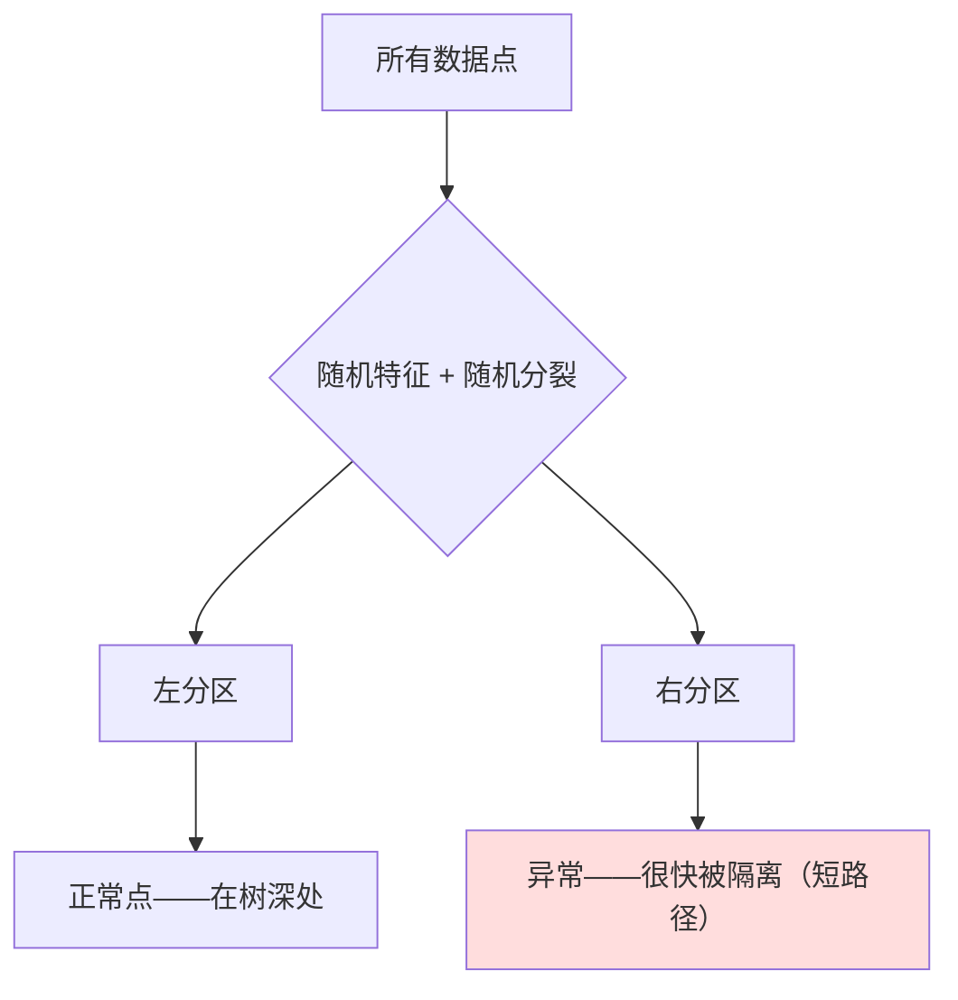

# 异常检测

> 正常好定义。异常就是不 fit 的任何东西。

**Type:** Build
**Languages:** Python
**Prerequisites:** Phase 2, Lessons 01-09
**Time:** ~75 minutes

## Learning Objectives

- 从零实现 Z-score、IQR 和孤立森林异常检测方法
- 区分点、上下文和集体异常，为每类选合适的检测方法
- 解释为什么异常检测被框定为建模正常数据而不是分类异常
- 对比无监督异常检测与监督分类，评估新颖异常覆盖和精确率之间的权衡

## 问题场景

一张信用卡下午 2 点在纽约用了，2:05 在东京又用了。工厂传感器正常范围 80-120° 却读了 150°。服务器日均 200 请求/秒却发了 50000。

这些是异常。找到它们很重要。欺诈亏几十亿。设备故障导致停机。网络入侵亏数据。

挑战：你很少有标注的异常样本。欺诈占交易的 0.1%。设备故障一年发生几次。你训练不了标准分类器，因为"异常"类几乎没东西可学。即使有一些标签，你见过的异常也不是你会遇到的唯一类型。明天的欺诈方案长得和今天的不一样。

异常检测翻转问题。不学什么是异常，学什么是正常。偏离正常的任何东西都可疑。不用标签也能工作、适应新类型的异常、能扩展到海量数据。

## 核心概念

### 三种异常类型

- **点异常**：单个数据点不管上下文都不寻常。500° 的温度读数。通常花 $50 却花了 $50000 的交易。
- **上下文异常**：给定上下文时不寻常。90° 在夏天正常，在冬天异常。相同值，不同上下文。
- **集体异常**：一组点作为一个序列不寻常，即使每个点单独看可能正常。5 次登录失败正常。50 次连在一起就是暴力破解攻击。

（mermaid 图保留：三种异常类型可视化）

### 无监督框定

三种情况：
1. **完全无监督**：没标签。在所有数据上拟合检测器，希望异常足够稀少不破坏"正常"模型。
2. **半监督**：只有干净的正常数据集。在干净集上拟合、给所有其他东西打分。这是能做到的最强设置。
3. **弱监督**：有少量标注异常。用来评估，不训练。无监督训练后在标注子集上测 precision/recall。

关键洞察：异常检测根本上不同于分类。你建模的是正常数据的分布，不是两类之间的决策边界。

### Z-Score 方法

最简单的方法。算每特征的均值和标准差。标记任何均值超过 k 倍标准差的点。

```
z_score = (x - mean) / std
异常 if |z_score| > threshold
```

默认阈值 3.0（高斯分布下 99.7% 的正常数据落在 3σ 内）。

### IQR 方法

比 Z-score 更鲁棒。用四分位距代替均值和标准差。

```
Q1 = 25th 百分位
Q3 = 75th 百分位
IQR = Q3 - Q1
lower = Q1 - factor · IQR
upper = Q3 + factor · IQR
异常 if x < lower or x > upper
```

默认因子 1.5。

### 孤立森林

关键洞察：异常少而且与众不同。在数据的随机划分里，异常更容易被隔离——它们需要更少的随机分裂就能从其余部分分离。



**异常分数**基于所有树的平均路径长度，按随机二叉搜索树的期望路径长度归一化：

```
score(x) = 2^(-平均路径长度(x) / c(n))
```

接近 1 意味着异常。接近 0.5 意味着正常。接近 0 意味着非常正常（在密集簇深处）。

### LOF（局部离群因子）

LOF 把一个点附近的局部密度和它邻居附近的密度对比。稀疏区域里被密集区域包围的点是异常的。

LOF ≈ 1.0 意味着和邻居密度相似（正常）。LOF > 1.0 意味着比邻居密度低（潜在异常）。LOF 远大于 1.0（比如 2.0+）意味着显著更低（可能异常）。

### 方法对比

| 方法 | 假设 | 速度 | 高维 | 局部异常 |
|------|------|------|------|----------|
| Z-score | 正态分布 | 极快 | 是（每特征） | 否 |
| IQR | 无（每特征） | 极快 | 是（每特征） | 否 |
| 孤立森林 | 无 | 快 | 是 | 部分 |
| LOF | 距离有意义 | 慢 | 差 | 是 |

### 评估挑战

- **极端类别不平衡**：0.1% 异常时，预测全"正常"也有 99.9% 准确率。Accuracy 没用。
- **AUROC 有误导性**：重不平衡下 AUROC 能看起来很好但实际阈值上漏掉大部分异常。
- **更好的指标**：Precision@k（top k 标记里有多少真异常）、AUPRC（precision-recall 曲线下面积）、固定假阳性率下的 recall。

```figure
f3-anomaly-fence
```

## Build It

`code/anomaly_detection.py` 从零实现 Z-score、IQR 和孤立森林。

### Z-Score 检测器

```python
def zscore_detect(X, threshold=3.0):
    mean = X.mean(axis=0)
    std = X.std(axis=0)
    std[std == 0] = 1.0
    z = np.abs((X - mean) / std)
    return z.max(axis=1) > threshold
```

### IQR 检测器

```python
def iqr_detect(X, factor=1.5):
    q1 = np.percentile(X, 25, axis=0)
    q3 = np.percentile(X, 75, axis=0)
    iqr = q3 - q1
    lower = q1 - factor * iqr
    upper = q3 + factor * iqr
    outside = (X < lower) | (X > upper)
    return outside.any(axis=1)
```

### 从零孤立森林

（IsolationTree + IsolationForest 类代码逐字保留）

### 演示场景

代码生成多个测试场景：
1. **带异常的单簇**：2D 高斯簇注入远离中心的异常。所有方法应该有效。
2. **多模态数据**：不同大小和密度的三个簇。簇之间的点是异常。Z-score 因为每特征范围宽而挣扎。
3. **高维数据**：50 个特征，但异常在其中只 5 个上不同。测试方法能不能在子集里找到异常。

## Use It

sklearn 里：

```python
from sklearn.ensemble import IsolationForest
from sklearn.neighbors import LocalOutlierFactor

iso = IsolationForest(n_estimators=100, contamination=0.05)
iso.fit(X_train)
predictions = iso.predict(X_test)
```

contamination 参数只影响阈值，不影响底层分数。不知道真实异常率就设为 "auto"，直接用原始分数。

### 生产考虑

1. **阈值漂移**：数据分布变了，固定阈值过时了。监控异常分数分布，定期调整。
2. **告警疲劳**：太多误报，操作员就不听了。从高阈值开始，信任建立了再降。
3. **集成方法**：生产上组合多个检测器。只有多个方法都同意才标记点。显著降低误报。
4. **反馈循环**：操作员标记的真异常/假异常要积累起来，用来评估和调优检测器。

## Ship It

- `outputs/skill-anomaly-detector.md`——选对检测器的决策 skill
- `code/anomaly_detection.py`——Z-score、IQR、孤立森林从零实现

## Exercises

1. **阈值调优**：Z-score 检测器阈值从 1.0 到 5.0 步长 0.5。画每个阈值的 precision 和 recall。甜点在哪？
2. **局部异常**：创建 2D 数据，每个特征单独看正常但组合起来异常。Z-score 按特征会漏这些，但孤立森林能抓到。
3. **从零 LOF**：用 k 近邻实现 Local Outlier Factor。和 sklearn 的 LocalOutlierFactor 对比。试 k=10 和 k=50——k 的选择怎么影响结果？
4. **实时异常检测**：修改 Z-score 检测器在流式设置下工作：新点到就更新运行均值和方差（Welford 在线算法）。和批量 Z-score 对比。

## Key Terms

| 术语 | 人们常说 | 实际含义 |
|------|----------|----------|
| 异常 | "离群点、奇怪值" | 显著偏离正常数据预期模式的点 |
| 孤立森林 | "随机分裂找异常" | 孤立树的集成，异常比正常点用更少分裂被隔离 |
| LOF | "和邻居比密度" | 标记局部密度显著低于邻居密度的点 |
| Z-score | "离均值多少标准差" | (x - mean) / std，用标准差单位衡量点离中心有多远 |
| IQR | "四分位距" | Q3 - Q1，用稳健百分位测量数据中间 50% 的散布 |
| Contamination | "预期异常比例" | 告诉检测器应该标记多少比例为异常的超参数 |
| Precision@k | "top k 标记里多少真的是" | 只在最可疑的 k 个点上算的 precision |
| AUPRC | "precision-recall 曲线下面积" | 跨所有阈值的 precision-recall 总结，不平衡数据上比 AUROC 好 |

## Further Reading

- [Liu et al., Isolation Forest (2008)](https://cs.nju.edu.cn/zhouzh/zhouzh.files/publication/icdm08b.pdf)——孤立森林原论文
- [Breunig et al., LOF (2000)](https://dl.acm.org/doi/10.1145/342009.335388)——LOF 原论文
- [Chandola et al., Anomaly Detection: A Survey (2009)](https://dl.acm.org/doi/10.1145/1541880.1541882)——异常检测方法综合综述
