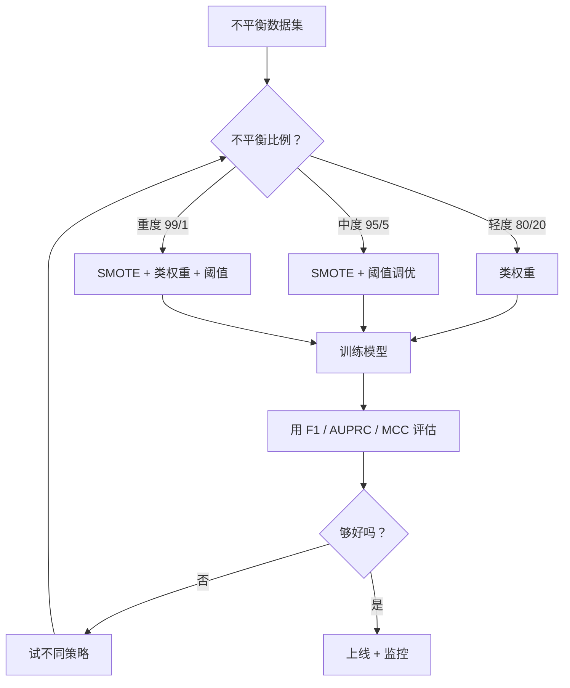
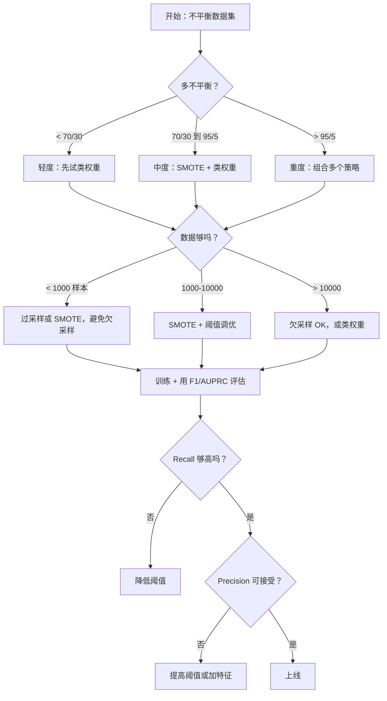

# 处理不平衡数据

> 当 99% 的数据是"正常"时，accuracy 就是谎言。

**Type:** Build
**Languages:** Python
**Prerequisites:** Phase 2, Lessons 01-09 (尤其评估指标)
**Time:** ~90 minutes

## Learning Objectives

- 从零实现 SMOTE，解释合成过采样和随机复制的区别
- 用 F1、AUPRC 和 Matthews 相关系数评估不平衡分类器，而不是 accuracy
- 对比类权重、阈值调优和重采样策略，为给定不平衡比例选合适的方法
- 构建结合 SMOTE、类权重和阈值优化的完整不平衡数据流水线

## 问题场景

你构建了欺诈检测模型。它拿到 99.9% accuracy。你庆祝。然后你发现它对每笔交易都预测"非欺诈"。

这不是 bug。当只有 0.1% 的交易是欺诈时，这是理性做法。模型学到总是猜多数类最小化总误差。它技术上正确、完全没用。

这在所有有意义的真实分类里发生：疾病诊断（1% 阳性率）、网络入侵（0.01% 攻击）、制造缺陷（0.5% 有缺陷）、垃圾邮件过滤（20% 垃圾）、客户流失预测（5% 流失者）。少数类越重要，它往往越稀少。

Accuracy 失败因为它平等对待所有正确预测。正确标记合法交易和正确抓到欺诈都算一个 accuracy 点。但抓欺诈是模型存在的全部原因。我们需要指标、技术和训练策略强迫模型关注稀少但重要的类。

## 核心概念

### 为什么 Accuracy 失败

（990 负/10 正的混淆矩阵示例逐字保留，展示 accuracy=99% 但 TP=0）

### 更好的指标

- **Precision** = TP / (TP + FP)。标记为正的里面多少真的是。高 precision 意味着少误报。
- **Recall** = TP / (TP + FN)。实际为正的里面抓到多少。高 recall 意味着少漏报。
- **F1 Score** = 2 · P · R / (P + R)。调和平均。比算术平均更惩罚 precision 和 recall 之间的极端不平衡。
- **F-beta Score** = (1 + β²) · P · R / (β² · P + R)。β > 1 时 recall 更重要。β < 1 时 precision 更重要。欺诈检测里 F2 常见（漏欺诈比误报更糟）。
- **AUPRC**（Precision-Recall 曲线下面积）。像 AUC-ROC 但对不平衡数据更有信息量。随机分类器的 AUPRC 等于正类比例（不是 0.5），改进更容易看出来。
- **Matthews 相关系数** = (TP·TN - FP·FN) / sqrt((TP+FP)(TP+FN)(TN+FP)(TN+FN))。范围 -1 到 +1。只有模型在两类上都表现好时才给高分。

### 不平衡数据流水线



### SMOTE：合成少数类过采样技术

随机过采样复制现有少数样本。这能用但有过拟合风险，因为模型反复看到相同点。

SMOTE 创建合理但不是拷贝的合成少数样本。算法：

1. 对每个少数样本 x，在其他少数样本中找 k 个最近邻居
2. 随机挑一个邻居
3. 在 x 和那个邻居之间的线段上创建新样本

公式：`new_sample = x + random(0, 1) · (neighbor - x)`

（mermaid 图 + 三步可视化保留）

### 采样策略对比

| 策略 | 数据变动 | 风险 | 何时用 |
|------|----------|------|--------|
| 过采样 | 少数类复制 | 过拟合 | 小数据集、中度不平衡 |
| 欠采样 | 多数类移除 | 信息丢失 | 大数据集、想快训练 |
| SMOTE | 添加合成少数 | 边界噪声 | 中度不平衡、足够少数样本做 k-NN |

### 类权重

不改变数据，改变模型怎么对待错误。给错误分类少数类更高的权重。

对 950 负 / 50 正：
- 负类权重 = n_samples / (2 · n_negative) = 1000 / (2 · 950) = 0.526
- 正类权重 = n_samples / (2 · n_positive) = 1000 / (2 · 50) = 10.0

正类拿到 19× 权重。错分类一个正样本的代价等于错分类 19 个负样本。

类权重在期望上数学等价于过采样，但不创建新数据点。更快、避免重复样本的过拟合风险。

### 阈值调优

大部分分类器输出概率。默认阈值 0.5。但 0.5 是任意的。不平衡数据下最优阈值通常更低。

过程：
1. 训练模型
2. 验证集上拿到预测概率
3. 阈值从 0.0 扫到 1.0
4. 每个阈值算 F1（或你选的指标）
5. 选最大化指标的阈值

### 代价敏感学习

类权重的推广。不是均匀代价，分配具体错分代价（矩阵示例逐字保留）。

### 决策流程图



```figure
class-imbalance
```

## Build It

### 从零 SMOTE

```python
def smote(X_minority, k=5, n_synthetic=100, seed=42):
    rng = np.random.RandomState(seed)
    n_samples = len(X_minority)
    k = min(k, n_samples - 1)
    synthetic = []
    for _ in range(n_synthetic):
        idx = rng.randint(0, n_samples)
        neighbors = find_k_neighbors(X_minority, idx, k)
        neighbor_idx = neighbors[rng.randint(0, len(neighbors))]
        t = rng.random()
        new_point = X_minority[idx] + t * (X_minority[neighbor_idx] - X_minority[idx])
        synthetic.append(new_point)
    return np.array(synthetic)
```

### 带类权重的逻辑回归 + 阈值调优

（全部 Python 代码逐字保留）

## Use It

sklearn + imbalanced-learn 里：

```python
from sklearn.linear_model import LogisticRegression
from imblearn.over_sampling import SMOTE
from imblearn.pipeline import Pipeline

smote = SMOTE(random_state=42)
X_resampled, y_resampled = smote.fit_resample(X_train, y_train)
model = LogisticRegression(class_weight="balanced")
```

从零实现展示了每个方法内部到底做什么。SMOTE 就是少数类上的 k-NN 插值。类权重给 loss 乘权重。阈值调优就是 cutoff 上的 for 循环。没有魔法。

## Exercises

1. **Borderline-SMOTE**：修改 SMOTE 只在决策边界附近的少数点（k 近邻里有多数类样本）生成合成样本。和标准 SMOTE 对比。
2. **代价矩阵优化**：实现代价敏感学习，代价矩阵当参数。创建函数带代价矩阵返回最小化期望代价的最优预测。试不同代价比（1:10, 1:100, 1:1000）。
3. **阈值校准**：实现 Platt scaling（对模型原始输出拟合逻辑回归来产生校准概率）。校准前后 precision-recall 曲线对比。
4. **不平衡比例实验**：在平衡数据集上逐步增加不平衡比例（50/50 → 70/30 → 90/10 → 95/5 → 99/1）。每个比例分别用和不用 SMOTE 训练。画 F1 vs 不平衡比例。SMOTE 在哪个比例开始有意义？

## Key Terms

| 术语 | 人们常说 | 实际含义 |
|------|----------|----------|
| 类不平衡 | "一个类样本远多" | 数据集中类分布严重偏斜，导致模型倾向多数类 |
| SMOTE | "合成过采样" | 在现有少数样本及其 k 近邻之间插值创建新的少数样本 |
| 类权重 | "让稀有类错误更贵" | 给 loss 乘类特定权重，让模型对少数类错分惩罚更重 |
| 阈值调优 | "移动决策边界" | 把分类概率 cutoff 从 0.5 改到最大化期望指标的值 |
| Precision-Recall 权衡 | "你不能两者都要" | 降低阈值抓到更多正（更高 recall）但也标记更多误报（更低 precision），反之亦然 |
| AUPRC | "PR 曲线下面积" | 总结 PR 曲线为一个数；重不平衡时比 AUC-ROC 信息量更大 |
| MCC | "平衡指标" | 预测和真实标签之间的相关，只有模型在两类上都好时才给高分 |
| 代价敏感学习 | "不同错误代价不同" | 把真实世界错分代价加进训练目标，让模型优化总代价而不是错误数 |

## Further Reading

- [SMOTE 原论文 (Chawla et al., 2002)](https://arxiv.org/abs/1106.1813)——不平衡学习最被引用的工作
- [Learning from Imbalanced Data (He & Garcia, 2009)](https://ieeexplore.ieee.org/document/5128907)——覆盖采样、代价敏感、算法方法的综合综述
- [The Precision-Recall Plot Is More Informative (Saito & Rehmsmeier, 2015)](https://journals.plos.org/plosone/article?id=10.1371/journal.pone.0118432)——什么时候以及为什么不平衡问题上 PR 曲线优于 ROC 曲线
