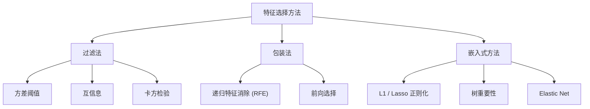
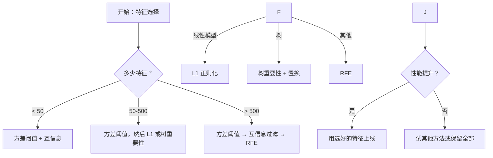

# 特征选择

> 更多特征不是更好。对的特征才是更好。

**Type:** Build
**Languages:** Python
**Prerequisites:** Phase 2, Lessons 01-09, 08 (特征工程)
**Time:** ~75 minutes

## Learning Objectives

- 从零实现过滤法（方差阈值、互信息、卡方）和包装法（RFE、前向选择）
- 解释为什么互信息能捕获关联漏掉的非线性特征-目标关系
- 对比 L1 正则化（嵌入式选择）和 RFE（包装选择），评估它们的计算权衡
- 构建结合多个方法的特征选择流水线，演示留出数据上泛化更好

## 问题场景

你有 500 个特征。模型训练慢、持续过拟合、没人能解释它学了什么。你加更多特征希望提升性能。结果更糟。

这是维数诅咒在行动。特征数增长时，特征空间体积爆炸。数据点变稀疏。点间距离收敛。模型需要指数倍更多数据来找到真实模式。噪声特征淹没信号特征。过拟合变成默认。

特征选择是解药。剥离噪声、移除冗余、保留携带目标实际信息的特征。结果：训练更快、泛化更好、模型能解释。

目标不是用所有可用信息。是用对的信息。

## 核心概念

### 三类特征选择方法



**过滤法**不用模型、用统计量独立给每个特征打分。快，但漏掉特征交互。

**包装法**训练模型评估特征子集。用模型性能当分数。结果更好但昂贵（重训模型很多次）。

**嵌入式方法**作为模型训练的一部分选特征。L1 正则化把权重驱到零。决策树在最有用的特征上分裂。选择发生在拟合时，不是单独的步骤。

### 方差阈值

最简单的过滤法。一个特征跨样本几乎不变，就几乎不带信息。

设阈值（比如 0.01）。丢掉每个方差低于它的特征。这在看目标变量之前就移除了常数或近常数特征。

限制：一个特征可以方差高但全是噪声。方差阈值必要但不充分。

### 互信息

互信息衡量知道特征 X 的值能减少多少目标 Y 的不确定性。

```
I(X; Y) = Σ_x Σ_y p(x, y) · log(p(x, y) / (p(x) · p(y)))
```

如果 X 和 Y 独立，I(X; Y) = 0。X 告诉你 Y 越多，互信息越高。

关键优势：捕获非线性关系。特征和目标可能零相关但高互信息（因为关系是二次或周期的）。

### 递归特征消除 (RFE)

包装法。用模型自身的重要性迭代剪枝：

1. 用所有特征训练模型
2. 按重要性排名（线性模型看系数、树看不纯度减少）
3. 移除最不重要的特征
4. 重复直到达到目标特征数

RFE 考虑特征交互，因为模型看到所有剩余特征在一起。代价：你训练模型 N - target 次。500 个特征目标 10 → 490 次训练。可以每次移除多个（比如每轮移除 bottom 10%）加速。

### L1 (Lasso) 正则化

```
loss = 预测误差 + α · Σ|w_i|
```

α 控制剪枝强度。α 越大，越多权重精确到零。

为什么精确到零？L1 惩罚在权重空间创建菱形约束区域。最优解倾向落在菱形的角上，那里一个或多个权重是零。L2（Ridge）创建圆形约束，权重收缩但很少命中零。

这是嵌入式特征选择：模型训练时自学忽略哪些特征。权重为零的特征实际上被移除了。

### 树特征重要性

决策树和集成自然排名特征。每次分裂减少不纯度（Gini 或 entropy）。产生更大不纯度减少的特征更重要。

### 置换重要性

模型无关方法：
1. 训练模型，记录验证集上的 baseline 性能
2. 对每个特征：随机打乱它的值，测性能下降多少
3. 下降越大，特征越重要

避免了树重要性的基数偏置。但慢：每特征一次完整评估，重复多次要稳定性。

### 对比表

| 方法 | 类型 | 速度 | 非线性 | 特征交互 |
|------|------|------|--------|----------|
| 方差阈值 | 过滤 | 极快 | 否 | 否 |
| 互信息 | 过滤 | 快 | 是 | 否 |
| RFE | 包装 | 慢 | 取决于模型 | 是 |
| L1 / Lasso | 嵌入式 | 快 | 否（线性） | 否 |
| 树重要性 | 嵌入式 | 中 | 是 | 是 |
| 置换重要性 | 模型无关 | 慢 | 是 | 是 |

### 决策流程图



```figure
f3-feature-prune
```

## Build It

代码生成已知特征结构的合成数据（0-4 有信息，5-9 和信息特征相关，10-19 纯噪声），然后运行五种方法对比。

### 方差阈值

```python
def variance_threshold(X, threshold=0.01):
    variances = np.var(X, axis=0)
    mask = variances > threshold
    return mask, variances
```

### 互信息（离散）

```python
def mutual_information(X, y, n_bins=10):
    n_samples, n_features = X.shape
    mi_scores = np.zeros(n_features)
    for f in range(n_features):
        x_binned = discretize(X[:, f], n_bins)
        # 计算联合和边缘频率，然后 MI
        ...
    return mi_scores
```

### RFE

```python
def rfe(X, y, n_features_to_select=5):
    remaining = list(range(X.shape[1]))
    while len(remaining) > n_features_to_select:
        X_subset = X[:, remaining]
        w, _ = simple_logistic_importance(X_subset, y)
        least_idx = np.argmin(np.abs(w))
        remaining.pop(least_idx)
    return remaining
```

### L1 特征选择 + 树重要性

（Python 代码逐字保留，含 soft-thresholding、Gini 不纯度、best_split、随机森林重要性聚合）

## Use It

sklearn 里：

```python
from sklearn.feature_selection import VarianceThreshold, mutual_info_classif, RFE, SelectFromModel
from sklearn.linear_model import Lasso
from sklearn.ensemble import RandomForestClassifier

vt = VarianceThreshold(threshold=0.01)
X_filtered = vt.fit_transform(X)

mi_scores = mutual_info_classif(X, y)
top_k = np.argsort(mi_scores)[-10:]

rfe_selector = RFE(LogisticRegression(), n_features_to_select=10)
rfe_selector.fit(X, y)
```

从零实现展示了每个方法内部到底做什么。方差阈值就是 `var(X, axis=0)` 加 mask。互信息就是在列联表里数联合和边缘频率。RFE 就是 train → rank → prune 循环。L1 就是梯度下降加 soft-thresholding 步骤。树重要性在分裂上累积不纯度减少。没有魔法——就是统计量和循环。

## Ship It

- `outputs/skill-feature-selector.md`——选对特征选择方法的快速参考决策树

## Exercises

1. **前向选择**：实现 RFE 的反面。从 0 个特征开始。每步加最能提升性能的那个。停止在加特征不再有帮助时。和 RFE 选的特征对比。哪个更快？哪个结果更好？
2. **稳定性选择**：跑 L1 选择 50 次，每次在随机 80% 子样本上、稍微不同的 alpha。数每个特征被选多少次。在 > 80% run 里被选的是"稳定"的。对比单次 L1。
3. **多重共线性检测**：计算所有特征的相关矩阵。实现给定相关阈值（比如 0.9）、从高度相关的每对里保留互信息更高的那个、移除另一个的函数。验证它移除了冗余特征。
4. **特征选择流水线**：方差阈值 → 互信息 top 50% → RFE。对比单独跑 RFE 在全部特征上的结果。流水线更快吗？同样准吗？
5. **从零置换重要性**：每个特征打乱 10 次，测量 F1 的平均下降。对比树重要性排名。找它们不同意的情况，解释为什么（提示：相关特征）。

## Key Terms

| 术语 | 人们常说 | 实际含义 |
|------|----------|----------|
| 过滤法 | "独立给特征打分" | 不用模型、用统计量排名特征，每个特征孤立评估 |
| 包装法 | "用模型选特征" | 训练模型评估特征子集，用性能当选择准则 |
| 嵌入式方法 | "模型训练时选特征" | 选择作为模型拟合的一部分发生，比如 L1 把权重驱到零 |
| 互信息 | "一个变量告诉你另一个多少" | 知道 X 之后 Y 不确定性的减少量，捕获线性和非线性依赖 |
| RFE | "train、rank、prune、repeat" | 迭代包装法：训练模型、移除最不重要的特征、重复 |
| L1 / Lasso | "杀死特征的惩罚" | loss 加绝对权重值之和，驱动不重要特征权重精确到零 |
| 方差阈值 | "移除常数特征" | 丢掉跨样本方差低于阈值的特征，过滤无信息特征 |
| 置换重要性 | "打乱然后测伤害" | 随机打乱每特征的值，测量模型性能下降多少 |
| 维数诅咒 | "特征太多，数据不够" | 加特征指数倍增大特征空间体积，让数据稀疏、距离无意义 |

## Further Reading

- [Guyon & Elisseeff: Variable and Feature Selection (2003)](https://jmlr.org/papers/v3/guyon03a.html)——特征选择方法的基础综述，仍被广泛引用
- [Meinshausen & Buhlmann: Stability Selection (2010)](https://arxiv.org/abs/0809.2932)——子采样 + 特征选择获得鲁棒可复现结果
