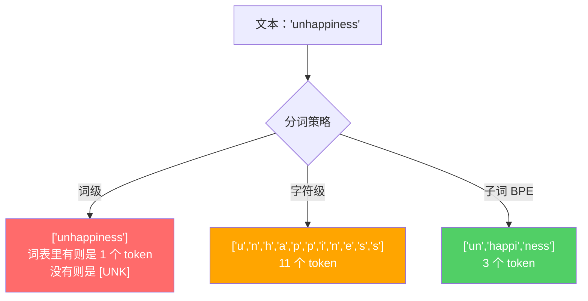
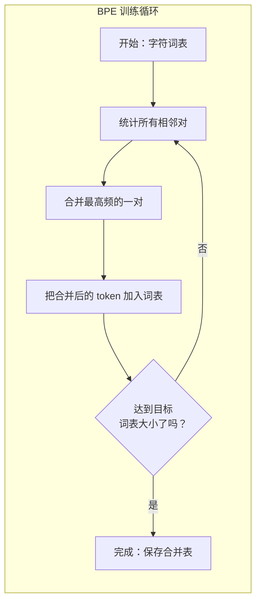
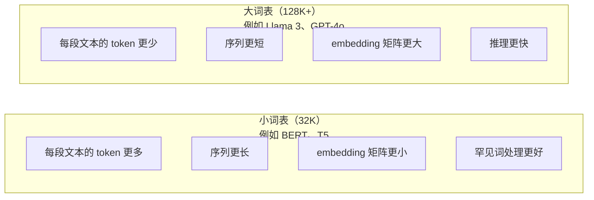

# 分词器：BPE、WordPiece、SentencePiece

> 你的 LLM 不读英文。它读的是整数。分词器决定了这些整数是承载意义，还是浪费意义。

**Type:** Build
**Languages:** Python
**Prerequisites:** Phase 05 (NLP 基础)
**Time:** ~90 分钟
## Learning Objectives

- 从零实现 BPE、WordPiece 和 Unigram 分词算法，并比较它们的合并策略
- 解释词表大小如何影响模型效率：太小会产生长序列，太大则会浪费 embedding 参数
- 分析不同语言和代码中的分词伪影，找出特定分词器在哪些地方失效
- 使用 tiktoken 和 sentencepiece 库对文本分词，并检查生成的 token ID

## 问题场景

你的 LLM 不读英文。它不读任何语言。它读数字。

"Hello, world!" 和 [15496, 11, 995, 0] 之间的那道鸿沟就是分词器。每个词、每个空格、每个标点，都必须先转换成一个整数，模型才能处理。这种转换不是中立的。它把一些假设烤进了模型里，之后再也取不出来。

这一步做错了，模型就会把容量浪费在用多个 token 编码常见词上。"unfortunately" 变成四个 token 而不是一个。对于多音节词密集的文本，你 128K 的上下文窗口瞬间缩水 75%。做对了，同样的上下文窗口能装下两倍的意义。"这个模型很会处理代码" 和 "这个模型一碰 Python 就卡壳" 之间的差别，往往就取决于分词器是怎么训练的。

你每一次调用 GPT-4 或 Claude 的 API，都是按 token 计费的。模型每生成一个 token，都要消耗算力。表示同一段输出所需的 token 越少，端到端推理就越快。分词不是预处理。它是架构。

## 核心概念

### 三种失败的方法（和一种胜出的方法）

把文本转成数字，有三种显而易见的做法。其中两种在大规模下行不通。

**词级分词**按空格和标点切分。"The cat sat" 变成 ["The", "cat", "sat"]。简单。但 "tokenization" 怎么办？"GPT-4o" 呢？或者德语复合词 "Geschwindigkeitsbegrenzung"？词级分词需要一个巨大的词表才能覆盖每种语言里的每个词。漏掉一个词，你就得到可怕的 `[UNK]` token——这是模型在说 "我完全不知道这是什么"。光英文就有超过一百万种词形。再加上代码、URL、科学计数法和另外 100 种语言，你需要一个无限大的词表。

**字符级分词**走的是另一个方向。"hello" 变成 ["h", "e", "l", "l", "o"]。词表很小（几百个字符）。永远不会出现未知 token。但序列会变得极长。一句在词级只要 10 个 token 的话，字符级要 50 个。模型必须学会 "t"、"h"、"e" 连在一起表示 "the"——把 attention 的容量烧在人类三岁就学会的事情上。

**子词分词**找到了甜点区。常见词保持完整："the" 就是一个 token。罕见词分解成有意义的片段："unhappiness" 变成 ["un", "happi", "ness"]。词表保持在可控范围（3 万到 12.8 万 token）。序列保持较短。未知 token 基本消失，因为任何词都能由子词片段拼出来。

每个现代 LLM 都用子词分词。GPT-2、GPT-4、BERT、Llama 3、Claude——全都是。问题在于用哪种算法。



### BPE：Byte Pair Encoding

BPE 是一种贪心压缩算法，被改用途来做分词。思路简单到能写在一张索引卡上。

从单个字符开始。统计训练语料里每一对相邻符号。把最高频的一对合并成一个新 token。重复，直到达到目标词表大小。

```figure
tokenizer-bpe
```

下面是在只有 "lower"、"lowest" 和 "newest" 的小语料上跑 BPE 的过程：

```
Corpus (with word frequencies):
  "lower"  x5
  "lowest" x2
  "newest" x6

Step 0 -- Start with characters:
  l o w e r       (x5)
  l o w e s t     (x2)
  n e w e s t     (x6)

Step 1 -- Count adjacent pairs:
  (e,s): 8    (s,t): 8    (l,o): 7    (o,w): 7
  (w,e): 13   (e,r): 5    (n,e): 6    ...

Step 2 -- Merge most frequent pair (w,e) -> "we":
  l o we r        (x5)
  l o we s t      (x2)
  n e we s t      (x6)

Step 3 -- Recount and merge (e,s) -> "es":
  l o we r        (x5)
  l o we s t      (x2)    <- 'es' only forms from 'e'+'s', not 'we'+'s'
  n e we s t      (x6)    <- wait, the 'e' before 'we' and 's' after 'we'

Actually tracking this precisely:
  After "we" merge, remaining pairs:
  (l,o): 7   (o,we): 7   (we,r): 5   (we,s): 8
  (s,t): 8   (n,e): 6    (e,we): 6

Step 3 -- Merge (we,s) -> "wes" or (s,t) -> "st" (tied at 8, pick first):
  Merge (we,s) -> "wes":
  l o we r        (x5)
  l o wes t       (x2)
  n e wes t       (x6)

Step 4 -- Merge (wes,t) -> "west":
  l o we r        (x5)
  l o west        (x2)
  n e west        (x6)

...continue until target vocab size reached.
```

合并表就是分词器。要编码新文本，就按学到的顺序依次应用合并。训练语料决定了存在哪些合并，而这个选择会永久塑造模型看到的东西。



### 字节级 BPE（GPT-2、GPT-3、GPT-4）

标准 BPE 工作在 Unicode 字符上。字节级 BPE 工作在原始字节（0-255）上。这样基础词表恰好是 256 个，能处理任何语言或编码，而且永远不会产生未知 token。

GPT-2 引入了这种做法。基础词表覆盖每一个可能的字节。BPE 合并在其上构建。OpenAI 的 tiktoken 库实现了字节级 BPE，词表大小如下：

- GPT-2：50,257 个 token
- GPT-3.5/GPT-4：约 100,256 个 token（cl100k_base 编码）
- GPT-4o：200,019 个 token（o200k_base 编码）

### WordPiece（BERT）

WordPiece 看起来和 BPE 相似，但挑选合并的方式不同。它不按原始频次，而是最大化训练数据的似然：

```
BPE merge criterion:      count(A, B)
WordPiece merge criterion: count(AB) / (count(A) * count(B))
```

BPE 问的是："哪一对出现得最频繁？" WordPiece 问的是："哪一对一起出现的次数比你凭偶然预期的更多？" 这个细微差别产生了不同的词表。WordPiece 偏爱那种共现令人意外的合并，而不仅仅是很频繁的合并。

WordPiece 还用 "##" 前缀标记续接子词：

```
"unhappiness" -> ["un", "##happi", "##ness"]
"embedding"   -> ["em", "##bed", "##ding"]
```

"##" 前缀告诉你，这个片段延续的是前一个 token。BERT 使用 WordPiece，词表大小 30,522 个 token。每个 BERT 变体——DistilBERT 也是；RoBERTa 的分词器实际上用的是 BPE，但 BERT 本身是 WordPiece。

### SentencePiece（Llama、T5）

SentencePiece 把输入当成原始的 Unicode 字符流，空格也算在内。没有预分词步骤。没有针对特定语言的分词边界规则。这让它真正与语言无关——它能处理中文、日文、泰文等不用空格分隔单词的语言。

SentencePiece 支持两种算法：
- **BPE 模式**：与标准 BPE 相同的合并逻辑，作用在原始字符序列上
- **Unigram 模式**：从一个大词表开始，迭代地移除对整体似然影响最小的 token。这是 BPE 的反向操作——是剪枝而不是合并。

Llama 2 使用 SentencePiece BPE，词表大小 32,000 个 token。T5 使用 SentencePiece Unigram，32,000 个 token。注意：Llama 3 换成了基于 tiktoken 的字节级 BPE 分词器，词表大小 128,256。

### 词表大小的权衡

这是一个真实的工程决策，后果可以量化。



具体的数字。对于 128K 词表、4,096 维 embedding，单是 embedding 矩阵就有 128,000 x 4,096 = 5.24 亿参数。对于 32K 词表，是 1.31 亿参数。仅仅是分词器的选择，就带来 4 亿参数的差异。

但更大的词表压缩文本也更激进。同一段英文，用 32K 词表要 100 个 token，用 128K 词表可能只要 70 个。这意味着生成时前向传播次数少了 30%。对于一个每天服务数百万请求的模型来说，这是直接的算力成本下降。

趋势很明确：词表在变大。GPT-2 用了 50,257。GPT-4 用了约 100K。Llama 3 用了 128K。GPT-4o 用了 200K。

| 模型 | 词表大小 | 分词器类型 | 英文单词平均 token 数 |
|-------|-----------|----------------|---------------------------|
| BERT | 30,522 | WordPiece | ~1.4 |
| GPT-2 | 50,257 | Byte-level BPE | ~1.3 |
| Llama 2 | 32,000 | SentencePiece BPE | ~1.4 |
| GPT-4 | ~100,256 | Byte-level BPE | ~1.2 |
| Llama 3 | 128,256 | Byte-level BPE (tiktoken) | ~1.1 |
| GPT-4o | 200,019 | Byte-level BPE | ~1.0 |

### 多语言税

以英文为主训练出来的分词器，对其他语言极其残忍。韩文在 GPT-2 的分词器里平均每个词要 2-3 个 token。中文可能更糟。这意味着韩语用户实际拿到的上下文窗口只有英语用户的一半——付一样的钱，换更低的信息密度。

这就是 Llama 3 把词表从 32K 扩到 128K、翻了四倍的原因。更多 token 分给非英文书写系统，意味着跨语言更公平的压缩。

```figure
tokenizer-tradeoff
```

## Build It

### 第 1 步：字符级分词器

从地基开始。字符级分词器把每个字符映射到它的 Unicode 码点。不需要训练。没有未知 token。只是一个直接映射。

```python
class CharTokenizer:
    def encode(self, text):
        return [ord(c) for c in text]

    def decode(self, tokens):
        return "".join(chr(t) for t in tokens)
```

"hello" 变成 [104, 101, 108, 108, 111]。每个字符都是自己的 token。这是我们要改进的基线。

### 第 2 步：从零实现 BPE 分词器

真正的实现。我们在原始字节上训练（像 GPT-2 那样），统计对，合并最高频的，并按顺序记录每一次合并。合并表就是分词器。

```python
from collections import Counter

class BPETokenizer:
    def __init__(self):
        self.merges = {}
        self.vocab = {}

    def _get_pairs(self, tokens):
        pairs = Counter()
        for i in range(len(tokens) - 1):
            pairs[(tokens[i], tokens[i + 1])] += 1
        return pairs

    def _merge_pair(self, tokens, pair, new_token):
        merged = []
        i = 0
        while i < len(tokens):
            if i < len(tokens) - 1 and tokens[i] == pair[0] and tokens[i + 1] == pair[1]:
                merged.append(new_token)
                i += 2
            else:
                merged.append(tokens[i])
                i += 1
        return merged

    def train(self, text, num_merges):
        tokens = list(text.encode("utf-8"))
        self.vocab = {i: bytes([i]) for i in range(256)}

        for i in range(num_merges):
            pairs = self._get_pairs(tokens)
            if not pairs:
                break
            best_pair = max(pairs, key=pairs.get)
            new_token = 256 + i
            tokens = self._merge_pair(tokens, best_pair, new_token)
            self.merges[best_pair] = new_token
            self.vocab[new_token] = self.vocab[best_pair[0]] + self.vocab[best_pair[1]]

        return self

    def encode(self, text):
        tokens = list(text.encode("utf-8"))
        for pair, new_token in self.merges.items():
            tokens = self._merge_pair(tokens, pair, new_token)
        return tokens

    def decode(self, tokens):
        byte_sequence = b"".join(self.vocab[t] for t in tokens)
        return byte_sequence.decode("utf-8", errors="replace")
```

训练循环就是 BPE 的核心：统计对，合并胜出者，重复。每次合并都会减少总 token 数。经过 `num_merges` 轮之后，词表从 256（基础字节）增长到 256 + num_merges。

编码时按学到的确切顺序应用合并。这很重要。如果第 1 次合并造出了 "th"，第 5 次合并造出了 "the"，那么编码时必须先应用第 1 次合并，这样第 5 次合并才能用 "th" + "e" 组成 "the"。

解码是逆操作：在词表里查每个 token ID，拼接字节，再解码成 UTF-8。

### 第 3 步：编码解码往返测试

```python
corpus = (
    "The cat sat on the mat. The cat ate the rat. "
    "The dog sat on the log. The dog ate the frog. "
    "Natural language processing is the study of how computers "
    "understand and generate human language. "
    "Tokenization is the first step in any NLP pipeline."
)

tokenizer = BPETokenizer()
tokenizer.train(corpus, num_merges=40)

test_sentences = [
    "The cat sat on the mat.",
    "Natural language processing",
    "tokenization pipeline",
    "unhappiness",
]

for sentence in test_sentences:
    encoded = tokenizer.encode(sentence)
    decoded = tokenizer.decode(encoded)
    raw_bytes = len(sentence.encode("utf-8"))
    ratio = len(encoded) / raw_bytes
    print(f"'{sentence}'")
    print(f"  Tokens: {len(encoded)} (from {raw_bytes} bytes) -- ratio: {ratio:.2f}")
    print(f"  Roundtrip: {'PASS' if decoded == sentence else 'FAIL'}")
```

压缩比告诉你分词器有多有效。0.50 的比值意味着分词器把文本压缩到了原始字节数一半的 token 数。越低越好。在训练语料上，比值会很好看。对于分布外文本，比如 "unhappiness"（它没出现在语料里），比值会变差——分词器对没见过的模式会退回到字符级编码。

### 第 4 步：与 tiktoken 对比

```python
import tiktoken

enc = tiktoken.get_encoding("cl100k_base")

texts = [
    "The cat sat on the mat.",
    "unhappiness",
    "Hello, world!",
    "def fibonacci(n): return n if n < 2 else fibonacci(n-1) + fibonacci(n-2)",
    "Geschwindigkeitsbegrenzung",
]

for text in texts:
    our_tokens = tokenizer.encode(text)
    tiktoken_tokens = enc.encode(text)
    tiktoken_pieces = [enc.decode([t]) for t in tiktoken_tokens]
    print(f"'{text}'")
    print(f"  Our BPE:   {len(our_tokens)} tokens")
    print(f"  tiktoken:  {len(tiktoken_tokens)} tokens -> {tiktoken_pieces}")
```

tiktoken 用的是完全相同的算法，只是在数百 GB 文本上训练、做了 10 万次合并。算法是一样的。差别在训练数据和合并次数。你在一个段落上训练、只做 40 次合并的分词器，当然比不过 tiktoken 在海量语料上的 10 万次合并。但机制是相同的。

### 第 5 步：词表分析

```python
def analyze_vocabulary(tokenizer, test_texts):
    total_tokens = 0
    total_chars = 0
    token_usage = Counter()

    for text in test_texts:
        encoded = tokenizer.encode(text)
        total_tokens += len(encoded)
        total_chars += len(text)
        for t in encoded:
            token_usage[t] += 1

    print(f"Vocabulary size: {len(tokenizer.vocab)}")
    print(f"Total tokens across all texts: {total_tokens}")
    print(f"Total characters: {total_chars}")
    print(f"Avg tokens per character: {total_tokens / total_chars:.2f}")

    print(f"\nMost used tokens:")
    for token_id, count in token_usage.most_common(10):
        token_bytes = tokenizer.vocab[token_id]
        display = token_bytes.decode("utf-8", errors="replace")
        print(f"  Token {token_id:4d}: '{display}' (used {count} times)")

    unused = [t for t in tokenizer.vocab if t not in token_usage]
    print(f"\nUnused tokens: {len(unused)} out of {len(tokenizer.vocab)}")
```

这会揭示词表里的 Zipf 分布。少数 token 占据主导（空格、"the"、"e"）。大多数 token 很少被用到。生产级分词器会针对这种分布做优化——常见模式拿到短的 token ID，罕见模式拿到更长的表示。

## Use It

你的从零实现版 BPE 能跑了。现在看看生产工具长什么样。

### tiktoken（OpenAI）

```python
import tiktoken

enc = tiktoken.get_encoding("cl100k_base")

text = "Tokenizers convert text to integers"
tokens = enc.encode(text)
print(f"Tokens: {tokens}")
print(f"Pieces: {[enc.decode([t]) for t in tokens]}")
print(f"Roundtrip: {enc.decode(tokens)}")
```

tiktoken 用 Rust 写成，带 Python 绑定。它每秒能编码数百万个 token。同样的 BPE 算法，工业级强度的实现。

### Hugging Face tokenizers

```python
from tokenizers import Tokenizer
from tokenizers.models import BPE
from tokenizers.trainers import BpeTrainer
from tokenizers.pre_tokenizers import ByteLevel

tokenizer = Tokenizer(BPE())
tokenizer.pre_tokenizer = ByteLevel()

trainer = BpeTrainer(vocab_size=1000, special_tokens=["<pad>", "<eos>", "<unk>"])
tokenizer.train(["corpus.txt"], trainer)

output = tokenizer.encode("The cat sat on the mat.")
print(f"Tokens: {output.tokens}")
print(f"IDs: {output.ids}")
```

Hugging Face tokenizers 库底层同样是 Rust。它能在几秒内于 GB 级语料上训练 BPE。你要训练自己的模型时，用的就是它。

### 加载 Llama 的分词器

```python
from transformers import AutoTokenizer

tokenizer = AutoTokenizer.from_pretrained("meta-llama/Llama-3.1-8B")

text = "Tokenizers are the unsung heroes of LLMs"
tokens = tokenizer.encode(text)
print(f"Token IDs: {tokens}")
print(f"Tokens: {tokenizer.convert_ids_to_tokens(tokens)}")
print(f"Vocab size: {tokenizer.vocab_size}")

multilingual = ["Hello world", "Hola mundo", "Bonjour le monde"]
for text in multilingual:
    ids = tokenizer.encode(text)
    print(f"'{text}' -> {len(ids)} tokens")
```

Llama 3 的 128K 词表压缩非英文文本的效果，明显好于 GPT-2 的 50K 词表。你可以自己验证——把同一句话用多种语言编码，数一数 token。

## Ship It

本课产出 `outputs/prompt-tokenizer-analyzer.md`——一个可复用的 prompt，用来分析任意文本与模型组合下的分词效率。喂给它一段文本样本，它会告诉你哪个模型的分词器处理得最好。

## Exercises

1. 修改 BPE 分词器，让它在每次合并时打印词表。观察 "t" + "h" 怎么变成 "th"，然后 "th" + "e" 怎么变成 "the"。追踪常见英文单词是如何一块一块拼装起来的。

2. 给 BPE 分词器加上特殊 token（`<pad>`、`<eos>`、`<unk>`）。把它们分配为 ID 0、1、2，并相应平移其他所有 token。实现一个预分词步骤，在跑 BPE 之前先按空白切分。

3. 实现 WordPiece 的合并准则（用似然比代替频次）。在同一语料、相同合并次数上分别训练 BPE 和 WordPiece。比较得到的词表——哪一个产出的子词在语言学上更有意义？

4. 构建一个多语言分词器效率基准。取 10 句英文、西班牙文、中文、韩文和阿拉伯文的句子。用 tiktoken（cl100k_base）分别分词，测量每个字符的平均 token 数。量化每种语言的 "多语言税"。

5. 在更大的语料（下载一篇维基百科文章）上训练你的 BPE 分词器。调整合并次数，使同一段文本上的压缩比与 tiktoken 相差在 10% 以内。这会逼你理解语料大小、合并次数和压缩质量之间的关系。

## Key Terms

| 术语 | 人们常说 | 实际含义 |
|------|----------------|----------------------|
| Token | "一个词" | 模型词表里的一个单位——可以是字符、子词、单词，或多词片段 |
| BPE | "某种压缩的东西" | Byte Pair Encoding——迭代合并最高频的相邻 token 对，直到达到目标词表大小 |
| WordPiece | "BERT 的分词器" | 类似 BPE，但合并准则是最大化似然比 count(AB)/(count(A)*count(B))，而不是原始频次 |
| SentencePiece | "一个分词器库" | 与语言无关的分词器，直接作用于原始 Unicode，不需要预分词，支持 BPE 和 Unigram 两种算法 |
| Vocabulary size | "它认识多少词" | 唯一 token 的总数：GPT-2 是 50,257，BERT 是 30,522，Llama 3 是 128,256 |
| Fertility | "不是分词术语" | 每个词的平均 token 数——衡量分词器跨语言的效率（1.0 是完美，3.0 意味着模型要多花三倍力气） |
| Byte-level BPE | "GPT 的分词器" | 作用在原始字节（0-255）而不是 Unicode 字符上的 BPE，保证任何输入都不会出现未知 token |
| Merge table | "分词器文件" | 训练中学到的有序合并列表——它本身就是分词器，而且顺序很重要 |
| Pre-tokenization | "按空格切分" | 子词分词之前应用的规则：空白切分、数字分离、标点处理 |
| Compression ratio | "分词器有多高效" | 产出的 token 数除以输入字节数——越低表示压缩越好、推理越快 |

## Further Reading

- [Sennrich et al., 2016 -- "Neural Machine Translation of Rare Words with Subword Units"](https://arxiv.org/abs/1508.07909) —— 把 BPE 引入 NLP 的论文，把一个 1994 年的压缩算法变成了现代分词的基础
- [Kudo & Richardson, 2018 -- "SentencePiece: A simple and language independent subword tokenizer"](https://arxiv.org/abs/1808.06226) —— 与语言无关的分词，让多语言模型变得可行
- [OpenAI tiktoken repository](https://github.com/openai/tiktoken) —— 生产级 BPE 的 Rust 实现，带 Python 绑定，GPT-3.5/4/4o 都在用
- [Hugging Face Tokenizers documentation](https://huggingface.co/docs/tokenizers) —— 生产级分词器训练，具备 Rust 性能
