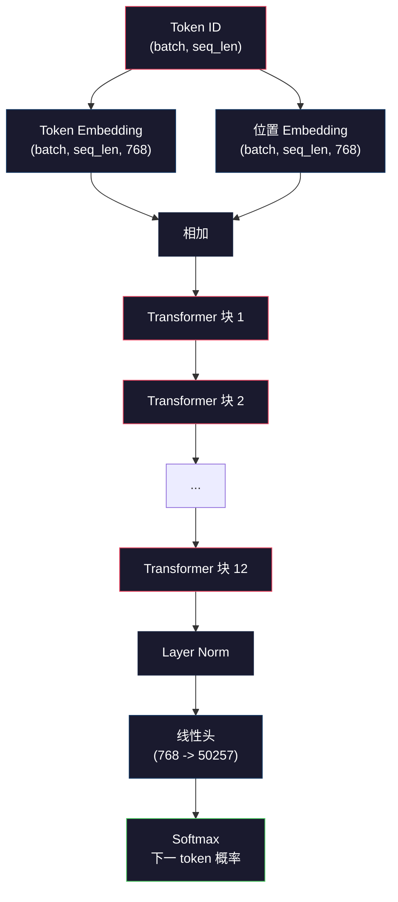
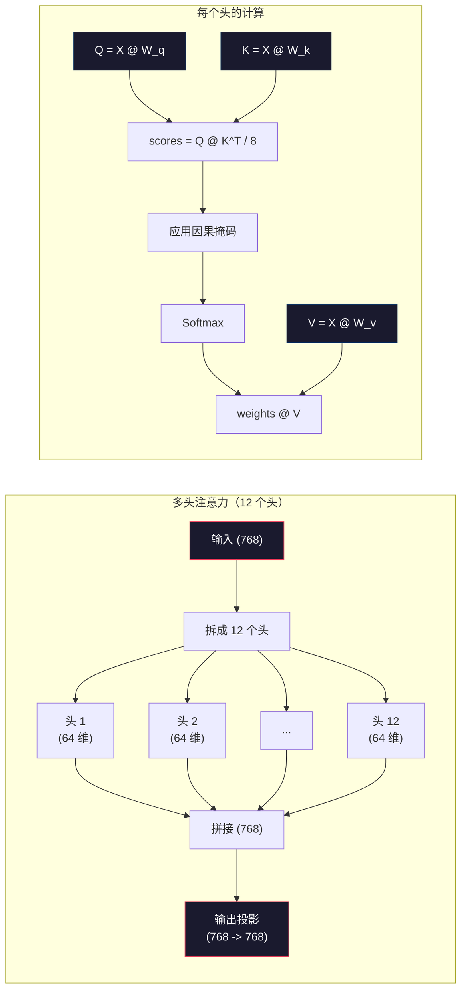
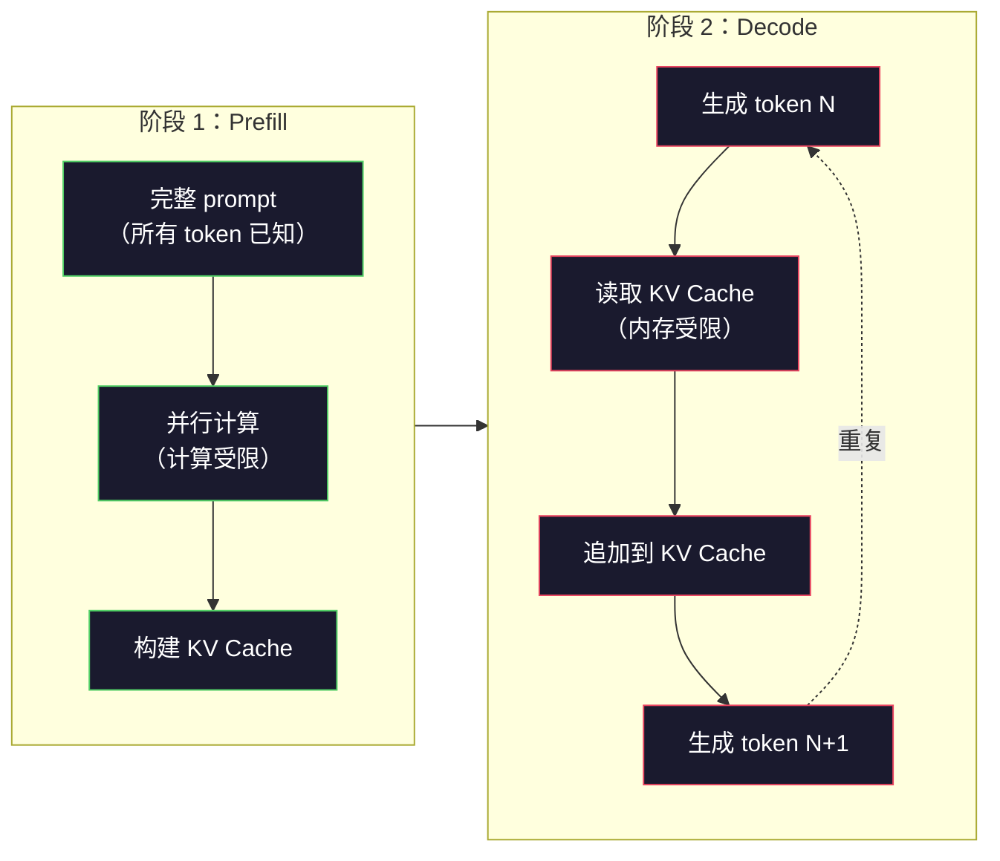

# 预训练一个迷你 GPT（124M 参数）

> GPT-2 Small 有 1.24 亿个参数。那是 12 个 transformer 层、12 个 attention 头，以及 768 维的 embedding。你可以在单块 GPU 上花几个小时从零训练它。大多数人从来不做这件事。他们直接用预训练 checkpoint。但如果你没有亲手训练过一个，你其实并不真正理解你所构建的产品底下那个模型内部在发生什么。

**Type:** Build
**Languages:** Python (with numpy)
**Prerequisites:** Phase 10, Lessons 01-03（Tokenizer、构建 Tokenizer、数据管道）
**Time:** ~120 分钟

## Learning Objectives

- 从零实现完整的 GPT-2 架构（124M 参数）：token embedding、位置 embedding、transformer 块以及语言模型头
- 用下一 token 预测和交叉熵损失，在文本语料上训练一个 GPT 模型
- 实现带温度采样与 top-k/top-p 过滤的自回归文本生成
- 监控训练损失曲线，验证模型确实学到了连贯的语言模式

## 问题场景

你知道 transformer 是什么。你读过那些图解。你能背出“attention is all you need”，也能在白板上画出标着“Multi-Head Attention”的方框。

但这些都不意味着你理解模型生成文本时到底发生了什么。

GPT-2 Small 里有 124,438,272 个参数（含权重共享）。其中每一个都是靠跑训练循环定下来的：前向传播、计算损失、反向传播、更新权重。十二个 transformer 块。每个块十二个 attention 头。768 维的 embedding 空间。50,257 个 token 的词表。模型每生成一个 token，这 1.24 亿个参数就全部参与一条矩阵乘法链：输入一串 token ID，输出下一个 token 上的概率分布。

如果你从未亲手搭过这些东西，你就是在跟一个黑盒打交道。你可以调用 API。你可以做微调。但一旦出问题——模型开始幻觉、开始重复自己、开始拒绝遵循指令——你脑子里并没有一个关于*为什么*的心智模型。

本课从零构建 GPT-2 Small。不用 PyTorch，用 numpy。每一次矩阵乘法都看得见。每一个梯度都由你的代码算出。你会亲眼看到这 1.24 亿个数字是如何合谋预测下一个词的。

## 核心概念

### GPT 架构

GPT 是一个自回归语言模型。“自回归”意味着它一次生成一个 token，每个 token 都以之前所有 token 为条件。整个架构是一摞 transformer 解码器块。

下面是从 token ID 到下一 token 概率的完整计算图：

1. token ID 输入进来。形状：(batch_size, seq_len)。
2. 查 token embedding 表。每个 ID 映射到一个 768 维向量。形状：(batch_size, seq_len, 768)。
3. 查位置 embedding 表。每个位置（0、1、2、……）映射到一个 768 维向量。形状相同。
4. 把 token embedding 与位置 embedding 相加。
5. 依次通过 12 个 transformer 块。
6. 最后一次层归一化。
7. 线性投影到词表大小。形状：(batch_size, seq_len, vocab_size)。
8. 用 softmax 得到概率。

这就是模型的全貌。没有卷积。没有循环。只有 embedding、attention、前馈网络和层归一化，堆叠 12 次。



### Transformer 块

12 个块的结构完全相同，都是 pre-norm 架构（GPT-2 用 pre-norm，而不是原始 transformer 那种 post-norm）：

1. LayerNorm
2. 多头自注意力
3. 残差连接（把输入加回去）
4. LayerNorm
5. 前馈网络（MLP）
6. 残差连接（把输入加回去）

残差连接至关重要。没有它，反向传播时梯度传到第 1 个块就已经消失殆尽。有了它，梯度可以沿“跳跃”通路从损失直接流到任意一层。这就是为什么你能堆 12 层、32 层甚至 96 层（据传 GPT-4 用了 120 层）。

### 注意力：核心机制

自注意力让每个 token 都能看到它之前的每一个 token，并决定对每个 token 关注多少。数学如下。

对每个 token 位置，从输入算出三个向量：
- **Query (Q)**：“我在找什么？”
- **Key (K)**：“我包含什么？”
- **Value (V)**：“我携带什么信息？”

```
Q = input @ W_q    (768 -> 768)
K = input @ W_k    (768 -> 768)
V = input @ W_v    (768 -> 768)

attention_scores = Q @ K^T / sqrt(d_k)
attention_scores = mask(attention_scores)   # causal mask: -inf for future positions
attention_weights = softmax(attention_scores)
output = attention_weights @ V
```

因果掩码是让 GPT 具备自回归性质的关键。位置 5 能关注位置 0-5，但不能关注 6、7、8，以此类推。这防止模型在训练时通过偷看未来 token 来“作弊”。

**多头注意力**把 768 维空间拆成 12 个头，每个 64 维。每个头学到不同的注意力模式。一个头可能追踪句法关系（主谓一致），另一个可能追踪语义相似性（近义词），还有一个可能追踪位置邻近性（相邻的词）。12 个头的输出拼接起来，再投影回 768 维。



除以 sqrt(d_k)——sqrt(64) = 8——这一步就是缩放。不做它，高维向量的点积会变得很大，把 softmax 推到梯度几乎为零的区间。这是原始《Attention Is All You Need》论文的关键洞见之一。

### KV Cache：为什么推理这么快

训练时，你一次处理整个序列。推理时，你一次只生成一个 token。不做优化的话，生成第 N 个 token 需要为之前全部 N-1 个 token 重新计算 attention。也就是每生成一个 token 要 O(N^2)，长度为 N 的序列总共 O(N^3)。

KV Cache 解决了这个问题。算完每个 token 的 K 和 V 之后就存起来。生成第 N+1 个 token 时，你只需要为新 token 计算 Q，然后从缓存里查之前所有 token 的 K 和 V。这把 K、V 计算的每 token 成本从 O(N) 降到 O(1)。attention 分数计算仍然是 O(N)，因为你要关注之前所有位置，但你省掉了对输入的重复矩阵乘法。

对 12 层、12 头的 GPT-2，KV cache 每个 token 存 2（K + V）x 12 层 x 12 头 x 64 维 = 18,432 个值。对 1024 个 token 的序列，FP32 下大约 75MB。对 128 层的 Llama 3 405B，单条序列的 KV cache 能超过 10GB。这就是长上下文推理是内存受限的原因。

### Prefill 与 Decode：推理的两个阶段

当你把 prompt 发给 LLM，推理分成两个截然不同的阶段。

**Prefill** 并行处理你的整个 prompt。所有 token 都是已知的，所以模型可以同时为所有位置计算 attention。这个阶段是计算受限的——GPU 以满吞吐做矩阵乘法。对 1000 token 的 prompt，在 A100 上 prefill 大约耗时 20-50ms。

**Decode** 一次生成一个 token。每个新 token 都依赖之前所有 token。这个阶段是内存受限的——瓶颈是从 GPU 显存里读取模型权重和 KV cache，而不是矩阵运算本身。GPU 的计算核心大部分时间在空等内存读取。对 GPT-2，不管矩阵乘法需要多少 FLOPs，每个 decode 步骤耗时都差不多，因为制约的是内存带宽。

这个区分对生产系统很重要。Prefill 吞吐随 GPU 算力扩展（FLOPS 越高，prefill 越快）。Decode 吞吐随内存带宽扩展（显存越快，decode 越快）。这就是为什么 NVIDIA 的 H100 相比 A100 重点改善内存带宽——它直接加速了 token 生成。



### 训练循环

训练 LLM 就是做下一 token 预测。给定 token [0, 1, 2, ..., N-1]，预测 token [1, 2, 3, ..., N]。损失函数是模型预测的概率分布与实际下一个 token 之间的交叉熵。

一个训练步骤：

1. **前向传播**：把 batch 跑过全部 12 个块，得到每个位置的 logits（softmax 之前的分数）。
2. **计算损失**：logits 与目标 token（输入向后移一位）之间的交叉熵。
3. **反向传播**：用 backprop 计算全部 124M 参数的梯度。
4. **优化器步进**：更新权重。GPT-2 用 Adam，配合学习率 warmup 和余弦衰减。

学习率调度的作用比你预想的更大。GPT-2 在最开始 2,000 步里从 0 warmup 到峰值学习率，然后按余弦曲线衰减。一开始就用高学习率会让模型发散。一直保持高学习率会在训练后期震荡。先 warmup 再衰减的模式被每一个主流 LLM 采用。

### GPT-2 Small：数字明细

| 组件 | 形状 | 参数 |
|-----------|-------|------------|
| Token embedding | (50257, 768) | 38,597,376 |
| 位置 embedding | (1024, 768) | 786,432 |
| 每块 attention（W_q, W_k, W_v, W_out） | 4 x (768, 768) | 2,359,296 |
| 每块 FFN（升维 + 降维） | (768, 3072) + (3072, 768) | 4,718,592 |
| 每块 LayerNorm（2 个） | 2 x 768 x 2 | 3,072 |
| 最终 LayerNorm | 768 x 2 | 1,536 |
| **每块合计** | | **7,080,960** |
| **总计（12 块）** | | **85,054,464 + 39,383,808 = 124,438,272** |

输出投影（logits 头）与 token embedding 矩阵共享权重。这叫权重共享（weight tying）——它把参数总量减少 38M，并且提升效果，因为它迫使模型对输入（embedding）和输出使用同一个表示空间。

## Build It

### 第 1 步：embedding 层

token embedding 把 50,257 个可能的 token 各自映射到一个 768 维向量。位置 embedding 补充每个 token 在序列中所处位置的信息。两者相加。

```python
import numpy as np

class Embedding:
    def __init__(self, vocab_size, embed_dim, max_seq_len):
        self.token_embed = np.random.randn(vocab_size, embed_dim) * 0.02
        self.pos_embed = np.random.randn(max_seq_len, embed_dim) * 0.02

    def forward(self, token_ids):
        seq_len = token_ids.shape[-1]
        tok_emb = self.token_embed[token_ids]
        pos_emb = self.pos_embed[:seq_len]
        return tok_emb + pos_emb
```

初始化用的 0.02 标准差来自 GPT-2 论文。太大，初始前向传播会产生极端值，训练不稳定。太小，初始输出对所有输入几乎相同，早期梯度信号毫无用处。

### 第 2 步：带因果掩码的自注意力

先看单头注意力。因果掩码在 softmax 之前把未来位置设为负无穷，确保每个位置只能关注自己和更早的位置。

```python
def attention(Q, K, V, mask=None):
    d_k = Q.shape[-1]
    scores = Q @ K.transpose(0, -1, -2 if Q.ndim == 4 else 1) / np.sqrt(d_k)
    if mask is not None:
        scores = scores + mask
    weights = np.exp(scores - scores.max(axis=-1, keepdims=True))
    weights = weights / weights.sum(axis=-1, keepdims=True)
    return weights @ V
```

这个 softmax 实现先减去最大值再做指数。不这么做，exp(很大的数) 会溢出成无穷。这是个数值稳定性技巧，不改变输出，因为对任意常数 c，softmax(x - c) = softmax(x)。

### 第 3 步：多头注意力

把 768 维输入拆成 12 个头，每个 64 维。每个头独立计算 attention。把结果拼接起来，再投影回 768 维。

```python
class MultiHeadAttention:
    def __init__(self, embed_dim, num_heads):
        self.num_heads = num_heads
        self.head_dim = embed_dim // num_heads
        self.W_q = np.random.randn(embed_dim, embed_dim) * 0.02
        self.W_k = np.random.randn(embed_dim, embed_dim) * 0.02
        self.W_v = np.random.randn(embed_dim, embed_dim) * 0.02
        self.W_out = np.random.randn(embed_dim, embed_dim) * 0.02

    def forward(self, x, mask=None):
        batch, seq_len, d = x.shape
        Q = (x @ self.W_q).reshape(batch, seq_len, self.num_heads, self.head_dim).transpose(0, 2, 1, 3)
        K = (x @ self.W_k).reshape(batch, seq_len, self.num_heads, self.head_dim).transpose(0, 2, 1, 3)
        V = (x @ self.W_v).reshape(batch, seq_len, self.num_heads, self.head_dim).transpose(0, 2, 1, 3)

        scores = Q @ K.transpose(0, 1, 3, 2) / np.sqrt(self.head_dim)
        if mask is not None:
            scores = scores + mask
        weights = np.exp(scores - scores.max(axis=-1, keepdims=True))
        weights = weights / weights.sum(axis=-1, keepdims=True)
        attn_out = weights @ V

        attn_out = attn_out.transpose(0, 2, 1, 3).reshape(batch, seq_len, d)
        return attn_out @ self.W_out
```

reshape-transpose-reshape 这套动作是多头注意力里最让人困惑的部分。实际发生的是：(batch, seq_len, 768) 的张量变成 (batch, seq_len, 12, 64)，再变成 (batch, 12, seq_len, 64)。现在 12 个头各自有一块 (seq_len, 64) 矩阵可以跑 attention。attention 之后，把过程反过来：(batch, 12, seq_len, 64) 变成 (batch, seq_len, 12, 64)，再变成 (batch, seq_len, 768)。

### 第 4 步：Transformer 块

一个完整的 transformer 块：LayerNorm、带残差的多头注意力、LayerNorm、带残差的前馈网络。

```python
class LayerNorm:
    def __init__(self, dim, eps=1e-5):
        self.gamma = np.ones(dim)
        self.beta = np.zeros(dim)
        self.eps = eps

    def forward(self, x):
        mean = x.mean(axis=-1, keepdims=True)
        var = x.var(axis=-1, keepdims=True)
        return self.gamma * (x - mean) / np.sqrt(var + self.eps) + self.beta


class FeedForward:
    def __init__(self, embed_dim, ff_dim):
        self.W1 = np.random.randn(embed_dim, ff_dim) * 0.02
        self.b1 = np.zeros(ff_dim)
        self.W2 = np.random.randn(ff_dim, embed_dim) * 0.02
        self.b2 = np.zeros(embed_dim)

    def forward(self, x):
        h = x @ self.W1 + self.b1
        h = np.maximum(0, h)  # GELU approximation: ReLU for simplicity
        return h @ self.W2 + self.b2


class TransformerBlock:
    def __init__(self, embed_dim, num_heads, ff_dim):
        self.ln1 = LayerNorm(embed_dim)
        self.attn = MultiHeadAttention(embed_dim, num_heads)
        self.ln2 = LayerNorm(embed_dim)
        self.ffn = FeedForward(embed_dim, ff_dim)

    def forward(self, x, mask=None):
        x = x + self.attn.forward(self.ln1.forward(x), mask)
        x = x + self.ffn.forward(self.ln2.forward(x))
        return x
```

前馈网络把 768 维输入扩展到 3,072 维（4 倍），过一个非线性，再投影回 768。这种先扩后缩的模式让模型在每个位置上有“更宽”的内部表示可用。GPT-2 用 GELU 激活，这里为简单起见用 ReLU——对理解架构来说差别很小。

### 第 5 步：完整 GPT 模型

堆 12 个 transformer 块。前面接 embedding 层，后面接输出投影。

```python
class MiniGPT:
    def __init__(self, vocab_size=50257, embed_dim=768, num_heads=12,
                 num_layers=12, max_seq_len=1024, ff_dim=3072):
        self.embedding = Embedding(vocab_size, embed_dim, max_seq_len)
        self.blocks = [
            TransformerBlock(embed_dim, num_heads, ff_dim)
            for _ in range(num_layers)
        ]
        self.ln_f = LayerNorm(embed_dim)
        self.vocab_size = vocab_size
        self.embed_dim = embed_dim

    def forward(self, token_ids):
        seq_len = token_ids.shape[-1]
        mask = np.triu(np.full((seq_len, seq_len), -1e9), k=1)

        x = self.embedding.forward(token_ids)
        for block in self.blocks:
            x = block.forward(x, mask)
        x = self.ln_f.forward(x)

        logits = x @ self.embedding.token_embed.T
        return logits

    def count_parameters(self):
        total = 0
        total += self.embedding.token_embed.size
        total += self.embedding.pos_embed.size
        for block in self.blocks:
            total += block.attn.W_q.size + block.attn.W_k.size
            total += block.attn.W_v.size + block.attn.W_out.size
            total += block.ffn.W1.size + block.ffn.b1.size
            total += block.ffn.W2.size + block.ffn.b2.size
            total += block.ln1.gamma.size + block.ln1.beta.size
            total += block.ln2.gamma.size + block.ln2.beta.size
        total += self.ln_f.gamma.size + self.ln_f.beta.size
        return total
```

注意这里的权重共享：`logits = x @ self.embedding.token_embed.T`。输出投影复用了 token embedding 矩阵（转置）。这不仅是省参数的技巧。它意味着模型用同一个向量空间来理解 token（embedding）和预测 token（输出）。

### 第 6 步：训练循环

真要在 124M 参数上跑完整训练，你需要 GPU 和 PyTorch。这个训练循环用纯 numpy 在一个小模型上演示机制。我们用一个小型模型（4 层、4 头、128 维）让它跑得动。

```python
def cross_entropy_loss(logits, targets):
    batch, seq_len, vocab_size = logits.shape
    logits_flat = logits.reshape(-1, vocab_size)
    targets_flat = targets.reshape(-1)

    max_logits = logits_flat.max(axis=-1, keepdims=True)
    log_softmax = logits_flat - max_logits - np.log(
        np.exp(logits_flat - max_logits).sum(axis=-1, keepdims=True)
    )

    loss = -log_softmax[np.arange(len(targets_flat)), targets_flat].mean()
    return loss


def train_mini_gpt(text, vocab_size=256, embed_dim=128, num_heads=4,
                   num_layers=4, seq_len=64, num_steps=200, lr=3e-4):
    tokens = np.array(list(text.encode("utf-8")[:2048]))
    model = MiniGPT(
        vocab_size=vocab_size, embed_dim=embed_dim, num_heads=num_heads,
        num_layers=num_layers, max_seq_len=seq_len, ff_dim=embed_dim * 4
    )

    print(f"Model parameters: {model.count_parameters():,}")
    print(f"Training tokens: {len(tokens):,}")
    print(f"Config: {num_layers} layers, {num_heads} heads, {embed_dim} dims")
    print()

    for step in range(num_steps):
        start_idx = np.random.randint(0, max(1, len(tokens) - seq_len - 1))
        batch_tokens = tokens[start_idx:start_idx + seq_len + 1]

        input_ids = batch_tokens[:-1].reshape(1, -1)
        target_ids = batch_tokens[1:].reshape(1, -1)

        logits = model.forward(input_ids)
        loss = cross_entropy_loss(logits, target_ids)

        if step % 20 == 0:
            print(f"Step {step:4d} | Loss: {loss:.4f}")

    return model
```

损失的起点接近 ln(vocab_size)——对 256 个 token 的字节级词表，就是 ln(256) = 5.55。随机模型给每个 token 分配相同概率。随着训练推进，损失下降，因为模型学会了预测常见模式：“t” 后面接 “h”、句号后面接空格，等等。

生产环境里，你会用 Adam 优化器，配梯度累积、学习率 warmup 和梯度裁剪。前向-算损失-反向-更新的循环完全一样。只是优化器更复杂。

### 第 7 步：文本生成

生成就是用训练好的模型一次预测一个 token。每次预测从输出分布中采样（或者按 argmax 贪心取）。

```python
def generate(model, prompt_tokens, max_new_tokens=100, temperature=0.8):
    tokens = list(prompt_tokens)
    seq_len = model.embedding.pos_embed.shape[0]

    for _ in range(max_new_tokens):
        context = np.array(tokens[-seq_len:]).reshape(1, -1)
        logits = model.forward(context)
        next_logits = logits[0, -1, :]

        next_logits = next_logits / temperature
        probs = np.exp(next_logits - next_logits.max())
        probs = probs / probs.sum()

        next_token = np.random.choice(len(probs), p=probs)
        tokens.append(next_token)

    return tokens
```

温度控制随机性。温度 1.0 用原始分布。温度 0.5 让它更尖锐（更确定——模型更常选它的首选）。温度 1.5 让它更平坦（更随机——低概率 token 拿到更大机会）。温度 0.0 是贪心解码（永远选概率最高的 token）。

`tokens[-seq_len:]` 这个窗口是必需的，因为模型有最大上下文长度（GPT-2 是 1024）。一旦超出，你必须丢掉最老的 token。这就是大家都在说的“上下文窗口”。

```figure
sampling-decoder
```

## Use It

### 完整训练与生成演示

```python
corpus = """The transformer architecture has revolutionized natural language processing.
Attention mechanisms allow the model to focus on relevant parts of the input.
Self-attention computes relationships between all pairs of positions in a sequence.
Multi-head attention splits the representation into multiple subspaces.
Each attention head can learn different types of relationships.
The feedforward network provides nonlinear transformations at each position.
Residual connections enable gradient flow through deep networks.
Layer normalization stabilizes training by normalizing activations.
Position embeddings give the model information about token ordering.
The causal mask ensures autoregressive generation during training.
Pre-training on large text corpora teaches the model general language understanding.
Fine-tuning adapts the pre-trained model to specific downstream tasks."""

model = train_mini_gpt(corpus, num_steps=200)

prompt = list("The transformer".encode("utf-8"))
output_tokens = generate(model, prompt, max_new_tokens=100, temperature=0.8)
generated_text = bytes(output_tokens).decode("utf-8", errors="replace")
print(f"\nGenerated: {generated_text}")
```

在小模型、小语料上，生成文本最好也只是半连贯。它会从训练文本里学到一些字节级模式，但没法像 GPT-2 那样用 40GB 训练数据和完整的 124M 参数架构去泛化。重点不是输出质量。重点是你能追踪每一步：embedding 查表、attention 计算、前馈变换、logit 投影、softmax 和采样。每个操作都看得见。

## Ship It

本课产出 `outputs/prompt-gpt-architecture-analyzer.md`——一个分析任意 GPT 风格模型架构选择的 prompt。把模型卡或技术报告丢给它，它会拆解参数分配、attention 设计与扩展决策。

## Exercises

1. 把模型改成 24 层、16 头，而不是 12/12。数一数参数。深度翻倍与宽度翻倍（embedding 维度）相比如何？

2. 实现 GELU 激活函数（GELU(x) = x * 0.5 * (1 + erf(x / sqrt(2)))），替换前馈网络里的 ReLU。两种激活各跑 500 步训练，比较最终损失。

3. 给生成函数加上 KV cache。在第一次前向传播后为每一层保存 K 和 V 张量，后续 token 复用它们。测量加速：分别在有缓存和没缓存时生成 200 个 token，比较实际耗时。

4. 实现 top-k 采样（只考虑概率最高的 k 个 token）和 top-p 采样（核采样：考虑累计概率超过 p 的最小 token 集合）。在温度 0.8 下比较 top-k=50 与 top-p=0.95 的输出质量。

5. 写一个训练损失曲线绘图器。训练 1000 步并画出 loss vs step。识别三个阶段：初期快速下降（学习常见字节）、中期变缓（学习字节模式）和平台期（在小语料上过拟合）。不管你训的是 128 维模型还是 GPT-4，这条曲线的形状都一样。

## Key Terms

| 术语 | 人们常说 | 实际含义 |
|------|----------------|----------------------|
| Autoregressive | “它一次生成一个词” | 每个输出 token 都以所有之前的 token 为条件——模型预测的是 P(token_n \| token_0, ..., token_{n-1}) |
| Causal mask | “它看不到未来” | 一个上三角为负无穷的矩阵，训练时阻止 attention 关注未来位置 |
| Multi-head attention | “多种注意力模式” | 把 Q、K、V 拆成并行的多个头（例如 GPT-2 的 12 个 64 维头），让每个头能学不同类型的关系 |
| KV Cache | “为了加速做缓存” | 保存之前 token 已算好的 Key 和 Value 张量，避免自回归生成中的重复计算 |
| Prefill | “处理 prompt” | 第一个推理阶段，所有 prompt token 并行处理——受 GPU FLOPS 约束 |
| Decode | “生成 token” | 第二个推理阶段，一次生成一个 token——受 GPU 带宽约束 |
| Weight tying | “共享 embedding” | 输入 token embedding 与输出投影头使用同一个矩阵——在 GPT-2 里省下 38M 参数 |
| Residual connection | “跳跃连接” | 把输入直接加到子层输出上（x + sublayer(x)）——让梯度能在深层网络中流动 |
| Layer normalization | “归一化激活值” | 沿特征维度归一化到均值 0、方差 1，带可学习的缩放和偏置参数 |
| Cross-entropy loss | “预测错得有多厉害” | -log(分配给正确下一个 token 的概率)，对所有位置取平均——LLM 训练的标准目标 |

## Further Reading

- [Radford et al., 2019 -- "Language Models are Unsupervised Multitask Learners" (GPT-2)](https://cdn.openai.com/better-language-models/language_models_are_unsupervised_multitask_learners.pdf)——引入 124M 到 1.5B 参数系列的 GPT-2 论文
- [Vaswani et al., 2017 -- "Attention Is All You Need"](https://arxiv.org/abs/1706.03762)——原始 transformer 论文，提出缩放点积注意力与多头注意力
- [Llama 3 Technical Report](https://arxiv.org/abs/2407.21783)——Meta 如何用 16K 块 GPU 把 GPT 架构扩展到 405B 参数
- [Pope et al., 2022 -- "Efficiently Scaling Transformer Inference"](https://arxiv.org/abs/2211.05102)——形式化定义 prefill vs decode 与 KV cache 分析的那篇论文
