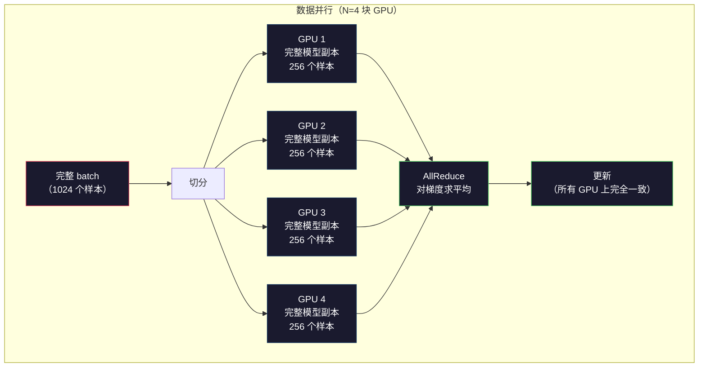
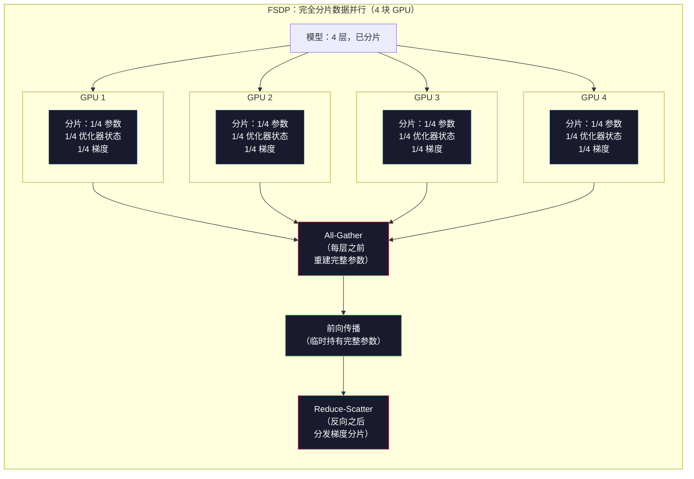
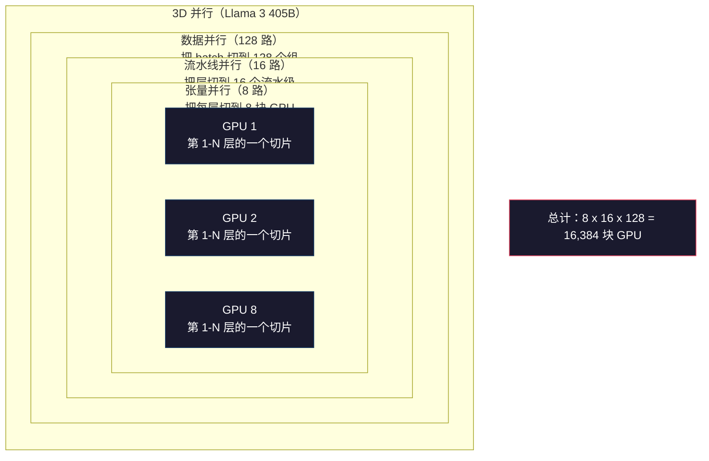

# 扩展：分布式训练、FSDP、DeepSpeed

> 你的 124M 模型在单块 GPU 上训完了。现在试试 70 亿参数。模型装不进显存。数据在单机上要跑好几周。到了这个规模，分布式训练不是可选项。它是唯一的出路。

**Type:** Build
**Languages:** Python
**Prerequisites:** Phase 10, Lesson 04（预训练一个迷你 GPT）
**Time:** ~120 分钟

## Learning Objectives

- 解释三种并行方式（数据并行、张量并行、流水线并行），并根据模型规模和集群规模判断各自何时必要
- 用 PyTorch DDP 实现数据并行训练，在多个 GPU 之间同步梯度
- 为给定规模的模型计算显存预算（权重 + 优化器状态 + 梯度 + 激活），从而确定最低硬件需求
- 配置 FSDP 或 DeepSpeed ZeRO 各阶段，把模型状态分片到多块 GPU，从而装下超出单卡显存的模型

## 问题场景

一个 7B 参数的模型用 FP16 存，光权重就要 14GB。Adam 优化器还要为每个参数额外存两份副本（一阶矩和二阶矩估计），又是 28GB。反向传播中的梯度再加 14GB。还没存任何一个激活值，你就已经到 56GB 了。

一块 NVIDIA A100 有 80GB 显存。

80GB 里的 56GB 已被吃掉，只剩 24GB 给激活值——也就是前向传播过程中产生、必须留到反向传播用的中间结果。对 2048 token 的序列、4096 维的模型，单层激活约占 64MB。32 层的话，每个样本要 2GB。batch size 为 8 就要 16GB。你只有 24GB。batch size 到 12 就爆了。

再试 70B 参数。光权重：FP16 下 140GB。一块 GPU 装不下。至少要 2 块 A100（2 x 80GB = 160GB）才勉强放得下权重。再加上优化器状态和梯度，需要的就远不止这些：最少 3 块以上 GPU，实际取决于分片策略，通常要 8-16 块。

Llama 3 405B 用了 16,384 块 NVIDIA H100 训练。这次训练估算的算力成本约 1 亿美元。DeepSeek V3 训练一个同量级模型只花了约 560 万美元，靠的是架构上的巧思（Mixture of Experts 让每个 token 只激活一部分参数）和训练效率。

本课讲让大规模训练成为可能的四种策略：数据并行、张量并行、流水线并行，以及完全分片数据并行。你会用纯 Python 逐个模拟，在接触任何分布式训练框架之前先搞懂机制。

## 核心概念

### 为什么必须做分布式

下面是真实模型的显存账。每个数字都是算出来的，不是估的。

| 模型 | 参数 | 权重（FP16） | Adam 状态 | 梯度（FP16） | 总计（不含激活） |
|-------|--------|----------------|-------------|------------------|----------------------|
| GPT-2 Small | 124M | 248 MB | 992 MB | 248 MB | 1.5 GB |
| Llama 3 8B | 8B | 16 GB | 64 GB | 16 GB | 96 GB |
| Llama 3 70B | 70B | 140 GB | 560 GB | 140 GB | 840 GB |
| Llama 3 405B | 405B | 810 GB | 3,240 GB | 810 GB | 4,860 GB |

“Adam 状态”这一列最要命。Adam 为每个参数存一个滑动均值（m）和一个滑动方差（v），都用 FP32。对 70B 模型，就是 70B x 4 字节 x 2 = 560GB。光优化器就需要 7 块 A100。

一块 H100 有 80GB。Llama 3 405B 至少需要 61 块 H100 才能放下权重、优化器和梯度。再加上激活值，数字还会涨。Meta 用了 16,384 块 GPU，不是因为他们想用——而是不得不用。

### 数据并行

最简单的分布式策略。把完整模型复制到 N 块 GPU 上。把每个训练 batch 切成 N 等份。每块 GPU 在自己那份数据上跑前向和反向。反向结束后，在所有 GPU 之间对梯度求平均。每块 GPU 用同一份平均梯度更新自己的权重副本，从而保持所有副本同步。

**好处：**吞吐线性扩展。N 块 GPU 每步处理 N 倍的数据。通信只限于梯度求平均，而且可以和计算重叠。

**代价：**每块 GPU 都保存模型、优化器状态和梯度的完整副本。对 70B 模型，每块 GPU 需要 840GB。数据并行完全不降低单卡显存占用，它只缩短训练时间。

**算一笔账：**有效 batch 大小 = per_gpu_batch_size x N。N=64 块 GPU、每卡 batch 为 16 时，有效 batch 是 1,024。Llama 3 每步的有效 batch 是 1600 万个 token。



### 张量并行

把单个层拆到多块 GPU 上。一次矩阵乘法由多块 GPU 分组完成，各自算出结果的一部分。

考虑前馈层里一个形状为 (8192, 8192) 的权重矩阵。做 4 路张量并行，每块 GPU 持有 (8192, 2048) 的分片。每块 GPU 用输入乘自己的分片，得到一个部分结果。这些部分结果被合并（通过 all-reduce 或 all-gather）来产生完整输出。

**好处：**降低模型权重占用的单卡显存。70B 模型拆到 8 块 GPU 上，每块 GPU 只持有约 8.75B 参数对应的权重。

**代价：**每一层之后都需要快速的 GPU 间通信。每次矩阵乘法后的 all-reduce 都增加延迟。在 NVLink 上（同一节点内 GPU 之间 900 GB/s）表现很好，但跨由 InfiniBand 连接（400 Gb/s，约 50 GB/s）的节点就很差。张量并行几乎总是被限制在单节点内（8 块 GPU）。

**实际用法：**Megatron-LM 开创了张量并行。Llama 3 405B 在每个节点内使用 8 路张量并行。

### 流水线并行

按层切分模型。GPU 1 跑第 1-8 层。GPU 2 跑第 9-16 层。GPU 3 跑第 17-24 层。GPU 4 跑第 25-32 层。数据在流水线中流动：GPU 1 算完自己的层就把激活发给 GPU 2，GPU 2 算完再发给 GPU 3，依此类推。

**好处：**GPU 之间通信极少——只在层边界传激活值，和梯度或权重比起来很小。带宽需求低，因此可以跨节点。

**代价：**流水线气泡。当 GPU 4 在算 micro-batch 1 的前向时，GPU 1、2、3 都在空等（它们早就把各自那部分前向完了）。反向传播时模式反过来。用朴素流水线，N 个流水级的 GPU 利用率只有 1/N。

**GPipe 和 PipeDream** 通过把 batch 切成 micro-batch 来解决气泡问题。GPU 1 一前向完 micro-batch 1，就立刻开始 micro-batch 2。这让计算在流水级的之间重叠起来。M 个 micro-batch、N 个流水级时，气泡比例降到 (N-1)/M。用 M=16 个 micro-batch、N=4 个流水级，气泡就是 3/16 = 18.75% 的空转时间。

### FSDP：完全分片数据并行

FSDP 把数据并行的可扩展性和分片的显存效率结合起来。每块 GPU 不再持有完整模型副本，只持有 1/N 的参数、梯度和优化器状态。

在一层做前向之前，FSDP 执行一次 **all-gather**，把所有 GPU 上的完整参数收集到每块 GPU 的显存里。前向结束后，每块 GPU 丢掉非本地参数。反向时 all-gather 再跑一次，重建参数以计算梯度。反向结束后，一次 **reduce-scatter** 把梯度分片分发下去，每块 GPU 只存 1/N 的梯度。

**8 块 GPU 跑 70B 模型的账：**

| 组件 | 不用 FSDP | 用 FSDP |
|-----------|-------------|-----------|
| 权重（FP16） | 每 GPU 140 GB | 每 GPU 17.5 GB |
| Adam 状态（FP32） | 每 GPU 560 GB | 每 GPU 70 GB |
| 梯度（FP16） | 每 GPU 140 GB | 每 GPU 17.5 GB |
| **总计** | **每 GPU 840 GB** | **每 GPU 105 GB** |

不用 FSDP，70B 模型根本放不进一块 80GB 的 GPU。用 8 块 GPU 跑 FSDP，每块要用 105GB——等等，还是放不下。你至少需要 16 块 GPU 才能把单卡压到 80GB 以下，或者把 FSDP 和激活重计算（activation checkpointing，反向时重新计算激活而不是存着）结合起来。

通信成本比朴素数据并行高，因为每层之前都要 all-gather。但省下来的显存让以前不可能的训跑变得可能。



### DeepSpeed ZeRO

DeepSpeed 的 ZeRO（Zero Redundancy Optimizer）在概念上和 FSDP 完全一样，但由微软独立开发。它定义了三个阶段，分片程度逐级加深：

| 阶段 | 分片内容 | 显存节省 | 通信量 |
|-------|--------|---------------|---------------|
| ZeRO-1 | 仅优化器状态 | 约 4 倍 | 与数据并行相同 |
| ZeRO-2 | + 梯度 | 约 8 倍 | 略多 |
| ZeRO-3 | + 参数 | 约 N 倍（N 块 GPU） | 每层一次 all-gather |

ZeRO-3 等价于 FSDP。名字不同，机制相同。在 DeepSpeed 验证了这个概念之后，PyTorch 才把 FSDP 做成原生实现。

DeepSpeed 还引入了 ZeRO-Offload（把优化器状态卸载到更便宜也更大的 CPU 内存）和 ZeRO-Infinity（卸载到 NVMe SSD）。这是用计算速度换显存容量——被卸载的操作更慢，但释放了 GPU 显存。

### 混合精度训练

现代训练同时使用多种浮点格式：

- **前向传播**：FP16 或 BF16（16 位）。显存是 FP32 的一半。矩阵乘法在 tensor core 上快 2 倍。
- **主权重**：FP32（32 位）。由优化器维护，在权重更新时保证数值精度。
- **损失缩放**：反向传播前把损失乘一个大常数，防止 FP16 梯度下溢成零。优化器步进前再除以同一个常数。

BF16（Brain Float 16）的指数范围和 FP32 相同（8 个指数位），但精度更低（7 个尾数位，FP32 是 23 个）。它很少需要损失缩放，因为能表示同样的数值范围。FP16 有 5 个指数位和 10 个尾数位——能表示更精细的数值，但在极端量级上会溢出/下溢。

Google 的 TPU 原生使用 BF16。NVIDIA 的 A100 和 H100 同时支持 FP16 和 BF16。业界基本已经转向 BF16，因为它省掉了损失缩放这堆麻烦。

**7B 模型的显存对比：**

| 精度 | 权重 | 优化器 | 梯度 | 总计 |
|-----------|---------|-----------|-----------|-------|
| 全部 FP32 | 28 GB | 56 GB | 28 GB | 112 GB |
| 混合（BF16 + FP32 主权重） | 14 GB | 56 GB | 14 GB | 84 GB |

混合精度在这个模型上省了 28GB。优化器状态无论如何都保持在 FP32——显存主要就花在这里。

### Megatron-LM 与 3D 并行

真正的大规模训练把三种并行叠在一起：

- **数据并行**跨节点组（扩大 batch size）
- **张量并行**在节点内（把层拆到 8 块 GPU）
- **流水线并行**跨节点（把层组拆到不同机器）

Llama 3 405B 在 16,384 块 H100 上：
- 每个节点内 8 路张量并行（每节点 8 块 GPU）
- 跨节点 16 路流水线并行（16 个流水级）
- 剩余维度上 128 路数据并行（16,384 / 8 / 16 = 128）

这种 3D 分解（8 x 16 x 128 = 16,384）就是扩展到几千块 GPU 的方法。每块 GPU 看到不同的数据分片（数据并行），持有每一层的一个切片（张量并行），并计算不同的一组层（流水线并行）。

DeepSeek V3 换了一条路。他们的 Mixture of Experts 架构每个 token 只激活 671B 参数中的 37B。这意味着每块 GPU 只需要计算（以及保存激活）那些被激活的参数。他们用 2,048 块 H800 训练——不到 Meta GPU 数量的 1/8——花了 560 万美元，而 Meta 估算要 1 亿美元。



```figure
paged-kv-cache
```

## Build It

### 第 1 步：模拟数据并行

把一个 batch 拆到模拟的 GPU 上。每块 GPU 在自己那份分片上跑前向。然后对“梯度”求平均（这里用损失值来模拟）。

```python
import numpy as np

def simulate_data_parallelism(data, num_gpus, model_fn):
    batch_size = len(data)
    shard_size = batch_size // num_gpus
    remainder = batch_size % num_gpus

    gpu_losses = []
    gpu_gradients = []

    offset = 0
    for gpu_id in range(num_gpus):
        extra = 1 if gpu_id < remainder else 0
        shard = data[offset:offset + shard_size + extra]
        offset += shard_size + extra

        loss, grad = model_fn(shard)
        gpu_losses.append(loss)
        gpu_gradients.append(grad)

    avg_loss = np.mean(gpu_losses)
    avg_gradient = np.mean(gpu_gradients, axis=0)

    return avg_loss, avg_gradient
```

all-reduce 操作（对梯度求平均）是数据并行中唯一的通信。实践中，NVIDIA GPU 上用的是 NCCL 库，它实现 ring all-reduce：每块 GPU 把自己的 1/N 梯度发给邻居，同时从另一个邻居接收 1/N，N-1 步之后每块 GPU 都拿到了完整的平均值。总通信量：2 x gradient_size x (N-1)/N，N 很大时接近梯度大小的 2 倍。

### 第 2 步：模拟张量并行

把权重矩阵拆到多块 GPU 上。每块 GPU 计算矩阵乘法的一部分。再把结果合并。

```python
def simulate_tensor_parallelism(input_data, weight_matrix, num_gpus):
    d_in, d_out = weight_matrix.shape
    assert d_out % num_gpus == 0, f"d_out {d_out} not divisible by num_gpus {num_gpus}"
    shard_size = d_out // num_gpus

    partial_results = []
    for gpu_id in range(num_gpus):
        start = gpu_id * shard_size
        end = start + shard_size
        weight_shard = weight_matrix[:, start:end]

        partial = input_data @ weight_shard
        partial_results.append(partial)

    full_output = np.concatenate(partial_results, axis=-1)

    direct_output = input_data @ weight_matrix
    error = np.abs(full_output - direct_output).max()

    return full_output, error
```

误差应该正好为零（或者只剩机器精度）。张量并行在数学上是精确的——它和在一块 GPU 上算完整矩阵乘法得到的结果完全一样。切分沿输出维度进行，所以每块 GPU 产出不同的一批列，拼接起来就重建了完整结果。

对列并行线性层（切输出维度），你做拼接。对行并行（切输入维度），你做求和。transformer 的 FFN 里，第一个线性层（升维）用列并行，第二个线性层（降维）用行并行。这样两层之间就不需要 all-reduce。

### 第 3 步：模拟流水线并行

把模型的层拆到虚拟 GPU 上。展示气泡问题：前面的阶段在空等，而后面的阶段在计算。

```python
def simulate_pipeline_parallelism(num_layers, num_stages, num_microbatches):
    layers_per_stage = num_layers // num_stages

    timeline = {}
    clock = 0

    for mb in range(num_microbatches):
        for stage in range(num_stages):
            start_time = max(
                timeline.get((stage, mb - 1, "fwd"), (0, 0))[1] if mb > 0 else 0,
                timeline.get((stage - 1, mb, "fwd"), (0, 0))[1] if stage > 0 else 0,
            )
            end_time = start_time + layers_per_stage
            timeline[(stage, mb, "fwd")] = (start_time, end_time)

    last_fwd_end = max(v[1] for v in timeline.values())

    for mb in range(num_microbatches - 1, -1, -1):
        for stage in range(num_stages - 1, -1, -1):
            deps = [last_fwd_end]
            if mb < num_microbatches - 1 and (stage, mb + 1, "bwd") in timeline:
                deps.append(timeline[(stage, mb + 1, "bwd")][1])
            if stage < num_stages - 1 and (stage + 1, mb, "bwd") in timeline:
                deps.append(timeline[(stage + 1, mb, "bwd")][1])
            start_time = max(deps)
            end_time = start_time + layers_per_stage
            timeline[(stage, mb, "bwd")] = (start_time, end_time)

    total_time = max(v[1] for v in timeline.values())
    compute_time = num_microbatches * num_stages * layers_per_stage * 2
    bubble_fraction = 1.0 - compute_time / (total_time * num_stages)

    return timeline, total_time, bubble_fraction
```

4 个流水级、1 个 micro-batch 时，气泡比例是 75%——任何时刻四块 GPU 里三块在空转。16 个 micro-batch 时，降到约 19%。消除气泡的代价是显存：你必须同时保存所有在途 micro-batch 的激活。

### 第 4 步：显存计算器

算出训练任意规模模型的精确显存需求。

```python
def memory_calculator(
    params_billions,
    precision_bytes=2,
    optimizer="adam",
    num_gpus=1,
    sharding="none",
    sequence_length=2048,
    batch_size_per_gpu=1,
    hidden_dim=None,
    num_layers=None,
):
    params = params_billions * 1e9

    weight_memory = params * precision_bytes

    if optimizer == "adam":
        optimizer_memory = params * 4 * 2
    elif optimizer == "sgd":
        optimizer_memory = params * 4
    else:
        optimizer_memory = 0

    gradient_memory = params * precision_bytes

    total_no_activation = weight_memory + optimizer_memory + gradient_memory

    if hidden_dim and num_layers:
        activation_per_layer = (
            sequence_length * batch_size_per_gpu * hidden_dim * precision_bytes * 4
        )
        activation_memory = activation_per_layer * num_layers
    else:
        activation_memory = params * precision_bytes * 0.5

    if sharding == "fsdp" or sharding == "zero3":
        weight_memory /= num_gpus
        optimizer_memory /= num_gpus
        gradient_memory /= num_gpus
    elif sharding == "zero2":
        optimizer_memory /= num_gpus
        gradient_memory /= num_gpus
    elif sharding == "zero1":
        optimizer_memory /= num_gpus

    per_gpu_total = weight_memory + optimizer_memory + gradient_memory + activation_memory

    return {
        "params_billions": params_billions,
        "weights_gb": weight_memory / 1e9,
        "optimizer_gb": optimizer_memory / 1e9,
        "gradients_gb": gradient_memory / 1e9,
        "activations_gb": activation_memory / 1e9,
        "per_gpu_total_gb": per_gpu_total / 1e9,
        "total_across_gpus_gb": per_gpu_total * num_gpus / 1e9,
        "fits_on_80gb": per_gpu_total / 1e9 <= 80,
        "num_gpus": num_gpus,
        "sharding": sharding,
    }
```

这个计算器回答每个 ML 工程师都会问的问题：“我需要多少块 GPU？”把模型规模喂进去，看它装不装得下。调整分片策略，直到单卡总量降到 80GB 以下。

### 第 5 步：混合精度模拟

对比 FP32、FP16 和混合精度训练的显存占用。

```python
def mixed_precision_comparison(params_billions):
    params = params_billions * 1e9

    fp32_weights = params * 4
    fp32_optimizer = params * 4 * 2
    fp32_gradients = params * 4
    fp32_total = fp32_weights + fp32_optimizer + fp32_gradients

    fp16_weights = params * 2
    fp16_master = params * 4
    fp16_optimizer = params * 4 * 2
    fp16_gradients = params * 2
    fp16_total = fp16_weights + fp16_master + fp16_optimizer + fp16_gradients

    mixed_weights = params * 2
    mixed_optimizer = params * 4 * 2
    mixed_gradients = params * 2
    mixed_total = mixed_weights + mixed_optimizer + mixed_gradients

    return {
        "fp32_total_gb": fp32_total / 1e9,
        "fp16_with_master_gb": fp16_total / 1e9,
        "mixed_bf16_gb": mixed_total / 1e9,
        "savings_vs_fp32": 1 - mixed_total / fp32_total,
    }
```

对大多数人来说最意外的一点：混合精度并不会把显存减半。优化器状态（Adam 的 m 和 v）不管精度如何都保持 FP32。对 7B 模型，FP32 训练用 112GB，混合精度用 84GB。这是减少 25%，不是 50%。优化器才是大头。

## Use It

### 运行所有模拟

```python
def run_all_demos():
    print("=" * 70)
    print("DATA PARALLELISM SIMULATION")
    print("=" * 70)

    np.random.seed(42)
    data = np.random.randn(64, 32)
    weight = np.random.randn(32, 16)

    def model_fn(batch):
        output = batch @ weight
        loss = np.mean(output ** 2)
        grad = 2 * batch.T @ (batch @ weight) / len(batch)
        return loss, grad

    for n_gpus in [1, 2, 4, 8]:
        loss, grad = simulate_data_parallelism(data, n_gpus, model_fn)
        print(f"  {n_gpus} GPUs: loss={loss:.4f}, grad_norm={np.linalg.norm(grad):.4f}")

    print()
    print("=" * 70)
    print("TENSOR PARALLELISM SIMULATION")
    print("=" * 70)

    x = np.random.randn(4, 8192)
    W = np.random.randn(8192, 8192)

    for n_gpus in [1, 2, 4, 8]:
        output, error = simulate_tensor_parallelism(x, W, n_gpus)
        print(f"  {n_gpus} GPUs: output_shape={output.shape}, max_error={error:.2e}")

    print()
    print("=" * 70)
    print("PIPELINE PARALLELISM SIMULATION")
    print("=" * 70)

    for n_mb in [1, 4, 8, 16, 32]:
        _, total_t, bubble = simulate_pipeline_parallelism(32, 4, n_mb)
        print(f"  {n_mb:2d} micro-batches: total_time={total_t:4d}, bubble={bubble:.1%}")

    print()
    print("=" * 70)
    print("MEMORY CALCULATOR")
    print("=" * 70)

    configs = [
        (7, "none", 1),
        (7, "fsdp", 8),
        (70, "none", 1),
        (70, "fsdp", 8),
        (70, "fsdp", 16),
        (405, "fsdp", 64),
        (405, "fsdp", 128),
    ]

    print(f"  {'Model':>8} {'Sharding':>8} {'GPUs':>5} {'Per-GPU':>10} {'Fits 80GB':>10}")
    print("  " + "-" * 50)
    for params, shard, gpus in configs:
        result = memory_calculator(params, num_gpus=gpus, sharding=shard)
        fits = "Yes" if result["fits_on_80gb"] else "No"
        print(f"  {params:>6}B {shard:>8} {gpus:>5} {result['per_gpu_total_gb']:>8.1f}GB {fits:>10}")

    print()
    print("=" * 70)
    print("MIXED PRECISION COMPARISON")
    print("=" * 70)

    for params_b in [7, 13, 70, 405]:
        result = mixed_precision_comparison(params_b)
        print(f"  {params_b}B: FP32={result['fp32_total_gb']:.0f}GB, "
              f"Mixed BF16={result['mixed_bf16_gb']:.0f}GB, "
              f"Savings={result['savings_vs_fp32']:.0%}")
```

## Ship It

本课产出 `outputs/prompt-distributed-training-planner.md`——一个输入模型规模和可用硬件、输出完整分布式训练方案的 prompt：并行策略、显存预算、通信开销和预期吞吐。

## Exercises

1. 给显存计算器加上激活重计算。开启重计算后，只每隔 K 层保存一次激活（典型 K=1，意味着全部重算）。展示显存与计算的权衡：重计算省了多少显存，又让训练慢了多少（完整重计算大约多 33% 计算量）？

2. 扩展流水线并行的模拟，实现 PipeDream 使用的 1F1B（一次前向、一次反向）调度。针对 4 个流水级、8 个 micro-batch，把气泡比例和朴素调度做对比。1F1B 调度因为更早开始反向传播，峰值显存应该更小。

3. 实现一个梯度累积模拟器。不要每处理完一个 micro-batch 就 all-reduce，而是在本地累积 K 步梯度再 all-reduce。展示这如何把通信量降低 K 倍，同时得到完全相同的最终梯度（也因此得到完全相同的训练结果）。

4. 构建一个成本估算器。给定模型规模、目标 token 数、GPU 类型（A100 每小时 2 美元，H100 每小时 3.50 美元）和并行策略，估算总训练成本（美元）。拿已知成本做验证：据报道 Llama 3 405B 约 1 亿美元，DeepSeek V3 约 560 万美元。

5. 给显存计算器加上 ZeRO-Offload。假设每节点 CPU 内存 512GB、NVMe 2TB。展示把优化器状态卸载到 CPU 如何让 70B 模型只需 4 块 GPU 就能训练（而不是 16 块），代价是优化器步进慢 30-50%。

## Key Terms

| 术语 | 人们常说 | 实际含义 |
|------|----------------|----------------------|
| Data parallelism | “把模型复制到每块 GPU” | 每块 GPU 处理不同的数据分片；每步之后通过 all-reduce 对梯度求平均 |
| Tensor parallelism | “把一层拆到多块 GPU” | 切分权重矩阵，让每块 GPU 计算矩阵乘法的一部分；需要高速 NVLink 互联 |
| Pipeline parallelism | “把层拆到多块 GPU” | 每块 GPU 跑不同的一组层；数据以 micro-batch 流过流水线以减少气泡 |
| FSDP | “把所有东西都分片” | Fully Sharded Data Parallel——每块 GPU 只持 1/N 的权重、梯度和优化器状态；计算前先 all-gather |
| ZeRO | “DeepSpeed 版的 FSDP” | Zero Redundancy Optimizer，三个阶段：分片优化器（阶段 1）、+ 梯度（阶段 2）、+ 参数（阶段 3） |
| All-reduce | “跨 GPU 求平均” | 集合通信操作，结束时每块 GPU 都拿到所有 GPU 输入的和（或平均）——通常实现为 ring all-reduce |
| All-gather | “从所有 GPU 收集” | 集合通信操作，结束时每块 GPU 都拿到所有 GPU 数据的拼接——FSDP 用它重建完整参数 |
| Reduce-scatter | “求和并分发” | 集合通信操作，先归约（求和）再把不同块分发到不同 GPU——FSDP 用它做梯度分片 |
| Mixed precision | “用半精度训练” | 前向/反向用 FP16/BF16，优化器状态用 FP32——省约 25% 显存而不是 50%，因为优化器占大头 |
| Pipeline bubble | “流水线里的空转” | GPU 等待上一阶段数据而空转的时间占比——用更多 micro-batch 来降低 |

## Further Reading

- [Rajbhandari et al., 2020 -- "ZeRO: Memory Optimizations Toward Training Trillion Parameter Models"](https://arxiv.org/abs/1910.02054)——定义三个分片阶段的 DeepSpeed ZeRO 论文
- [Shoeybi et al., 2020 -- "Megatron-LM: Training Multi-Billion Parameter Language Models Using Model Parallelism"](https://arxiv.org/abs/1909.08053)——NVIDIA 面向 transformer 的张量并行
- [Narayanan et al., 2021 -- "Efficient Large-Scale Language Model Training on GPU Clusters Using Megatron-LM"](https://arxiv.org/abs/2104.04473)——结合数据、张量与流水线的 3D 并行
- [Zhao et al., 2023 -- "PyTorch FSDP: Experiences on Scaling Fully Sharded Data Parallel"](https://arxiv.org/abs/2304.11277)——PyTorch 原生的 FSDP 实现
- [Llama 3 Technical Report](https://arxiv.org/abs/2407.21783)——16,384 块 GPU 训练与 3D 并行细节
- [DeepSeek-V3 Technical Report](https://arxiv.org/abs/2412.19437)——MoE 架构如何把一个数量级的训练成本省下来
