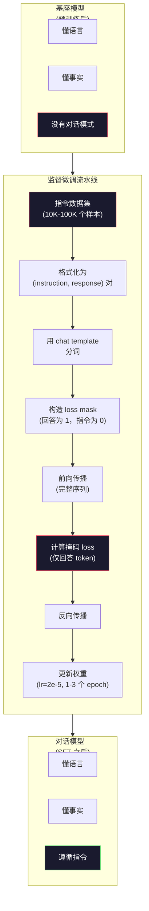

# 指令微调（SFT）

> 基座模型只预测下一个 token。仅此而已。它不会遵循指令、回答问题，也不会拒绝有害请求。SFT 是 token 预测器与有用助手之间的桥梁。你对话过的每个模型——Claude、GPT、Llama Chat——都经过这一步。

**Type:** Build
**Languages:** Python (with numpy)
**Prerequisites:** Phase 10, Lesson 04（预训练一个迷你 GPT）
**Time:** ~90 分钟
## Learning Objectives

- 实现监督微调（SFT），把基座语言模型变成能遵循指令的助手
- 用包含 system、user、assistant 角色的 chat template 格式化训练数据，并只在非 assistant 的 token 上计算 loss
- 解释为什么需要 SFT：基座模型只会续写文本，而不是回答问题
- 通过在留出的指令集上对比基座模型与微调后模型的回答，评估 SFT 的质量

## 问题场景

你在第 04 课训练了一个模型。给定一个序列，它能预测下一个 token。喂给它 "The transformer architecture"，它可能会接着写 "has revolutionized natural language processing."。对一个 next-token 预测器来说，这已经很了不起。

现在试试这个：喂给它 "What is the capital of France?"。基座模型不会回答 "Paris."。它会延续模式。它可能生成 "What is the capital of Germany? What is the capital of Spain?"，因为它从包含问题列表的文档里学到了这个模式。它也可能生成 "is a question that many people ask"，因为这是合理的下一 token 延续。模型没有*回答*这个概念。它只懂*续写*。

这就是 GPT-3（基座模型，2020 年 6 月发布）和 ChatGPT（指令微调版，2022 年 11 月发布）之间的差距。同样的架构。同样的预训练。区别在于 20,000 到 100,000 对精心构造的（instruction, response）数据，它们教会了模型遵循对话模式。

Stanford Alpaca 证明了你不需要数百万个样本。2023 年 3 月，他们只用 52,000 对由 GPT-3.5 生成的指令-回答数据微调了 Llama 7B。总成本：600 美元。结果是一个能遵循指令、回答问题、进行对话的聊天机器人。不如 ChatGPT，但以 600 美元和几小时训练的成本来看，已经惊人地接近。

Meta 的 Llama 2 Chat 在初始 SFT 阶段只用了约 27,000 个高质量样本。关键洞察：质量比数量更重要。27,000 个由熟练标注员撰写的样本，胜过 100 万个从互联网抓取来的噪声样本。

## 核心概念

### SFT 到底做了什么

监督微调延续了预训练的训练循环——前向传播、计算 loss、反向传播、更新权重——只是换了一种数据。你训练的不再是原始文本，而是结构化的对话：

```json
{
  "system": "You are a helpful assistant.",
  "user": "What is the capital of France?",
  "assistant": "The capital of France is Paris."
}
```

模型已经知道 Paris 是法国的首都。它在预训练时从维基百科、教科书和网页中学到了这一点。SFT 不教模型新事实。它教模型一种新*行为*：看到问题就产出答案。看到指令就产出完成。看到有害请求就产出拒绝。

可以这样理解：预训练给模型知识。SFT 给模型礼貌。

### 数据格式

三种格式主导着业界。它们编码同样的信息——谁说了什么——只是分隔符不同。

**Alpaca 格式**（Stanford，2023 年 3 月）：

```json
{
  "instruction": "Summarize the following article in 3 sentences.",
  "input": "The European Central Bank raised interest rates...",
  "output": "The ECB increased rates by 25 basis points..."
}
```

简单且被广泛使用。`input` 字段是可选的——很多指令不需要额外上下文。Stanford 用这种格式发布了 52,000 个样本，由 GPT-3.5 生成，花了 600 美元。这开启了开源指令微调运动。

**ShareGPT 格式**（社区，2023 年）：

```json
{
  "conversations": [
    {"from": "system", "value": "You are a helpful assistant."},
    {"from": "human", "value": "What causes tides?"},
    {"from": "gpt", "value": "Tides are caused by the gravitational pull of the Moon..."},
    {"from": "human", "value": "How often do they occur?"},
    {"from": "gpt", "value": "Most coastal areas experience two high tides and two low tides per day..."}
  ]
}
```

支持多轮对话。"from" 字段按惯例使用 "human" 和 "gpt"，与真实模型无关。Vicuna 是在 70,000 段从用户分享的 ChatGPT 记录中抓取的 ShareGPT 对话上训练的。

**ChatML 格式**（OpenAI，被许多开源模型采用）：

```
<|im_start|>system
You are a helpful assistant.<|im_end|>
<|im_start|>user
What is the capital of France?<|im_end|>
<|im_start|>assistant
The capital of France is Paris.<|im_end|>
```

使用特殊 token（`<|im_start|>`、`<|im_end|>`）分隔角色。这些 token 在微调时被加入 tokenizer 的词表。Qwen、Yi 和许多其他模型都使用 ChatML。

三种格式做的事完全一样：告诉模型"这是指令，这是回答，学这个模式"。

### 为什么有效

模型从预训练中已经懂语言了。它见过数十亿个"问题后跟答案"、"指令后跟完成"以及人与人对话的例子。这些模式已经编码在权重里。

SFT 把这种潜在能力集中起来。与其让模型自己从上下文判断该回答问题还是续写文档，SFT 显式地在对话模式上训练。经过几千个样本后，模型学会了：看到 assistant 角色标记，就产出有用的回答。

这就是 27,000 个样本就够用的原因。你不是在教模型英语。你不是在教它世界事实。你是在教它一个简单行为：响应指令。知识早就在那里了。

### 掩码 loss

这是 SFT 中最重要的技术细节，而大多数教程都跳过了它。

预训练时，你在每个 token 上计算 loss。模型学习预测序列中的每一个下一 token。SFT 时，你只在*回答*的 token 上计算 loss。指令 token 在那里提供上下文，但模型不会因为"预测"它们不对而被惩罚。

为什么？因为你不想让模型学会*生成*指令。你想让它学会*响应*指令。如果你在指令 token 上计算 loss，你就是在训练模型把 "What is the capital of France?" 当作自己在提问一样去预测。这浪费梯度信号，还可能让模型搞不清自己的角色。

实践中，你构造一个 loss mask：回答 token 为 1，指令 token 为 0。求平均前，把逐 token 的 loss 乘上这个 mask。

```
Tokens:    [SYS] You are helpful [USER] What is the capital? [ASST] Paris is the capital [EOS]
Loss mask:   0    0    0     0      0     0   0  0     0       1     1    1   1     1      1
```

只有 `[ASST]` 之后的 token 对 loss 有贡献。前向传播时模型看到完整对话（它需要指令才能产出正确回答），但权重只根据它预测回答的准确程度更新。

### 训练超参数

SFT 使用的超参数与预训练截然不同。你不是从零训练，而是在调整一个已经能用的模型。

| 参数 | 预训练（Llama 2 7B） | SFT（Llama 2 Chat） |
|-----------|---------------------------|---------------------|
| 学习率 | 3e-4（峰值） | 2e-5 |
| Epoch 数 | 1（数据单次遍历） | 2 |
| Batch size | 4M tokens | 64 examples |
| Warmup 步数 | 2,000 | 0-100 |
| Weight decay | 0.1 | 0.0-0.1 |
| 数据规模 | 2T tokens | 27,000 examples |

SFT 的学习率低 15 倍。这很关键。微调时的高学习率会摧毁预训练知识。模型"忘记"它学到的东西，过拟合到小小的微调数据集上。这就是灾难性遗忘。

两个 epoch 意味着模型把每个训练样本看两遍。在小数据集上超过 3 个 epoch 会导致记忆——模型开始逐字复现训练样本，而不是泛化。

### 灾难性遗忘

微调可能摧毁通用能力。在指令遵循数据上训练太久，模型会失去写代码、做数学或产出创意文本的能力。它会在训练数据的具体格式上变得非常出色，在其他所有事情上一塌糊涂。

三种缓解手段：

1. **低学习率。** 1e-5 到 5e-5。更小的更新意味着对预训练特征的破坏更少。

2. **短训练。** 1-3 个 epoch。在模型过拟合之前停下。

3. **混入预训练数据。** Llama 2 Chat 在 SFT 数据集中混入了小比例（2-5%）的原始预训练数据。这在学习新的指令遵循行为的同时，"提醒"模型它的通用能力。

### 真实数字

在单张 NVIDIA A100 80GB GPU 上，用 10,000 对高质量指令数据微调 7B 模型大约需要 1 小时。算一下：

- 10,000 个样本 × 平均 512 个 token = 5.12M tokens
- 2 个 epoch = 总共 10.24M tokens
- 7B 模型微调的 A100 吞吐：约 3,000 tokens/秒
- 10.24M / 3,000 = 约 3,400 秒 = 约 57 分钟

对于我们的迷你 GPT（4 层、128 维），训练几乎瞬间完成。重点是理解机制，而不是规模。



```figure
loss-masking
```

## Build It

### 第 1 步：指令数据集

创建一个合成指令数据集。在生产中，Scale AI 和 Anthropic 这样的公司会雇人工标注员来写这些数据。我们用程序生成，以演示格式。

```python
import numpy as np

INSTRUCTION_DATA = [
    {
        "instruction": "What is the capital of France?",
        "response": "The capital of France is Paris."
    },
    {
        "instruction": "Explain gravity in one sentence.",
        "response": "Gravity is the force that attracts objects with mass toward each other."
    },
    {
        "instruction": "Write a haiku about the ocean.",
        "response": "Waves crash on the shore, salt and foam beneath the sun, endless blue expanse."
    },
    {
        "instruction": "What is 15 multiplied by 7?",
        "response": "15 multiplied by 7 is 105."
    },
    {
        "instruction": "Name three programming languages.",
        "response": "Three programming languages are Python, Rust, and TypeScript."
    },
    {
        "instruction": "Summarize photosynthesis.",
        "response": "Photosynthesis converts sunlight, water, and carbon dioxide into glucose and oxygen."
    },
    {
        "instruction": "What year did World War II end?",
        "response": "World War II ended in 1945."
    },
    {
        "instruction": "Define machine learning.",
        "response": "Machine learning is a field where algorithms learn patterns from data to make predictions."
    },
]
```

八个样本很少。Stanford Alpaca 用了 52,000 个。但无论你手里是 8 个还是 52,000 个，机制都一样：分词、掩码、只在回答上计算 loss。

### 第 2 步：用 chat template 分词

把指令-回答对转换成带特殊角色标记的 token 序列。这些标记告诉模型指令在哪里结束、回答从哪里开始。

```python
SPECIAL_TOKENS = {
    "INST_START": 253,
    "INST_END": 254,
    "RESP_START": 255,
}


def tokenize_instruction_pair(instruction, response, vocab_size=256):
    inst_tokens = list(instruction.encode("utf-8"))
    resp_tokens = list(response.encode("utf-8"))

    inst_tokens = [min(t, vocab_size - 4) for t in inst_tokens]
    resp_tokens = [min(t, vocab_size - 4) for t in resp_tokens]

    tokens = (
        [SPECIAL_TOKENS["INST_START"]]
        + inst_tokens
        + [SPECIAL_TOKENS["INST_END"]]
        + [SPECIAL_TOKENS["RESP_START"]]
        + resp_tokens
    )

    return tokens


def create_loss_mask(tokens):
    mask = np.zeros(len(tokens), dtype=np.float32)
    in_response = False

    for i, token in enumerate(tokens):
        if token == SPECIAL_TOKENS["RESP_START"]:
            in_response = True
            continue
        if in_response:
            mask[i] = 1.0

    return mask
```

指令 token 的 loss mask 全为 0，回答 token 全为 1。`RESP_START` 这个 token 本身的 mask 是 0，因为它是分隔符，不属于回答内容。

### 第 3 步：掩码交叉熵 loss

标准的交叉熵，但乘上 loss mask。只有回答 token 对梯度有贡献。

```python
def masked_cross_entropy_loss(logits, targets, loss_mask):
    batch, seq_len, vocab_size = logits.shape
    logits_flat = logits.reshape(-1, vocab_size)
    targets_flat = targets.reshape(-1)
    mask_flat = loss_mask.reshape(-1)

    max_logits = logits_flat.max(axis=-1, keepdims=True)
    log_softmax = logits_flat - max_logits - np.log(
        np.exp(logits_flat - max_logits).sum(axis=-1, keepdims=True)
    )

    per_token_loss = -log_softmax[np.arange(len(targets_flat)), targets_flat]

    masked_loss = per_token_loss * mask_flat
    num_response_tokens = mask_flat.sum()
    if num_response_tokens == 0:
        return 0.0
    loss = masked_loss.sum() / num_response_tokens

    return loss
```

分母是 `num_response_tokens`，不是 `seq_len`。如果除以总序列长度，较长的指令会稀释梯度信号。除以回答 token 数，能保证无论指令多长，每个回答 token 的权重相同。

### 第 4 步：SFT 训练循环

复用第 04 课的 MiniGPT。训练循环看起来与预训练几乎一样，只是加上指令格式化和掩码 loss。

```python
import sys
import os
sys.path.insert(0, os.path.join(os.path.dirname(__file__), "..", "..", "04-pre-training-mini-gpt", "code"))
from main import MiniGPT, LayerNorm, FeedForward, MultiHeadAttention, TransformerBlock, Embedding


def sft_train(model, dataset, num_epochs=2, lr=2e-5, seq_len=64):
    formatted_data = []
    for example in dataset:
        tokens = tokenize_instruction_pair(example["instruction"], example["response"])
        mask = create_loss_mask(tokens)
        formatted_data.append((tokens, mask))

    print(f"SFT Training: {len(formatted_data)} examples, {num_epochs} epochs, lr={lr}")
    print(f"Total tokens: {sum(len(t) for t, _ in formatted_data):,}")
    print()

    losses = []

    for epoch in range(num_epochs):
        epoch_loss = 0.0
        num_batches = 0

        indices = np.random.permutation(len(formatted_data))

        for idx in indices:
            tokens, mask = formatted_data[idx]

            if len(tokens) < 3:
                continue
            if len(tokens) > seq_len:
                tokens = tokens[:seq_len]
                mask = mask[:seq_len]

            input_ids = np.array(tokens[:-1]).reshape(1, -1)
            target_ids = np.array(tokens[1:]).reshape(1, -1)
            loss_mask = np.array(mask[1:]).reshape(1, -1)

            logits = model.forward(input_ids)
            loss = masked_cross_entropy_loss(logits, target_ids, loss_mask)

            batch_size, s_len, v_size = logits.shape
            probs = np.exp(logits - logits.max(axis=-1, keepdims=True))
            probs = probs / probs.sum(axis=-1, keepdims=True)
            dlogits = probs.copy()
            dlogits[np.arange(batch_size)[:, None], np.arange(s_len), target_ids] -= 1.0

            mask_expanded = loss_mask[:, :, np.newaxis]
            num_resp = loss_mask.sum()
            if num_resp > 0:
                dlogits = dlogits * mask_expanded / num_resp

            for block in model.blocks:
                block.ffn.W1 -= lr * np.random.randn(*block.ffn.W1.shape) * 0.01
                block.ffn.W2 -= lr * np.random.randn(*block.ffn.W2.shape) * 0.01
                block.ffn.b1 -= lr * np.random.randn(*block.ffn.b1.shape) * 0.01
                block.ffn.b2 -= lr * np.random.randn(*block.ffn.b2.shape) * 0.01

            epoch_loss += loss
            num_batches += 1
            losses.append(loss)

        avg_loss = epoch_loss / max(num_batches, 1)
        print(f"Epoch {epoch + 1}/{num_epochs} | Avg Loss: {avg_loss:.4f}")

    return model, losses
```

学习率是 2e-5，与 Llama 2 Chat 一致。对比预训练用的 3e-4——小了 15 倍。梯度被掩码：指令 token 产生零梯度。只有回答 token 推动权重。

### 第 5 步：对比基座模型与 SFT 模型

SFT 的全部意义就在于行为改变。我们通过检查模型对指令格式输入与原始文本续写的反应来衡量它。

```python
def generate_response(model, prompt_tokens, max_new_tokens=50, temperature=0.8):
    tokens = list(prompt_tokens)
    seq_len = model.embedding.pos_embed.shape[0]

    for _ in range(max_new_tokens):
        context = np.array(tokens[-seq_len:]).reshape(1, -1)
        logits = model.forward(context)
        next_logits = logits[0, -1, :]

        next_logits = next_logits / max(temperature, 1e-8)
        probs = np.exp(next_logits - next_logits.max())
        probs = probs / probs.sum()
        probs = np.clip(probs, 1e-10, 1.0)
        probs = probs / probs.sum()

        next_token = np.random.choice(len(probs), p=probs)
        tokens.append(int(next_token))

    return tokens


def evaluate_instruction_following(model, instructions):
    print("Evaluating instruction following:")
    print("-" * 50)

    for instruction in instructions:
        tokens = (
            [SPECIAL_TOKENS["INST_START"]]
            + [min(t, 252) for t in list(instruction.encode("utf-8"))]
            + [SPECIAL_TOKENS["INST_END"]]
            + [SPECIAL_TOKENS["RESP_START"]]
        )

        output = generate_response(model, tokens, max_new_tokens=30, temperature=0.6)
        response_start = len(tokens)
        response_tokens = output[response_start:]
        response_bytes = bytes([t for t in response_tokens if t < 128])
        response_text = response_bytes.decode("utf-8", errors="replace")

        print(f"  Q: {instruction}")
        print(f"  A: {response_text[:80]}")
        print()
```

在只有 8 个样本的迷你模型上，回答不会有什么意义。这是预期之中的。重要的是*结构*：模型学会了在回答标记之后产出输出，而不是继续生成更多指令。

### 第 6 步：衡量灾难性遗忘

对比 SFT 前后模型的下一 token 预测能力。如果 SFT 损害了通用能力，原始文本上的 loss 会上升。

```python
def measure_forgetting(model, test_text, seq_len=64):
    tokens = np.array(list(test_text.encode("utf-8")[:512]))

    total_loss = 0.0
    num_windows = 0

    for start in range(0, len(tokens) - seq_len - 1, seq_len):
        input_ids = tokens[start:start + seq_len].reshape(1, -1)
        target_ids = tokens[start + 1:start + seq_len + 1].reshape(1, -1)

        logits = model.forward(input_ids)

        batch, s_len, vocab_size = logits.shape
        logits_flat = logits.reshape(-1, vocab_size)
        targets_flat = target_ids.reshape(-1)

        max_logits = logits_flat.max(axis=-1, keepdims=True)
        log_softmax = logits_flat - max_logits - np.log(
            np.exp(logits_flat - max_logits).sum(axis=-1, keepdims=True)
        )

        loss = -log_softmax[np.arange(len(targets_flat)), targets_flat].mean()
        total_loss += loss
        num_windows += 1

    return total_loss / max(num_windows, 1)
```

在真实的微调中，你会在整个训练过程中跟踪这个指标。如果原始文本 loss 上升超过 10-15%，说明你的 SFT 太激进了。降低学习率或减少 epoch 数。

## Use It

### 完整的 SFT 流水线演示

```python
if __name__ == "__main__":
    np.random.seed(42)

    test_text = """The transformer architecture processes sequences through self-attention.
Each layer applies multi-head attention followed by a feedforward network.
Residual connections and layer normalization stabilize deep networks.
The model learns to predict the next token given all previous tokens."""

    print("=" * 70)
    print("INSTRUCTION TUNING (SFT) DEMO")
    print("=" * 70)
    print()

    model = MiniGPT(
        vocab_size=256, embed_dim=128, num_heads=4,
        num_layers=4, max_seq_len=128, ff_dim=512
    )
    print(f"Model: {model.count_parameters():,} parameters")
    print(f"Config: 4 layers, 4 heads, 128 dims (mini GPT from Lesson 04)")
    print()

    print("PRE-SFT: Measuring base model loss on raw text")
    base_loss = measure_forgetting(model, test_text)
    print(f"  Base model loss: {base_loss:.4f}")
    print()

    print("=" * 70)
    print("SFT TRAINING")
    print("=" * 70)

    model, losses = sft_train(
        model, INSTRUCTION_DATA, num_epochs=3, lr=2e-5, seq_len=128
    )

    print()
    print("POST-SFT: Measuring fine-tuned model loss on raw text")
    sft_loss = measure_forgetting(model, test_text)
    print(f"  SFT model loss: {sft_loss:.4f}")
    print(f"  Change: {((sft_loss - base_loss) / base_loss * 100):+.1f}%")
    if abs(sft_loss - base_loss) / base_loss < 0.15:
        print("  Minimal forgetting (< 15% change)")
    else:
        print("  Significant forgetting detected")
    print()

    print("=" * 70)
    print("INSTRUCTION FOLLOWING EVALUATION")
    print("=" * 70)
    print()

    test_instructions = [
        "What is the capital of France?",
        "Name a programming language.",
        "Define gravity.",
    ]
    evaluate_instruction_following(model, test_instructions)

    print("=" * 70)
    print("DATA FORMAT EXAMPLES")
    print("=" * 70)
    print()

    for i, example in enumerate(INSTRUCTION_DATA[:3]):
        tokens = tokenize_instruction_pair(example["instruction"], example["response"])
        mask = create_loss_mask(tokens)
        resp_count = int(mask.sum())
        total_count = len(tokens)
        print(f"  Example {i + 1}: {total_count} tokens, {resp_count} response tokens ({resp_count/total_count:.0%} of sequence)")
        print(f"    Instruction: {example['instruction']}")
        print(f"    Response: {example['response']}")
        print()

    print("=" * 70)
    print("TRAINING LOSS CURVE")
    print("=" * 70)
    print()

    if losses:
        window = max(1, len(losses) // 5)
        for i in range(0, len(losses), window):
            chunk = losses[i:i + window]
            avg = sum(chunk) / len(chunk)
            print(f"  Steps {i:3d}-{i + len(chunk) - 1:3d}: avg loss = {avg:.4f}")
```

## Ship It

本课产出 `outputs/prompt-sft-data-curator.md`——一个帮助你设计和整理 SFT 指令数据集的 prompt。给定目标能力（代码生成、数学、对话），它会产出一份数据收集计划，包含格式规范、质量标准和多样性要求。

## Exercises

1. 加入 system prompt 支持。修改 `tokenize_instruction_pair`，让它接受 system 消息并添加到指令之前。构造 5 个使用不同 system prompt 的样本（"You are a poet"、"You are a math tutor"），验证模型在训练时看到了不同的 system prompt。

2. 实现数据混合。写一个函数，接收 SFT 数据集和原始文本语料，产出训练 batch，其中 5% 的样本是原始文本（不掩码），95% 是指令对（掩码）。跑 3 个 epoch，对比纯 SFT 训练下的遗忘指标。

3. 构建数据质量打分器。对每对指令-回答计算：(a) 回答的 token 长度，(b) 指令与回答的长度比，(c) 词表多样性（唯一 token 数 / 总 token 数）。过滤掉回答长度 < 10 个 token 或多样性 < 0.3 的样本。展示过滤如何影响最终 loss。

4. 实现多轮对话训练。扩展分词逻辑以处理 3 轮对话（user-assistant-user-assistant-user-assistant）。loss mask 应覆盖全部三个 assistant 轮次。打印一个样本的 token-mask 对齐情况，验证 mask 正确。

5. 对比学习率。用 lr=1e-4、lr=2e-5 和 lr=1e-6 各训练同一个模型一次。画出 loss 曲线。1e-4 那一轮应该初期下降很快但最终 loss 更高（过拟合）。1e-6 那一轮应该几乎不动。2e-5 那一轮应该是最佳点。

## Key Terms

| 术语 | 人们常说 | 实际含义 |
|------|----------------|----------------------|
| SFT | "在对话上微调" | Supervised Fine-Tuning：在 (instruction, response) 对上继续训练，loss 只在回答 token 上计算 |
| Instruction tuning | "教模型遵循指令" | 在显式的指令-回答对上训练，让基座模型学会对话模式，而不是学到新知识 |
| Loss masking | "忽略 prompt" | 把指令 token 的 loss 置零，使梯度只来自回答 token 的预测 |
| ChatML | "Chat Markup Language" | 一种用 `<\|im_start\|>` 和 `<\|im_end\|>` 分隔符标记对话数据中说话者角色的 token 格式 |
| Alpaca format | "Stanford 的格式" | 带 instruction/input/output 字段的 JSON 格式，用于 52K 个花费 600 美元的 GPT-3.5 生成样本 |
| Catastrophic forgetting | "模型变笨了" | 微调摧毁预训练能力，因为梯度更新用任务特定模式覆盖了通用知识 |
| Weight tying | "共享 embedding" | 输入 token embedding 和输出预测头使用同一个矩阵，节省参数并提升连贯性 |
| Chat template | "你怎么格式化 prompt" | 为模型组织对话的具体 token 序列（角色标记、分隔符） |

## Further Reading

- [Ouyang et al., 2022 -- "Training language models to follow instructions with human feedback" (InstructGPT)](https://arxiv.org/abs/2203.02155)——在 OpenAI 引入指令微调 + RLHF 的论文
- [Taori et al., 2023 -- "Stanford Alpaca: An Instruction-following LLaMA Model"](https://github.com/tatsu-lab/stanford_alpaca)——600 美元的 52K 指令样本，证明 SFT 在小数据集上有效
- [Touvron et al., 2023 -- "Llama 2: Open Foundation and Fine-Tuned Chat Models"](https://arxiv.org/abs/2307.09288)——Meta 的 SFT + RLHF 流水线，用了 27K 个高质量样本
- [Chiang et al., 2023 -- "Vicuna: An Open-Source Chatbot Impressing GPT-4"](https://lmsys.org/blog/2023-03-30-vicuna/)——在 70K 段 ShareGPT 对话上训练
- [Zhou et al., 2023 -- "LIMA: Less Is More for Alignment"](https://arxiv.org/abs/2305.11206)——证明 1,000 个精心筛选的样本就能匹敌在更大数据集上做的 SFT
