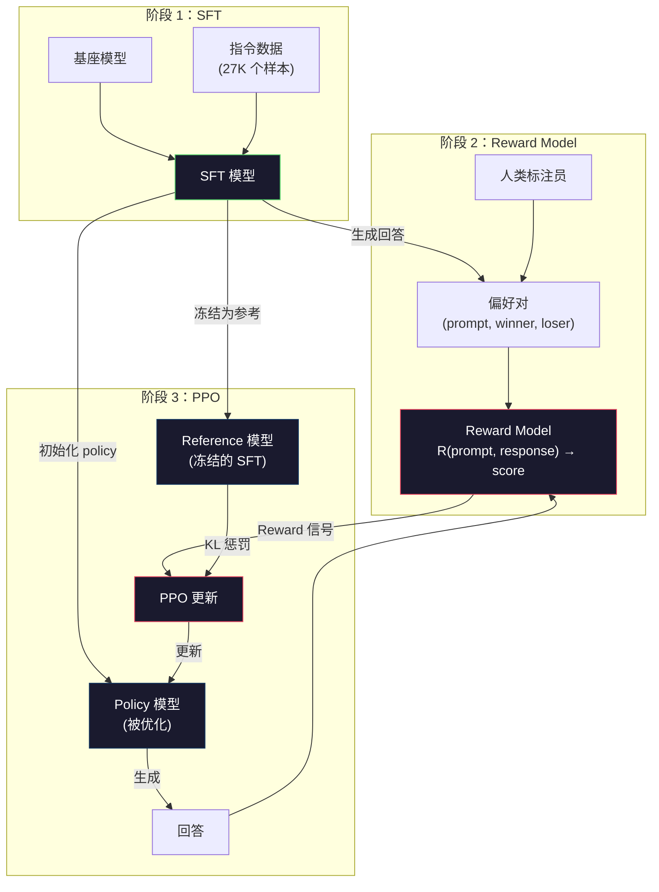
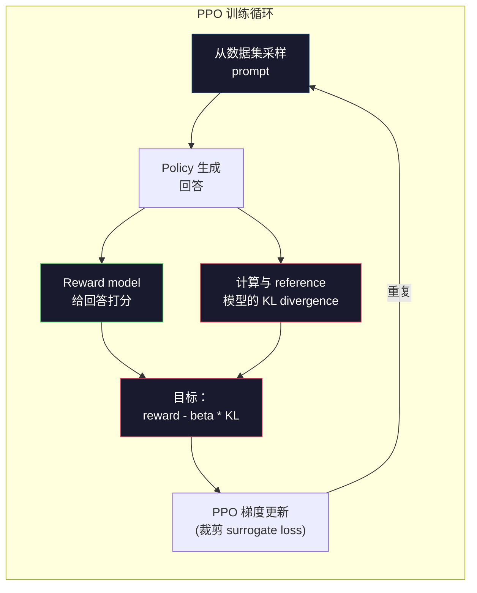

# RLHF：Reward Model + PPO

> SFT 教会模型遵循指令。但它没有教会模型哪个回答更*好*。两个语法正确、事实准确回答，在有用性上可能天差地别。RLHF 就是把人类判断编码进模型行为的方式。它让 Claude 乐于助人，让 GPT 彬彬有礼。

**Type:** Build
**Languages:** Python (with numpy)
**Prerequisites:** Phase 10, Lesson 06（指令微调 / SFT）
**Time:** ~90 分钟
## Learning Objectives

- 从人类偏好对（chosen vs rejected）构建一个能给回答质量打分的 reward model
- 实现用 reward model 优化语言模型 policy 的 PPO 训练循环，并加上 KL 惩罚
- 解释 RLHF 为什么需要三个模型（SFT、reward、policy），以及 KL 约束如何防止 reward hacking
- 通过对比偏好优化前后的回答质量，评估 RLHF 的效果

## 问题场景

让模型"解释量子计算"，它可能产出：

**回答 A：** "Quantum computing uses qubits that can exist in superposition, meaning they can be 0, 1, or both simultaneously. This allows quantum computers to process certain calculations exponentially faster than classical computers. Key algorithms include Shor's algorithm for factoring large numbers and Grover's algorithm for searching unsorted databases."

**回答 B：** "Quantum computing is a type of computing that uses quantum mechanical phenomena. It was first proposed in the 1980s. Richard Feynman suggested that quantum systems could be simulated by quantum computers. The field has grown significantly since then. Many companies are now working on quantum computers. IBM, Google, and others have made progress. Quantum supremacy was claimed by Google in 2019."

两个回答事实都正确。语法都没问题。都遵循了指令。但回答 A 明显更好。它更简洁、信息量更大、结构更好。人类每次都会选 A。

SFT 捕捉不到这种区别。它在"正确"的回答上训练模型，但没有机制说"这个回答比那个好"。它把每个训练样本当作同样好。如果 A 和 B 都出现在 SFT 数据集里，模型会同等对待它们。

RLHF 解决了这个问题。它训练一个 reward model 来预测人类更偏好哪个回答，然后用这个 reward 信号把语言模型推向更高质量的输出。InstructGPT（ChatGPT 的前身）用 RLHF 大幅提升了 GPT-3 的有用性、真实性和无害性。OpenAI 的内部评估者在 85% 的情况下更偏好 InstructGPT 的输出而非 GPT-3 的输出，尽管 InstructGPT 小了 135 倍（1.3B 对 175B 参数）。

## 核心概念

### 三个阶段

RLHF 不是一次训练。它是由三个顺序阶段组成的流水线，每一阶段都建立在前一阶段之上。

**阶段 1：SFT。** 在指令-回答对上训练基座模型（第 06 课）。这给你一个能遵循指令、但不知道哪些回答更好的模型。

**阶段 2：Reward Model。** 收集人类偏好数据：给标注员看同一个 prompt 的两个回答，问"哪个更好？"训练一个模型来预测这些偏好。reward model 以 (prompt, response) 为输入，输出一个标量分数。

**阶段 3：PPO。** 用 reward model 为语言模型生成训练信号。语言模型生成回答，reward model 给它们打分，PPO 更新语言模型以产出分数更高的回答。KL divergence 惩罚防止语言模型偏离 SFT checkpoint 太远。



### Reward Model

reward model 是一个被改造成打分器的语言模型。拿 SFT 模型，把语言建模头（输出词表上的分布）替换成标量头（输出一个数）。除了最后一层，架构完全相同。

输入：prompt 与回答拼接。输出：单个标量 reward 分数。

训练数据是人类偏好对。对每个 prompt，标注员看两个回答并选出更好的。这产生了训练三元组：(prompt, preferred_response, rejected_response)。

loss 函数使用 Bradley-Terry 成对偏好模型：

```
loss = -log(sigmoid(reward(preferred) - reward(rejected)))
```

这是关键方程。`sigmoid(reward(A) - reward(B))` 给出回答 A 优于回答 B 的概率。loss 推动 reward model 给偏好回答更高的分数。

为什么用成对比较而不是绝对分数？因为人类非常不擅长给绝对质量打分（"这个回答是 10 分里的 7.3 还是 7.5？"），但非常擅长相对比较（"A 比 B 好吗？"）。Bradley-Terry 模型把相对比较转换成一致的绝对打分体系。

**InstructGPT 的数字：** OpenAI 从 40 名承包商那里收集了 33,000 对比较。每次比较大约花 5 分钟。这就是 2,750 小时的人力，用于 reward model 的训练数据。

### PPO：Proximal Policy Optimization

PPO 是一种强化学习算法。在 RLHF 中，"环境"是 reward model，"agent"是语言模型，"动作"是生成一个 token。

目标：

```
maximize: E[R(prompt, response)] - beta * KL(policy || reference)
```

第一项推动模型生成高 reward 的回答。第二项（KL divergence 惩罚）防止模型偏离 SFT checkpoint 太远。

为什么需要 KL 惩罚？没有它，模型会找到退化解。reward model 是在有限的人类偏好数据上训练的。它有盲区。语言模型会利用这些盲区——找到在 reward model 上得分很高但实际上毫无意义的输出。经典例子：

- 重复 "I'm so helpful and harmless!" 在有用性/无害性 reward model 上得分很高
- 产出冗长、听起来正式但空洞的回答，因为它们模式匹配到"高质量"
- 利用训练数据中恰好与高 reward 相关的特定短语

KL 惩罚的意思是：你可以变好，但不能变成完全不同的模型。保持在已经合理的 SFT 版本附近。偏离太远，KL 代价就会压过 reward。

**InstructGPT 的数字：** PPO 训练用 lr=1.5e-5、KL 系数 beta=0.02、256K 个 episode（prompt-回答对），每个 batch 做 4 个 PPO epoch。整个 RLHF 流水线在一组 GPU 集群上花了好几天。



### PPO 目标详解

PPO 使用"裁剪 surrogate 目标"来防止过大的更新。新 policy 与旧 policy 概率之间的比值被裁剪到 [1 - epsilon, 1 + epsilon] 区间，其中 epsilon 通常是 0.2。

```
ratio = pi_new(action | state) / pi_old(action | state)
clipped_ratio = clip(ratio, 1 - epsilon, 1 + epsilon)
loss = -min(ratio * advantage, clipped_ratio * advantage)
```

advantage 函数估计当前回答比预期质量好多少。在 RLHF 中：

```
advantage = reward(prompt, response) - baseline
```

baseline 通常是近期回答的平均 reward。正 advantage 意味着回答比平均好；负 advantage 意味着更差。PPO 提高高于平均的回答的概率，降低低于平均的回答的概率。

裁剪防止灾难性更新。如果单个回答拿到异常高的 reward，未裁剪的比值可能非常大，导致模型剧烈偏向那个回答。裁剪限制了更新幅度，维持训练稳定。

### Reward Hacking

RLHF 的暗面。语言模型在针对 reward model 做优化，而 reward model 是人类偏好的不完美代理。随着语言模型越来越擅长最大化 reward，它开始利用 reward model 的弱点。

常见失效模式：

| 失效模式 | 会发生什么 | 原因 |
|---------|-------------|-----|
| 冗长 | 模型产出越来越长的回答 | 人类标注员往往偏爱更长、更详细的回答，所以 reward model 给长度更高分数 |
| 谄媚 | 模型同意用户说的一切 | 标注员偏爱认同问题前提的回答 |
| 含糊其辞 | 模型拒绝给出确定答案 | 含糊的回答（"这是一个涉及多种视角的复杂话题……"）很少被标记为错误 |
| 格式作弊 | 模型过度使用项目符号和标题 | 格式化的回答在标注员眼里更"精致" |

缓解策略：更强的 KL 惩罚（防止模型偏得足够远以利用弱点）、在对抗样本上训练 reward model（修补已知失效模式）、使用多个不同架构的 reward model（很难同时 hack 所有）。

### 真实的 RLHF 流水线

| 模型 | 比较对 | 标注员 | RM 规模 | PPO 步数 | KL 系数 |
|-------|-----------------|------------|---------|-----------|----------|
| InstructGPT | 33K | 40 | 6B | 256K | 0.02 |
| Llama 2 Chat | ~1M | 未公开 | 70B | 未公开 | 0.01 |
| Claude | 未公开 | 未公开 | 未公开 | 未公开 | 未公开 |
| Anthropic RLHF paper | 22K | 20 | 52B | 50K | 0.001 |

Anthropic 2022 年的论文在 22,000 对比较上训练了一个 52B 的 reward model。更大的 reward model 产生更可靠的信号，使 PPO 训练更稳定。用小 reward model 训练大语言模型是有风险的——reward model 没有足够容量捕捉好回答与坏回答之间的细微差别。

```figure
rlhf-pipeline
```

## Build It

### 第 1 步：合成偏好数据

在生产中，人类标注员创建偏好数据。我们构造合成对，其中"偏好"的回答客观上更好（更简洁、更准确、更有用）。

```python
import numpy as np

PREFERENCE_DATA = [
    {
        "prompt": "What is the capital of France?",
        "preferred": "The capital of France is Paris.",
        "rejected": "France is a country in Europe. It has many cities. The capital is Paris. Paris is known for the Eiffel Tower.",
    },
    {
        "prompt": "Explain gravity in one sentence.",
        "preferred": "Gravity is the force that attracts objects with mass toward each other.",
        "rejected": "Gravity is something that makes things fall down when you drop them.",
    },
    {
        "prompt": "What is 15 times 7?",
        "preferred": "15 times 7 is 105.",
        "rejected": "Let me think about this. 15 times 7. Well, 10 times 7 is 70, and 5 times 7 is 35, so the answer might be around 105.",
    },
    {
        "prompt": "Name three programming languages.",
        "preferred": "Python, Rust, and TypeScript.",
        "rejected": "There are many programming languages. Some popular ones include various languages like Python and others.",
    },
    {
        "prompt": "What year did World War II end?",
        "preferred": "World War II ended in 1945.",
        "rejected": "World War II was a major global conflict. It involved many countries. The war ended in the mid-1940s, specifically in 1945.",
    },
    {
        "prompt": "Define machine learning.",
        "preferred": "Machine learning is a field where algorithms learn patterns from data to make predictions without being explicitly programmed.",
        "rejected": "Machine learning is a type of AI. AI stands for artificial intelligence. Machine learning uses data to learn.",
    },
]
```

偏好回答简洁直接。被拒绝的回答展示了常见失效模式：不必要的填充、含糊其辞、重复解释和不精确。这正是 SFT 捕捉不到、而 RLHF 能捕捉的区别。

### 第 2 步：Reward Model 架构

reward model 复用迷你 GPT 的 transformer 架构，但把词表大小的输出头换成单标量投影。

```python
import sys
import os
sys.path.insert(0, os.path.join(os.path.dirname(__file__), "..", "..", "04-pre-training-mini-gpt", "code"))
from main import MiniGPT, LayerNorm, Embedding, TransformerBlock


class RewardModel:
    def __init__(self, vocab_size=256, embed_dim=128, num_heads=4,
                 num_layers=4, max_seq_len=128, ff_dim=512):
        self.embedding = Embedding(vocab_size, embed_dim, max_seq_len)
        self.blocks = [
            TransformerBlock(embed_dim, num_heads, ff_dim)
            for _ in range(num_layers)
        ]
        self.ln_f = LayerNorm(embed_dim)
        self.reward_head = np.random.randn(embed_dim) * 0.02

    def forward(self, token_ids):
        seq_len = token_ids.shape[-1]
        mask = np.triu(np.full((seq_len, seq_len), -1e9), k=1)

        x = self.embedding.forward(token_ids)
        for block in self.blocks:
            x = block.forward(x, mask)
        x = self.ln_f.forward(x)

        last_hidden = x[:, -1, :]
        reward = last_hidden @ self.reward_head

        return reward
```

reward model 取*最后*一个 token 位置的 hidden state，把它投影成标量。为什么是最后一个 token？因为 causal attention mask 意味着最后那个位置已经注意到所有之前的 token。它对整个 (prompt, response) 序列有最完整的表示。

### 第 3 步：Bradley-Terry Loss

用 Bradley-Terry 成对 loss 在偏好对上训练 reward model。

```python
def tokenize_for_reward(prompt, response, vocab_size=256):
    prompt_tokens = [min(t, vocab_size - 1) for t in list(prompt.encode("utf-8"))]
    response_tokens = [min(t, vocab_size - 1) for t in list(response.encode("utf-8"))]
    return prompt_tokens + [0] + response_tokens


def sigmoid(x):
    return np.where(
        x >= 0,
        1.0 / (1.0 + np.exp(-x)),
        np.exp(x) / (1.0 + np.exp(x))
    )


def bradley_terry_loss(reward_preferred, reward_rejected):
    diff = reward_preferred - reward_rejected
    loss = -np.log(sigmoid(diff) + 1e-8)
    return loss


def train_reward_model(rm, preference_data, num_epochs=10, lr=1e-4, max_seq_len=128):
    print(f"Training Reward Model: {len(preference_data)} preference pairs, {num_epochs} epochs")
    print()

    losses = []
    accuracies = []

    for epoch in range(num_epochs):
        epoch_loss = 0.0
        epoch_correct = 0
        num_pairs = 0

        indices = np.random.permutation(len(preference_data))

        for idx in indices:
            pair = preference_data[idx]

            preferred_tokens = tokenize_for_reward(pair["prompt"], pair["preferred"])
            rejected_tokens = tokenize_for_reward(pair["prompt"], pair["rejected"])

            preferred_tokens = preferred_tokens[:max_seq_len]
            rejected_tokens = rejected_tokens[:max_seq_len]

            preferred_ids = np.array(preferred_tokens).reshape(1, -1)
            rejected_ids = np.array(rejected_tokens).reshape(1, -1)

            r_preferred = rm.forward(preferred_ids)[0]
            r_rejected = rm.forward(rejected_ids)[0]

            loss = bradley_terry_loss(r_preferred, r_rejected)

            if r_preferred > r_rejected:
                epoch_correct += 1

            diff = r_preferred - r_rejected
            grad = sigmoid(diff) - 1.0

            rm.reward_head -= lr * grad * rm.ln_f.forward(
                rm.embedding.forward(preferred_ids)
            )[:, -1, :].flatten()

            epoch_loss += loss
            num_pairs += 1

        avg_loss = epoch_loss / max(num_pairs, 1)
        accuracy = epoch_correct / max(num_pairs, 1)
        losses.append(avg_loss)
        accuracies.append(accuracy)

        if epoch % 2 == 0:
            print(f"  Epoch {epoch + 1:3d} | Loss: {avg_loss:.4f} | Accuracy: {accuracy:.1%}")

    return rm, losses, accuracies
```

准确率指标很直观：reward model 正确排序的偏好对占多大比例？随机模型得 50%。在干净数据上训练良好的 reward model 应该超过 70%。InstructGPT 的 reward model 在留出比较上达到约 72% 准确率，听起来不高，但实际上很好——许多偏好对即使对人类也是模糊的（标注员间一致率约为 73%）。

### 第 4 步：简化的 PPO 循环

完整的 PPO 很复杂。这个实现抓住核心机制：生成回答、给它们打分、计算 advantage，并用 KL 惩罚更新 policy。

```python
def compute_kl_divergence(policy_logits, reference_logits):
    policy_probs = np.exp(policy_logits - policy_logits.max(axis=-1, keepdims=True))
    policy_probs = policy_probs / policy_probs.sum(axis=-1, keepdims=True)
    policy_probs = np.clip(policy_probs, 1e-10, 1.0)

    ref_probs = np.exp(reference_logits - reference_logits.max(axis=-1, keepdims=True))
    ref_probs = ref_probs / ref_probs.sum(axis=-1, keepdims=True)
    ref_probs = np.clip(ref_probs, 1e-10, 1.0)

    kl = np.sum(policy_probs * np.log(policy_probs / ref_probs), axis=-1)
    return kl.mean()


def generate_response(model, prompt_tokens, max_new_tokens=30, temperature=0.8, max_seq_len=128):
    tokens = list(prompt_tokens)

    for _ in range(max_new_tokens):
        context = np.array(tokens[-max_seq_len:]).reshape(1, -1)
        logits = model.forward(context)
        next_logits = logits[0, -1, :]

        next_logits = next_logits / max(temperature, 1e-8)
        probs = np.exp(next_logits - next_logits.max())
        probs = probs / probs.sum()
        probs = np.clip(probs, 1e-10, 1.0)
        probs = probs / probs.sum()

        next_token = np.random.choice(len(probs), p=probs)
        tokens.append(int(next_token))

    return tokens


def copy_model_weights(source, target):
    target.embedding.token_embed = source.embedding.token_embed.copy()
    target.embedding.pos_embed = source.embedding.pos_embed.copy()
    target.ln_f.gamma = source.ln_f.gamma.copy()
    target.ln_f.beta = source.ln_f.beta.copy()
    for s_block, t_block in zip(source.blocks, target.blocks):
        t_block.attn.W_q = s_block.attn.W_q.copy()
        t_block.attn.W_k = s_block.attn.W_k.copy()
        t_block.attn.W_v = s_block.attn.W_v.copy()
        t_block.attn.W_out = s_block.attn.W_out.copy()
        t_block.ffn.W1 = s_block.ffn.W1.copy()
        t_block.ffn.W2 = s_block.ffn.W2.copy()
        t_block.ffn.b1 = s_block.ffn.b1.copy()
        t_block.ffn.b2 = s_block.ffn.b2.copy()
        t_block.ln1.gamma = s_block.ln1.gamma.copy()
        t_block.ln1.beta = s_block.ln1.beta.copy()
        t_block.ln2.gamma = s_block.ln2.gamma.copy()
        t_block.ln2.beta = s_block.ln2.beta.copy()


def ppo_training(policy_model, reference_model, reward_model, prompts,
                 num_episodes=20, lr=1.5e-5, kl_coeff=0.02, max_seq_len=128):
    print(f"PPO Training: {num_episodes} episodes, lr={lr}, KL coeff={kl_coeff}")
    print()

    rewards_history = []
    kl_history = []

    for episode in range(num_episodes):
        prompt_text = prompts[episode % len(prompts)]
        prompt_tokens = [min(t, 252) for t in list(prompt_text.encode("utf-8"))]

        response_tokens = generate_response(
            policy_model, prompt_tokens,
            max_new_tokens=20, temperature=0.8, max_seq_len=max_seq_len
        )

        response_ids = np.array(response_tokens[:max_seq_len]).reshape(1, -1)
        reward = reward_model.forward(response_ids)[0]

        policy_logits = policy_model.forward(response_ids)
        ref_logits = reference_model.forward(response_ids)
        kl = compute_kl_divergence(policy_logits, ref_logits)

        total_reward = reward - kl_coeff * kl

        rewards_history.append(float(reward))
        kl_history.append(float(kl))

        for block in policy_model.blocks:
            update_scale = lr * total_reward
            block.ffn.W1 += update_scale * np.random.randn(*block.ffn.W1.shape) * 0.01
            block.ffn.W2 += update_scale * np.random.randn(*block.ffn.W2.shape) * 0.01

        if episode % 5 == 0:
            avg_reward = np.mean(rewards_history[-5:]) if rewards_history else 0
            avg_kl = np.mean(kl_history[-5:]) if kl_history else 0
            print(f"  Episode {episode:3d} | Reward: {reward:.4f} | KL: {kl:.4f} | "
                  f"Avg Reward: {avg_reward:.4f}")

    return policy_model, rewards_history, kl_history
```

核心循环：(1) 采样一个 prompt，(2) 生成回答，(3) 用 reward model 打分，(4) 计算与冻结 reference 的 KL divergence，(5) 计算调整后的 reward（reward 减 KL 惩罚），(6) 更新 policy。随着 policy 偏离 reference，KL 惩罚增大，自动防止 reward hacking。

### 第 5 步：Reward 分数对比

经过 RLHF 后，policy 模型的回答在 reward model 上的得分应该高于原始 SFT 模型的回答。

```python
def compare_models(sft_model, rlhf_model, reward_model, prompts, max_seq_len=128):
    print("Model Comparison (reward scores)")
    print("-" * 60)
    print(f"  {'Prompt':<35} {'SFT':>10} {'RLHF':>10}")
    print("  " + "-" * 55)

    sft_total = 0.0
    rlhf_total = 0.0

    for prompt in prompts:
        prompt_tokens = [min(t, 252) for t in list(prompt.encode("utf-8"))]

        sft_response = generate_response(
            sft_model, prompt_tokens,
            max_new_tokens=20, temperature=0.6, max_seq_len=max_seq_len
        )
        rlhf_response = generate_response(
            rlhf_model, prompt_tokens,
            max_new_tokens=20, temperature=0.6, max_seq_len=max_seq_len
        )

        sft_ids = np.array(sft_response[:max_seq_len]).reshape(1, -1)
        rlhf_ids = np.array(rlhf_response[:max_seq_len]).reshape(1, -1)

        sft_reward = reward_model.forward(sft_ids)[0]
        rlhf_reward = reward_model.forward(rlhf_ids)[0]

        sft_total += sft_reward
        rlhf_total += rlhf_reward

        truncated_prompt = prompt[:33] + ".." if len(prompt) > 35 else prompt
        print(f"  {truncated_prompt:<35} {sft_reward:>10.4f} {rlhf_reward:>10.4f}")

    n = len(prompts)
    print("  " + "-" * 55)
    print(f"  {'Average':<35} {sft_total/n:>10.4f} {rlhf_total/n:>10.4f}")

    return sft_total / n, rlhf_total / n
```

## Use It

### 完整的 RLHF 流水线演示

```python
if __name__ == "__main__":
    np.random.seed(42)

    print("=" * 70)
    print("RLHF PIPELINE: REWARD MODEL + PPO")
    print("=" * 70)
    print()

    print("STAGE 1: SFT Model (from Lesson 06)")
    print("-" * 40)
    sft_model = MiniGPT(
        vocab_size=256, embed_dim=128, num_heads=4,
        num_layers=4, max_seq_len=128, ff_dim=512
    )
    print(f"  Parameters: {sft_model.count_parameters():,}")
    print()

    print("STAGE 2: Train Reward Model")
    print("-" * 40)
    rm = RewardModel(
        vocab_size=256, embed_dim=128, num_heads=4,
        num_layers=4, max_seq_len=128, ff_dim=512
    )

    rm, rm_losses, rm_accuracies = train_reward_model(rm, PREFERENCE_DATA, num_epochs=10, lr=1e-4)
    print()

    print("Reward Model Evaluation:")
    print("-" * 40)
    correct = 0
    for pair in PREFERENCE_DATA:
        pref_tokens = tokenize_for_reward(pair["prompt"], pair["preferred"])[:128]
        rej_tokens = tokenize_for_reward(pair["prompt"], pair["rejected"])[:128]

        r_pref = rm.forward(np.array(pref_tokens).reshape(1, -1))[0]
        r_rej = rm.forward(np.array(rej_tokens).reshape(1, -1))[0]

        if r_pref > r_rej:
            correct += 1
        print(f"  Preferred: {r_pref:+.4f} | Rejected: {r_rej:+.4f} | {'Correct' if r_pref > r_rej else 'Wrong'}")

    print(f"\n  Accuracy: {correct}/{len(PREFERENCE_DATA)} = {correct/len(PREFERENCE_DATA):.1%}")
    print()

    print("STAGE 3: PPO Training")
    print("-" * 40)

    policy_model = MiniGPT(
        vocab_size=256, embed_dim=128, num_heads=4,
        num_layers=4, max_seq_len=128, ff_dim=512
    )
    reference_model = MiniGPT(
        vocab_size=256, embed_dim=128, num_heads=4,
        num_layers=4, max_seq_len=128, ff_dim=512
    )

    copy_model_weights(sft_model, policy_model)
    copy_model_weights(sft_model, reference_model)

    train_prompts = [pair["prompt"] for pair in PREFERENCE_DATA]

    policy_model, rewards, kls = ppo_training(
        policy_model, reference_model, rm,
        train_prompts, num_episodes=20, lr=1.5e-5, kl_coeff=0.02
    )
    print()

    print("=" * 70)
    print("COMPARISON: SFT vs RLHF")
    print("=" * 70)
    print()

    eval_prompts = [
        "What is the capital of France?",
        "Explain gravity.",
        "Name three programming languages.",
    ]

    sft_avg, rlhf_avg = compare_models(sft_model, policy_model, rm, eval_prompts)
    print()

    print("=" * 70)
    print("KL DIVERGENCE ANALYSIS")
    print("=" * 70)
    print()

    if kls:
        print(f"  Initial KL: {kls[0]:.4f}")
        print(f"  Final KL:   {kls[-1]:.4f}")
        print(f"  Max KL:     {max(kls):.4f}")
        kl_threshold = 0.1
        print(f"  KL > {kl_threshold}: {'Yes (model drifted significantly)' if max(kls) > kl_threshold else 'No (model stayed close to reference)'}")
```

## Ship It

本课产出 `outputs/prompt-reward-model-designer.md`——一个用于设计 reward model 训练流水线的 prompt。给定目标行为（有用性、编码能力、安全性），它会产出数据收集协议、标注员指南和 reward model 评估标准。

## Exercises

1. 修改 reward model，使用所有 hidden state 的均值而不是只用最后一个位置。对比准确率。mean pooling 给每个 token 相同权重，而最后位置方法依赖 causal attention 聚合信息。在 6 对偏好数据上测试，报告哪种方法准确率更高。

2. 实现 reward model 校准。训练后，把所有偏好对跑过 reward model，计算：(a) 偏好回答的平均 reward，(b) 被拒回答的平均 reward，(c) margin（偏好减被拒）。校准良好的模型应该有清晰的 margin。然后加入 4 对新的偏好数据，检查 margin 在未见数据上是否保持。

3. 模拟 reward hacking。构造一个给长回答高分的 reward model（reward = len(response) / 100）。用这个有缺陷的 reward model 跑 PPO，观察 policy 模型生成越来越长、越来越重复的输出。然后加入 0.1 的 KL 惩罚，展示它阻止了退化行为。

4. 实现多目标 reward。训练两个 reward model——一个针对有用性，一个针对简洁性。把它们组合为 R = 0.7 * R_helpful + 0.3 * R_concise。展示组合目标产出的回答既有用又简洁，避免了单一有用性 reward 的冗长陷阱。

5. 对比不同的 KL 系数。分别用 beta=0.001（太低，reward hacking）、beta=0.02（标准）、beta=0.5（太高，学不到东西）跑 PPO。画出每种设置的 reward 曲线和 KL 曲线。beta=0.02 那一轮应该表现出稳定的 reward 提升，KL 有界。

## Key Terms

| 术语 | 人们常说 | 实际含义 |
|------|----------------|----------------------|
| RLHF | "用人类反馈训练" | Reinforcement Learning from Human Feedback：用人类偏好信号优化语言模型输出的三阶段流水线（SFT、reward model、PPO） |
| Reward model | "给回答打分的模型" | 带标量输出头的 transformer，用 Bradley-Terry loss 在成对人类偏好上训练 |
| Bradley-Terry | "那个比较模型" | 一个概率模型，P(A > B) = sigmoid(score(A) - score(B))，把成对偏好转换成一致的打分函数 |
| PPO | "那个 RL 算法" | Proximal Policy Optimization：更新 policy 以最大化 reward，同时裁剪更新幅度以防止不稳定 |
| KL divergence | "两个分布差多少" | 衡量 policy 模型的 token 分布与 reference 模型之间的差异——用作防止 reward hacking 的惩罚 |
| KL penalty | "给模型拴上绳" | 从 reward 信号中减去 Beta * KL(policy \|\| reference)——防止 policy 偏离 SFT checkpoint 太远 |
| Reward hacking | "钻 reward 的空子" | policy 通过利用 reward model 的弱点找到退化的高 reward 输出，而不是真正变好 |
| Preference pair | "哪个更好，A 还是 B？" | 由 (prompt, preferred_response, rejected_response) 组成的训练样本——RLHF 训练数据的基本单位 |
| Reference model | "冻结的 SFT checkpoint" | SFT 模型的副本，权重永不改变——用作 KL divergence 计算的锚点 |

## Further Reading

- [Ouyang et al., 2022 -- "Training language models to follow instructions with human feedback" (InstructGPT)](https://arxiv.org/abs/2203.02155)——让 RLHF 在大语言模型上变得实用的论文
- [Schulman et al., 2017 -- "Proximal Policy Optimization Algorithms"](https://arxiv.org/abs/1707.06347)——OpenAI 的 PPO 原始论文
- [Bai et al., 2022 -- "Training a Helpful and Harmless Assistant with Reinforcement Learning from Human Feedback"](https://arxiv.org/abs/2204.05862)——Anthropic 的 RLHF 论文，详细分析了 reward hacking 和 KL 惩罚
- [Stiennon et al., 2020 -- "Learning to summarize with human feedback"](https://arxiv.org/abs/2009.01325)——RLHF 应用于摘要，展示 reward model 能捕捉细微的质量判断
- [Christiano et al., 2017 -- "Deep reinforcement learning from human preferences"](https://arxiv.org/abs/1706.03741)——从人类比较中学习 reward 函数的奠基工作
