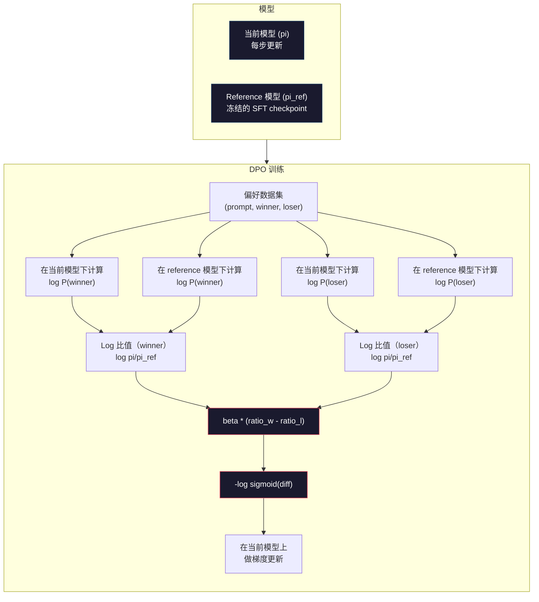

# DPO：Direct Preference Optimization

> RLHF 有效。但它需要训练三个模型（SFT、reward model、policy），处理 PPO 的不稳定性，还要调 KL 惩罚。DPO 问的是：如果这些都能跳过呢？DPO 直接在偏好对上优化语言模型。没有 reward model。没有 PPO。一个训练循环。同样的结果。

**Type:** Build
**Languages:** Python (with numpy)
**Prerequisites:** Phase 10, Lesson 07（RLHF）
**Time:** ~90 分钟
## Learning Objectives

- 实现 DPO 训练，在不需要单独 reward model 的情况下直接在偏好对上优化语言模型
- 推导 DPO 的 loss 函数，并解释它如何通过 policy 的 log 概率隐式表示一个 reward model
- 从训练稳定性、计算成本和所需模型数量三个维度对比 DPO 与 RLHF
- 调整 beta 参数以控制训练后的 policy 偏离 reference 模型的程度

## 问题场景

你在第 07 课搭好了 RLHF 流水线。三个阶段。三个模型。SFT 模型、reward model，以及用 PPO 优化的 policy 模型。光 reward model 就需要数千对人工偏好数据和一个单独的训练循环。PPO 需要仔细调节 KL 系数、学习率、裁剪比例和 epoch 数。

实践中，PPO 训练出了名地不稳定。超参数的微小改动就会让训练发散。reward model 是人类偏好的不完美代理，policy 会找到利用其弱点的方法。KL 惩罚有帮助，但需要自己调参——太低会 reward hacking，太高模型几乎学不到东西。

正是这种复杂性，让大多数开源模型在 InstructGPT 发布后好几年里都搞不定 RLHF。三阶段流水线很脆弱。每个阶段都有自己的失效模式，错误还会累积。

2023 年 5 月，Rafael Rafailov、Archit Sharma 和 Stanford 的同事发表了 "Direct Preference Optimization: Your Language Model is Secretly a Reward Model"。关键洞察：你不需要单独的 reward model。最优 reward 函数由语言模型自己的 token 概率在数学上决定。你可以完全跳过 reward model，直接在偏好对上优化语言模型。

DPO 把 RLHF 压缩成一个监督学习步骤。一个模型。一个 loss 函数。一个训练循环。没有强化学习。Zephyr-7B 是最早在规模化场景中使用 DPO 的模型之一，在多个 benchmark 上追平或超过了用完整 RLHF 训练的模型。Meta 把 DPO 用在了 Llama 3 对齐流水线的一部分。Anthropic 在其对齐研究中引用过 DPO 风格的方法。

## 核心概念

### 关键洞察

RLHF 优化这个目标：

```
maximize: E[R(x, y)] - beta * KL(pi || pi_ref)
```

其中 R 是 reward model，pi 是 policy，pi_ref 是 reference 模型，beta 是 KL 系数。

DPO 论文证明这个目标有闭式最优解。对任意 reward 函数 R，最优 policy 是：

```
pi*(y | x) = pi_ref(y | x) * exp(R(x, y) / beta) / Z(x)
```

其中 Z(x) 是归一化常数。重新排列：

```
R(x, y) = beta * log(pi*(y | x) / pi_ref(y | x)) + beta * log Z(x)
```

这就是突破点。reward 完全用 policy 模型的概率和 reference 模型的概率表示出来了。你不需要训练单独的 reward model。reward *隐式*地存在于概率比中。

把它代入 Bradley-Terry 偏好模型：

```
P(y_w > y_l | x) = sigmoid(R(x, y_w) - R(x, y_l))
                  = sigmoid(beta * (log pi(y_w|x)/pi_ref(y_w|x) - log pi(y_l|x)/pi_ref(y_l|x)))
```

Z(x) 项抵消了，因为两个回答都以同一个 prompt x 为条件。剩下的是仅由 policy 模型和 reference 模型在偏好回答与被拒回答上的 log 概率构成的函数。

### DPO Loss

```
L_DPO = -log(sigmoid(beta * (log pi(y_w|x)/pi_ref(y_w|x) - log pi(y_l|x)/pi_ref(y_l|x))))
```

逐项拆解：

- **y_w** = 偏好（获胜）的回答
- **y_l** = 被拒（落败）的回答
- **x** = prompt
- **pi** = 当前模型（正在训练）
- **pi_ref** = reference 模型（冻结的 SFT checkpoint）
- **beta** = 控制偏离 reference 程度的温度参数（通常在 0.1 到 0.5 之间）

比值 `log pi(y|x) / pi_ref(y|x)` 是 log 概率比。比值为正时，当前模型给回答 y 的概率高于 reference。为负时，当前模型给的概率更低。

DPO loss 推动模型提高偏好回答的 log 概率比，降低被拒回答的 log 概率比。beta 参数控制模型能多激进地偏离 reference——小 beta 允许大偏离，大 beta 让模型贴近 reference。



### DPO 为什么更简单

| 方面 | RLHF（PPO） | DPO |
|--------|-----------|-----|
| 要训练的模型 | 3 个（SFT + reward + policy） | 1 个（只有 policy） |
| 训练循环 | 3 个（SFT、RM 训练、PPO） | 2 个（SFT、DPO） |
| 超参数 | lr、KL 系数、裁剪比例、RM lr、epoch 各 3 组 | lr、beta、epoch |
| reward model | 必需（单独训练） | 隐式存在于模型概率中 |
| RL 算法 | PPO（复杂、不稳定） | 监督学习（稳定） |
| GPU 显存 | PPO 期间内存中有 3-4 个模型 | 2 个模型（当前 + reference） |
| 训练稳定性 | 对超参数敏感 | 稳健，与 SFT 类似 |

DPO 训练时内存里需要两个模型——当前模型和冻结的 reference。RLHF 需要三到四个：policy、reference、reward model，以及可选的 value function baseline。对 70B 模型，FP16 下每个副本占 140GB。去掉 reward model 省下的显存相当可观。

### DPO 何时胜过 RLHF

**小数据集。** 有 5,000-20,000 对偏好数据时，DPO 往往追平或超过 RLHF。RLHF 里的 reward model 需要足够的数据才能泛化——数据有限时它会过拟合，产生不可靠的 reward 信号。DPO 通过完全不需要 reward model 绕过了这个问题。

**算力有限。** DPO 所需的算力大约是完整 RLHF 的三分之一（一个训练循环而不是三个）。对没有大型 GPU 集群的团队，这是务实之选。

**快速迭代。** 想试 10 个不同的偏好数据集，看哪个产出的模型最好？DPO 让你几小时内就能跑完每个实验。RLHF 则需要为每个数据集重新训练 reward model。

### RLHF 何时胜过 DPO

**大规模训练。** 在 GPT-4 或 Claude 的规模上，RLHF 单独的 reward model 能捕捉更细微的偏好信号。reward model 充当一个学习到的 loss 函数，能适应复杂的质量标准。

**复杂 reward 信号。** 当"更好"涉及多个维度（有用性、无害性、诚实）时，reward model 能学到这种多目标权衡。DPO 把每对偏好当作二值信号——一个更好，一个更差——而不建模原因。

**迭代对齐。** RLHF 流水线可以用当前 policy 生成新回答，让人工打分，并在在线循环中重新训练 reward model。DPO 在固定的偏好对数据集上工作。Constitutional AI（Anthropic 的方法）大量利用了 RLHF 的这种迭代特性。

### DPO 之后：KTO、ORPO、SimPO

DPO 启发了一系列简化的对齐方法。

**KTO（Kahneman-Tversky Optimization，2024）：** 你甚至不需要成对数据。KTO 用不成对的反馈——只需把每个回答标为"好"或"坏"，无需与替代项比较。这极大简化了数据收集。不用给标注员看两个回答问"哪个更好？"，你只给他们看一个回答问"这个好吗？"loss 函数应用了前景理论的损失厌恶：坏回答被惩罚的程度高于好回答被奖励的程度。

**ORPO（Odds Ratio Preference Optimization，2024）：** 把 SFT 和对齐合并到单次训练步骤中。不是先做 SFT 再做 DPO，而是修改 SFT loss 让它包含偏好信号。loss 有两项：偏好回答上的标准 next-token 预测 loss，加上一个 odds ratio 项，拉大偏好回答与被拒回答的概率差距。一个训练循环而不是两个。

**SimPO（Simple Preference Optimization，2024）：** 完全去掉 reference 模型。不是对照冻结 reference 计算 log 概率比，SimPO 用回答的平均 log 概率（按长度归一化）作为隐式 reward。这节省显存（不需要 reference 模型）并简化训练。长度归一化防止模型偏好更短的回答。

| 方法 | 年份 | 内存中的模型 | 需要成对数据？ | 需要 reference？ | 训练循环 |
|--------|------|-----------------|-------------|-----------------|----------------|
| RLHF | 2022 | 3-4 | 是（用于 RM） | 是 | 3 |
| DPO | 2023 | 2 | 是 | 是 | 2 |
| KTO | 2024 | 2 | 否（不成对） | 是 | 2 |
| ORPO | 2024 | 1 | 是 | 否 | 1 |
| SimPO | 2024 | 1 | 是 | 否 | 1 |

趋势很清晰：每种方法都消除了一块复杂度。RLHF 需要 reward model 和 PPO。DPO 把两者都去掉了。KTO 去掉了成对数据。ORPO 去掉了单独的 SFT 阶段。SimPO 去掉了 reference 模型。对齐税——从基座模型到对齐模型所需的算力和复杂度成本——一直在下降。

### 真实的 DPO 部署

**Zephyr-7B（HuggingFace，2023 年 10 月）：** Mistral 7B 基座，在 UltraChat（200K 个样本）上做 SFT，然后在 UltraFeedback（60K 对偏好数据）上做 DPO。MT-Bench 得分 6.47——当时 7B 模型中的最高分。作为对比，Llama 2 Chat 70B 得 6.86，意味着 Zephyr 仅用 DPO 对齐就逼近了一个体积 10 倍于它的模型，差距在 6% 以内。

**Llama 3（Meta，2024 年 4 月）：** 在初始 RLHF 阶段之后使用了 DPO。这种组合表明 DPO 和 RLHF 可以互补——RLHF 负责广泛对齐，DPO 负责定向精修。

**Neural Magic / nm-chat（2024）：** 把 DPO 应用到多个开源模型，在多个对齐 benchmark 上一致比仅做 SFT 的基线提升 5-15%。

```figure
dpo-loss
```

## Build It

### 第 1 步：偏好数据集

与 RLHF 相同的格式——(prompt, preferred, rejected) 三元组。DPO 直接消费这些数据，不需要中间的 reward model。

```python
import numpy as np
import sys
import os
sys.path.insert(0, os.path.join(os.path.dirname(__file__), "..", "..", "04-pre-training-mini-gpt", "code"))
from main import MiniGPT, LayerNorm, Embedding, TransformerBlock

PREFERENCE_DATA = [
    {
        "prompt": "What is the capital of France?",
        "preferred": "The capital of France is Paris.",
        "rejected": "France is a country in Europe. It has many cities. The capital is Paris. Paris is known for the Eiffel Tower.",
    },
    {
        "prompt": "Explain gravity in one sentence.",
        "preferred": "Gravity is the force that attracts objects with mass toward each other.",
        "rejected": "Gravity is something that makes things fall down when you drop them.",
    },
    {
        "prompt": "What is 15 times 7?",
        "preferred": "15 times 7 is 105.",
        "rejected": "Let me think about this. 15 times 7. Well, 10 times 7 is 70, and 5 times 7 is 35, so the answer might be around 105.",
    },
    {
        "prompt": "Name three programming languages.",
        "preferred": "Python, Rust, and TypeScript.",
        "rejected": "There are many programming languages. Some popular ones include various languages like Python and others.",
    },
    {
        "prompt": "What year did World War II end?",
        "preferred": "World War II ended in 1945.",
        "rejected": "World War II was a major global conflict. It involved many countries. The war ended in the mid-1940s, specifically in 1945.",
    },
    {
        "prompt": "Define machine learning.",
        "preferred": "Machine learning is a field where algorithms learn patterns from data to make predictions without being explicitly programmed.",
        "rejected": "Machine learning is a type of AI. AI stands for artificial intelligence. Machine learning uses data to learn.",
    },
]
```

### 第 2 步：序列 log 概率

DPO loss 需要计算给定 prompt 时回答的总 log 概率。这意味着在完整 (prompt + response) 序列上跑模型，并把每个回答 token 的 log 概率加起来。

```python
def tokenize_sequence(text, vocab_size=256):
    return [min(t, vocab_size - 1) for t in list(text.encode("utf-8"))]


def compute_sequence_log_prob(model, prompt_tokens, response_tokens, max_seq_len=128):
    full_sequence = prompt_tokens + response_tokens
    if len(full_sequence) > max_seq_len:
        full_sequence = full_sequence[:max_seq_len]

    if len(full_sequence) < 2:
        return 0.0

    input_ids = np.array(full_sequence[:-1]).reshape(1, -1)
    target_ids = np.array(full_sequence[1:])

    logits = model.forward(input_ids)
    logits = logits[0]

    max_logits = logits.max(axis=-1, keepdims=True)
    log_probs = logits - max_logits - np.log(
        np.exp(logits - max_logits).sum(axis=-1, keepdims=True)
    )

    prompt_len = len(prompt_tokens)
    response_start = max(0, prompt_len - 1)
    response_end = len(target_ids)

    if response_start >= response_end:
        return 0.0

    response_log_probs = log_probs[response_start:response_end, :]
    response_targets = target_ids[response_start:response_end]

    total_log_prob = 0.0
    for i, target in enumerate(response_targets):
        total_log_prob += response_log_probs[i, target]

    return total_log_prob
```

这个函数是 DPO 的主力。对每对偏好数据，它要跑四次：模型跑偏好回答、模型跑被拒回答、reference 跑偏好回答、reference 跑被拒回答。每个训练样本 4 次前向传播，对比 RLHF 的生成 + reward 打分 + value 估计 + PPO 更新。更简单、更快、更稳定。

### 第 3 步：DPO Loss

论文核心的代码版。一个函数。一个 loss。没有 reward model。

```python
def sigmoid(x):
    return np.where(
        x >= 0,
        1.0 / (1.0 + np.exp(-x)),
        np.exp(x) / (1.0 + np.exp(x))
    )


def dpo_loss(policy_logprob_preferred, policy_logprob_rejected,
             ref_logprob_preferred, ref_logprob_rejected, beta=0.1):
    preferred_ratio = policy_logprob_preferred - ref_logprob_preferred
    rejected_ratio = policy_logprob_rejected - ref_logprob_rejected

    logit = beta * (preferred_ratio - rejected_ratio)

    loss = -np.log(sigmoid(logit) + 1e-8)

    preferred_reward = beta * preferred_ratio
    rejected_reward = beta * rejected_ratio

    return loss, {
        "preferred_ratio": float(preferred_ratio),
        "rejected_ratio": float(rejected_ratio),
        "logit": float(logit),
        "implicit_preferred_reward": float(preferred_reward),
        "implicit_rejected_reward": float(rejected_reward),
        "reward_margin": float(preferred_reward - rejected_reward),
    }
```

`preferred_ratio` 和 `rejected_ratio` 就是 DPO 推导中的 log 概率比。当当前模型给偏好回答更高的概率（相对于 reference）、给被拒回答更低的概率时，logit 为正，loss 很低。训练信号正是把模型往这个方向推。

`implicit_preferred_reward` 和 `implicit_rejected_reward` 是 DPO loss 隐式赋予的 reward。你可以把它们提取出来验证训练是否在起作用——偏好与被拒 reward 之间的 margin 应该随训练增加。

### 第 4 步：DPO 训练循环

一个标准的监督训练循环。没有 PPO。没有 reward model。只有前向传播和梯度更新。

```python
def copy_model_weights(source, target):
    target.embedding.token_embed = source.embedding.token_embed.copy()
    target.embedding.pos_embed = source.embedding.pos_embed.copy()
    target.ln_f.gamma = source.ln_f.gamma.copy()
    target.ln_f.beta = source.ln_f.beta.copy()
    for s_block, t_block in zip(source.blocks, target.blocks):
        t_block.attn.W_q = s_block.attn.W_q.copy()
        t_block.attn.W_k = s_block.attn.W_k.copy()
        t_block.attn.W_v = s_block.attn.W_v.copy()
        t_block.attn.W_out = s_block.attn.W_out.copy()
        t_block.ffn.W1 = s_block.ffn.W1.copy()
        t_block.ffn.W2 = s_block.ffn.W2.copy()
        t_block.ffn.b1 = s_block.ffn.b1.copy()
        t_block.ffn.b2 = s_block.ffn.b2.copy()
        t_block.ln1.gamma = s_block.ln1.gamma.copy()
        t_block.ln1.beta = s_block.ln1.beta.copy()
        t_block.ln2.gamma = s_block.ln2.gamma.copy()
        t_block.ln2.beta = s_block.ln2.beta.copy()


def dpo_train(policy_model, reference_model, preference_data,
              num_epochs=5, lr=5e-6, beta=0.1, max_seq_len=128):
    print(f"DPO Training: {len(preference_data)} pairs, {num_epochs} epochs, "
          f"lr={lr}, beta={beta}")
    print()

    losses = []
    margins = []

    for epoch in range(num_epochs):
        epoch_loss = 0.0
        epoch_margin = 0.0
        num_examples = 0

        indices = np.random.permutation(len(preference_data))

        for idx in indices:
            pair = preference_data[idx]

            prompt_tokens = tokenize_sequence(pair["prompt"])
            preferred_tokens = tokenize_sequence(pair["preferred"])
            rejected_tokens = tokenize_sequence(pair["rejected"])

            pi_logprob_w = compute_sequence_log_prob(
                policy_model, prompt_tokens, preferred_tokens, max_seq_len
            )
            pi_logprob_l = compute_sequence_log_prob(
                policy_model, prompt_tokens, rejected_tokens, max_seq_len
            )
            ref_logprob_w = compute_sequence_log_prob(
                reference_model, prompt_tokens, preferred_tokens, max_seq_len
            )
            ref_logprob_l = compute_sequence_log_prob(
                reference_model, prompt_tokens, rejected_tokens, max_seq_len
            )

            loss, metrics = dpo_loss(
                pi_logprob_w, pi_logprob_l,
                ref_logprob_w, ref_logprob_l, beta
            )

            update_direction = 1.0 if metrics["logit"] < 0 else -0.1
            for block in policy_model.blocks:
                block.ffn.W1 += lr * update_direction * np.random.randn(*block.ffn.W1.shape) * 0.01
                block.ffn.W2 += lr * update_direction * np.random.randn(*block.ffn.W2.shape) * 0.01

            epoch_loss += loss
            epoch_margin += metrics["reward_margin"]
            num_examples += 1
            losses.append(float(loss))
            margins.append(metrics["reward_margin"])

        avg_loss = epoch_loss / max(num_examples, 1)
        avg_margin = epoch_margin / max(num_examples, 1)

        print(f"  Epoch {epoch + 1}/{num_epochs} | Loss: {avg_loss:.4f} | "
              f"Avg Margin: {avg_margin:.4f}")

    return policy_model, losses, margins
```

与 RLHF 相比，这个训练循环简单得令人清爽。对每对偏好数据：计算四个 log 概率（两个模型、两个回答），代入 DPO loss，计算梯度，更新 policy。没有生成步骤。没有 reward model 推理。没有 advantage 估计。没有裁剪。

### 第 5 步：对比 DPO 与 RLHF

测量隐式 reward margin 和 log 概率偏移，把 DPO 与第 07 课的 RLHF 模型做对比。

```python
def evaluate_preference_accuracy(model, reference_model, preference_data, beta=0.1, max_seq_len=128):
    correct = 0
    total = 0

    for pair in preference_data:
        prompt_tokens = tokenize_sequence(pair["prompt"])
        preferred_tokens = tokenize_sequence(pair["preferred"])
        rejected_tokens = tokenize_sequence(pair["rejected"])

        pi_w = compute_sequence_log_prob(model, prompt_tokens, preferred_tokens, max_seq_len)
        pi_l = compute_sequence_log_prob(model, prompt_tokens, rejected_tokens, max_seq_len)
        ref_w = compute_sequence_log_prob(reference_model, prompt_tokens, preferred_tokens, max_seq_len)
        ref_l = compute_sequence_log_prob(reference_model, prompt_tokens, rejected_tokens, max_seq_len)

        preferred_reward = beta * (pi_w - ref_w)
        rejected_reward = beta * (pi_l - ref_l)

        if preferred_reward > rejected_reward:
            correct += 1
        total += 1

    return correct / max(total, 1)


def analyze_implicit_rewards(model, reference_model, preference_data, beta=0.1, max_seq_len=128):
    print("Implicit Reward Analysis:")
    print("-" * 65)
    print(f"  {'Prompt':<30} {'Pref Reward':>12} {'Rej Reward':>12} {'Margin':>10}")
    print("  " + "-" * 60)

    for pair in preference_data:
        prompt_tokens = tokenize_sequence(pair["prompt"])
        preferred_tokens = tokenize_sequence(pair["preferred"])
        rejected_tokens = tokenize_sequence(pair["rejected"])

        pi_w = compute_sequence_log_prob(model, prompt_tokens, preferred_tokens, max_seq_len)
        pi_l = compute_sequence_log_prob(model, prompt_tokens, rejected_tokens, max_seq_len)
        ref_w = compute_sequence_log_prob(reference_model, prompt_tokens, preferred_tokens, max_seq_len)
        ref_l = compute_sequence_log_prob(reference_model, prompt_tokens, rejected_tokens, max_seq_len)

        pref_reward = beta * (pi_w - ref_w)
        rej_reward = beta * (pi_l - ref_l)
        margin = pref_reward - rej_reward

        truncated = pair["prompt"][:28] + ".." if len(pair["prompt"]) > 30 else pair["prompt"]
        print(f"  {truncated:<30} {pref_reward:>12.4f} {rej_reward:>12.4f} {margin:>10.4f}")

    print()
```

### 第 6 步：Beta 敏感性分析

beta 参数是 DPO 中对应 RLHF 里 KL 系数的角色。它控制模型能偏离 reference 多少。这个实验展示它的影响。

```python
def beta_sensitivity_analysis(sft_model, preference_data, betas, max_seq_len=128):
    print("Beta Sensitivity Analysis")
    print("-" * 60)
    print(f"  {'Beta':>8} {'Final Loss':>12} {'Final Margin':>14} {'Accuracy':>10}")
    print("  " + "-" * 55)

    results = []

    for beta in betas:
        policy = MiniGPT(
            vocab_size=256, embed_dim=128, num_heads=4,
            num_layers=4, max_seq_len=max_seq_len, ff_dim=512
        )
        reference = MiniGPT(
            vocab_size=256, embed_dim=128, num_heads=4,
            num_layers=4, max_seq_len=max_seq_len, ff_dim=512
        )
        copy_model_weights(sft_model, policy)
        copy_model_weights(sft_model, reference)

        policy, losses, margins_list = dpo_train(
            policy, reference, preference_data,
            num_epochs=3, lr=5e-6, beta=beta, max_seq_len=max_seq_len
        )

        accuracy = evaluate_preference_accuracy(
            policy, reference, preference_data, beta, max_seq_len
        )

        final_loss = losses[-1] if losses else 0
        final_margin = margins_list[-1] if margins_list else 0

        print(f"  {beta:>8.3f} {final_loss:>12.4f} {final_margin:>14.4f} {accuracy:>10.1%}")
        results.append({
            "beta": beta,
            "final_loss": final_loss,
            "final_margin": final_margin,
            "accuracy": accuracy,
        })

        print()

    return results
```

小 beta（0.01）让模型自由偏离 reference——学得快但有过退化解的风险。大 beta（1.0）让模型贴近 reference——稳定但学得慢。大多数应用的最佳区间是 0.1 到 0.3。

## Use It

### 完整的 DPO 流水线演示

```python
if __name__ == "__main__":
    np.random.seed(42)

    print("=" * 70)
    print("DPO: DIRECT PREFERENCE OPTIMIZATION")
    print("=" * 70)
    print()

    print("STEP 1: Initialize SFT Model (from Lesson 06)")
    print("-" * 50)
    sft_model = MiniGPT(
        vocab_size=256, embed_dim=128, num_heads=4,
        num_layers=4, max_seq_len=128, ff_dim=512
    )
    print(f"  Parameters: {sft_model.count_parameters():,}")
    print()

    print("STEP 2: DPO Training")
    print("-" * 50)

    policy_model = MiniGPT(
        vocab_size=256, embed_dim=128, num_heads=4,
        num_layers=4, max_seq_len=128, ff_dim=512
    )
    reference_model = MiniGPT(
        vocab_size=256, embed_dim=128, num_heads=4,
        num_layers=4, max_seq_len=128, ff_dim=512
    )
    copy_model_weights(sft_model, policy_model)
    copy_model_weights(sft_model, reference_model)

    policy_model, losses, margins = dpo_train(
        policy_model, reference_model, PREFERENCE_DATA,
        num_epochs=5, lr=5e-6, beta=0.1
    )
    print()

    print("=" * 70)
    print("STEP 3: Evaluate")
    print("=" * 70)
    print()

    pre_accuracy = evaluate_preference_accuracy(
        sft_model, reference_model, PREFERENCE_DATA, beta=0.1
    )
    post_accuracy = evaluate_preference_accuracy(
        policy_model, reference_model, PREFERENCE_DATA, beta=0.1
    )

    print(f"  Preference accuracy (pre-DPO):  {pre_accuracy:.1%}")
    print(f"  Preference accuracy (post-DPO): {post_accuracy:.1%}")
    print()

    analyze_implicit_rewards(policy_model, reference_model, PREFERENCE_DATA, beta=0.1)

    print("=" * 70)
    print("STEP 4: Training Dynamics")
    print("=" * 70)
    print()

    if losses:
        print("  Loss curve:")
        window = max(1, len(losses) // 5)
        for i in range(0, len(losses), window):
            chunk = losses[i:i + window]
            avg = sum(chunk) / len(chunk)
            print(f"    Steps {i:3d}-{i + len(chunk) - 1:3d}: loss = {avg:.4f}")
        print()

    if margins:
        print("  Reward margin curve:")
        window = max(1, len(margins) // 5)
        for i in range(0, len(margins), window):
            chunk = margins[i:i + window]
            avg = sum(chunk) / len(chunk)
            print(f"    Steps {i:3d}-{i + len(chunk) - 1:3d}: margin = {avg:.4f}")
        print()

    print("=" * 70)
    print("STEP 5: Beta Sensitivity")
    print("=" * 70)
    print()

    beta_results = beta_sensitivity_analysis(
        sft_model, PREFERENCE_DATA, betas=[0.01, 0.1, 0.3, 1.0]
    )

    print("=" * 70)
    print("DPO vs RLHF COMPARISON")
    print("=" * 70)
    print()
    print("  DPO advantages:")
    print("    - 1 training loop (vs 3 for RLHF)")
    print("    - 2 models in memory (vs 3-4 for RLHF)")
    print("    - Supervised learning (vs RL, more stable)")
    print("    - No reward model to train or maintain")
    print()
    print("  RLHF advantages:")
    print("    - Separate reward model captures complex preferences")
    print("    - Online learning: generate, rate, retrain")
    print("    - Better for multi-objective alignment")
    print("    - Proven at largest scales (GPT-4, Claude)")
    print()
    print("  Practical guidance:")
    print("    - Start with DPO. It's simpler and often sufficient.")
    print("    - Switch to RLHF if DPO plateaus on your eval metrics.")
    print("    - Many production systems use both: RLHF first, DPO to refine.")
```

## Ship It

本课产出 `outputs/prompt-alignment-method-selector.md`——一个帮你为具体场景选择正确对齐方法（SFT、RLHF、DPO、KTO、ORPO、SimPO）的 prompt。根据你的数据可得性、算力预算和对齐目标，它推荐一种方法及训练计划。

## Exercises

1. 实现 KTO（Kahneman-Tversky Optimization）。KTO 不需要成对数据——只需把每个回答标为"好"或"坏"。好回答的 loss 是 `-log(sigmoid(beta * log_ratio))`，坏回答的 loss 是 `-log(1 - sigmoid(beta * log_ratio))`，并对坏回答的 loss 乘以损失厌恶系数（通常 1.5 倍）。在同一份数据上训练（把 preferred 当作"好"、rejected 当作"坏"，独立处理）并对比 DPO 的准确率。

2. 实现长度归一化的 DPO。不用原始 log 概率，而是除以回答 token 数：`normalized_logprob = total_logprob / num_tokens`。这防止模型偏好更短的回答（它们的总 log 概率更高）。对比归一化与不归一化时的隐式 reward margin。

3. 构建 ORPO 风格的组合 loss。在 DPO loss 上加上偏好回答的标准 next-token 预测 loss：`L = L_sft(preferred) + alpha * L_dpo`。尝试 alpha 取 0.1、0.5 和 1.0。组合 loss 应产出一个既能遵循指令（来自 SFT 项）又偏好更好回答（来自 DPO 项）的模型，从而省去单独的 SFT 阶段。

4. 实现迭代式 DPO。跑 3 个 epoch 的 DPO，然后用训练好的模型生成新回答，把它们与原始偏好回答配成新的偏好对，再跑一次 DPO。做两轮这种"自博弈"过程。对比第 1 轮和第 2 轮之后的偏好准确率，看迭代精修是否有帮助。

5. 用不同的 reference 模型对比 DPO。不用 SFT checkpoint 作 reference，尝试：(a) 基座模型（SFT 之前），(b) DPO 第 1 个 epoch 的 checkpoint，(c) policy 模型的指数移动平均。报告哪种 reference 产生最高的偏好准确率和最稳定的训练曲线。

## Key Terms

| 术语 | 人们常说 | 实际含义 |
|------|----------------|----------------------|
| DPO | "没有 RL 的 RLHF" | Direct Preference Optimization：一种监督学习算法，直接在偏好对上优化语言模型，绕过 reward model 和 PPO |
| Implicit reward | "reward 就在模型里" | reward 函数由 policy 与 reference 模型之间的 log 概率比决定——不需要单独的 reward model |
| Beta (DPO) | "那个温度" | 控制 policy 能偏离 reference 模型多远——小 beta 允许大偏离，大 beta 让模型贴近 |
| Log-probability ratio | "模型变了多少" | log pi(y\|x) - log pi_ref(y\|x)——为正表示当前模型给的概率高于 reference |
| Reference model | "冻结的 checkpoint" | SFT 模型的副本，权重永不改变——作为计算概率比的锚点 |
| KTO | "没有成对数据的 DPO" | Kahneman-Tversky Optimization：用不成对的"好"或"坏"标签工作，不需要偏好对 |
| ORPO | "一步对齐" | Odds Ratio Preference Optimization：在 SFT loss 中加入偏好项，把 SFT 和对齐合并到单个训练循环 |
| SimPO | "不需要 reference" | Simple Preference Optimization：用长度归一化的平均 log 概率作为隐式 reward，从而去掉 reference 模型 |
| Alignment tax | "让模型变安全的代价" | 从基座模型到对齐模型所需的额外算力、数据和复杂度——DPO 显著降低了它 |

## Further Reading

- [Rafailov et al., 2023 -- "Direct Preference Optimization: Your Language Model is Secretly a Reward Model"](https://arxiv.org/abs/2305.18290)——把对齐从 RLHF 简化为监督学习的 DPO 论文
- [Tunstall et al., 2023 -- "Zephyr: Direct Distillation of LM Alignment"](https://arxiv.org/abs/2310.16944)——Zephyr-7B，展示在 UltraFeedback 上做 DPO 能在 benchmark 上追平 RLHF
- [Ethayarajh et al., 2024 -- "KTO: Model Alignment as Prospect Theoretic Optimization"](https://arxiv.org/abs/2402.01306)——去掉成对偏好数据的需求
- [Hong et al., 2024 -- "ORPO: Monolithic Preference Optimization without Reference Model"](https://arxiv.org/abs/2403.07691)——把 SFT 和对齐合并在一步中
- [Meng et al., 2024 -- "SimPO: Simple Preference Optimization with a Reference-Free Reward"](https://arxiv.org/abs/2405.14734)——完全去掉 reference 模型
- [Llama 3 Technical Report](https://arxiv.org/abs/2407.21783)——Meta 结合 RLHF 和 DPO 的对齐流水线
