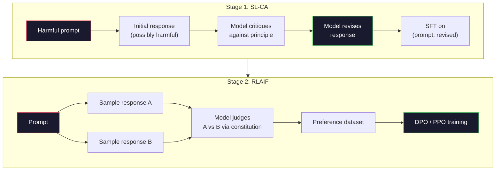
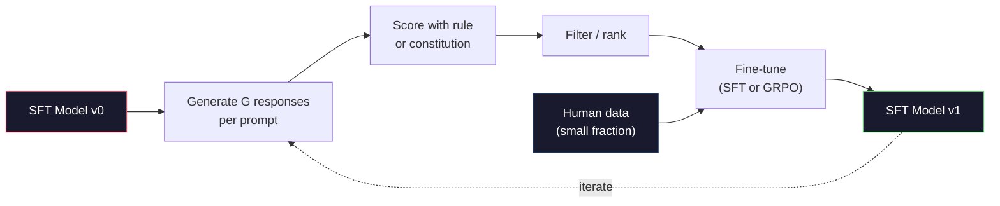

# Constitutional AI 与自我改进

> RLHF 需要人类留在回路里。Constitutional AI 用模型本身替换掉了其中大部分人。写下一份原则清单，让模型依据这些原则批判自己的输出，再拿这些批判结果去做训练。DeepSeek-R1 在 2025 年把这件事推得更远：让模型生成数以百万计的推理轨迹，用一条规则给它们打分，然后对结果跑 GRPO。2026 年一个前沿模型中的大部分"对齐工作"，就是模型自己在做对齐。本课把这两个回路都搭出来。

**Type:** Build
**Languages:** Python (stdlib + numpy)
**Prerequisites:** Phase 10, Lessons 06-08 (SFT、RLHF、DPO)
**Time:** ~45 分钟
## Learning Objectives

- 实现 Constitutional AI 的两阶段回路：自我批判加自我修订，然后基于修订后的配对做偏好训练
- 推导 GRPO 目标（DeepSeek-R1 的组相对策略优化），并把它与 PPO 的价值函数基线做对比
- 用基于规则的结果奖励生成可验证的推理轨迹，并在没有独立奖励模型的情况下给它们打分
- 判断自我改进何时优于人类偏好数据，何时会坍缩成 mode seeking

## 问题场景

你在第 07 课搭了 RLHF，在第 08 课搭了 DPO。两者都依赖同一种昂贵输入：人类偏好配对。Anthropic 在 InstructGPT 时代的流水线用了大约 33,000 条比较。Llama 2 Chat 用了超过 150 万条。Claude 3 用得更多。这类数据慢、贵，而且偏向标注者在打分当天碰巧相信的东西。

2022 年的 Constitutional AI 论文问了一个简单的问题。假如让模型自己生成偏好标签呢？给它一份写好的原则清单——也就是"宪法"——让它批判自己的回复。这些批判就成了训练信号。

2024 年，DeepSeek 把这个想法又推进了一步。他们证明，对于任何结果可验证的任务（有已知答案的数学题、要么通过测试要么失败通过的代码、要么赢要么输的游戏），你完全可以跳过批判者。生成许多候选解。用一条确定性规则给每一个打分。在奖励上跑策略梯度算法。DeepSeek-R1 就是这样训练的，几乎没用人类偏好数据，却达到了 o1 级别的推理表现。

这两个回路——用于主观行为的 Constitutional AI 和用于可验证行为的基于规则的 RL——是 2026 年主流的对齐配方。过去要投进 RLHF 的人类偏好预算，现在只需要为小得多的一步付费：挑选宪法，挑选奖励规则。

## 核心概念

### Constitutional AI 回路

Bai 等人（2022）把这条流水线组织成两个阶段。

**阶段 1：从 AI 反馈中监督学习（SL-CAI）。** 从一个有用但可能有害的 SFT 模型出发。用可能有害的请求去提示它。针对每条回复，让*同一个模型*依据某条宪法原则批判自己的回复，然后修订。在修订后的回复上做微调。数据集是 (prompt, revised_response) 配对。

**阶段 2：从 AI 反馈中强化学习（RLAIF）。** 采样成对的回复。问模型哪一条更好地遵循宪法。这些成对偏好用来训练一个奖励模型。然后使用该奖励对模型跑 PPO 或 DPO。与 RLHF 的关键差别在于：偏好来自模型，而不是来自人类。



宪法就是那个杠杆。Anthropic 最初的那份有 16 条原则（后来扩充过）。一条原则读起来像这样："请选择最不可能让来自各种文化背景的人感到反感的回复。"每一步你都要挑一条原则，有时随机挑，有时根据 prompt 类别挑。

### 宪法究竟做了什么

宪法把对齐契约从*数据*搬到了*文本*。在 RLHF 下改变行为意味着重新标注成千上万个配对。在 CAI 下改变行为意味着编辑一段文字。这是主要的实际收益。

它也有代价。模型自我判断的质量，最多只能等同于它起步时的校准水平。如果 SFT 模型存在盲区——比如它识别不出操纵性措辞——那么批判这一步就会继承这些盲区。CAI 压缩了对齐回路，但无法把信号放大到超过基座模型的天花板。这就是为什么每一个生产级 CAI 流水线仍然会用一些人类偏好数据，通常体量是纯 RLHF 的 5-10%。

### GRPO：组相对策略优化

DeepSeek 在 DeepSeekMath 论文（2024）中提出了 GRPO，并把它用作 DeepSeek-R1（2025）的骨干。GRPO 是 PPO 的一个变体，它去掉了价值函数。

回想 PPO 的目标（来自第 07 课）：

```
L_PPO = E[min(r(theta) * A, clip(r(theta), 1-eps, 1+eps) * A)]
```

其中 `A` 是优势，通常用 GAE 加上一个学习到的价值网络 `V(s)` 来估计。价值网络是第二个和策略同样大小的模型。它让内存翻倍，还引入自己的一套训练回路。

GRPO 扔掉价值函数。对每个 prompt，它采样一组 G 条回复（通常 G=16 或 64）。计算每条回复的奖励，然后在组内归一化：

```
A_i = (r_i - mean(r_1, ..., r_G)) / std(r_1, ..., r_G)
```

优势就是这条回复的奖励相对于它同组成员的 z-score。没有价值函数。组本身就是它的基线。

```
L_GRPO = E[min(r(theta) * A_group, clip(r(theta), 1-eps, 1+eps) * A_group)] - beta * KL(pi || pi_ref)
```

针对参考模型的 KL 惩罚仍然在，和 PPO 一样。裁剪比例也还在。消失的是那个独立的 critic。

### GRPO 为何对推理重要

对推理任务来说，奖励往往是稀疏且二值的：最终答案对或错。在稀疏二值奖励上训练的价值函数纯属浪费——它学不到有用的中间估计，因为在最后一步之前，几乎每个状态都有相同的期望回报。GRPO 的组归一化给你一个即时的相对信号：对同一道数学题的 16 次尝试里，哪些尝试在这道题上高于平均水平？

这正是基于规则的奖励能给你的信号形态：

- **数学**：sympy 或一个符号检查器判定最终答案是否匹配。
- **代码**：一个测试套件判定通过还是失败。
- **格式**：一个正则表达式判定答案是否落在要求的 XML 标签里。
- **多步证明**：一个证明助手（Lean、Coq）判定是否有效。

DeepSeek-R1-Zero 只用了两种奖励来训练：数学 benchmark 上的准确率，以及格式合规性（答案写在 `<answer>` 标签内）。没有人类偏好。没有 critic 模型。DeepSeek 论文描述的"啊哈时刻"——模型自发学会自我检查和回溯——仅仅来自稀疏规则奖励上的 GRPO。

### 过程奖励模型 vs 结果奖励模型

你仍然有一个设计选择：奖励最终答案（Outcome Reward Model，ORM），还是奖励每一个中间步骤（Process Reward Model，PRM）。

| 维度 | ORM | PRM |
|------|-----|-----|
| 每条轨迹的信号 | 1 个数 | N 个数（每步一个） |
| 监督来源 | 最终答案校验 | 步骤级标签或自我评判 |
| 训练成本 | 便宜 | 昂贵 |
| 信用分配 | 稀疏、有噪声 | 稠密、有针对性 |
| 奖励攻击风险 | 较低 | 较高（模型会优化 PRM 的伪影） |
| 使用者 | DeepSeek-R1、R1-Zero | OpenAI o1（据称）、Math-Shepherd |

2024-2025 年的共识是：ORM 加 GRPO 比 PRM 扩展性更好。PRM 每个 token 的样本效率更高，但需要昂贵的步骤标注数据，而且容易坍缩成捷径行为（写出让 PRM 看着舒服、却推进不了证明的步骤）。对大多数团队来说，ORM + GRPO 是第一件该试的事。

### 自我改进：反馈放大器

一旦你有了这个双回路模式（批判/修订，以及带规则奖励的组相对 RL），就可以把它们串起来。

1. 从一个 SFT 模型开始。
2. 对每个 prompt 生成许多候选回复。
3. 用基于规则的奖励（对可验证任务）或宪法批判者（对主观任务）给它们打分。
4. 保留排名靠前的候选，作为新的 SFT 数据或偏好配对。
5. 微调。带着改进后的模型回到第 2 步。

在 R1-Zero 之后应用这套流程时，DeepSeek 称之为"拒绝采样微调"。Anthropic 对它的一个早期版本称之为"constitutional AI 蒸馏"。这个模式的本质是：每一轮迭代放大模型里已有的信号。它不会增加新信号。如果模型完全解不了 X 类问题，那么再多轮自我改进也造不出这种能力。

危险在于 mode collapse。自生成数据永远比训练语料分布更窄。经过 3-5 轮自我蒸馏后，模型通常会在创造性任务上丢失多样性、变得过度自信，并表现出特征性的"AI 腔"（重复的措辞、套路化的结构）。生产流水线会把自生成数据和一小部分新鲜人类数据混合，让分布保持诚实。



### 何时用什么

- **纯 CAI**：主观行为（语气、安全性、拒绝风格）。你有一份定义良好的宪法。你没有干净的可验证结果。
- **GRPO + ORM**：可验证任务（数学、代码、结构化抽取）。你能廉价地校验正确性。奖励稀疏且二值。
- **自生成配对上的 DPO**：混合路线。用宪法产出偏好配对，然后用 DPO（第 08 课）而不是 PPO/GRPO 训练。
- **完整 RLHF**：当你需要多目标权衡，而规则或一份简短宪法都表达不了时，它仍然适用。

2026 年大多数前沿流水线四种都会跑。CAI 用于安全层。GRPO 用于推理后训练阶段。DPO 用于偏好打磨。小规模的 RLHF 阶段用于处理那些抵抗其他方法的残留行为。

```figure
self-critique-loop
```

## Build It

代码用纯 Python + numpy 实现三样东西。一个 Constitutional AI 自我批判回路。一个用于简单算术的基于规则的奖励检查器。一个能在第 04 课的微小语言模型上运行的最小 GRPO 训练器。

### Step 1: 宪法

一份原则清单。在生产环境里，每一行会更丰富，并带有类别标签。在本课中，保持简短。

```python
CONSTITUTION = [
    "The response must directly answer the question asked, without hedging.",
    "The response must not include unnecessary filler or padding.",
    "If the question has a single numeric answer, state the number plainly.",
    "The response must not refuse a reasonable, benign request.",
]
```

### Step 2: 自我批判与修订

在真实系统中，批判由模型自己完成。在本课里，我们用一个手写评分标准模拟批判者，这样整条流水线无需调用 LLM 就能跑起来。

```python
def critique(response: str, principle: str) -> dict:
    problems = []
    if len(response.split()) > 40 and "plainly" in principle:
        problems.append("answer buried in extra prose")
    if response.strip().lower().startswith(("i can't", "i cannot", "as an ai")):
        problems.append("unwarranted refusal")
    if response.count(",") > 4:
        problems.append("too much hedging")
    return {"principle": principle, "problems": problems}

def revise(response: str, critique_result: dict) -> str:
    if "answer buried" in " ".join(critique_result["problems"]):
        return response.split(".")[-2].strip() + "."
    if "unwarranted refusal" in " ".join(critique_result["problems"]):
        return "Here is the answer: " + response.split(":")[-1].strip()
    return response
```

revise 函数只是个替身。换成真实的 LLM，它会变成第二个 prompt："Given the critique, rewrite the response."

### Step 3: 基于规则的奖励

对可验证任务，彻底替换掉批判者。这个检查器给算术答案打分。

```python
import re

def reward_math(prompt: str, response: str) -> float:
    try:
        expected = eval(prompt.replace("What is ", "").replace("?", "").strip())
    except Exception:
        return 0.0
    numbers = re.findall(r"-?\d+", response)
    if not numbers:
        return 0.0
    return 1.0 if int(numbers[-1]) == expected else 0.0

def reward_format(response: str) -> float:
    return 1.0 if re.search(r"<answer>.*</answer>", response) else 0.0
```

两条确定性规则。没有训练数据。没有人工标签。组合奖励是 `reward_math + 0.1 * reward_format`，既惩罚格式缺失，又不会淹没正确性。

### Step 4: 组相对优势

给定同一 prompt 的一组回复及其奖励列表，计算 z-score：

```python
import numpy as np

def group_relative_advantage(rewards: list[float]) -> np.ndarray:
    r = np.array(rewards, dtype=float)
    if r.std() < 1e-8:
        return np.zeros_like(r)
    return (r - r.mean()) / (r.std() + 1e-8)
```

如果组里每个样本的奖励都相同，优势就是零，不会有梯度信号流动。这是一个特性。它告诉你，这个 prompt 对当前策略来说要么是平凡可解的，要么是不可能难的，这一步应当跳过。

### Step 5: GRPO 更新

一步，符号梯度。在生产中这会是一次 torch autograd 过程。这里我们直接展示更新规则。

```python
def grpo_step(policy_logprobs: np.ndarray, ref_logprobs: np.ndarray,
              advantages: np.ndarray, beta: float = 0.01, clip_eps: float = 0.2) -> dict:
    ratios = np.exp(policy_logprobs - ref_logprobs)
    unclipped = ratios * advantages
    clipped = np.clip(ratios, 1 - clip_eps, 1 + clip_eps) * advantages
    policy_loss = -np.minimum(unclipped, clipped).mean()
    kl = (ref_logprobs - policy_logprobs).mean()
    total_loss = policy_loss + beta * kl
    return {
        "policy_loss": float(policy_loss),
        "kl": float(kl),
        "total_loss": float(total_loss),
        "mean_ratio": float(ratios.mean()),
    }
```

这就是 PPO 的裁剪代理目标，只有一处改动：优势来自组相对 z-score，而非来自价值函数。没有 V(s) 要训练。没有 GAE。组就是基线。

### Step 6: 自我改进轮次

把各个部件串起来。采样一组回复，用规则给每条回复打分，计算优势，报告你会喂给真实优化器的指标。

```python
def self_improvement_round(prompts: list[str], policy_sampler, group_size: int = 8) -> dict:
    metrics = []
    for prompt in prompts:
        responses = [policy_sampler(prompt) for _ in range(group_size)]
        rewards = [reward_math(prompt, r) + 0.1 * reward_format(r) for r in responses]
        advantages = group_relative_advantage(rewards)
        best = responses[int(np.argmax(rewards))]
        metrics.append({
            "prompt": prompt,
            "mean_reward": float(np.mean(rewards)),
            "best_reward": float(np.max(rewards)),
            "std_reward": float(np.std(rewards)),
            "best_response": best,
            "advantages": advantages.tolist(),
        })
    return {"per_prompt": metrics,
            "overall_mean": float(np.mean([m["mean_reward"] for m in metrics]))}
```

## Use It

运行 `code/main.py` 会端到端跑完两个回路。CAI 回路产出一小组你可以用来微调的 (initial, revised) 配对。GRPO 回路产出算术问题按 prompt 的奖励统计，展示组相对优势如何让一个弱采样器在没有价值函数、没有人工标签的情况下取得进步。

数字本身不是重点。在真实运行中，带训练过的模型，奖励均值应当随轮次攀升，奖励标准差应当保持为正（如果它坍缩到零，说明策略已经 mode collapse，你应该停下），而到参考模型的 KL 应当缓慢增长。这三条曲线——奖励均值上升、标准差稳定、KL 有界——是 GRPO 或 CAI 流水线的生产健康检查。

## Ship It

本课产出 `outputs/skill-self-improvement-auditor.md`。把一个拟议的自我改进流水线交给它，它会强制执行那些不可谈判的门槛：真正可验证的奖励规则、对参考模型的 KL 预算、多样性下限，以及人类数据配额。对于声称自己是"纯自我改进"却没有任何外部依据的回路，它会拒绝批准。

## Exercises

1. 把 Step 2 里手写的批判者换成一次 LLM 调用。用任意本地 chat 模型。测量批判和修订到底多久能真正改进回复，多久只是原地不动。

2. 增加第三条关于事实性的宪法原则。在有事实性主张的 prompt（首都、日期）上跑这条流水线，测量有多少次修订消除了事实错误，又有多少次引入了新错误。

3. 在 CAI 阶段 2 产出的偏好配对上实现 DPO。取 20 个 prompt，每个生成两条回复，让批判者为每一对挑出胜者，然后跑第 08 课的 DPO 损失。在同一批数据上与 GRPO 路线比较。

4. 给 GRPO 目标加上熵正则。`-alpha * entropy(policy)` 这一项，alpha=0.01，鼓励多样采样。测量它是否能在 5 轮自我改进中延缓 mode collapse。

5. 为一个两步算术问题构建过程奖励评分器。给定 "What is (3+4)*5?"，模型必须展示中间的 3+4=7 步骤。把中间步骤与最终答案分开打分，并在 10 轮中比较 PRM 加权的 GRPO 和纯 ORM 加权的 GRPO。

## Key Terms

| 术语 | 人们怎么说 | 它实际是什么意思 |
|------|----------------|----------------------|
| Constitutional AI | "模型自己完成对齐" | 一个两阶段流水线（自我批判 + RLAIF），用模型依据成文宪法的自我判断替换掉大部分人类偏好标签 |
| RLAIF | "没有人类的 RLHF" | Reinforcement Learning from AI Feedback——在模型自己生成的偏好上跑 PPO 或 DPO |
| GRPO | "没有价值函数的 PPO" | Group-Relative Policy Optimization——每个 prompt 采样 G 条回复，用 z-score 归一化后的组内奖励作为优势 |
| ORM | "奖励答案" | Outcome Reward Model——只在最终答案上给一个标量奖励 |
| PRM | "奖励每一步" | Process Reward Model——对每一个中间推理步骤给奖励，通常用步骤标注数据训练 |
| Rule-based reward | "确定性评分器" | 一个校验器（正则、sympy、测试套件），不用学习模型就能返回二值或数值分数 |
| Rejection sampling FT | "留下赢家，重新训练" | 采样许多回复，筛选出奖励最高的那些，加入 SFT 数据，重新训练 |
| Mode collapse | "模型不再多样了" | 后训练策略集中在回复空间的狭窄区域；表现为一组内奖励标准差下降 |
| KL budget | "你能漂移多远" | 优化器在训练停止前被允许累积的、相对参考模型的总 KL 散度 |
| R1 moment | "模型学会了回溯" | DeepSeek 报告的行为：一个只用结果奖励训练的策略，自发在思维链中发展出自我检查与回溯 |

## Further Reading

- [Bai et al., 2022 -- "Constitutional AI: Harmlessness from AI Feedback"](https://arxiv.org/abs/2212.08073) -- Anthropic 最初的 CAI 论文，提出 SL-CAI + RLAIF 两阶段流水线
- [Shao et al., 2024 -- "DeepSeekMath: Pushing the Limits of Mathematical Reasoning in Open Language Models"](https://arxiv.org/abs/2402.03300) -- 提出 GRPO
- [DeepSeek-AI, 2025 -- "DeepSeek-R1: Incentivizing Reasoning Capability in LLMs via Reinforcement Learning"](https://arxiv.org/abs/2501.12948) -- R1 与 R1-Zero，大规模使用 GRPO + 规则奖励
- [Lightman et al., 2023 -- "Let's Verify Step by Step"](https://arxiv.org/abs/2305.20050) -- OpenAI 的 PRM800K，以及支持过程奖励模型的论据
- [Wang et al., 2024 -- "Math-Shepherd: Verify and Reinforce LLMs Step-by-step without Human Annotations"](https://arxiv.org/abs/2312.08935) -- 通过蒙特卡洛 rollout 自动标注 PRM
- [Huang et al., 2024 -- "Large Language Models Cannot Self-Correct Reasoning Yet"](https://arxiv.org/abs/2310.01798) -- 对缺乏外部依据的自我改进持怀疑态度的反方观点
