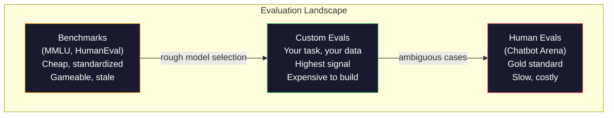
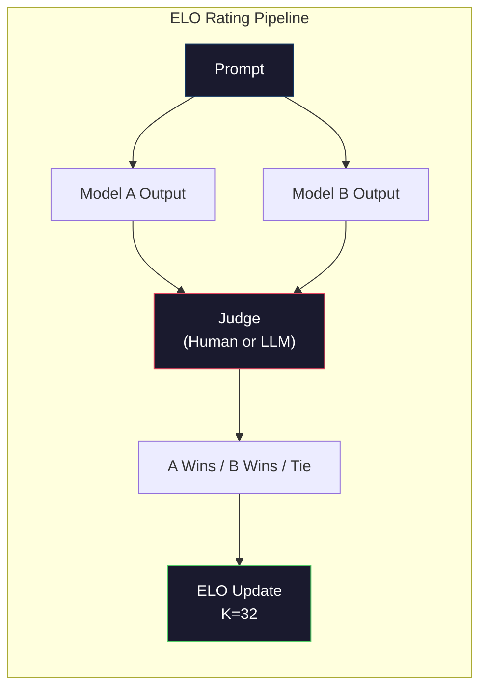

# 评估：Benchmark、Eval、LM Harness

> 古德哈特定律：当一个度量变成目标，它就不再是一个好的度量。每一家前沿实验室都在刷 benchmark。MMLU 分数一路上涨，而模型仍然不能可靠地数出 "strawberry" 里有几个 R。唯一真正重要的 eval 是*你自己的* eval——在*你的*任务上，用*你的*数据。

**Type:** Build
**Languages:** Python
**Prerequisites:** Phase 10, Lessons 01-05 (LLMs from Scratch)
**Time:** ~90 分钟
## Learning Objectives

- 构建一个自定义评估 harness，对语言模型运行多项选择和开放式 benchmark
- 解释标准 benchmark（MMLU、HumanEval）为何会饱和，以及为何无法区分前沿模型
- 用恰当的指标实现任务专属 eval：exact match、F1、BLEU，以及 LLM-as-judge 打分
- 设计针对你具体用例的自定义评估套件，而不是只依赖公开排行榜

## 问题场景

MMLU 于 2020 年发布，包含 57 个学科的 15,908 道题。三年之内，前沿模型就把它刷饱和了。GPT-4 得 86.4%。Claude 3 Opus 得 86.8%。Llama 3 405B 得 88.6%。排行榜被压缩到 3 分的区间里，其中的差异是统计噪声，不是真实的能力差距。

与此同时，同样是这些模型，却会在一个 10 岁小孩不用动脑就能处理的任务上失败。Claude 3.5 Sonnet 在 MMLU 上拿 88.7%，但最初数不清 "strawberry" 里的字母——这个任务不需要任何世界知识，也不需要任何推理，只需逐字符迭代。HumanEval 用 164 道题测试代码生成。模型在上面得的分数超过 90%，却仍然会产出连初级开发者都能一眼看出的边界情况崩溃代码。

benchmark 表现与真实世界可靠性之间的鸿沟，就是 LLM 评估的核心问题。benchmark 告诉你一个模型在 benchmark 上表现如何。它几乎不告诉你，这个模型在你的具体任务、你的具体数据、你的具体失效模式下会表现如何。如果你在做客服机器人，MMLU 无关紧要。如果你在做代码助手，HumanEval 只覆盖函数级生成——它对调试、重构、跨文件解释代码一无所知。

你需要自定义 eval。不是因为 benchmark 没用——做粗略的模型选型时它们很有用——而是因为最终评估必须精确匹配你的部署条件。

## 核心概念

### Eval 的地形

评估有三类，各自成本和信号质量不同。

**Benchmark** 是标准化的测试套件。MMLU、HumanEval、SWE-bench、MATH、ARC、HellaSwag。你让模型跑这个 benchmark，得到一个分数。优点是：所有人用的是同一套测试，所以你可以比较模型。缺点是：模型和训练数据越来越污染这些 benchmark。实验室用包含 benchmark 题目的数据训练。分数涨了。能力未必。

**自定义 eval** 是你为自己的具体用例搭的测试套件。你定义输入、期望输出和打分函数。法律文档摘要器就在法律文档上评估。SQL 生成器就在你的数据库 schema 上评估。这些搭起来昂贵，但它们是唯一能预测生产表现的评估。

**人类评估** 用付费标注员按有用性、正确性、流畅度、安全性等标准判断模型输出。这是自动化打分失效的开放式任务的金标准。Chatbot Arena 已经在 100+ 个模型上收集了超过 200 万张人类偏好票。缺点是：成本（每次判断 $0.10-$2.00）和速度（数小时到数天）。



### benchmark 为何失效

有三种机制会让 benchmark 分数不再反映真实能力。

**数据污染。** 训练语料会爬取互联网。benchmark 题目就活在互联网上。模型在训练中见过答案。这不是传统意义上的作弊——实验室并非有意加入 benchmark 数据。但网页规模的数据爬取让排除几乎不可能。

**应试教学。** 实验室为 benchmark 表现优化训练混合配比。如果训练混合里有 5% 是 MMLU 风格的多项选择，模型就学会了这种格式和答案分布。MMLU 是四选一。模型会学到答案在 A/B/C/D 上大致均匀分布，这在模型不知道答案时也能帮上忙。

**饱和。** 当每个前沿模型在一个 benchmark 上都拿 85-90% 时，这个 benchmark 就不再具有区分力。剩下的 10-15% 题目可能是歧义的、错标的，或者需要冷僻的领域知识。MMLU 从 87% 提到 89%，可能只意味着模型多背住了两道冷僻题，而不是变聪明了。

### Perplexity：快速健康检查

perplexity 衡量模型对一个 token 序列有多惊讶。形式上，它是平均负对数似然的指数：

```
PPL = exp(-1/N * sum(log P(token_i | context)))
```

perplexity 为 10 意味着，模型平均而言在每个 token 位置的确定程度，相当于在 10 个选项里均匀猜测。越低越好。GPT-2 在 WikiText-103 上的 perplexity 约为 30。GPT-3 约为 20。Llama 3 8B 约为 7。

perplexity 适合在同一个测试集上比较模型，但它有盲区。一个模型可以通过擅长预测常见模式而获得低 perplexity，同时却在罕见但重要的模式上表现糟糕。它也完全不说明指令遵循、推理或事实准确性。把它当作健全性检查，而不是最终裁决。

### LLM-as-Judge

用一个强模型去评估一个弱模型的输出。思路很简单：让 GPT-4o 或 Claude Sonnet 按 1-5 分给一条回复的正确性、有用性和安全性打分。用 GPT-4o-mini 每次判断约花 $0.01，而且与人类判断的相关性出人意料地好——在大多数任务上约 80% 一致。

打分 prompt 比模型本身更重要。含糊的 prompt（"Rate this response"）会产生噪声分数。带评分标准的结构化 prompt（"答案事实正确且引用了来源给 5 分，正确但未引用来源给 4 分，部分正确给 3 分……"）会产生一致、可复现的分数。

失效模式：judge 模型会出现位置偏差（在成对比较中偏爱第一条回复）、冗长偏差（偏爱更长的回复）以及自我偏好（GPT-4 给 GPT-4 的输出打分高于同等质量的 Claude 输出）。缓解办法：随机化顺序、按长度归一化、使用与被评估模型不同的 judge。

### 从成对比较得到 ELO 评分

这是 Chatbot Arena 的做法。把同一个 prompt 的两条回复展示出来，它们来自不同模型。由人类（或 LLM judge）挑出更好的那一条。从成千上万次这样的比较中，为每个模型计算一个 ELO 评分——就是国际象棋用的那套系统。

ELO 的优势：相对排名比绝对打分更可靠，能优雅地处理平局，而且比逐个独立打分每个输出收敛所需的比较次数更少。截至 2026 年初，Chatbot Arena 的排名显示 GPT-4o、Claude 3.5 Sonnet 和 Gemini 1.5 Pro 在榜首处彼此相差不超过 20 个 ELO 点。



### Eval 框架

**lm-evaluation-harness**（EleutherAI）：标准的开源 eval 框架。支持 200+ 个 benchmark。一条命令就能让任意 Hugging Face 模型跑 MMLU、HellaSwag、ARC 等。Open LLM Leaderboard 用的就是它。

**RAGAS**：专门面向 RAG 流水线的评估框架。衡量忠实度（答案是否与检索到的上下文相符？）、相关性（检索到的上下文是否与问题相关？）以及答案正确性。

**promptfoo**：配置驱动的、面向 prompt 工程的 eval。在 YAML 里定义测试用例，对多个模型运行，得到通过/失败报告。适合做 prompt 回归测试——确保一次 prompt 改动不会破坏已有的测试用例。

### 构建自定义 eval

这是生产中唯一重要的 eval。流程如下：

1. **定义任务。** 模型到底该做什么？要精确。"回答问题的"太含糊。"给定一封客户投诉邮件，抽取产品名、问题类别和情绪"才是你可以评估的任务。

2. **创建测试用例。** 原型 eval 至少 50 条，生产环境 200+ 条。每个测试用例是一个 (input, expected_output) 配对。包含边界情况：空输入、对抗性输入、歧义输入、其他语言的输入。

3. **定义打分方式。** 结构化输出用 exact match。文本相似度用 BLEU/ROUGE。开放式质量用 LLM-as-judge。抽取任务用 F1。用权重组合多个指标。

4. **自动化。** 每个 eval 一条命令跑完。没有手工步骤。以可跨时间比较的格式存储结果。

5. **持续跟踪。** 孤立的一个 eval 分数没有意义。你需要趋势线。上次 prompt 改动之后分数提高了吗？换模型之后回退了吗？让你的 eval 和 prompt 一起做版本管理。

| Eval 类型 | 每次判断成本 | 与人类的一致度 | 最适合 |
|-----------|------------------|----------------------|----------|
| Exact match | ~$0 | 100%（在适用时） | 结构化输出、分类 |
| BLEU/ROUGE | ~$0 | ~60% | 翻译、摘要 |
| LLM-as-judge | ~$0.01 | ~80% | 开放式生成 |
| 人类评估 | $0.10-$2.00 | 不适用（它本身就是 ground truth） | 歧义、高风险任务 |

```figure
perplexity-loss
```

## Build It

### Step 1: 一个最小 eval 框架

定义核心抽象。一个 eval 用例包含输入、期望输出，以及可选的元数据字典。一个 scorer 接收预测和参考，返回 0 到 1 之间的分数。

```python
import json
from collections import Counter

class EvalCase:
    def __init__(self, input_text, expected, metadata=None):
        self.input_text = input_text
        self.expected = expected
        self.metadata = metadata or {}

class EvalSuite:
    def __init__(self, name, cases, scorers):
        self.name = name
        self.cases = cases
        self.scorers = scorers

    def run(self, model_fn):
        results = []
        for case in self.cases:
            prediction = model_fn(case.input_text)
            scores = {}
            for scorer_name, scorer_fn in self.scorers.items():
                scores[scorer_name] = scorer_fn(prediction, case.expected)
            results.append({
                "input": case.input_text,
                "expected": case.expected,
                "prediction": prediction,
                "scores": scores,
            })
        return results
```

### Step 2: 打分函数

构建 exact match、token F1，以及一个模拟的 LLM-as-judge scorer。

```python
def exact_match(prediction, expected):
    return 1.0 if prediction.strip().lower() == expected.strip().lower() else 0.0

def token_f1(prediction, expected):
    pred_tokens = set(prediction.lower().split())
    exp_tokens = set(expected.lower().split())
    if not pred_tokens or not exp_tokens:
        return 0.0
    common = pred_tokens & exp_tokens
    precision = len(common) / len(pred_tokens)
    recall = len(common) / len(exp_tokens)
    if precision + recall == 0:
        return 0.0
    return 2 * (precision * recall) / (precision + recall)

def llm_judge_simulated(prediction, expected):
    pred_words = set(prediction.lower().split())
    exp_words = set(expected.lower().split())
    if not exp_words:
        return 0.0
    overlap = len(pred_words & exp_words) / len(exp_words)
    length_penalty = min(1.0, len(prediction) / max(len(expected), 1))
    return round(overlap * 0.7 + length_penalty * 0.3, 3)
```

### Step 3: ELO 评分系统

实现带 ELO 更新的成对比较。这正是 Chatbot Arena 用来给模型排名的系统。

```python
class ELOTracker:
    def __init__(self, k=32, initial_rating=1500):
        self.ratings = {}
        self.k = k
        self.initial_rating = initial_rating
        self.history = []

    def _ensure_player(self, name):
        if name not in self.ratings:
            self.ratings[name] = self.initial_rating

    def expected_score(self, rating_a, rating_b):
        return 1 / (1 + 10 ** ((rating_b - rating_a) / 400))

    def record_match(self, player_a, player_b, outcome):
        self._ensure_player(player_a)
        self._ensure_player(player_b)

        ea = self.expected_score(self.ratings[player_a], self.ratings[player_b])
        eb = 1 - ea

        if outcome == "a":
            sa, sb = 1.0, 0.0
        elif outcome == "b":
            sa, sb = 0.0, 1.0
        else:
            sa, sb = 0.5, 0.5

        self.ratings[player_a] += self.k * (sa - ea)
        self.ratings[player_b] += self.k * (sb - eb)

        self.history.append({
            "a": player_a, "b": player_b,
            "outcome": outcome,
            "rating_a": round(self.ratings[player_a], 1),
            "rating_b": round(self.ratings[player_b], 1),
        })

    def leaderboard(self):
        return sorted(self.ratings.items(), key=lambda x: -x[1])
```

### Step 4: 计算 perplexity

用 token 概率计算 perplexity。实践中你会从模型的 logits 得到这些概率。这里我们用一个概率分布来模拟。

```python
import numpy as np

def perplexity(log_probs):
    if not log_probs:
        return float("inf")
    avg_neg_log_prob = -np.mean(log_probs)
    return float(np.exp(avg_neg_log_prob))

def token_log_probs_simulated(text, model_quality=0.8):
    np.random.seed(hash(text) % 2**31)
    tokens = text.split()
    log_probs = []
    for i, token in enumerate(tokens):
        base_prob = model_quality
        if len(token) > 8:
            base_prob *= 0.6
        if i == 0:
            base_prob *= 0.7
        prob = np.clip(base_prob + np.random.normal(0, 0.1), 0.01, 0.99)
        log_probs.append(float(np.log(prob)))
    return log_probs
```

### Step 5: 汇总结果

计算一次 eval 运行的汇总统计：均值、中位数、某阈值下的通过率，以及各指标的分解。

```python
def summarize_results(results, threshold=0.8):
    all_scores = {}
    for r in results:
        for metric, score in r["scores"].items():
            all_scores.setdefault(metric, []).append(score)

    summary = {}
    for metric, scores in all_scores.items():
        arr = np.array(scores)
        summary[metric] = {
            "mean": round(float(np.mean(arr)), 3),
            "median": round(float(np.median(arr)), 3),
            "std": round(float(np.std(arr)), 3),
            "min": round(float(np.min(arr)), 3),
            "max": round(float(np.max(arr)), 3),
            "pass_rate": round(float(np.mean(arr >= threshold)), 3),
            "n": len(scores),
        }
    return summary

def print_summary(summary, suite_name="Eval"):
    print(f"\n{'=' * 60}")
    print(f"  {suite_name} Summary")
    print(f"{'=' * 60}")
    for metric, stats in summary.items():
        print(f"\n  {metric}:")
        print(f"    Mean:      {stats['mean']:.3f}")
        print(f"    Median:    {stats['median']:.3f}")
        print(f"    Std:       {stats['std']:.3f}")
        print(f"    Range:     [{stats['min']:.3f}, {stats['max']:.3f}]")
        print(f"    Pass rate: {stats['pass_rate']:.1%} (threshold >= 0.8)")
        print(f"    N:         {stats['n']}")
```

### Step 6: 跑通完整流水线

把所有东西接起来。定义一个任务，创建测试用例，模拟两个模型，运行 eval，从成对比较中计算 ELO，并打印排行榜。

```python
def demo_model_good(prompt):
    responses = {
        "What is the capital of France?": "Paris",
        "What is 2 + 2?": "4",
        "Who wrote Hamlet?": "William Shakespeare",
        "What language is PyTorch written in?": "Python and C++",
        "What is the boiling point of water?": "100 degrees Celsius",
    }
    return responses.get(prompt, "I don't know")

def demo_model_bad(prompt):
    responses = {
        "What is the capital of France?": "Paris is the capital city of France",
        "What is 2 + 2?": "The answer is four",
        "Who wrote Hamlet?": "Shakespeare",
        "What language is PyTorch written in?": "Python",
        "What is the boiling point of water?": "212 Fahrenheit",
    }
    return responses.get(prompt, "Unknown")

cases = [
    EvalCase("What is the capital of France?", "Paris"),
    EvalCase("What is 2 + 2?", "4"),
    EvalCase("Who wrote Hamlet?", "William Shakespeare"),
    EvalCase("What language is PyTorch written in?", "Python and C++"),
    EvalCase("What is the boiling point of water?", "100 degrees Celsius"),
]

suite = EvalSuite(
    name="General Knowledge",
    cases=cases,
    scorers={
        "exact_match": exact_match,
        "token_f1": token_f1,
        "llm_judge": llm_judge_simulated,
    },
)

results_good = suite.run(demo_model_good)
results_bad = suite.run(demo_model_bad)

print_summary(summarize_results(results_good), "Model A (concise)")
print_summary(summarize_results(results_bad), "Model B (verbose)")
```

"好"模型给出精确答案。"坏"模型给出啰嗦的改写。exact match 狠狠地惩罚了啰嗦的模型。token F1 和 LLM-as-judge 则宽容得多。这说明了为什么指标选择很重要：同一个模型，会因为你怎么打分而显得很棒或很糟。

### Step 7: ELO 锦标赛

在多轮之间对模型做两两比较。

```python
elo = ELOTracker(k=32)

for case in cases:
    pred_a = demo_model_good(case.input_text)
    pred_b = demo_model_bad(case.input_text)

    score_a = token_f1(pred_a, case.expected)
    score_b = token_f1(pred_b, case.expected)

    if score_a > score_b:
        outcome = "a"
    elif score_b > score_a:
        outcome = "b"
    else:
        outcome = "tie"

    elo.record_match("model_a_concise", "model_b_verbose", outcome)

print("\nELO Leaderboard:")
for name, rating in elo.leaderboard():
    print(f"  {name}: {rating:.0f}")
```

### Step 8: perplexity 对比

比较不同质量水平的"模型"之间的 perplexity。

```python
test_text = "The quick brown fox jumps over the lazy dog in the garden"

for quality, label in [(0.9, "Strong model"), (0.7, "Medium model"), (0.4, "Weak model")]:
    log_probs = token_log_probs_simulated(test_text, model_quality=quality)
    ppl = perplexity(log_probs)
    print(f"  {label} (quality={quality}): perplexity = {ppl:.2f}")
```

## Use It

### lm-evaluation-harness（EleutherAI）

对任意模型跑 benchmark 的标准工具。

```python
# pip install lm-eval
# Command line:
# lm_eval --model hf --model_args pretrained=meta-llama/Llama-3.1-8B --tasks mmlu --batch_size 8

# Python API:
# import lm_eval
# results = lm_eval.simple_evaluate(
#     model="hf",
#     model_args="pretrained=meta-llama/Llama-3.1-8B",
#     tasks=["mmlu", "hellaswag", "arc_easy"],
#     batch_size=8,
# )
# print(results["results"])
```

### promptfoo

配置驱动的、面向 prompt 工程的 eval。在 YAML 里定义测试，对多个 provider 运行。

```yaml
# promptfoo.yaml
providers:
  - openai:gpt-4o-mini
  - anthropic:claude-3-haiku

prompts:
  - "Answer in one word: {{question}}"

tests:
  - vars:
      question: "What is the capital of France?"
    assert:
      - type: contains
        value: "Paris"
  - vars:
      question: "What is 2 + 2?"
    assert:
      - type: equals
        value: "4"
```

### 用 RAGAS 做 RAG 评估

```python
# pip install ragas
# from ragas import evaluate
# from ragas.metrics import faithfulness, answer_relevancy, context_precision
#
# result = evaluate(
#     dataset,
#     metrics=[faithfulness, answer_relevancy, context_precision],
# )
# print(result)
```

RAGAS 衡量的是通用 eval 遗漏的东西：模型的答案是否以检索到的上下文为依据，而不只是在抽象意义上"正确"。

## Ship It

本课产出 `outputs/prompt-eval-designer.md`——一个可复用的 prompt，能为任意任务设计自定义 eval 套件。给它一段任务描述，它就会生成测试用例、打分函数，以及通过/失败阈值的建议。

它还产出 `outputs/skill-llm-evaluation.md`——一个根据你的任务类型、预算和延迟要求选择合适评估策略的决策框架。

## Exercises

1. 增加一个"一致性"scorer：把同一输入跑 5 次，测量输出有多大概率一致。确定性输入上答案不一致，暴露出 prompt 脆弱或 temperature 设置过高。

2. 扩展 ELO 跟踪器，支持多个 judge 函数（exact match、F1、LLM-as-judge）并给它们加权。比较当你重压 exact match 与重压 F1 时，排行榜如何变化。

3. 为一个具体任务构建 eval 套件：把邮件分为 5 类。创建 100 个多样化测试用例，包含边界情况（可能属于多个类别的邮件、空邮件、其他语言的邮件）。测量不同的"模型"（基于规则、关键词匹配、模拟 LLM）表现如何。

4. 实现污染检测：给定一组 eval 题目和一个训练语料，检查有多大比例的 eval 题目（或接近的改述）出现在训练数据里。研究者就是这样审计 benchmark 有效性的。

5. 构建一个"模型 diff"工具。给定两个模型版本的 eval 结果，高亮哪些具体测试用例变好了、哪些回退了、哪些没变。这是 eval 版的代码 diff——理解一次改动是帮忙还是添乱，它必不可少。

## Key Terms

| 术语 | 人们怎么说 | 它实际是什么意思 |
|------|----------------|----------------------|
| MMLU | "那个 benchmark" | Massive Multitask Language Understanding——57 个学科的 15,908 道多项选择题，2025 年已被刷到 88% 以上 |
| HumanEval | "代码 eval" | OpenAI 的 164 道 Python 函数补全题，只测试孤立的函数生成 |
| SWE-bench | "真实编程 eval" | 来自 12 个 Python 仓库的 2,294 个 GitHub issue，衡量端到端的 bug 修复，包括测试生成 |
| Perplexity | "模型有多困惑" | exp(-avg(log P(token_i given context)))——越低意味着模型给实际出现的 token 分配的概率越高 |
| ELO rating | "模型的棋类排名" | 由成对胜负记录计算出的相对技能评分，Chatbot Arena 用它给 100+ 个模型排名 |
| LLM-as-judge | "用 AI 给 AI 打分" | 一个强模型按评分标准给弱模型的输出打分，约 $0.01/次判断，与人类评委约 80% 一致 |
| Data contamination | "模型见过测试题" | 训练数据包含 benchmark 题目，在没提升真实能力的情况下抬高了分数 |
| Eval suite | "一堆测试" | 一个带版本的 (input, expected_output, scorer) 三元组集合，用来衡量某项具体能力 |
| Pass rate | "答对了百分之多少" | 得分高于阈值的 eval 用例比例——比平均分更可操作，因为它衡量可靠性 |
| Chatbot Arena | "模型排名网站" | LMSYS 平台，拥有 200 万+ 人类偏好票，通过 ELO 评分产出最受信任的 LLM 排行榜 |

## Further Reading

- [Hendrycks et al., 2021 -- "Measuring Massive Multitask Language Understanding"](https://arxiv.org/abs/2009.03300) -- MMLU 论文，尽管已经饱和，仍是被引用最多的 LLM benchmark
- [Chen et al., 2021 -- "Evaluating Large Language Models Trained on Code"](https://arxiv.org/abs/2107.03374) -- OpenAI 的 HumanEval 论文，确立了代码生成评估方法论
- [Zheng et al., 2023 -- "Judging LLM-as-a-Judge"](https://arxiv.org/abs/2306.05685) -- 对用 LLM 评估 LLM 的系统性分析，包括位置偏差与冗长偏差的发现
- [Arena（原 LMSYS Chatbot Arena）](https://arena.ai/leaderboard) -- 拥有 200 万+ 票的众包模型比较平台，最受信任的真实世界 LLM 排名
