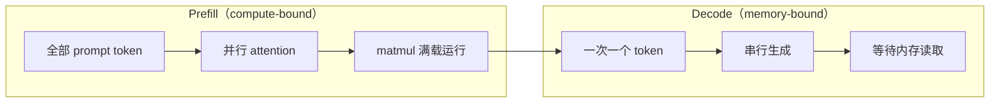
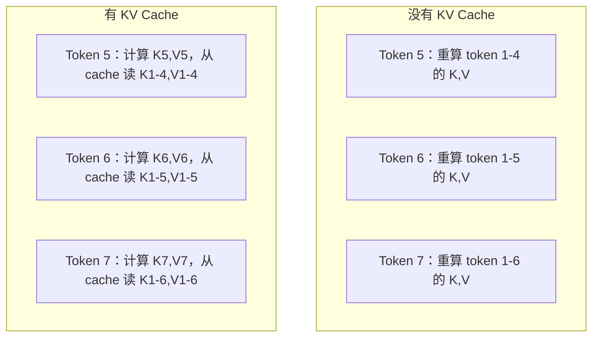
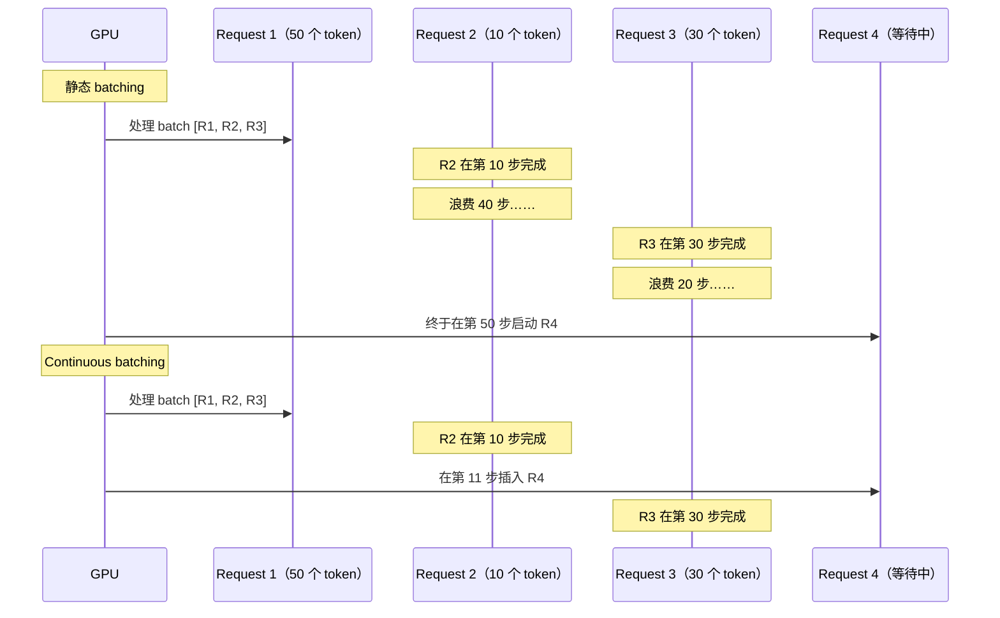
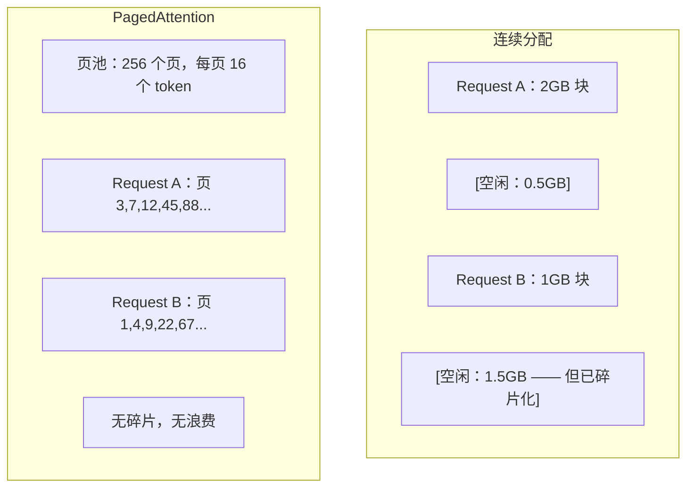
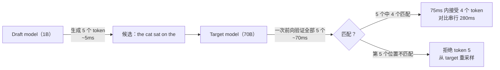

# 推理优化

> LLM 推理由两个阶段定义。Prefill 并行处理你的 prompt —— compute-bound。Decode 一个接一个生成 token —— memory-bound。每一项优化都瞄准其中一个，或者两个都瞄。

**Type:** Build
**Languages:** Python
**Prerequisites:** Phase 10, Lessons 01-08 (Transformer architecture, attention)
**Time:** ~120 分钟
## Learning Objectives

- 实现 KV cache，消除自回归 token 生成过程中的重复计算
- 解释 LLM 推理的 prefill 与 decode 两个阶段，以及为什么它们有不同的瓶颈（compute-bound 与 memory-bound）
- 实现 continuous batching 与 PagedAttention 的思路，在并发请求下最大化 GPU 利用率
- 比较各种推理优化技术（KV cache、speculative decoding、flash attention）及其吞吐/延迟权衡

## 问题场景

你把 Llama 3 70B 部署在 4 张 A100 上。单个用户能拿到约 50 token/秒。感觉很快。然后 100 个用户同时打这个 endpoint。吞吐掉到每用户 3 token/秒。你每月 $25,000 的 GPU 账单，提供的回复比人类打字还慢。

模型本身在 1 个用户和 100 个用户之间没有变化。同样的权重，同样的架构，同样的数学。变化的是你如何调度这些工作。朴素推理浪费了 90% 以上的可用 GPU 算力。一个在等第 47 个 token 的用户占着整个 batch slot，而 GPU 的内存总线在两次 matmul 之间空转。与此同时，一个新用户 2,000 token 的 prompt 本可以用有用的计算填满这段死时间。

这不是一个扩展性问题。这是一个调度问题。本课的这些技术 —— KV caching、continuous batching、PagedAttention、speculative decoding、prefix caching —— 正是每月 $25k 推理账单和同样流量下每月 $5k 账单之间的区别。

vLLM 在 4xA100-80GB 上服务 Llama 3 70B，低并发时能到每用户约 50 token/秒，在 100 个并发请求下靠 continuous batching 和 PagedAttention 维持每用户 15-25 TPS。没有这些优化，同样的硬件在那个并发下只能服务每用户 5 TPS。同样的 GPU，同样的模型，4 倍吞吐。

## 核心概念

### Prefill 与 Decode

每一个 LLM 推理请求都有两个截然不同的阶段。

**Prefill** 处理整个输入 prompt。所有 token 都是已知的，所以 attention 可以在整个序列上并行计算。这是一次大规模的矩阵乘法 —— GPU 核心保持忙碌。瓶颈是算力：你的硬件每秒能交付多少 FLOPS。一张 A100 做到 312 TFLOPS（BF16）。在单张 A100 上，70B 模型处理 4,096 token 的 prompt 做 prefill 大约需要 400ms。

**Decode** 一次生成一个输出 token。每个新 token 都要关注所有先前 token，但一次前向传播只产出一个 token。权重矩阵的大小和 prefill 时一样，但你是在用一个向量而不是一个矩阵去乘它们。GPU 核心在微秒级就完工，然后等待下一批权重从内存到达。瓶颈是内存带宽：你能多快地把模型权重从 HBM 流式送到计算单元。一张 A100 有 2 TB/s 带宽。FP16 的 70B 模型是 140 GB。完整读一遍模型要 70ms —— 这就是单个 decode 步的下限。



**ops:byte ratio**（也叫 arithmetic intensity，算术强度）刻画了这种权衡。它衡量你每从内存加载一个字节，执行了多少次操作。

```
ops:byte ratio = FLOPs per token / bytes read from memory
```

在 prefill 阶段，batch 有 4,096 个 token，每加载一个权重你大约执行 4,096 次乘加操作。比值很高 —— 你是 compute-bound。在 batch size 为 1 的 decode 阶段，每加载一个权重你大约执行 1 次操作。比值很低 —— 你是 memory-bound。

关键的洞察是：*decode 之所以是 memory-bound，是因为你为了产出一个 token 要读完整模型*。下面每一项优化，要么减少你要读的东西，要么增加每次读取处理的 token 批量，要么干脆避免读取。

### KV Cache

在 attention 中，每个 token 的 query 都要关注所有先前 token 的 key 和 value 向量。不做缓存的话，生成第 N 个 token 就要为前面全部 N-1 个 token 重新计算 key 和 value 投影。token 1 在生成 token 2 时被投影一次，生成 token 3 时又一次，生成 token 4 时再又一次。到第 1,000 个 token 时，你已经把 token 1 投影了 999 次。

KV cache 保存所有先前 token 的 key 和 value 投影。生成第 N 个 token 时，你只计算第 N 个 token 的 key 和 value，然后把它们与 token 1 到 N-1 缓存下来的 K/V 拼接起来。



**KV cache 的内存公式：**

```
KV cache size = 2 * num_layers * num_kv_heads * head_dim * seq_len * bytes_per_param
```

对 Llama 3 70B（80 层，GQA 下 8 个 KV head，head_dim=128，BF16）：

```
per token: 2 * 80 * 8 * 128 * 2 bytes = 327,680 bytes = 320 KB
at 4,096 tokens: 320 KB * 4,096 = 1.28 GB
at 128K tokens: 320 KB * 131,072 = 40 GB
```

Llama 3 70B 的一次 128K 上下文对话要消耗 40 GB 的 KV cache —— 半张 A100 的内存。100 个并发用户、每人 4K token，单是 KV cache 就需要 128 GB。这就是为什么 KV cache 管理是推理优化的核心挑战。

### Continuous Batching

静态 batching 等到凑齐 N 个请求，一起处理，然后等*所有*请求都结束才接受新请求。如果一个请求需要 500 个 token，另一个只需要 10 个，短请求结束后还要空坐 490 个 decode 步。

Continuous batching（也叫 iteration-level batching）在任何请求一完成时就把新请求插进 batch。每个 decode 步都会重新评估 batch。一个 10 个 token 后就完成的请求，会立刻被一个等待中的请求替换掉。



吞吐提升多少，取决于输出长度有多不一致。长度统一时，continuous batching 与静态 batching 打平。长度多变时（常见情况），continuous batching 能带来 2-5 倍的吞吐提升，因为 GPU 的槽位从不会空着。

### PagedAttention

每个请求的 KV cache 是一段连续内存块。请求不断到来和离开，内存就会碎片化 —— 和操作系统里的 RAM 碎片化一模一样。一个 4K token 的请求需要 1.28 GB 连续内存。就算你总共还剩 2 GB 空闲，也未必有 1.28 GB 的*连续*空间。你要么浪费内存，要么拒绝这个请求。

PagedAttention（来自 vLLM）把操作系统式的虚拟内存机制用到 KV cache 上。它不是给每个请求分配一大块连续内存，而是分配固定大小的「页」（通常每页 16 个 token）。页可以散布在物理 GPU 内存的任何位置。页表把每个请求的逻辑序列位置映射到物理页位置。



PagedAttention 还让共享前缀可以用上 **copy-on-write**。如果 50 个请求共享同一个 system prompt，那段 system prompt 的 KV cache 页只存一次，被 50 个请求共同引用。只有当某个请求分叉（不同的用户消息）时，它才获得自己的页。对于带共享 system prompt 的应用，这能大幅削减内存占用。

vLLM 报告称，通过 PagedAttention，内存浪费接近零（约 4%，而朴素分配是 60-80%）。

### Speculative Decoding

Decode 慢是因为它是串行的 —— 你生成一个 token，喂回去，再生成下一个。但如果你能廉价地猜出接下来 5 个 token，然后一次性验证它们呢？

Speculative decoding 用一个小而快的 **draft model** 生成 K 个候选 token。大 **target model** 随后在一次前向传播中处理全部 K 个候选（这看起来就像 prefill —— 并行、compute-bound、高效）。如果 target model 与 draft model 的预测一致，你就在一次 target 前向传播的时间里接受了全部 K 个 token。如果它在位置 j 上不一致，你就接受第 1 到 j-1 个 token，丢弃其余的。



加速幅度取决于 **acceptance rate** —— draft model 的预测与 target 一致的比例。用 Llama 3 8B 为 Llama 3 70B 做 draft，自然语言上的 acceptance rate 典型是 70-85%。这对应 2-3 倍的 decode 加速。

speculative decoding 有三条路线：

| 方法 | Draft 来源 | Acceptance rate | 额外开销 |
|--------|-------------|-----------------|----------|
| Draft-target（Leviathan et al.） | 独立的小模型 | 70-85% | draft 模型的内存 |
| EAGLE（Li et al.） | 挂在 target 上的轻量 head | 75-90% | 约 1% 额外参数 |
| N-gram lookup | token n-gram 表 | 40-60% | 可忽略 |

**EAGLE** 在 target model 的隐状态之上训练一个小的自回归 head。它用 target model 倒数第二层的特征来预测下一个 token 的 embedding。由于它作用在 target model 自己的表征上（而不是另一个模型的），它能在增加极少内存的情况下拿到更高的 acceptance rate。EAGLE-2 增加了一棵动态 draft 树，根据上下文调整候选数量。

**N-gram speculative decoding** 维护一张 n-gram 续写表，来源可以是当前上下文，也可以是预先构建的语料。如果 draft 与同一对话中出现过的内容吻合（重复模式、代码、结构化输出），它就能以零神经网络开销触发。平均 acceptance rate 更低，但每次投机的成本基本是免费的。

Speculative decoding 在*数学上是精确的* —— 输出分布与 target model 的分布完全一致。它不是近似。验证步骤保证每一个被接受的 token 概率正是 target model 会赋予的概率。

### Prefix Caching

很多请求共享同一个前缀。一个聊天机器人 system prompt。一个 RAG 上下文块。一组 few-shot 示例。没有 prefix caching，每个请求都要从头为这些共享 token 重算 KV cache。

Prefix caching 把常见前缀的 KV cache 存下来，跨请求复用。当一个带已知前缀的新请求到达时，系统复制（或引用）缓存的 KV 条目，只计算独有后缀部分的 KV。

对于一个被所有请求共享的 2,000 token system prompt，prefix caching 每个请求能省掉约 400ms 的 prefill。按每秒 100 个请求算，每秒就省下 40 秒的 GPU 计算 —— 超过一整张 GPU 的算力。

SGLang 的 RadixAttention 用一棵 radix 树（trie）实现 prefix caching，按 token 内容为前缀建索引。任何匹配到已存前缀的请求都能免费拿到它的 KV cache。这棵树还支持部分前缀匹配 —— 如果 2,000 个前缀 token 中有 1,500 个与某个缓存条目共享，你就复用这 1,500 个，只重算 500 个。

### 推理引擎

生产环境 LLM 服务由三个引擎主导：

| 引擎 | 关键创新 | 最适合 |
|--------|---------------|----------|
| vLLM | PagedAttention、continuous batching | 通用服务，兼容性最广 |
| SGLang | RadixAttention（prefix caching）、结构化生成 | 多轮聊天机器人、受约束解码 |
| TensorRT-LLM | NVIDIA kernel 融合、FP8 quantization | NVIDIA 硬件上的最高单卡吞吐 |

**vLLM** 是默认的起点。它支持的模型范围最广，能跑在任何 GPU 厂商的硬件上（NVIDIA、AMD、Intel），并通过 PagedAttention + continuous batching 拿到很强的吞吐。OpenAI 兼容的 API 意味着你可以把它直接替换进任何 OpenAI API 调用。

**SGLang** 建立在与 vLLM 相同的基础之上，但加了用于 prefix caching 的 RadixAttention，以及一个用于结构化 LLM 程序的领域特定语言。如果你的负载涉及多轮对话、工具调用或受约束解码（JSON 输出、正则引导生成），SGLang 常常能靠前缀复用比 vLLM 快 2-5 倍。

**TensorRT-LLM** 把模型编译成优化过的 NVIDIA GPU kernel。它融合操作（attention + linear + activation 在一个 kernel 里），在 H100 上使用 FP8，并与 NVIDIA Triton Inference Server 集成用于生产部署。它在 NVIDIA 硬件上能拿到最高的单卡吞吐，但配置更多，且只能在 NVIDIA GPU 上运行。

Llama 3 70B 的真实数字（4xA100-80GB，BF16）：

| 指标 | vLLM | SGLang | TensorRT-LLM |
|--------|------|--------|---------------|
| 吞吐（1 用户） | ~50 TPS | ~55 TPS | ~65 TPS |
| 吞吐（100 用户） | ~2,500 TPS 总计 | ~3,200 TPS 总计 | ~3,000 TPS 总计 |
| 首 token 时间 | ~400ms | ~300ms（前缀命中） | ~350ms |
| 最大上下文 | 128K | 128K | 128K |

### Ops:Byte 框架

你无法优化你无法度量的东西。ops:byte ratio 告诉你当前是 compute-bound 还是 memory-bound，而这决定了哪些优化才有意义。

```
Compute roof: peak FLOPS of the GPU
Memory roof:  peak bandwidth * ops:byte ratio
```

当 ops:byte 很低（decode、小 batch）时，你撞的是内存带宽屋顶。增加算力（更高频率、更多核心）没有帮助。你需要减少内存读取（quantization、KV cache 压缩），或者增大 batch size，把读取成本摊到更多有用的工作上。

当 ops:byte 很高（prefill、大 batch）时，你撞的是算力屋顶。优化内存带宽没有帮助。你需要更快的 GPU、kernel 融合，或者降低精度来挤出更多 FLOPS。

| 场景 | ops:byte | 瓶颈 | 优化手段 |
|----------|----------|-------|---------------|
| Prefill，batch=1 | ~4,096 | 算力 | Kernel 融合、FP8 |
| Decode，batch=1 | ~1 | 内存 | Quantization、KV 压缩 |
| Decode，batch=32 | ~32 | 内存 | 更大 batch、continuous batching |
| Decode，batch=256 | ~256 | 过渡区 | 两者都重要 |
| Decode，batch=1024 | ~1,024 | 算力 | Kernel 融合、张量并行 |

A100 上的交叉点大约在 ops:byte = 156（312 TFLOPS / 2 TB/s）。低于 156 你是 memory-bound。高于 156 你是 compute-bound。continuous batching 通过每次迭代塞进更多 token，把 decode 推向这个交叉点。

```figure
context-window-slide
```

## Build It

### 第 1 步：从零实现 KV Cache

我们构建一个多头 KV cache，按层、按 head 存储 key 和 value 投影，并演示内存增长的模式。

```python
import numpy as np

class KVCache:
    def __init__(self, num_layers, num_heads, head_dim, max_seq_len, dtype=np.float16):
        self.num_layers = num_layers
        self.num_heads = num_heads
        self.head_dim = head_dim
        self.max_seq_len = max_seq_len
        self.dtype = dtype

        self.k_cache = np.zeros(
            (num_layers, num_heads, max_seq_len, head_dim), dtype=dtype
        )
        self.v_cache = np.zeros(
            (num_layers, num_heads, max_seq_len, head_dim), dtype=dtype
        )
        self.seq_len = 0

    def update(self, layer_idx, new_keys, new_values):
        num_new = new_keys.shape[1]
        end = self.seq_len + num_new
        self.k_cache[layer_idx, :, self.seq_len:end, :] = new_keys
        self.v_cache[layer_idx, :, self.seq_len:end, :] = new_values
        return (
            self.k_cache[layer_idx, :, :end, :],
            self.v_cache[layer_idx, :, :end, :]
        )

    def advance(self, num_tokens):
        self.seq_len += num_tokens

    def memory_bytes(self):
        return self.k_cache.nbytes + self.v_cache.nbytes

    def used_bytes(self):
        per_token = 2 * self.num_layers * self.num_heads * self.head_dim * np.dtype(self.dtype).itemsize
        return per_token * self.seq_len
```

### 第 2 步：带 KV Cache 的 Attention

一个简化的多头 attention，在 decode 步使用 KV cache。

```python
def scaled_dot_product_attention(query, keys, values):
    head_dim = query.shape[-1]
    scores = np.matmul(query, keys.transpose(0, 1, 3, 2)) / np.sqrt(head_dim)
    seq_len_q = scores.shape[-2]
    seq_len_k = scores.shape[-1]
    if seq_len_q > 1:
        mask = np.triu(np.ones((seq_len_q, seq_len_k), dtype=np.float32), k=seq_len_k - seq_len_q + 1)
        scores = scores + mask * (-1e9)
    max_scores = np.max(scores, axis=-1, keepdims=True)
    exp_scores = np.exp(scores - max_scores)
    attn_weights = exp_scores / np.sum(exp_scores, axis=-1, keepdims=True)
    return np.matmul(attn_weights, values)


class MultiHeadAttention:
    def __init__(self, d_model, num_heads):
        self.num_heads = num_heads
        self.head_dim = d_model // num_heads
        scale = np.sqrt(2.0 / d_model)
        self.W_q = np.random.randn(d_model, d_model).astype(np.float32) * scale
        self.W_k = np.random.randn(d_model, d_model).astype(np.float32) * scale
        self.W_v = np.random.randn(d_model, d_model).astype(np.float32) * scale
        self.W_o = np.random.randn(d_model, d_model).astype(np.float32) * scale

    def forward(self, x, kv_cache=None, layer_idx=0):
        batch, seq_len, d_model = x.shape
        Q = np.matmul(x, self.W_q).reshape(batch, seq_len, self.num_heads, self.head_dim).transpose(0, 2, 1, 3)
        K = np.matmul(x, self.W_k).reshape(batch, seq_len, self.num_heads, self.head_dim).transpose(0, 2, 1, 3)
        V = np.matmul(x, self.W_v).reshape(batch, seq_len, self.num_heads, self.head_dim).transpose(0, 2, 1, 3)

        if kv_cache is not None:
            K_full, V_full = kv_cache.update(layer_idx, K[0], V[0])
            K = K_full[np.newaxis, :, :, :]
            V = V_full[np.newaxis, :, :, :]
            if seq_len == 1:
                kv_cache.advance(1)

        attn_out = scaled_dot_product_attention(Q, K, V)
        attn_out = attn_out.transpose(0, 2, 1, 3).reshape(batch, -1, d_model)
        return np.matmul(attn_out, self.W_o)
```

### 第 3 步：Continuous Batching 模拟器

这里模拟静态 batching 与 continuous batching 在调度上的差异。

```python
import heapq

class Request:
    def __init__(self, request_id, prompt_tokens, output_tokens, arrival_step):
        self.request_id = request_id
        self.prompt_tokens = prompt_tokens
        self.output_tokens = output_tokens
        self.arrival_step = arrival_step
        self.tokens_generated = 0
        self.start_step = None
        self.end_step = None

    def is_done(self):
        return self.tokens_generated >= self.output_tokens


def simulate_static_batching(requests, batch_size):
    step = 0
    completed = []
    queue = list(requests)
    queue.sort(key=lambda r: r.arrival_step)

    while queue:
        batch = []
        while queue and len(batch) < batch_size:
            r = queue.pop(0)
            r.start_step = max(step, r.arrival_step)
            batch.append(r)

        if batch:
            step = max(step, max(r.start_step for r in batch))
            max_output = max(r.output_tokens for r in batch)
            for r in batch:
                r.tokens_generated = r.output_tokens
                r.end_step = step + max_output
            step += max_output
            completed.extend(batch)

    return completed


def simulate_continuous_batching(requests, batch_size):
    step = 0
    completed = []
    queue = sorted(requests, key=lambda r: r.arrival_step)
    queue_idx = 0
    active = []
    waiting = []

    while queue_idx < len(queue) or active or waiting:
        while queue_idx < len(queue) and queue[queue_idx].arrival_step <= step:
            waiting.append(queue[queue_idx])
            queue_idx += 1

        while waiting and len(active) < batch_size:
            r = waiting.pop(0)
            r.start_step = step
            active.append(r)

        if not active:
            if waiting:
                step += 1
                continue
            elif queue_idx < len(queue):
                step = queue[queue_idx].arrival_step
                continue
            else:
                break

        for r in active:
            r.tokens_generated += 1

        done = [r for r in active if r.is_done()]
        for r in done:
            r.end_step = step + 1
            completed.append(r)
        active = [r for r in active if not r.is_done()]

        step += 1

    return completed


def batching_stats(completed):
    latencies = [r.end_step - r.arrival_step for r in completed]
    total_time = max(r.end_step for r in completed) - min(r.arrival_step for r in completed)
    total_tokens = sum(r.output_tokens for r in completed)
    return {
        "avg_latency": np.mean(latencies),
        "p50_latency": np.median(latencies),
        "p99_latency": np.percentile(latencies, 99),
        "total_time": total_time,
        "throughput": total_tokens / total_time if total_time > 0 else 0,
    }
```

### 第 4 步：Prefix Cache

一个基于 trie 的 prefix cache，为共享前缀存储 KV 条目。

```python
class TrieNode:
    def __init__(self):
        self.children = {}
        self.kv_data = None
        self.hit_count = 0


class PrefixCache:
    def __init__(self, max_entries=1000):
        self.root = TrieNode()
        self.max_entries = max_entries
        self.total_entries = 0
        self.hits = 0
        self.misses = 0

    def _walk(self, token_ids):
        node = self.root
        depth = 0
        for tid in token_ids:
            if tid not in node.children:
                break
            node = node.children[tid]
            depth += 1
        return node, depth

    def lookup(self, token_ids):
        node, depth = self._walk(token_ids)
        if depth > 0:
            self.hits += 1
            current = self.root
            for tid in token_ids[:depth]:
                current = current.children[tid]
                current.hit_count += 1
            kv_entries = []
            current = self.root
            for tid in token_ids[:depth]:
                current = current.children[tid]
                if current.kv_data is not None:
                    kv_entries.append(current.kv_data)
            return depth, kv_entries
        self.misses += 1
        return 0, []

    def insert(self, token_ids, kv_per_token):
        node = self.root
        for i, tid in enumerate(token_ids):
            if tid not in node.children:
                if self.total_entries >= self.max_entries:
                    return i
                node.children[tid] = TrieNode()
                self.total_entries += 1
            node = node.children[tid]
            if i < len(kv_per_token):
                node.kv_data = kv_per_token[i]
        return len(token_ids)

    def hit_rate(self):
        total = self.hits + self.misses
        return self.hits / total if total > 0 else 0.0
```

### 第 5 步：Speculative Decoding 模拟器

我们模拟 draft-target 式 speculative decoding，acceptance rate 可配置。

```python
class DraftModel:
    def __init__(self, vocab_size, acceptance_rate=0.8):
        self.vocab_size = vocab_size
        self.acceptance_rate = acceptance_rate

    def generate(self, context, num_tokens):
        tokens = np.random.randint(0, self.vocab_size, size=num_tokens)
        return tokens

    def get_probs(self, context, token):
        probs = np.random.dirichlet(np.ones(self.vocab_size))
        return probs


class TargetModel:
    def __init__(self, vocab_size):
        self.vocab_size = vocab_size

    def get_probs(self, context, tokens=None):
        if tokens is not None:
            return [np.random.dirichlet(np.ones(self.vocab_size)) for _ in tokens]
        return np.random.dirichlet(np.ones(self.vocab_size))


def speculative_decode(draft_model, target_model, context, num_speculative=5,
                       draft_cost=1.0, target_cost=10.0, verify_cost=12.0):
    total_tokens = 0
    total_cost = 0.0
    accepted_counts = []
    context = list(context)

    max_tokens = 100

    while total_tokens < max_tokens:
        draft_tokens = draft_model.generate(context, num_speculative)
        total_cost += draft_cost * num_speculative

        target_probs = target_model.get_probs(context, draft_tokens)
        total_cost += verify_cost

        accepted = 0
        for i, token in enumerate(draft_tokens):
            draft_p = draft_model.get_probs(context + list(draft_tokens[:i]), token)
            target_p = target_probs[i]

            r = np.random.random()
            acceptance_prob = min(1.0, target_p[token] / (draft_p[token] + 1e-10))

            if r < draft_model.acceptance_rate:
                accepted += 1
                context.append(token)
                total_tokens += 1
            else:
                new_token = np.random.choice(draft_model.vocab_size, p=target_p)
                context.append(new_token)
                total_tokens += 1
                break

        accepted_counts.append(accepted)

        if accepted == num_speculative:
            bonus_probs = target_model.get_probs(context)
            bonus_token = np.random.choice(draft_model.vocab_size, p=bonus_probs)
            context.append(bonus_token)
            total_tokens += 1

    sequential_cost = total_tokens * target_cost
    return {
        "total_tokens": total_tokens,
        "speculative_cost": total_cost,
        "sequential_cost": sequential_cost,
        "speedup": sequential_cost / total_cost if total_cost > 0 else 1.0,
        "avg_accepted": np.mean(accepted_counts),
        "acceptance_rate": np.mean(accepted_counts) / num_speculative,
    }


def compare_speculation_strategies(vocab_size=1000, num_trials=20):
    results = {}

    for name, acceptance_rate, spec_tokens in [
        ("Draft-target (8B->70B)", 0.78, 5),
        ("EAGLE", 0.85, 6),
        ("N-gram", 0.50, 4),
        ("No speculation", 0.0, 0),
    ]:
        if spec_tokens == 0:
            results[name] = {
                "speedup": 1.0,
                "acceptance_rate": 0.0,
                "avg_accepted": 0.0,
            }
            continue

        trial_results = []
        for _ in range(num_trials):
            draft = DraftModel(vocab_size, acceptance_rate=acceptance_rate)
            target = TargetModel(vocab_size)
            context = list(np.random.randint(0, vocab_size, size=10))
            result = speculative_decode(draft, target, context, num_speculative=spec_tokens)
            trial_results.append(result)

        results[name] = {
            "speedup": np.mean([r["speedup"] for r in trial_results]),
            "acceptance_rate": np.mean([r["acceptance_rate"] for r in trial_results]),
            "avg_accepted": np.mean([r["avg_accepted"] for r in trial_results]),
        }

    return results
```

### 第 6 步：KV Cache 显存分析器

针对真实模型配置计算 KV cache 的显存需求。

```python
MODEL_CONFIGS = {
    "Llama-3-8B": {
        "num_layers": 32, "num_kv_heads": 8, "head_dim": 128,
        "model_params_b": 8, "gqa": True,
    },
    "Llama-3-70B": {
        "num_layers": 80, "num_kv_heads": 8, "head_dim": 128,
        "model_params_b": 70, "gqa": True,
    },
    "Llama-3-405B": {
        "num_layers": 126, "num_kv_heads": 8, "head_dim": 128,
        "model_params_b": 405, "gqa": True,
    },
    "Mistral-7B": {
        "num_layers": 32, "num_kv_heads": 8, "head_dim": 128,
        "model_params_b": 7, "gqa": True,
    },
    "GPT-4-est": {
        "num_layers": 120, "num_kv_heads": 96, "head_dim": 128,
        "model_params_b": 1800, "gqa": False,
    },
}


def kv_cache_memory(config, seq_len, dtype_bytes=2):
    per_token = 2 * config["num_layers"] * config["num_kv_heads"] * config["head_dim"] * dtype_bytes
    total = per_token * seq_len
    return {
        "per_token_bytes": per_token,
        "per_token_kb": per_token / 1024,
        "total_bytes": total,
        "total_mb": total / (1024 ** 2),
        "total_gb": total / (1024 ** 3),
    }


def memory_budget(config, gpu_memory_gb, model_dtype_bytes=2, kv_dtype_bytes=2):
    model_memory_gb = config["model_params_b"] * 1e9 * model_dtype_bytes / (1024 ** 3)
    overhead_gb = gpu_memory_gb * 0.1
    available_for_kv = gpu_memory_gb - model_memory_gb - overhead_gb

    if available_for_kv <= 0:
        return {"error": "Model does not fit in GPU memory", "model_memory_gb": model_memory_gb}

    per_token = 2 * config["num_layers"] * config["num_kv_heads"] * config["head_dim"] * kv_dtype_bytes
    max_tokens = int(available_for_kv * (1024 ** 3) / per_token)

    return {
        "gpu_memory_gb": gpu_memory_gb,
        "model_memory_gb": round(model_memory_gb, 1),
        "overhead_gb": round(overhead_gb, 1),
        "available_for_kv_gb": round(available_for_kv, 1),
        "max_total_tokens": max_tokens,
        "max_users_at_2k": max_tokens // 2048,
        "max_users_at_4k": max_tokens // 4096,
        "max_users_at_32k": max_tokens // 32768,
    }
```

## Use It

用 vLLM：

```python
from vllm import LLM, SamplingParams

llm = LLM(
    model="meta-llama/Meta-Llama-3-70B-Instruct",
    tensor_parallel_size=4,
    enable_prefix_caching=True,
    max_model_len=8192,
    gpu_memory_utilization=0.9,
)

params = SamplingParams(temperature=0.7, max_tokens=256)
outputs = llm.generate(["Explain inference optimization in one paragraph."], params)
```

用 SGLang 做 prefix caching + 结构化输出：

```python
import sglang as sgl

@sgl.function
def classify(s, text):
    s += sgl.system("You are a classifier. Output JSON only.")
    s += sgl.user(f"Classify this text: {text}")
    s += sgl.assistant(sgl.gen("result", regex=r'\{"label": "(positive|negative|neutral)"\}'))

runtime = sgl.Runtime(model_path="meta-llama/Meta-Llama-3-70B-Instruct", tp_size=4)
sgl.set_default_backend(runtime)

results = classify.run_batch([
    {"text": "This product is amazing!"},
    {"text": "Terrible experience."},
    {"text": "It was okay I guess."},
])
```

用 TensorRT-LLM：

```python
import tensorrt_llm
from tensorrt_llm.runtime import ModelRunner

runner = ModelRunner.from_dir("./llama-70b-trt-engine/", rank=0)

outputs = runner.generate(
    batch_input_ids=[tokenizer.encode("Explain KV caching.")],
    max_new_tokens=256,
    temperature=0.7,
)
```

## Ship It

本课产出：
- `outputs/skill-inference-optimization.md` —— 一个用于诊断和优化 LLM 推理服务的 skill

## Exercises

1. 修改 KV cache 分析器，比较 FP16、FP8、INT4 三种 KV cache quantization。对 4K 上下文下的 Llama 3 70B，计算在 4xA100-80GB 上各自的最大并发用户数。KV 量化到 INT4 应该大约能把用户容量提高到 4 倍。

2. 扩展 continuous batching 模拟器，跟踪 GPU 利用率（每一步 batch slot 被填满的比例）。对于 50 个输出长度服从 Pareto 分布（shape=1.5，scale=20）的请求，分别画出静态 batching 和 continuous batching 的利用率随时间变化曲线。Continuous batching 应维持 80% 以上的利用率。

3. 实现一个 grouped-query attention（GQA）版本的 KV cache，其中 `num_kv_heads < num_query_heads`。Llama 3 70B 有 64 个 query head，但只有 8 个 KV head。计算相对完整多头 attention 的内存节省（KV cache 大小缩减到 1/8）。

4. 构建一个使用 LRU 淘汰的 prefix cache。把 max_entries 设为 500，生成 1,000 个请求，其中 60% 共享 5 个常见前缀之一。测量命中率，并与不限容量的 cache 比较。淘汰策略得当时，命中率应保持在 55% 以上。

5. 扩展 speculative decoding 模拟器，实现树状投机（EAGLE-2 风格）。不再只用一条 K 个 draft token 的链，而是生成一棵候选树（例如 3 层、每层 2 个分支 = 8 个叶候选）。比较每一轮验证接受的总 token 数与线性投机。

## Key Terms

| 术语 | 常见说法 | 实际含义 |
|------|----------------|----------------------|
| Prefill | 「处理 prompt」 | 并行地对所有输入 token 计算 attention —— compute-bound，因为完整的矩阵乘法让 GPU 核心保持忙碌 |
| Decode | 「生成 token」 | 每次前向传播产出一个 token，每次都重读完整模型权重 —— memory-bound，因为计算在下一批权重到达前就做完了 |
| KV cache | 「缓存 attention 状态」 | 保存所有先前 token 的 key 和 value 投影，使其不必在每个 decode 步重算 —— 用内存换计算 |
| Continuous batching | 「动态 batching」 | 在任何请求一结束时就把它替换成新请求，每个 decode 迭代都重新评估 batch，而不是等整批结束 |
| PagedAttention | 「KV cache 的虚拟内存」 | 用固定大小的页而非连续块分配 KV cache，消除内存碎片，并为共享前缀启用 copy-on-write |
| Speculative decoding | 「先起草再验证」 | 用快的 draft model 提出多个 token，然后在一次 target model 前向传播中全部验证 —— 数学上精确，2-3 倍加速 |
| EAGLE | 「自投机解码」 | 一种 speculative decoding 变体，在 target model 自己的隐状态上训练轻量 head，获得比独立 draft model 更高的 acceptance rate |
| Prefix caching | 「复用 system prompt 的 KV」 | 为常见前缀（system prompt、few-shot 示例）存储已计算的 KV cache 条目，跨请求复用，跳过冗余 prefill |
| Ops:byte ratio | 「算术强度」 | 计算操作数与读取内存字节数之比 —— 决定一个负载是 compute-bound（比值高）还是 memory-bound（比值低） |
| Time to first token | 「TTFT」 | 从收到请求到产出第一个输出 token 的延迟 —— 长 prompt 下主要由 prefill 时间决定 |

## Further Reading

- Kwon et al., "Efficient Memory Management for Large Language Model Serving with PagedAttention" (2023) —— 引入 paged KV cache 管理的 vLLM 论文，如今已是推理服务的行业标准
- Leviathan et al., "Fast Inference from Transformers via Speculative Decoding" (2023) —— 证明 draft-verify 投机能产生精确的 target model 分布、同时获得 2-3 倍加速的基础论文
- Li et al., "EAGLE: Speculative Sampling Requires Rethinking Feature Uncertainty" (2024) —— 在 target model 自己的特征上训练 head，而不是用独立的 draft model，从而获得更高的 acceptance rate
- Zheng et al., "SGLang: Efficient Execution of Structured Language Model Programs" (2024) —— 引入用于 prefix caching 的 RadixAttention，以及面向多次调用 LLM 程序的编程模型
- Williams et al., "Roofline: An Insightful Visual Performance Model for Multicore Architectures" (2009) —— 原始的 roofline 论文，形式化了用于推理算力与内存瓶颈的 ops:byte 框架
