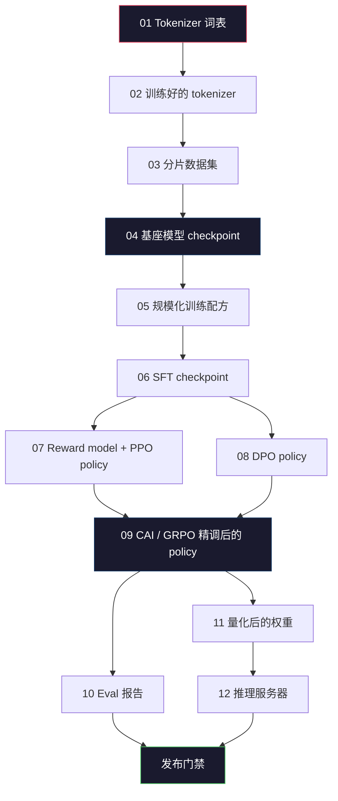
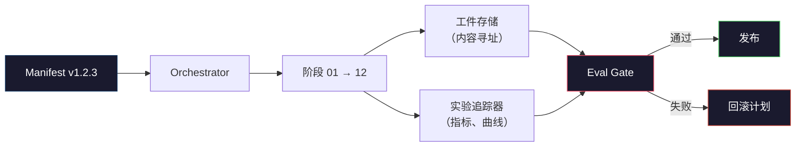

# 构建完整的 LLM 流水线

> 第 01 到 12 课的每一课都只是一条流水线中的一个阶段。本课是那副脚手架，把这些阶段拼成一次端到端运行：tokenize、pre-train、scale、SFT、align、evaluate、quantize、serve。你不会在笔记本上训练一个 70B 模型。你要产出的是编排层、manifest、eval gate 和回滚计划 —— 2026 年前沿团队用来决定什么能上线的那些东西。这是综合大课。

**Type:** Build
**Languages:** Python (stdlib)
**Prerequisites:** All Phase 10 lessons 01-12
**Time:** ~120 分钟
## Learning Objectives

- 把前面十一课（tokenizer、data、pre-training、scaling、SFT、RLHF、DPO、CAI、eval、quantization、inference）组合成一份可复现的流水线规范
- 定义阶段之间的工件契约：每个阶段消费什么、产出什么，下一阶段如何验证输入
- 构建一个编排器，能够追踪实验、对工件做哈希，并以 eval 阈值作为上线决策的门禁
- 设计回滚计划：哪些工件重跑很便宜，哪些很昂贵，一个损坏的 checkpoint 代价有多大

## 问题场景

前面每一课单独看都能跑通。tokenizer 训好了。微型 GPT 预训练完了。SFT 数据集拼好了。reward model 训好了。DPO 跑完了。Evals 测完了。量化权重导出了。推理服务器起起来了。但每一个都是一个 notebook。每一个都有自己的约定、自己的输出路径、自己的 seed。

前沿训练跑不是 notebook。Llama 3 405B 用了 3,000 万 H100 小时，前后大约 54 天。DeepSeek-V3 用了约 280 万 H800 小时。在这段时间里，一个损坏的 checkpoint、一次数据污染、一次 eval 回退，就可能让一个团队损失一周的墙上时间和一个月的 GPU 预算。团队熬过来的方式是流水线卫生：每个阶段都有确定性的输入、确定性的输出、一份 manifest、一个哈希、一道门禁。

这就是综合大课。你不会在笔记本上把流水线端到端跑一遍。你要写的是协调各阶段的编排器、描述这次运行的 manifest、为上线决策把关的校验器，以及让别人能从一个文件复跑你工作的重放计划。代码很小；纪律很大。

这个模式从 1 亿参数扩展到 1 万亿参数都不变。同样四个组件 —— manifest、orchestrator、eval gate、artifact store —— 既跑 Llama 3，也跑你的业余 GPT。区别在于每个阶段 config 里数字的大小，而不在流水线的形状。

## 核心概念

### 十二个阶段

Phase 10 的每一课都是一个阶段。下面是完整的依赖图。



阶段 07 和 08 可以并行。其余都是硬依赖。阶段 02（tokenizer）一变，下游所有工件全部作废。阶段 10（eval）一变，只作废上线决策。

### Manifest

manifest 是一个文件，它把一次运行描述得足够完整，以至于能重放。流水线产出的任何东西都不应该依赖于 manifest 之外的状态。字段都很枯燥，而且都是必填的。

```
pipeline_version: 1.2.3
seed: 42
git_commit: a1b2c3d4
stages:
  01_tokenizer:
    recipe: bpe_32k
    input_hash: sha256:...
    output_hash: sha256:...
    wall_clock_sec: 3600
    cost_usd: 12
```

阶段 N 的输出哈希就是阶段 N+1 的输入哈希。任何偏差都会让流水线停下。这就是你及早发现数据损坏的方式。这也是另一个大洲的同事验证他的重放产出了与你相同工件的方式。

实践中，团队会用一个小的 YAML schema，加上一个把本次运行与上一次成功运行做 diff 的 manifest 校验器。任何超出预期字段（成本、墙上时间）的差异都是一个红旗。

### 工件类型化

每个阶段的输出都是一个有类型的工件。不是一个目录里的一坨文件，也不是一个 pickle，而是一个有名字的类型，带着已知的 schema。

| 阶段 | 工件类型 | 关键字段 |
|-------|--------------|-----------|
| 01-02 | Tokenizer | vocab.json, merges.txt, config.json, hash |
| 03 | Dataset | shards[]、行数、token 数、去重统计 |
| 04-05 | Checkpoint | weights.safetensors, config.json、优化器状态、步数 |
| 06 | SFT Model | checkpoint + SFT 配方 + 数据配比 |
| 07 | Reward Model | RM checkpoint + 偏好数据哈希 |
| 08-09 | Policy | checkpoint + reference 哈希 + beta + 已消耗的 KL 预算 |
| 10 | Eval Report | benchmark 分数 + 回退 diff + eval 数据哈希 |
| 11 | Quantized Model | 量化权重 + 校准数据 + 相对 FP16 的准确率差值 |
| 12 | Server Spec | endpoint + 模型哈希 + config + 可观测性钩子 |

类型化能挡住最常见的失败模式：把阶段 08 的输出当作阶段 06 的输入，把 DPO 训出来的模型从 SFT 的路径上线。有类型的工件和有类型的阶段签名，让这类错误变成编译期失败，而不是第五天才暴露的失败。

### Eval Gate

上线不是「训练结束了」。上线是「训练结束了，而且 eval gate 通过了」。门禁在运行开始之前就定义好。

```
gates:
  mmlu:      >= baseline + 0.5   # no regression
  humaneval: >= baseline + 1.0
  truthfulqa: >= baseline         # no drop
  safety_refusal_rate: <= 0.05
  kl_from_reference: <= 25.0
  cost_total_usd: <= 50000
```

每一道门禁都是一个数值阈值。没有「看起来不错」式的门禁。没有主观签字。如果所有门禁都通过，工件被标记为可上线。只要有任意一道失败，这次运行就被挂起，等待具名评审人显式覆盖 —— 覆盖本身也会记录进 manifest。

两道门禁能抓住大多数灾难。*回退* 门禁（新模型在核心 benchmark 上至少要和上一版一样好）抓训练 bug。*KL 预算* 门禁（对齐后的 policy 相对 reference 的漂移不能超过 X）抓对齐过度。每一条生产流水线这两道都有。

### Orchestrator

一小段代码，读 manifest，派发阶段，追踪工件，并在任何契约违规时停下。这不是 Airflow。这不是 Kubeflow。做流水线卫生，你要的是一个无聊的、自己写的东西。

编排器的职责很窄：

1. 从 manifest 解析出 DAG。
2. 对每个阶段，检查期望的输出是否已经以正确的哈希存在（存在就跳过）。
3. 运行该阶段，捕获 stdout/stderr，测量墙上时间和成本。
4. 校验输出哈希与下游阶段期望的输入哈希是否一致。
5. 失败时，写一份部分 manifest，标明具体失败的阶段，并以非零码退出。

那是 200 行 Python。它看起来就像本课里的 `code/main.py`。底层上，真实流水线用 `torchrun` 或 `ray` 在集群上执行各个阶段，但编排器本身跑在一台机器上。

### 实验追踪与工件存储

两个外部系统锚定整条流水线。

**实验追踪器（wandb、neptune、mlflow）。** 按阶段记录 loss 曲线、eval 指标、系统遥测。三周后你需要比较运行 A 和运行 B 时，去的就是追踪器。团队几乎总是用托管的追踪器 —— 自己写会浪费本该投在训练上的时间。

**工件存储（S3、R2、GCS）。** 给 checkpoint、数据集、tokenizer、eval 报告用的不可变对象存储。工件按哈希寻址，而不是按文件名。像 `latest.pt` 这样的文件名是个陷阱；`ckpt-7b-step-20000-sha256:abc123.safetensors` 才是一份契约。

编排器同时写入两者。追踪器是给看图表的人用的。工件存储是给下一个阶段查输入用的。

### 成本核算

一次前沿训练跑背后挂着一个美元数字。预算纪律发生在两个地方。

**运行前估算。** 从 manifest 计算预期 FLOPs（预训练用 6 x params x tokens）、预期 GPU 小时（FLOPs / 峰值吞吐 / 利用率），以及按当前租用价格算出的美元成本。如果估算超出预算门禁，流水线拒绝启动。

**运行中追踪。** 逐阶段的墙上时间和成本被记进 manifest。每个阶段之后都检查剩余预算。如果某个阶段超支，下一阶段的门禁就会用新的剩余预算来评估。你不用等到 VC 打电话时才知道钱烧完了。

Llama 3 公布的成本是 $61M。DeepSeek-V3 公布主预训练跑是 $5.6M。这个比例主要来自硬件效率加上 mixture-of-experts —— 但成本之所以可见，是因为两个团队都按阶段追踪，而不是按整次运行追踪。

### 可复现与确定性

这两个不是一回事。*可复现* 意味着同样的 manifest、同样的代码、同样的基础设施，产出的 checkpoint 在下游指标上是等效的。*确定性* 意味着逐位相同的输出。

现代 LLM 训练是可复现的，但不是确定性的。分布式训练的归约顺序、GPU kernel 的非确定性（cuBLAS、flash-attn）以及混合精度舍入，合起来导致不同运行的浮点数在 1e-5 的级别上有差异。这对最终指标没问题，指标不会动。如果你试图用位级 diff 来调试，那就是致命的。解药是记录每个阶段的输入哈希、输出哈希和主要指标 —— 只要这些对得上，这次运行就算「复现」了，即使权重并非逐位相同。



### 回滚计划

在运行开始之前，把每个阶段失败时会发生什么写下来。分三类。

- **重跑便宜**（数小时）：tokenizer、eval、quantization、推理服务器。直接重跑。
- **中等**（数天）：SFT、DPO、CAI。保留基座模型；只重跑对齐阶段。
- **昂贵**（数周、数百万美元）：预训练。这里的回滚计划不是「重跑」。而是「用最后一个好的 checkpoint，用修订后的数据重跑更便宜的下游阶段」。

因为阶段依赖是有类型、有哈希的，编排器可以自动算出回滚集合：作废失败的阶段以及它的所有后代。阶段 06（SFT）失败会作废 06、07、08、09、10、11、12。阶段 11（quantization）失败只作废 11 和 12。事先把这些名字定下来，可以避免团队凌晨 4 点精疲力尽时临时瞎编。

### 2026 年观察到的生产配方

大多数前沿团队收敛到了同一副骨架。

- Tokenizer：128k BPE，带 byte fallback。在一个小而均衡的多语言切片上训练。
- 预训练：10-20T token，以网页为主，加上代码和合成数据。Muon 或 AdamW 优化器。FSDP2 或 DeepSpeed ZeRO-3。梯度 checkpointing。BF16 权重，FP32 master。
- SFT：50 万到 200 万条指令对，人工与合成混合，对 eval 集做严格去重。
- 对齐：DPO 或 CAI + GRPO。只有当偏好信号的多维程度超出 DPO 能表达的范围时才用 RLHF。
- Eval：MMLU-Pro、MATH、HumanEval+、GPQA、SWE-Bench Verified、LiveBench，外加一个公众永远看不到的私有留出集。
- Quantization：服务用 4-bit GPTQ 或 AWQ，准确率差值要紧的安全 eval 用 8-bit。
- 服务：vLLM、TensorRT-LLM，或自研。Continuous batching。Speculative decoding。KV cache 淘汰。

数字每六个月变一次。骨架不变。

```figure
beam-search
```

## Build It

本课的代码是一个编排器和一个 manifest 校验器，而不是十二个训练脚本。每个阶段用一个占位实现来模拟，产出形状和哈希都正确的输出工件。在你把 GPU 的钱烧在真实阶段上之前，端到端跑一遍编排器就能证明流水线的管道是通的。

完整实现见 `code/main.py`。关键部分：

- `Manifest` dataclass：流水线版本、seed、git commit、阶段、门禁。
- `Stage` dataclass：名字、类型、输入（哈希）、输出（哈希）、墙上时间、成本。
- `Orchestrator.run()`：解析 DAG、派发阶段、校验哈希、更新 manifest。
- `EvalGate.check()`：读取阈值，与最新的 eval 报告比较，返回通过/失败。
- `ArtifactStore`（内存版桩实现）：按哈希 put/get，模拟 S3。
- `CostTracker`：按阶段和累计，超过上限时停止。

`main.py` 里的流水线跑十二个占位阶段，产出一份 manifest，并演练一次失败的 eval gate，让你看到被挂起的运行长什么样。把每个占位实现替换成对应课程里的真实训练脚本，你就得到了真实前沿流水线所用的骨架。

## Use It

标准工作流有三条命令。

```
python code/main.py plan    # validate manifest, compute cost estimate, print DAG
python code/main.py run     # execute stages, writing to manifest.out.yaml
python code/main.py gate    # read manifest.out.yaml, apply eval gates, ship-or-hold
```

每次都先跑 `plan`。大多数流水线 bug 在 plan 阶段就会暴露 —— 缺失的门禁阈值、过期的哈希、预算超支。跑 `plan` 是免费的。跑 `run` 很贵。在便宜的一侧抓 bug 来省钱。

`gate` 的输出要么是 `SHIP`，要么是 `HOLD: <reason>`。被挂起的运行不是失败，而是一个决策点。具名评审人要么覆盖（覆盖会被记录），要么批准回滚。

## Ship It

本课产出 `outputs/skill-llm-pipeline-reviewer.md`。把一份拟定的流水线 manifest 喂给它，它会检查所有契约：阶段类型、哈希链、门禁、回滚计划、成本估算。缺少 eval gate、KL 预算没有上界、或者把 eval 数据和训练数据混在一起的 manifest，它拒绝批准。

## Exercises

1. 扩展编排器，支持阶段 07 和 08 并行执行。使用标准库的 `concurrent.futures` 模块。确认最终 manifest 记录了两个阶段的输出，并且阶段 09 的输入哈希是两者的确定性组合。

2. 增加一道「污染检查」门禁。给定 eval 数据集哈希和训练数据集分片，计算重叠（精确字符串匹配或 13-gram 匹配）。重叠超过 0.1% 则门禁失败。喂给它一个被污染的训练集，确认门禁把这次运行挂起。

3. 从第一性原理实现一个成本估算器。对阶段 04（预训练），把 FLOPs 估算为 6 x params x tokens，假设 H100 上 BF16 989 TFLOPs 达到 40% MFU（model FLOPs utilization），价格 $2.50/GPU 小时。报告一个在 2T token 上训练的 7B 模型的估算值。与已公布的 Llama 2 数字比较。

4. 构建一个部分回滚。模拟阶段 09（CAI）失败，然后重跑阶段 09 到 12，同时保留 01-08 的缓存。编排器应该按哈希发现缓存的工件并跳过它们。测量相比完整重跑省下的墙上时间。

5. 增加可观测性。为每个阶段发出 OpenTelemetry span，属性包含参数、已见 token、loss 和成本。把 span 管道到本地 collector。重点不是仪表盘；重点是每个阶段的健康状况都能从一个 trace ID 追溯出来。

## Key Terms

| 术语 | 常见说法 | 实际含义 |
|------|----------------|----------------------|
| Manifest | 「那份配方文件」 | 描述流水线版本、seed、逐阶段配置和门禁阈值的 YAML 或 JSON —— 足以重放一次运行 |
| Content-addressed | 「按哈希不按文件名」 | 工件按内容的 SHA-256 存储，所以你永远不会把版本 A 和版本 B 搞混 |
| Eval gate | 「上线标准」 | benchmark 指标和安全分数上的数值阈值，工件必须先通过才会被标记为可上线 |
| KL budget | 「对齐漂移了多远」 | 对齐各阶段累计 KL(policy || reference) 的上限，作为门禁强制执行 |
| MFU | 「你把 GPU 用到了几成」 | Model FLOPs Utilization —— 实际达到的 FLOPs 除以理论峰值。70B 规模下典型是 40%，7B 是 55% |
| Rollback plan | 「坏了我们怎么办」 | 每个阶段失败时预先写好的动作集：重跑、回退、用修订后的输入重新训练 |
| Orchestrator | 「指挥」 | 读取 manifest、派发阶段、校验哈希、在任何契约违规时停下的那个进程 |
| Artifact store | 「权重的版本化 S3」 | 不可变的内容寻址对象存储 —— checkpoint、数据集、eval 报告的单一事实来源 |
| Reproducible | 「重放得到同样的指标」 | 位级权重不同，但下游指标等效 —— 分布式 LLM 训练的现实目标 |
| Cost gate | 「不能超过 X」 | 运行前成本估算加上运行中追踪 —— 估算超预算时流水线拒绝启动 |

## Further Reading

- [Dubey et al., 2024 -- "The Llama 3 Herd of Models"](https://arxiv.org/abs/2407.21783) —— 对一个前沿流水线最详细的公开描述，涵盖数据、训练、对齐、eval
- [DeepSeek-AI, 2024 -- "DeepSeek-V3 Technical Report"](https://arxiv.org/abs/2412.19437) —— 效率优先的流水线，成本约为 Llama 3 级训练的 1/10
- [Kaplan et al., 2020 -- "Scaling Laws for Neural Language Models"](https://arxiv.org/abs/2001.08361) —— 计算-数据-参数缩放关系的原始论文
- [Hoffmann et al., 2022 -- "Training Compute-Optimal Large Language Models (Chinchilla)"](https://arxiv.org/abs/2203.15556) —— 对 Kaplan 的修正，重新校准了现代的数据预算
- [PyTorch FSDP2 documentation](https://pytorch.org/docs/stable/fsdp.html) —— 在 PyTorch 2.4+ 中取代 FSDP1 的分布式训练原语
- [Weights & Biases LLM Reports](https://wandb.ai/site/solutions/llms/) —— 开源 LLM 运行的真实 manifest 和实验追踪器输出，可作为可借鉴的模板
