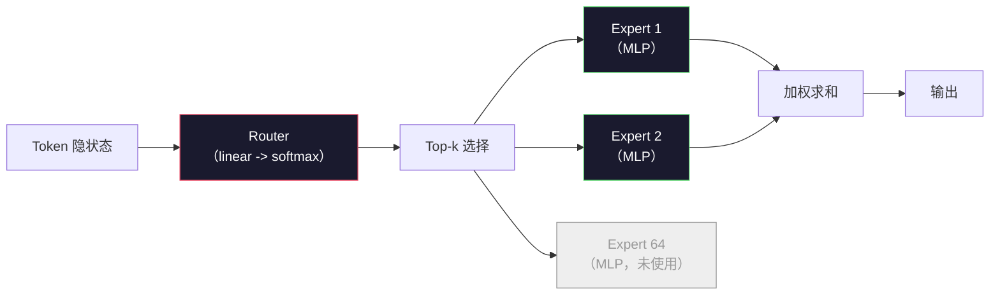

# 开放模型：架构走读

> 你在第 04 课从零构建了一个 GPT-2 Small。2026 年的前沿开放模型是同一族系，只做了五六个具体改动。用 RMSNorm 代替 LayerNorm。用 SwiGLU 代替 GELU。用 RoPE 代替学习式位置编码。用 GQA 或 MLA 代替完整 MHA。大规模上 Mixture-of-Experts。你已经掌握的数学覆盖了其中 95%。本课把 Llama 3、DeepSeek-V3、Mixtral、Qwen 和 Gemma 并排读一遍，指出每种架构具体在哪一行上分叉。

**Type:** Learn
**Languages:** Python (stdlib)
**Prerequisites:** Phase 10, Lessons 04, 05, 12 (Pre-training, Scaling, Inference)
**Time:** ~45 分钟
## Learning Objectives

- 读懂 Llama 3、Mistral、Mixtral、Gemma 2、Qwen 2.5 和 DeepSeek-V3 的 config.json，并解释每一个字段
- 说出每个模型相对 GPT-2 Small 做的具体架构改动，并从第一性原理给出理由
- 仅凭 config 就算出任意开放模型的参数量、KV cache 大小和激活值内存
- 给定延迟、内存和能力约束，为一个部署目标挑出合适的开放模型

## 问题场景

第 04 课你写了 350 行 numpy，得到了一个 GPT-2 形状的模型。Llama 3 405B 有一份 200 页的技术报告。你的直觉是这些是不同的物种。它们不是。那 200 页描述的仍是同一个对象，只是做了五六个有充分理由的修改，外加一千个关于扩展的实现细节。骨架 —— embedding、transformer block、attention、MLP、norm、head —— 没有变。

本课是一份 diff。对每一个主要开放模型家族，我们列出它相对 GPT-2 到底改了什么、为什么改、付出了什么代价。读完之后，你可以拿起一份全新的 model card，在脑子里把它翻译回 GPT-2 基线。

实际的收益是：当 Meta 发布 Llama 5 或 DeepSeek 发布 V4 时，你不需要建立新的心智模型。你去看 config，看出这些熟悉的旋钮里哪些动了，就知道下游影响是什么。2026 年的架构是一个有限的工具箱。每个新模型只是挑了其中一个不同的子集。

## 核心概念

### 不变的核心

所有自回归开放模型都共享：

- Token embedding 矩阵（vocab_size x hidden_dim）。
- N 个 decoder block 的堆叠：norm、self-attention、residual、norm、MLP、residual。
- 最后的 norm 和投影到 vocab_size 的线性 head（通常与 embedding 共享权重）。
- 因果 mask、next-token 交叉熵损失。

这就是形状。剩下的都是旋钮。

### 真正会动的六个旋钮

在每一个 2024-2026 年的前沿开放模型里，同样这六个设计选择被反复挑中：

1. **归一化。** LayerNorm -> RMSNorm。
2. **位置编码。** 学习式绝对位置 -> RoPE（外加变体：YaRN、NTK）。
3. **激活函数。** GELU -> SwiGLU（或 GeGLU）。
4. **Attention head 共享。** MHA -> GQA -> MQA -> MLA。
5. **稠密 vs 稀疏 MLP。** Dense -> Mixture-of-Experts。
6. **Pre-norm 的位置。** Pre-norm 保留。Post-norm 消失了。

其他一切（学习率调度、数据配比、batch size、上下文长度）都属于训练配置，不属于架构。六个旋钮。

### 旋钮 1：RMSNorm

LayerNorm 减去均值、除以标准差、缩放、平移。RMSNorm 只保留缩放：

```
RMSNorm(x) = x / sqrt(mean(x^2) + eps) * gamma
```

不减均值。没有 bias。每个 token 少一次 matmul。Zhang 和 Sennrich（2019）论证它在机器翻译上追平 LayerNorm，同时快 10%。每一个现代开放模型都在用它。

代价：无。收益：小幅吞吐提升，代码更简单。

### 旋钮 2：RoPE

学习式位置 embedding 在 GPT-2 里是一张 1024 槽的查找表。上下文到 1025 就越过表尾了。模型无法外推到训练长度之外。

Rotary Position Embedding（RoPE，Su et al. 2021）的做法是：在 attention 点积之前，把每个 Q 和 K 向量按成对维度做旋转来注入位置。旋转角度是位置的确定函数，所以没有任何东西需要学习，也不存在用尽的问题。配合缩放技巧（NTK-aware 插值、YaRN），一个在 8k 上下文上训练的模型在推理时可以拉伸到 128k，准确率损失有限。

```
q_rotated = rotate(q, angle(pos))
k_rotated = rotate(k, angle(pos))
score = q_rotated . k_rotated
```

每一个 Llama、Mistral、Qwen、DeepSeek 和 Gemma 都用 RoPE。Gemma 2 用的是混合方案（多数层用 RoPE，另一些层用局部滑窗 attention）。

### 旋钮 3：SwiGLU

GPT-2 的 MLP 是 `x -> gelu(xW1 + b1) -> (...)W2 + b2`。SwiGLU（Shazeer 2020）把激活换成门控乘积：

```
SwiGLU(x) = (xW1) * sigmoid(xW1) * xV
```

两个并行投影而不是一个，由 Swish 激活做门控。在每参数 perplexity 上经验性地更强。Llama 2 采用了它，所有人都跟上了。MLP 的隐层大小通常这样设定，使得总参数量与原稠密 MLP 匹配：如果 GPT-2 用 `ff_dim = 4 * hidden`，SwiGLU 就用 `ff_dim = (2/3) * 4 * hidden = 8/3 * hidden`。

### 旋钮 4：Attention Head 共享

GPT-2 用的是 **Multi-Head Attention（MHA）**：每个 head 都有自己的 Q、K、V 投影。

**Multi-Query Attention（MQA，Shazeer 2019）** 让所有 head 共享一个 K 和一个 V。这把 KV cache 缩小了 num_heads 倍，在典型模型上就是 12 倍到 32 倍的削减。在困难 benchmark 上准确率会略有下降。

**Grouped-Query Attention（GQA，Ainslie et al. 2023）** 是折中方案：G 组 Q head 共享一个 K 和一个 V。Llama 3 8B 用的 GQA 是 32 个 Q head 配 8 个 KV head（G=8），所以 KV cache 相对完整 MHA 缩减 4 倍。

**Multi-Head Latent Attention（MLA，DeepSeek 2024）** 把 K 和 V 压缩进一个共享的低秩 latent，再按 head 投影回原维度。它进一步减小 KV cache，同时保留逐 head 的表达能力。DeepSeek-V2 和 V3 的长上下文性能就依赖这一点。

| 方案 | KV head 数 | KV cache | 准确率 |
|--------|----------|----------|----------|
| MHA    | num_heads | 完整 | 最佳 |
| GQA    | num_groups（G < num_heads） | 缩减为 num_heads / G | 接近 MHA |
| MQA    | 1 | 缩减为 num_heads 分之一 | 小幅下降 |
| MLA    | latent，逐 head 解压 | 小于 MQA | 接近 MHA |

对任何超过约 13B 参数的模型，GQA 或 MLA 实际上已经是必选项。大规模上用完整 MHA 是 KV cache 的灾难。

### 旋钮 5：Mixture of Experts

稠密 MLP 对每个 token 都激活它的全部参数。MoE MLP 每个 block 有 K 个 expert，还有一个 router 为每个 token 挑出 top-k 个 expert（典型是 top-2）。只有这些 expert 的权重会对该 token 做前向。

```
router_logits = xW_r
indices, weights = top_k(router_logits, k=2)
output = sum_i weights[i] * expert[indices[i]](x)
```

吸引力在于：你可以有 64 个各 7B 大小的 expert（于是总参数量很大），而每个 token 只跑其中 2 个（于是每 token 计算量相当于一个稠密 7B 模型）。Mixtral 8x7B 总参数 47B，但每 token 只激活 13B。DeepSeek-V3 总参数 671B，但每 token 只激活 37B。



优点：同样的计算量，更多参数，更大容量。缺点：expert 的显存还是得存在某个地方（所以服务时需要的 VRAM 比等效稠密模型更多），router 的负载均衡很难，而在对齐阶段微调 router 本身就是一个研究领域。

### 旋钮 6：Pre-norm 保留

最初的 transformer 在每个子层之后做 layer norm。GPT-2 之后每一个开放模型都把它放在每个子层*之前*。Pre-norm 在深层网络上严格更容易训练。没什么可争的。

### 逐个模型的差异

下面这张表把一切具体化。

| 模型 | 年份 | 总参数 | 激活参数 | Norm | 激活函数 | 位置编码 | Attention | MoE | 上下文 |
|-------|------|-------------|---------------|------|-----------|----------|-----------|-----|---------|
| GPT-2 Small | 2019 | 124M | 124M | LayerNorm | GELU | 学习式 | MHA（12 head） | 否 | 1k |
| Llama 3 8B | 2024 | 8B | 8B | RMSNorm | SwiGLU | RoPE | GQA（32/8） | 否 | 128k |
| Llama 3 70B | 2024 | 70B | 70B | RMSNorm | SwiGLU | RoPE | GQA（64/8） | 否 | 128k |
| Llama 3 405B | 2024 | 405B | 405B | RMSNorm | SwiGLU | RoPE | GQA（128/16） | 否 | 128k |
| Mistral 7B | 2023 | 7.2B | 7.2B | RMSNorm | SwiGLU | RoPE | GQA | 否 | 32k |
| Mixtral 8x7B | 2023 | 47B | 13B | RMSNorm | SwiGLU | RoPE | GQA | 是（8 个 expert，top-2） | 32k |
| Gemma 2 9B | 2024 | 9B | 9B | RMSNorm（pre+post） | GeGLU | RoPE + 滑窗 | GQA | 否 | 8k |
| Qwen 2.5 72B | 2024 | 72B | 72B | RMSNorm | SwiGLU | RoPE（YaRN） | GQA（64/8） | 否 | 128k |
| DeepSeek V2 236B | 2024 | 236B | 21B | RMSNorm | SwiGLU | RoPE | MLA | 是（160 个 expert，top-6） | 128k |
| DeepSeek V3 | 2024 | 671B | 37B | RMSNorm | SwiGLU | RoPE | MLA | 是（256 个 expert，top-8） | 128k |

扫一遍这些列。RMSNorm 是通用的。SwiGLU 或它的表亲 GeGLU 是通用的。RoPE 是通用的。7B 以上 GQA 是通用的，除非被 MLA 取代。MoE 是顶端那一档的分水岭。

### 读懂 config.json

Llama 3 8B 的 config：

```
{
  "hidden_size": 4096,
  "intermediate_size": 14336,
  "num_hidden_layers": 32,
  "num_attention_heads": 32,
  "num_key_value_heads": 8,
  "max_position_embeddings": 131072,
  "rope_theta": 500000.0,
  "rms_norm_eps": 1e-5,
  "vocab_size": 128256
}
```

每一个字段都对应你早已实现过的东西。

- `hidden_size`：embedding 维度。
- `intermediate_size`：MLP 隐层大小（hidden 的 3.5 倍 —— SwiGLU 的算术）。
- `num_hidden_layers`：堆叠深度。
- `num_attention_heads`：Q head 数。
- `num_key_value_heads`：KV head 数（GQA）。
- `max_position_embeddings`：训练上下文长度。
- `rope_theta`：RoPE 基频。Meta 把它从默认的 10k 放大到 500k，用于长上下文外推。
- `rms_norm_eps`：数值稳定性。
- `vocab_size`：token 数。

仅凭这些你就能算出总参数、KV cache 和峰值激活值内存。精确公式见 `code/main.py`。

### 激活值内存预算

参数超过几十亿之后，激活值在训练显存中占主导。预训练的经验法则（配合梯度 checkpointing）：

```
activation_mem ~ batch_size * seq_len * hidden_size * num_layers * bytes_per_element
```

对 Llama 3 8B，batch 1、seq 8192、BF16、32 层、hidden 4096：带 checkpointing 光是激活值就大约 8 GB，不带则 40 GB。这就是 flash-attention 和 ring-attention 重要的原因 —— 它们重写 attention 的计算方式，让激活值装得下。

### KV Cache 预算

最大上下文下的推理：

```
kv_cache = 2 * num_layers * num_kv_heads * head_dim * max_seq_len * bytes_per_element
```

Llama 3 8B 在 128k 上下文、BF16、head_dim = hidden / num_heads = 128 下：
每个序列 `2 * 32 * 8 * 128 * 131072 * 2 = 17.2 GB`。

8B 权重在 BF16 下是 16 GB。单条 128k 序列的 KV cache 比权重还大。正是这种内存压力推动了 GQA、MLA 和 KV cache quantization 的研究。

### 各模型的适用场景

- **单张 80GB GPU，不用 MoE**：Llama 3 8B、Mistral 7B、Gemma 2 9B。好服务，工具链广泛。
- **单节点（8x80GB），大容量**：Llama 3 70B、Qwen 2.5 72B。稠密模型中开放能力最高。
- **开放能力最强，接受 MoE 复杂度**：DeepSeek V3、Mixtral 8x22B。每单位激活 FLOP 的能力最好。
- **长上下文需求**：Llama 3（靠 RoPE 缩放做到 128k）、DeepSeek（MLA 的优势）。
- **低延迟服务**：Gemma 2 9B（滑窗削减长上下文的计算）。

```figure
rmsnorm-vs-layernorm
```

## Build It

本课的代码是一个计算器。给定任意 config.json，它按组件打印参数量、最大上下文下的 KV cache、SwiGLU MLP 比例，以及对该架构的简短判定（dense / GQA / MLA / MoE）。

```python
config = {
    "hidden_size": 4096, "intermediate_size": 14336,
    "num_hidden_layers": 32, "num_attention_heads": 32,
    "num_key_value_heads": 8, "vocab_size": 128256,
    "max_position_embeddings": 131072,
}
```

脚本逐字段走一遍架构，计算 embedding、attention（含 GQA 缩减）、MLP（含 SwiGLU 扩张）、layernorm 和 head 的参数量。然后按声明的上下文长度计算 KV cache，并打印一份摘要。

实现见 `code/main.py`。

## Use It

在脚本内置的 Llama 3 8B、Mistral 7B、Mixtral 8x7B 和 DeepSeek V3 配置上运行这个计算器。比较参数拆解。注意 MoE 模型的总参数量远超稠密模型，但激活参数量往往更小。注意 DeepSeek V3 的 KV cache 比 Llama 3 405B 更小，尽管它的总参数更多 —— 这就是 MLA 在起作用。

然后把你本地任意模型的配置填进去，读摘要，判断它能否装进你的 GPU。

## Ship It

本课产出 `outputs/skill-open-model-picker.md`。给定一个部署目标（GPU 类型、VRAM、上下文长度、延迟预算）和一份任务画像（聊天、代码、推理、长上下文），它会推荐一个开放模型、第 11 课里的量化方案、以及第 12 课里的推理栈，并对六个架构旋钮给出明确的推理。

## Exercises

1. 从 HuggingFace 读取 Qwen 2.5 72B 的 config。从零计算总参数。与 HF 报告的值比较，找出任何差异的来源（head dim 取整、KV 共享系数等）。

2. DeepSeek V3 用 256 个 expert 做 top-8 路由。计算激活 expert 与总 expert 的比例，与 Mixtral 8x7B 的 8 选 2 比较。从稀疏（25%）转向更稠密的稀疏（3%）对每 FLOP 容量意味着什么？

3. 计算 Llama 3 405B 在 128k 上下文下 FP8 和 BF16 的 KV cache。FP8 时它是 BF16 数值的一半。在单个 8xH100 节点上（每卡 80GB，共 640GB，减去权重占用）你能服务多少条并行序列？

4. Gemma 2 交替使用全 attention 层和滑窗 attention 层。写出一半层使用 4096 token 滑窗而非完整上下文时的 KV cache 数学。在总上下文 8k 时这能省多少显存？

5. 找一个在本课写成之后发布的前沿开放模型。指出它选了六个旋钮中的哪些，以及它是否引入了第七个旋钮。每当一个新架构发布，课程就会显得过时 —— 目标是更新你的表格，而不是重建你的心智模型。

## Key Terms

| 术语 | 常见说法 | 实际含义 |
|------|----------------|----------------------|
| RMSNorm | 「没有均值的 LayerNorm」 | 只用均方根做归一化，配一个学习式缩放 —— 更便宜，效果与 LayerNorm 相当 |
| RoPE | 「旋转位置」 | 把每个 Q 和 K 向量按二维成对维度、以依赖位置的角度旋转 —— 配合缩放技巧可外推到训练长度之外 |
| SwiGLU | 「新的 MLP 激活」 | 带 Swish 的门控线性单元：`(xW1) * sigmoid(xW1) * xV` —— 2024 之后每个开放模型的标准配置 |
| GQA | 「折中的 attention」 | Grouped-Query Attention：G 组 Q head 共享一个 K head 和一个 V head —— 缩小 KV cache，又不像 MQA 那样掉准确率 |
| MLA | 「DeepSeek 的 attention」 | Multi-Head Latent Attention：把 K/V 压缩进共享的低秩 latent，再逐 head 解压 —— 大模型中 KV cache 最小 |
| MoE | 「稀疏 expert」 | Mixture of Experts：每个 block 有 N 个 MLP，router 为每个 token 挑 top-k —— 总参数巨大，激活参数很小 |
| Top-k routing | 「每个 token 挑 k 个 expert」 | router 为每个 expert 算一个分数，激活最高的 k 个 —— 典型 k 从 2（Mixtral）到 8（DeepSeek） |
| YaRN | 「拉伸 RoPE」 | 又一个 RoPE 扩展 —— 插值旋转角度，在推理时把上下文从 8k 扩到 128k+ |
| Sliding-window attention | 「别关注所有东西」 | 每个 token 只关注最近 W 个 token —— 把每 token 的 attention 成本上限压到 O(W)，Gemma 2 和早期 Mistral 在使用 |
| Active params | 「每个 token 实际跑多少」 | 对 MoE 模型而言，每个 token 做一次前向时涉及的参数量（远小于总参数）—— 决定每 token 的 FLOPs |

## Further Reading

- [Dubey et al., 2024 -- "The Llama 3 Herd of Models"](https://arxiv.org/abs/2407.21783) —— 稠密 Llama 3 家族的架构与训练参考
- [DeepSeek-AI, 2024 -- "DeepSeek-V3 Technical Report"](https://arxiv.org/abs/2412.19437) —— MLA 加上无辅助损失的负载均衡，再加上 671B MoE
- [Jiang et al., 2024 -- "Mixtral of Experts"](https://arxiv.org/abs/2401.04088) —— MoE 开放模型的经典论文
- [Su et al., 2021 -- "RoFormer: Enhanced Transformer with Rotary Position Embedding"](https://arxiv.org/abs/2104.09864) —— RoPE 论文
- [Shazeer, 2020 -- "GLU Variants Improve Transformer"](https://arxiv.org/abs/2002.05202) —— SwiGLU、GeGLU 及其朋友们
- [Ainslie et al., 2023 -- "GQA: Training Generalized Multi-Query Transformer Models"](https://arxiv.org/abs/2305.13245) —— GQA 论文
- [Gemma 2 Team, 2024 -- "Gemma 2: Improving Open Language Models at a Practical Size"](https://arxiv.org/abs/2408.00118) —— 全 attention 与滑窗混合、pre+post-norm
- [Qwen Team, 2024 -- "Qwen 2.5 Technical Report"](https://arxiv.org/abs/2412.15115) —— YaRN 上下文扩展与长上下文训练配方
