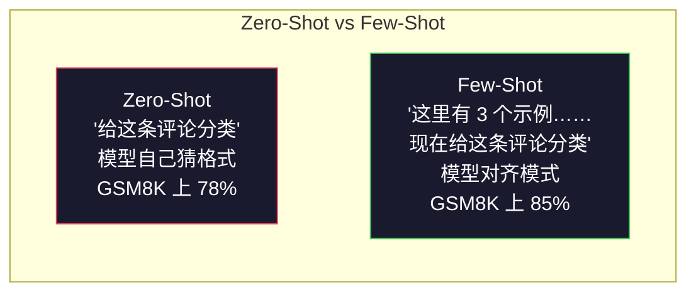
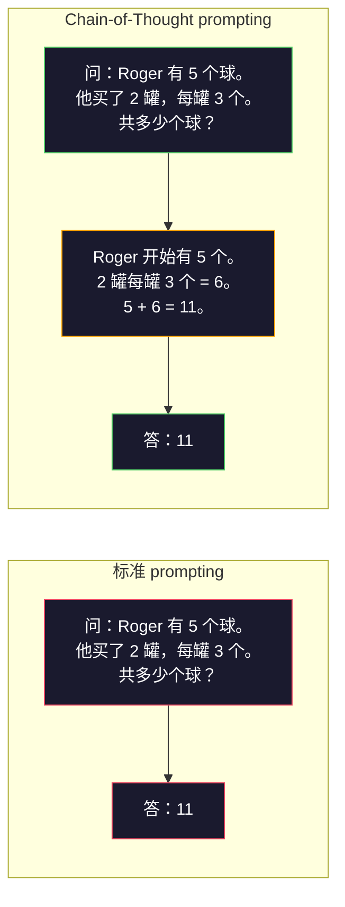
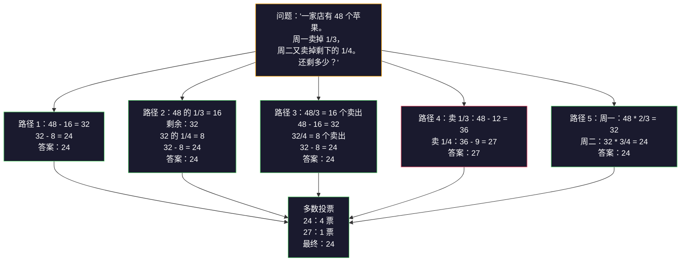
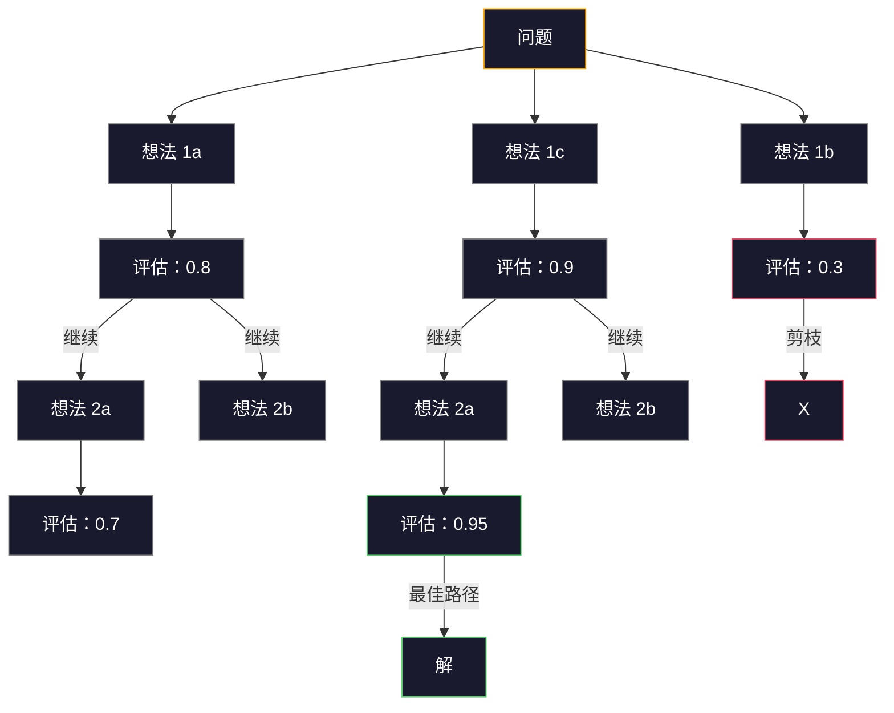
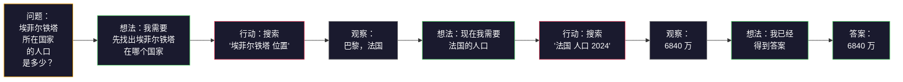

# Few-Shot、Chain-of-Thought、Tree-of-Thought

> 告诉模型做什么，是 prompting。告诉它怎么想，才是 engineering。同一个模型、同一个任务、同一份数据，准确率从 78% 到 91% 的落差，不是模型更强，而是推理策略更强。

**Type:** Build
**Languages:** Python
**Prerequisites:** Lesson 11.01 (Prompt Engineering)
**Time:** ~45 分钟

## Learning Objectives

- 实现 few-shot prompting：挑选并格式化示例演示，使任务准确率最大化
- 应用 chain-of-thought（CoT）推理，提升数学应用题这类多步问题的准确率
- 构建一个 tree-of-thought prompt，探索多条推理路径并选出最好的一条
- 在标准 benchmark 上度量 zero-shot、few-shot 与 CoT 带来的准确率提升

## 问题场景

你做一个数学辅导应用。prompt 写着："Solve this word problem."。在小学标准数学 benchmark GSM8K 上，GPT-5 有 94% 的题目答对。你以为已经到顶了。其实没有——chain-of-thought 还能再加 3-4 个点。

加上五个词——"Let's think step by step"——准确率跳到 91%。再加几个带解题过程的示例，能达到 95%。同一个模型，同一个 temperature，同样的 API 成本。唯一的区别是你给了模型一张草稿纸。

这不是 hack。这就是推理本身的运作方式。人类解多步问题不会一步跳到答案。transformer 也不会。当你迫使模型生成中间 token 时，这些 token 就成为下一个 token 的上下文。每一步推理都喂给下一步。模型真的是一步一步算到答案的。

但"一步一步地想"只是起点，不是终点。如果我采样五条推理路径然后多数投票呢？如果让模型探索一棵可能性树，评估并剪枝呢？如果把推理与工具使用交替穿插呢？这些都不是假设。它们是有实测改进的已发表技术，本课你会把它们全部实现出来。

## 核心概念

### Zero-Shot vs Few-Shot：什么时候示例胜过指令

zero-shot prompting 只给模型一个任务，别的什么都不给。few-shot prompting 先给它示例。

Wei et al.（2022）在 8 个 benchmark 上测量了这件事。对情感分类这类简单任务，zero-shot 与 few-shot 的差距在 2% 以内。对多步算术和符号推理这类复杂任务，few-shot 把准确率提升了 10-25%。

直觉是：示例是压缩过的指令。与其描述输出格式，不如直接展示。与其解释推理过程，不如演示出来。模型在示例上做模式匹配，比解读抽象指令更可靠。



**few-shot 占优的时候**：格式敏感的任务、分类、结构化抽取、领域特定术语，以及任何需要模型对齐特定模式的任务。

**zero-shot 占优的时候**：简单的事实性问题；示例会限制创造力的创作类任务；以及找到好示例比写好指令还难的任务。

### 示例选择：相似胜过随机

并非所有示例都一样好。在分类任务上，挑选与目标输入相似的示例，比随机选择高出 5-15%（Liu et al., 2022）。三条原则：

1. **语义相似度**：挑 embedding 空间里离输入最近的示例
2. **标签多样性**：示例要覆盖所有输出类别
3. **难度匹配**：与目标问题的复杂度相当

大多数任务的最优示例数是 3-5 个。少于 3 个，模型没有足够信号抽出模式。多于 5 个，收益递减，还白白浪费上下文窗口的 token。类别很多的分类任务，每个标签用一个示例。

### Chain-of-Thought：给模型一张草稿纸

Chain-of-Thought（CoT）prompting 由 Google Brain 的 Wei et al.（2022）提出。想法很简单：不要只向模型要答案，让它先展示推理步骤。



从机制上讲，为什么有效？transformer 生成的每个 token 都成为下一个 token 的上下文。没有 CoT 时，模型必须把所有推理压进单次前向传播的隐状态里。有了 CoT，模型把中间计算外化成 token。每个推理 token 都在扩展有效的计算深度。

**GSM8K benchmark（小学水平数学，8.5K 道题）：**

| 模型 | Zero-Shot | Zero-Shot CoT | Few-Shot CoT |
|-------|-----------|---------------|--------------|
| GPT-4o | 78% | 91% | 95% |
| GPT-5 | 94% | 97% | 98% |
| o4-mini (reasoning) | 97% | — | — |
| Claude Opus 4.7 | 93% | 97% | 98% |
| Gemini 3 Pro | 92% | 96% | 98% |
| Llama 4 70B | 80% | 89% | 94% |
| DeepSeek-V3.1 | 89% | 94% | 96% |

**关于 reasoning 模型的说明。** OpenAI 的 o 系列（o3、o4-mini）和 DeepSeek-R1 这类模型在给出答案之前会在内部跑 chain-of-thought。对 reasoning 模型加"Let's think step by step"是多余的，有时甚至适得其反——它们已经做过了。

CoT 有两种形态：

**Zero-shot CoT**：在 prompt 末尾追加"Let's think step by step"。不需要示例。Kojima et al.（2022）证明，单这一句话就能在算术、常识和符号推理任务上提升准确率。

**Few-shot CoT**：提供包含推理步骤的示例。它比 zero-shot CoT 更有效，因为模型看到了你期望的确切推理格式。

**CoT 有害的时候**：简单的事实回忆（"What is the capital of France?"）、单步分类、速度比准确率更重要的任务。CoT 每次查询会多出 50-200 个推理 token 的开销。对高吞吐、低复杂度的任务，那是白花的成本。

### Self-Consistency：多采样，一次投票

Wang et al.（2023）提出了 self-consistency。洞察是：单条 CoT 路径可能包含推理错误。但如果你采样 N 条独立推理路径（使用 temperature > 0），再对最终答案做多数投票，错误就会相互抵消。



在最初的 PaLM 540B 实验中，self-consistency 在 N=40 时把 GSM8K 准确率从 56.5%（单条 CoT）提升到 74.4%。在 GPT-5 上提升很小（97% 到 98%），因为基础准确率已经饱和。这项技术在基础 CoT 准确率处于 60-85% 的模型上最能发光——那是单路径错误频发但尚未系统化的甜点区。对 reasoning 模型（o 系列、R1），self-consistency 已被内置的内部采样涵盖。

代价是：N 次采样意味着 N 倍的 API 成本和延迟。实践中，N=5 就能拿到大部分收益。N=3 是做出有意义投票的最低要求。N > 10 对大多数任务收益递减。

### Tree-of-Thought：分支式探索

Yao et al.（2023）提出了 Tree-of-Thought（ToT）。CoT 沿一条线性推理路径走，而 ToT 探索多条分支，在继续之前评估哪些最有前途。



ToT 有三个组成部分：

1. **想法生成**：产出多个候选的下一步
2. **状态评估**：给每个候选打分（可以把 LLM 自身当评估器）
3. **搜索算法**：在树中做 BFS 或 DFS，剪掉低分支

在 Game of 24 任务上（用 4 个数字通过算术运算凑出 24），GPT-4 用标准 prompting 解出 7.3% 的题目。用 CoT 只有 4.0%（CoT 在这里反而有害，因为搜索空间太宽）。用 ToT 达到 74%。

ToT 很贵。树中每个节点都需要一次 LLM 调用。分支因子 3、深度 3 的树最多需要 39 次 LLM 调用。只用在搜索空间大但可评估的问题上——规划、解谜、带约束的创意性问题求解。

### ReAct：思考 + 行动

Yao et al.（2022）把推理轨迹与行动结合了起来。模型在思考（生成推理）和行动（调用工具、搜索、计算）之间交替。



在知识密集型任务上，ReAct 胜过纯 CoT，因为它能把推理建立在真实数据上。在 HotpotQA（多跳问答）上，GPT-4 配 ReAct 达到 35.1% 的 exact match，而单用 CoT 是 29.4%。真正的威力在于：观察会纠正推理错误——模型可以在执行途中更新计划。

ReAct 是现代 AI agent 的基础。每个 agent 框架（LangChain、CrewAI、AutoGen）都实现了 Thought-Action-Observation 循环的某种变体。你会在 Phase 14 里构建完整的 agent。本课讲的是它的 prompting 模式。

### 结构化提示：XML 标签、分隔符、标题

当 prompt 变复杂时，结构能防止模型混淆各个部分。三种做法：

**XML 标签**（对 Claude 效果最好，其他地方也稳）：
```
<context>
You are reviewing a pull request.
The codebase uses TypeScript and React.
</context>

<task>
Review the following diff for bugs, security issues, and style violations.
</task>

<diff>
{diff_content}
</diff>

<output_format>
List each issue with: file, line, severity (critical/warning/info), description.
</output_format>
```

**Markdown 标题**（通用）：
```
## Role
Senior security engineer at a fintech company.

## Task
Analyze this API endpoint for vulnerabilities.

## Input
{api_code}

## Rules
- Focus on OWASP Top 10
- Rate each finding: critical, high, medium, low
- Include remediation steps
```

**分隔符**（极简但有效）：
```
---INPUT---
{user_text}
---END INPUT---

---INSTRUCTIONS---
Summarize the above in 3 bullet points.
---END INSTRUCTIONS---
```

### Prompt 链：顺序分解

有些任务对单个 prompt 来说太复杂。prompt chaining 把它们拆成若干步，上一个 prompt 的输出成为下一个 prompt 的输入。


链式调用胜过单 prompt，有三个原因：

1. **每一步更简单**：模型只处理一个聚焦的任务，而不是同时兼顾所有事
2. **中间输出可检查**：你可以在步骤之间校验和纠正
3. **不同步骤可以用不同模型**：抽取用便宜模型，推理用贵模型

### 性能对比

| 技术 | 最适合 | GSM8K 准确率（GPT-5） | API 调用 | Token 开销 | 复杂度 |
|-----------|----------|------------------------|-----------|----------------|------------|
| Zero-Shot | 简单任务 | 94% | 1 | 无 | 极低 |
| Few-Shot | 格式对齐 | 96% | 1 | 200-500 tokens | 低 |
| Zero-Shot CoT | 快速提升推理 | 97% | 1 | 50-200 tokens | 极低 |
| Few-Shot CoT | 单次调用准确率最高 | 98% | 1 | 300-600 tokens | 低 |
| Self-Consistency (N=5) | 高风险推理 | 98.5% | 5 | 5 倍 token 成本 | 中 |
| Reasoning 模型（o4-mini） | 直接替代 CoT | 97% | 1 | 隐藏（内部 2-10 倍） | 极低 |
| Tree-of-Thought | 搜索/规划问题 | N/A（Game of 24 上 74%） | 10-40+ | 10-40 倍 token 成本 | 高 |
| ReAct | 知识锚定的推理 | N/A（HotpotQA 上 35.1%） | 3-10+ | 可变 | 高 |
| Prompt 链 | 复杂的多步任务 | 96%（流水线） | 2-5 | 2-5 倍 token 成本 | 中 |

正确的技术取决于三个因素：准确率要求、延迟预算和成本容忍度。对大多数生产系统，few-shot CoT 加一个 3 次采样的 self-consistency 兜底，能覆盖 90% 的用例。

```figure
few-shot-curve
```

## Build It

我们要构建一个数学问题求解器，把 few-shot prompting、chain-of-thought 推理和 self-consistency 投票组合进一条流水线。然后为难题加上 tree-of-thought。

完整实现在 `code/advanced_prompting.py`。以下是关键组件。

### 第 1 步：Few-shot 示例库

第一个组件管理 few-shot 示例，并为给定问题挑出最相关的那些。

```python
GSM8K_EXAMPLES = [
    {
        "question": "Janet's ducks lay 16 eggs per day. She eats three for breakfast every morning and bakes muffins for her friends every day with four. She sells every egg at the farmers' market for $2. How much does she make every day at the farmers' market?",
        "reasoning": "Janet's ducks lay 16 eggs per day. She eats 3 and bakes 4, using 3 + 4 = 7 eggs. So she has 16 - 7 = 9 eggs left. She sells each for $2, so she makes 9 * 2 = $18 per day.",
        "answer": "18"
    },
    ...
]
```

每个示例有三部分：问题、推理链和最终答案。推理链正是把一个普通 few-shot 示例变成 CoT few-shot 示例的东西。

### 第 2 步：Chain-of-Thought prompt 构建器

prompt 构建器把 system message、带推理链的 few-shot 示例和目标问题组装成单个 prompt。

```python
def build_cot_prompt(question, examples, num_examples=3):
    system = (
        "You are a math problem solver. "
        "For each problem, show your step-by-step reasoning, "
        "then give the final numerical answer on the last line "
        "in the format: 'The answer is [number]'."
    )

    example_text = ""
    for ex in examples[:num_examples]:
        example_text += f"Q: {ex['question']}\n"
        example_text += f"A: {ex['reasoning']} The answer is {ex['answer']}.\n\n"

    user = f"{example_text}Q: {question}\nA:"
    return system, user
```

格式约束（"The answer is [number]"）至关重要。没有它，self-consistency 就无法跨样本抽取并比较答案。

### 第 3 步：Self-Consistency 投票

采样 N 条推理路径，取多数答案。

```python
def self_consistency_solve(question, examples, client, model, n_samples=5):
    system, user = build_cot_prompt(question, examples)

    answers = []
    reasonings = []
    for _ in range(n_samples):
        response = client.chat.completions.create(
            model=model,
            messages=[
                {"role": "system", "content": system},
                {"role": "user", "content": user}
            ],
            temperature=0.7
        )
        text = response.choices[0].message.content
        reasonings.append(text)
        answer = extract_answer(text)
        if answer is not None:
            answers.append(answer)

    vote_counts = Counter(answers)
    best_answer = vote_counts.most_common(1)[0][0] if vote_counts else None
    confidence = vote_counts[best_answer] / len(answers) if best_answer else 0

    return best_answer, confidence, reasonings, vote_counts
```

temperature 0.7 很重要。在 temperature 0.0 下，N 个样本会完全相同，失去意义。你需要足够的随机性来产生多样的推理路径，但不能多到模型开始胡言乱语。

### 第 4 步：Tree-of-Thought 求解器

对线性推理失效的问题，ToT 探索多种思路，并评估哪个方向最有前途。

```python
def tree_of_thought_solve(question, client, model, breadth=3, depth=3):
    thoughts = generate_initial_thoughts(question, client, model, breadth)
    scored = [(t, evaluate_thought(t, question, client, model)) for t in thoughts]
    scored.sort(key=lambda x: x[1], reverse=True)

    for current_depth in range(1, depth):
        next_thoughts = []
        for thought, score in scored[:2]:
            extensions = extend_thought(thought, question, client, model, breadth)
            for ext in extensions:
                ext_score = evaluate_thought(ext, question, client, model)
                next_thoughts.append((ext, ext_score))
        scored = sorted(next_thoughts, key=lambda x: x[1], reverse=True)

    best_thought = scored[0][0] if scored else ""
    return extract_answer(best_thought), best_thought
```

评估器本身就是一次 LLM 调用。你问模型："On a scale of 0.0 to 1.0, how promising is this reasoning path for solving the problem?"。这就是 ToT 的关键洞察——让模型评估自己的部分解。

### 第 5 步：完整流水线

流水线把所有技术组合起来，并采用升级策略。

```python
def solve_with_escalation(question, examples, client, model):
    single_answer, _ = few_shot_cot_solve(question, examples, client, model)

    sc_answer, confidence, _, _ = self_consistency_solve(
        question, examples, client, model, n_samples=5
    )

    if confidence >= 0.8 and single_answer == sc_answer:
        return sc_answer, "self_consistency", confidence

    tot_answer, _ = tree_of_thought_solve(question, client, model)
    return tot_answer, "tree_of_thought", None
```

升级逻辑：先试便宜的（单条 CoT）。单条确定性路径没有票数份额，所以它的质量检查是"一致性"：temperature-0 的答案必须与采样路径的多数答案相同。如果不一致，或者 self-consistency 置信度低于 0.8（5 个样本里不足 4 个同意），就升级到 ToT。这样平衡了成本与准确率——大多数问题便宜地解决，难题才多花算力。

## Use It

### 模板驱动的 few-shot prompt

LangChain 内置了 prompt 模板和输出解析支持，简化 few-shot 与 CoT 模式：

```python
from langchain_core.prompts import FewShotPromptTemplate, PromptTemplate
from langchain_openai import ChatOpenAI

example_prompt = PromptTemplate(
    input_variables=["question", "reasoning", "answer"],
    template="Q: {question}\nA: {reasoning} The answer is {answer}."
)

few_shot_prompt = FewShotPromptTemplate(
    examples=examples,
    example_prompt=example_prompt,
    suffix="Q: {input}\nA: Let's think step by step.",
    input_variables=["input"]
)

llm = ChatOpenAI(model="gpt-4o", temperature=0.7)
chain = few_shot_prompt | llm
result = chain.invoke({"input": "If a train travels 120 km in 2 hours..."})
```

LangChain 还有用于语义相似度选择的 `ExampleSelector` 类：

```python
from langchain_core.example_selectors import SemanticSimilarityExampleSelector
from langchain_openai import OpenAIEmbeddings

selector = SemanticSimilarityExampleSelector.from_examples(
    examples,
    OpenAIEmbeddings(),
    k=3
)
```

### 编译式 prompt

DSPy 把 prompting 策略当作可优化的模块。你不用手工雕琢 CoT prompt，而是定义一个签名，让 DSPy 去优化 prompt：

```python
import dspy

dspy.configure(lm=dspy.LM("openai/gpt-4o", temperature=0.7))

class MathSolver(dspy.Module):
    def __init__(self):
        self.solve = dspy.ChainOfThought("question -> answer")

    def forward(self, question):
        return self.solve(question=question)

solver = MathSolver()
result = solver(question="Janet's ducks lay 16 eggs per day...")
```

DSPy 的 `ChainOfThought` 会自动加上推理轨迹。`dspy.majority` 实现了 self-consistency：

```python
result = dspy.majority(
    [solver(question=q) for _ in range(5)],
    field="answer"
)
```

### 对比：从零实现 vs 框架

| 特性 | 从零实现（本课） | LangChain | DSPy |
|---------|--------------------------|-----------|------|
| 对 prompt 格式的控制 | 完全 | 基于模板 | 自动 |
| Self-consistency | 手动投票 | 手动 | 内置（`dspy.majority`） |
| 示例选择 | 自定义逻辑 | `ExampleSelector` | `dspy.BootstrapFewShot` |
| Tree-of-Thought | 自定义树搜索 | 社区 chain | 未内置 |
| Prompt 优化 | 手动迭代 | 手动 | 自动编译 |
| 最适合 | 学习、自定义流水线 | 标准工作流 | 研究、优化 |

## Ship It

本课产出两个 artifact。

**1. Reasoning Chain Prompt**（`outputs/prompt-reasoning-chain.md`）：一个可用于生产的 prompt 模板，适合带 self-consistency 的 few-shot CoT。填入你的示例和问题领域即可。

**2. CoT Pattern Selection Skill**（`outputs/skill-cot-patterns.md`）：一个决策框架，根据任务类型、准确率要求和成本约束选择正确的推理技术。

## Exercises

1. **度量差距**：取 10 道 GSM8K 题目。分别用 zero-shot、few-shot、zero-shot CoT 和 few-shot CoT 解每道题。记录各自的准确率。在你使用的模型上，哪种技术的提升最大？

2. **示例选择实验**：对同样的 10 道题，比较随机选择示例与手工挑选相似示例。度量准确率差异。到哪个点，示例的质量比数量更重要？

3. **Self-consistency 成本曲线**：在 20 道 GSM8K 题目上，用 N=1、3、5、7、10 运行 self-consistency。画出准确率随成本（总 token）变化的曲线。你的模型的曲线拐点在哪里？

4. **构建一个 ReAct 循环**：给流水线加一个计算器工具。当模型生成数学表达式时，用 Python 的 `eval()`（在沙箱中）执行并把结果回传。度量工具锚定的推理是否胜过纯 CoT。

5. **ToT 用于创作任务**：把 Tree-of-Thought 求解器改造成创意写作任务："Write a 6-word story that is both funny and sad."。用 LLM 当评估器。分支式探索产出的创意作品是否比单次生成更好？

## Key Terms

| 术语 | 常见说法 | 实际含义 |
|------|----------------|----------------------|
| Few-shot prompting | "给它几个例子" | 在 prompt 中放入输入-输出演示，以锚定模型的输出格式和行为 |
| Chain-of-Thought | "让它一步一步地想" | 引出中间推理 token，在给出最终答案前扩展模型的有效计算 |
| Self-Consistency | "多跑几遍" | 在 temperature > 0 下采样 N 条多样推理路径，用多数投票选出最常见的最终答案 |
| Tree-of-Thought | "让它探索选项" | 在推理分支上做结构化搜索，评估每个部分解，只扩展有前途的路径 |
| ReAct | "思考 + 工具使用" | 在 Thought-Action-Observation 循环中把推理轨迹与外部行动（搜索、计算、API 调用）交替穿插 |
| Prompt chaining | "拆成几步" | 把一个复杂任务分解为顺序 prompt，每个输出成为下一个输入 |
| Zero-shot CoT | "就加一句'think step by step'" | 不加任何示例，只在 prompt 后附加一句推理触发短语，依赖模型的潜在推理能力 |

## Further Reading

- [Chain-of-Thought Prompting Elicits Reasoning in Large Language Models](https://arxiv.org/abs/2201.11903) -- Wei et al. 2022。来自 Google Brain 的原始 CoT 论文。读第 2-3 节看核心结果。
- [Self-Consistency Improves Chain of Thought Reasoning in Language Models](https://arxiv.org/abs/2203.11171) -- Wang et al. 2023。self-consistency 论文。Table 1 有你需要的全部数字。
- [Tree of Thoughts: Deliberate Problem Solving with Large Language Models](https://arxiv.org/abs/2305.10601) -- Yao et al. 2023。ToT 论文。第 4 节的 Game of 24 结果最精彩。
- [ReAct: Synergizing Reasoning and Acting in Language Models](https://arxiv.org/abs/2210.03629) -- Yao et al. 2022。现代 AI agent 的基础。第 3 节解释了 Thought-Action-Observation 循环。
- [Large Language Models are Zero-Shot Reasoners](https://arxiv.org/abs/2205.11916) -- Kojima et al. 2022。"Let's think step by step" 那篇论文。如此简单却出乎意料地有效。
- [DSPy: Compiling Declarative Language Model Calls into Self-Improving Pipelines](https://arxiv.org/abs/2310.03714) -- Khattab et al. 2023。把 prompting 当作编译问题。想走出手工 prompt engineering 就读这篇。
- [OpenAI — Reasoning models guide](https://platform.openai.com/docs/guides/reasoning) -- 供应商指南，讲 chain-of-thought 何时变成内部的、按 token 计价的 "reasoning" 模式，而非 prompt 层的技巧。
- [Lightman et al., "Let's Verify Step by Step" (2023)](https://arxiv.org/abs/2305.20050) -- process reward model（PRM），给推理链的每一步打分；这是继结果奖励之后成功的推理监督信号。
- [Snell et al., "Scaling LLM Test-Time Compute Optimally" (2024)](https://arxiv.org/abs/2408.03314) -- 对 CoT 长度、self-consistency 采样和 MCTS 的系统研究；当准确率比延迟更重要时，"think step by step" 会走向何方。
