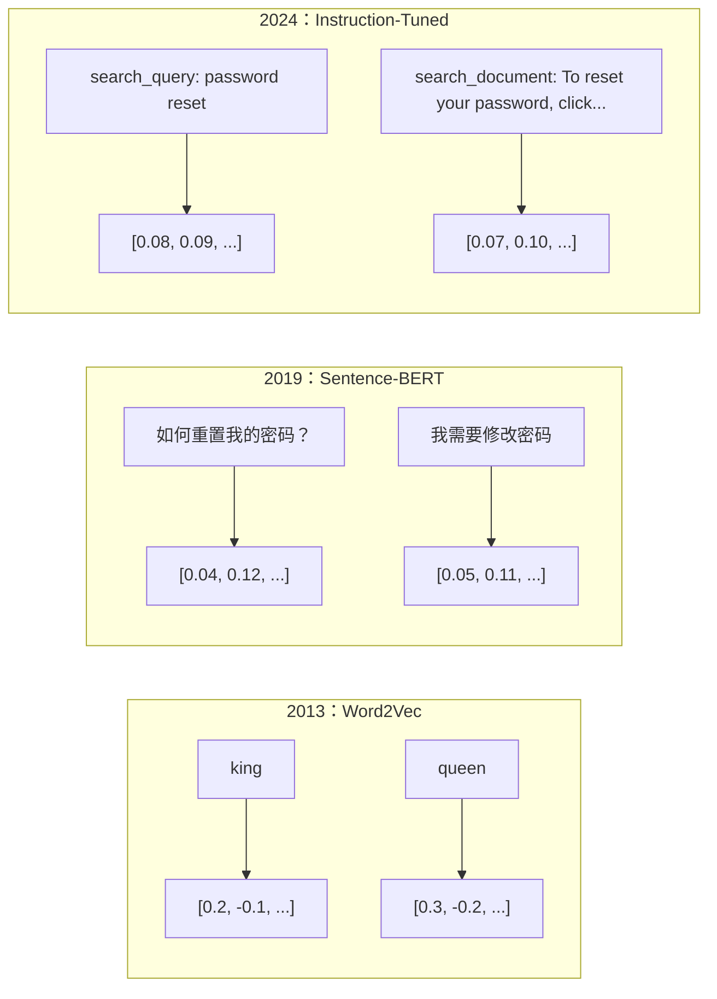
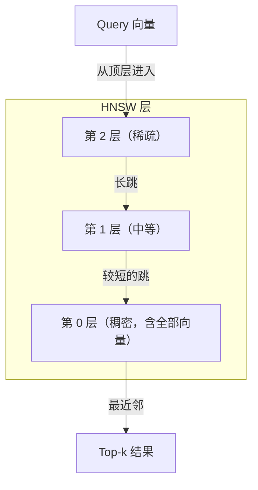

# Embedding 与向量表示

> 文本是离散的。数学是连续的。每次你让 LLM 去找“相似”的文档、比较语义、或者做超越关键词的搜索，你都在依赖这两个世界之间的一座桥。那座桥就是 embedding。如果你不理解 embedding，你就不理解现代 AI。你只是在用它。

**Type:** Build
**Languages:** Python
**Prerequisites:** Phase 11, Lesson 01 (Prompt Engineering)
**Time:** ~75 分钟
**Related:** Phase 5 · 22（Embedding Models Deep Dive）覆盖 dense、sparse、multi-vector 三种形态，Matryoshka 截断，以及按维度轴选模型。本课聚焦生产流水线（vector DB、HNSW、相似度数学）。选模型之前先读 Phase 5 · 22。

## Learning Objectives

- 使用 API 提供方和开源模型生成文本 embedding，并计算它们之间的 cosine similarity
- 解释 embedding 为什么能解决关键词搜索无法处理的词表不匹配问题
- 构建一个 semantic search 索引，按语义而不是精确关键词匹配来检索文档
- 用 retrieval benchmark（precision@k、recall）评估 embedding 质量，并为你的任务挑对 embedding 模型

## 问题场景

你有 10,000 张客服工单。一位客户写“my payment didn't go through”。你需要找到相似的过往工单。关键词搜索会找到同时含“payment”和“didn't go through”的工单。它会漏掉“transaction failed”“charge was declined”和“billing error”。这些工单用完全不同的词描述了同一个问题。

这就是词表不匹配（vocabulary mismatch）问题。人类语言有几十种方式表达同一件事。关键词搜索把每个词当作没有含义的独立符号。它无法知道“declined”和“didn't go through”指的是同一个概念。

你需要一种文本表示，让语义而不是拼写决定相似度。你需要一种方法，把“my payment didn't go through”和“transaction was declined”在某个数学空间里放得很近，同时把“my payment arrived on time”推得很远，尽管它们共享“payment”这个词。

那种表示就是 embedding。

## 核心概念

### 什么是 Embedding？

embedding 是一个稠密的浮点数向量，表示文本的语义。“dense”这个词很重要——每个维度都承载信息，而不像 sparse 表示（bag-of-words、TF-IDF）那样大多数维度是零。

“The cat sat on the mat”会变成类似 `[0.023, -0.041, 0.087, ..., 0.012]` 的东西——一个 768 到 3072 个数字的列表，取决于模型。这些数字编码语义。你从不直接查看它们。你比较它们。

### Word2Vec 的突破

2013 年，Google 的 Tomas Mikolov 和同事发表了 Word2Vec。核心洞见是：训练一个神经网络，从相邻词预测某个词（或从某个词预测相邻词），隐藏层的权重就变成了有意义的向量表示。

那个著名的结果：

```
king - man + woman = queen
```

词 embedding 上的向量算术捕捉到了语义关系。从“man”到“woman”的方向，大致就是从“king”到“queen”的方向。正是这一刻，这个领域意识到几何可以编码语义。

Word2Vec 产生 300 维向量。每个词得到一个向量，与上下文无关。“river bank”里的“bank”和“bank account”里的“bank”有相同的 embedding。这一局限驱动了接下来十年的研究。

### 从词到句子

词 embedding 表示单个 token。生产系统需要对整个句子、段落或文档做 embedding。出现了四种方法：

**Averaging**：取句子中所有词向量的均值。便宜、有损，但对短文本意外地不错。完全丢失词序——“dog bites man”和“man bites dog”得到相同的 embedding。

**CLS token**：transformer 模型（BERT，2018）输出一个特殊的 [CLS] token embedding，代表整个输入。比 averaging 好，但 [CLS] token 是为下一句预测训练的，不是为相似度。

**Contrastive learning**：显式训练模型把相似对拉近、不相似对推远。Sentence-BERT（Reimers & Gurevych，2019）用了这个方法，并成为现代 embedding 模型的基础。给定“How do I reset my password?”和“I need to change my password”，模型学会这些应该有几乎相同的向量。

**Instruction-tuned embeddings**：最新的方法。E5 和 GTE 这类模型接受任务前缀（“search_query:”“search_document:”），告诉模型要产出哪种 embedding。这让一个模型可以服务多个任务。



### 现代 Embedding 模型

市场已经收敛到少数几个生产级选项（MTEB 分数为 2026 年初，MTEB v2）：

| 模型 | 提供方 | 维度 | MTEB | 上下文 | 每 100 万 token 成本 |
|-------|----------|-----------|------|---------|------------------|
| Gemini Embedding 2 | Google | 3072 (Matryoshka) | 67.7 (retrieval) | 8192 | $0.15 |
| embed-v4 | Cohere | 1024 (Matryoshka) | 65.2 | 128K | $0.12 |
| voyage-4 | Voyage AI | 1024/2048 (Matryoshka) | 66.8 | 32K | $0.12 |
| text-embedding-3-large | OpenAI | 3072 (Matryoshka) | 64.6 | 8192 | $0.13 |
| text-embedding-3-small | OpenAI | 1536 (Matryoshka) | 62.3 | 8192 | $0.02 |
| BGE-M3 | BAAI | 1024 (dense+sparse+ColBERT) | 63.0 多语言 | 8192 | Open-weight |
| Qwen3-Embedding | Alibaba | 4096 (Matryoshka) | 66.9 | 32K | Open-weight |
| Nomic-embed-v2 | Nomic | 768 (Matryoshka) | 63.1 | 8192 | Open-weight |

MTEB（Massive Text Embedding Benchmark）v2 覆盖 retrieval、classification、clustering、reranking 和 summarization 等 100+ 个任务。越高越好。到 2026 年，open-weight 模型（Qwen3-Embedding、BGE-M3）在大多数维度上追平甚至超过闭源托管模型。Gemini Embedding 2 在纯 retrieval 上领先；Voyage/Cohere 在特定领域（finance、law、code）领先。在正式采用之前，永远要在你自己的 query 上做 benchmark。

### 相似度度量

给定两个 embedding 向量，有三种方法衡量它们有多相似：

**Cosine similarity**：两个向量之间夹角的余弦。范围从 -1（相反）到 1（方向相同）。忽略模长——一个 10 词的句子和一个 500 词的文档如果指向同一方向，可以得 1.0。这是 90% 用例的默认选择。

```
cosine_sim(a, b) = dot(a, b) / (||a|| * ||b||)
```

**Dot product**：两个向量的原始内积。当向量归一化（单位长度）时，与 cosine similarity 完全相同。计算更快。OpenAI 的 embedding 是归一化的，所以 dot product 和 cosine 给出相同排序。

```
dot(a, b) = sum(a_i * b_i)
```

**Euclidean (L2) distance**：向量空间中的直线距离。越小越相似。对模长差异敏感。当空间中的绝对位置重要、而不只是方向时使用。

```
L2(a, b) = sqrt(sum((a_i - b_i)^2))
```

何时用哪个：

| 度量 | 何时使用 | 何时避免 |
|--------|----------|------------|
| Cosine similarity | 比较不同长度的文本；大多数 retrieval 任务 | 模长本身携带信息 |
| Dot product | embedding 已归一化；追求最大速度 | 向量模长各不相同 |
| Euclidean distance | 聚类；空间最近邻问题 | 比较长度差异极大的文档 |

### Vector Database 与 HNSW

暴力相似度搜索会把 query 与每一个已存储的向量比较。100 万个向量、1536 维时，每次 query 就是 15 亿次乘加运算。太慢了。

vector database 用近似最近邻（ANN）算法解决这个问题。主流算法是 HNSW（Hierarchical Navigable Small World）：

1. 构建一个多层的向量图
2. 顶层稀疏——遥远簇之间的长距离连接
3. 底层稠密——邻近向量之间的细粒度连接
4. 搜索从顶层开始，贪心地逐层下降细化
5. 在 O(log n) 时间而不是 O(n) 内返回近似的 top-k 结果

HNSW 用很小的精度损失（通常 95-99% recall）换取巨大的速度提升。1000 万个向量时，暴力搜索要几秒。HNSW 只要几毫秒。



生产选项：

| 数据库 | 类型 | 最适合 | 最大规模 |
|----------|------|----------|-----------|
| Pinecone | 托管 SaaS | 零运维生产 | 十亿级 |
| Weaviate | 开源 | 自托管、hybrid search | 1 亿+ |
| Qdrant | 开源 | 高性能、过滤 | 1 亿+ |
| ChromaDB | 嵌入式 | 原型、本地开发 | 100 万 |
| pgvector | Postgres 扩展 | 已在使用 Postgres | 1000 万 |
| FAISS | 库 | 进程内、研究 | 10 亿+ |

### Chunking 策略

文档太长，无法作为单个向量做 embedding。一份 50 页的 PDF 涵盖几十个主题——它的 embedding 变成所有内容的平均，与任何具体内容都不相似。你把文档切成 chunk，逐个 embedding。

**Fixed-size chunking**：每 N 个 token 切一刀，带 M-token 重叠。简单可预测。文档没有清晰结构时效果很好。512 token 的 chunk 加 50 token 重叠：chunk 1 是 token 0-511，chunk 2 是 token 462-973。

**Sentence-based chunking**：在句子边界切分，把句子分组直到达到 token 上限。每个 chunk 至少是一个完整句子。比 fixed-size 好，因为你永远不会把一个想法切成两半。

**Recursive chunking**：先在最大的边界切（章节标题）。如果还是太大，试段落边界。再试句子边界。最后按字符数硬切。这就是 LangChain 的 `RecursiveCharacterTextSplitter`，对混合格式的语料效果很好。

**Semantic chunking**：对每个句子做 embedding，然后把 embedding 相似的连续句子分组。当 embedding 相似度跌破阈值时，开始新 chunk。昂贵（需要逐句 embedding），但产生最连贯的 chunk。

| 策略 | 复杂度 | 质量 | 最适合 |
|----------|-----------|---------|----------|
| Fixed-size | 低 | 尚可 | 非结构化文本、日志 |
| Sentence-based | 低 | 好 | 文章、邮件 |
| Recursive | 中 | 好 | Markdown、HTML、混合文档 |
| Semantic | 高 | 最佳 | 关键 retrieval 质量 |

大多数系统的最佳区间：256-512 token 的 chunk，带 50 token 重叠。

### Bi-Encoder 与 Cross-Encoder

bi-encoder 独立地 embedding query 和文档，然后比较向量。快——query 只 embedding 一次，与预先计算好的文档 embedding 比较。这是你用于 retrieval 的方式。

cross-encoder 把 query 和一篇文档作为单个输入，输出一个相关性分数。慢——它把每个 query-document 对都过一遍完整模型。但准确得多，因为它可以同时关注 query 和文档的 token。

生产模式：bi-encoder 检索 top-100 候选，cross-encoder 把它们重排到 top-10。这就是 retrieve-then-rerank 流水线。


Reranking 模型：Cohere Rerank 3.5（每 1000 次 query $2）、BGE-reranker-v2（免费、开源）、Jina Reranker v2（免费、开源）。

### Matryoshka Embedding

传统 embedding 是全有或全无的。1536 维向量就用 1536 个 float。不重新训练就无法截断到 256 维。

Matryoshka Representation Learning（Kusupati 等，2022）解决了这个问题。模型被训练成前 N 维捕捉最重要的信息，像俄罗斯套娃。把 1536 维的 Matryoshka embedding 截断到 256 维会损失一些精度，但仍然可用。

OpenAI 的 text-embedding-3-small 和 text-embedding-3-large 通过 `dimensions` 参数支持 Matryoshka 截断。请求 256 维而不是 1536 维，存储减少 6 倍，在 MTEB benchmark 上精度损失约 3-5%。

### Binary Quantization

一个 1536 维 embedding 以 float32 存储占 6,144 字节。乘以 1000 万文档：光向量就是 61 GB。

binary quantization 把每个 float 转成一个 bit：正值变 1，负值变 0。存储从 6,144 字节降到 192 字节——32 倍缩减。相似度用 Hamming distance（数不同的 bit 数）计算，CPU 一条指令就能做完。

精度损失在 retrieval recall 上大约 5-10%。常见模式：用 binary quantization 在数百万向量上做第一遍搜索，然后用全精度向量对 top-1000 重新打分。这样能用 1/32 的内存拿到 95%+ 的全精度准确率。

```figure
cosine-similarity
```

## Build It

我们从零构建一个 semantic search 引擎。没有 vector database。没有外部 embedding API。纯 Python，用 numpy 做数学。

### 第 1 步：文本分块

```python
def chunk_text(text, chunk_size=200, overlap=50):
    words = text.split()
    chunks = []
    start = 0
    while start < len(words):
        end = start + chunk_size
        chunk = " ".join(words[start:end])
        chunks.append(chunk)
        start += chunk_size - overlap
    return chunks


def chunk_by_sentences(text, max_chunk_tokens=200):
    sentences = text.replace("\n", " ").split(".")
    sentences = [s.strip() + "." for s in sentences if s.strip()]
    chunks = []
    current_chunk = []
    current_length = 0
    for sentence in sentences:
        sentence_length = len(sentence.split())
        if current_length + sentence_length > max_chunk_tokens and current_chunk:
            chunks.append(" ".join(current_chunk))
            current_chunk = []
            current_length = 0
        current_chunk.append(sentence)
        current_length += sentence_length
    if current_chunk:
        chunks.append(" ".join(current_chunk))
    return chunks
```

### 第 2 步：从零构建 Embedding

我们用 TF-IDF 加 L2 归一化实现一个简单的稠密 embedding。这虽然不是神经 embedding，但遵循同样的契约：文本进，定长向量出，相似文本产生相似向量。

```python
import math
import numpy as np
from collections import Counter

class SimpleEmbedder:
    def __init__(self):
        self.vocab = []
        self.idf = []
        self.word_to_idx = {}

    def fit(self, documents):
        vocab_set = set()
        for doc in documents:
            vocab_set.update(doc.lower().split())
        self.vocab = sorted(vocab_set)
        self.word_to_idx = {w: i for i, w in enumerate(self.vocab)}
        n = len(documents)
        self.idf = np.zeros(len(self.vocab))
        for i, word in enumerate(self.vocab):
            doc_count = sum(1 for doc in documents if word in doc.lower().split())
            self.idf[i] = math.log((n + 1) / (doc_count + 1)) + 1

    def embed(self, text):
        words = text.lower().split()
        count = Counter(words)
        total = len(words) if words else 1
        vec = np.zeros(len(self.vocab))
        for word, freq in count.items():
            if word in self.word_to_idx:
                tf = freq / total
                vec[self.word_to_idx[word]] = tf * self.idf[self.word_to_idx[word]]
        norm = np.linalg.norm(vec)
        if norm > 0:
            vec = vec / norm
        return vec
```

### 第 3 步：相似度函数

```python
def cosine_similarity(a, b):
    dot = np.dot(a, b)
    norm_a = np.linalg.norm(a)
    norm_b = np.linalg.norm(b)
    if norm_a == 0 or norm_b == 0:
        return 0.0
    return float(dot / (norm_a * norm_b))


def dot_product(a, b):
    return float(np.dot(a, b))


def euclidean_distance(a, b):
    return float(np.linalg.norm(a - b))
```

### 第 4 步：暴力搜索向量索引

```python
class VectorIndex:
    def __init__(self):
        self.vectors = []
        self.texts = []
        self.metadata = []

    def add(self, vector, text, meta=None):
        self.vectors.append(vector)
        self.texts.append(text)
        self.metadata.append(meta or {})

    def search(self, query_vector, top_k=5, metric="cosine"):
        scores = []
        for i, vec in enumerate(self.vectors):
            if metric == "cosine":
                score = cosine_similarity(query_vector, vec)
            elif metric == "dot":
                score = dot_product(query_vector, vec)
            elif metric == "euclidean":
                score = -euclidean_distance(query_vector, vec)
            else:
                raise ValueError(f"Unknown metric: {metric}")
            scores.append((i, score))
        scores.sort(key=lambda x: x[1], reverse=True)
        results = []
        for idx, score in scores[:top_k]:
            results.append({
                "text": self.texts[idx],
                "score": score,
                "metadata": self.metadata[idx],
                "index": idx
            })
        return results

    def size(self):
        return len(self.vectors)
```

### 第 5 步：Semantic Search 引擎

```python
class SemanticSearchEngine:
    def __init__(self, chunk_size=200, overlap=50):
        self.embedder = SimpleEmbedder()
        self.index = VectorIndex()
        self.chunk_size = chunk_size
        self.overlap = overlap

    def index_documents(self, documents, source_names=None):
        all_chunks = []
        all_sources = []
        for i, doc in enumerate(documents):
            chunks = chunk_text(doc, self.chunk_size, self.overlap)
            all_chunks.extend(chunks)
            name = source_names[i] if source_names else f"doc_{i}"
            all_sources.extend([name] * len(chunks))
        self.embedder.fit(all_chunks)
        for chunk, source in zip(all_chunks, all_sources):
            vec = self.embedder.embed(chunk)
            self.index.add(vec, chunk, {"source": source})
        return len(all_chunks)

    def search(self, query, top_k=5, metric="cosine"):
        query_vec = self.embedder.embed(query)
        return self.index.search(query_vec, top_k, metric)

    def search_with_scores(self, query, top_k=5):
        results = self.search(query, top_k)
        return [
            {
                "text": r["text"][:200],
                "source": r["metadata"].get("source", "unknown"),
                "score": round(r["score"], 4)
            }
            for r in results
        ]
```

### 第 6 步：比较相似度度量

```python
def compare_metrics(engine, query, top_k=3):
    results = {}
    for metric in ["cosine", "dot", "euclidean"]:
        hits = engine.search(query, top_k=top_k, metric=metric)
        results[metric] = [
            {"score": round(h["score"], 4), "preview": h["text"][:80]}
            for h in hits
        ]
    return results
```

## Use It

使用生产 embedding API 时，架构完全不变。只有 embedder 改变：

```python
from openai import OpenAI

client = OpenAI()

def openai_embed(texts, model="text-embedding-3-small", dimensions=None):
    kwargs = {"model": model, "input": texts}
    if dimensions:
        kwargs["dimensions"] = dimensions
    response = client.embeddings.create(**kwargs)
    return [item.embedding for item in response.data]
```

用 OpenAI 做 Matryoshka 截断——同一个模型，更少的维度，更低的存储：

```python
full = openai_embed(["semantic search query"], dimensions=1536)
compact = openai_embed(["semantic search query"], dimensions=256)
```

256 维向量只用 1/6 的存储。对 1000 万文档来说，就是 10 GB 对 61 GB。精度损失在标准 benchmark 上大约 3-5%。

用 Cohere 做 reranking：

```python
import cohere

co = cohere.ClientV2()

results = co.rerank(
    model="rerank-v3.5",
    query="What is the refund policy?",
    documents=["Full refund within 30 days...", "No refunds after 90 days..."],
    top_n=3
)
```

用本地 embedding，不依赖 API：

```python
from sentence_transformers import SentenceTransformer

model = SentenceTransformer("BAAI/bge-small-en-v1.5")
embeddings = model.encode(["semantic search query", "another document"])
```

我们构建中的 VectorIndex 类适用于以上任何一种。换掉 embedding 函数，保留搜索逻辑。

## Ship It

本课产出：
- `outputs/prompt-embedding-advisor.md`——一个 prompt，用于为具体用例选择 embedding 模型和策略
- `outputs/skill-embedding-patterns.md`——一个 skill，教 agent 如何在生产环境中有效使用 embedding

## Exercises

1. **度量对比**：用 cosine similarity、dot product 和 euclidean distance 对同一批样例文档运行同样的 5 个 query。记录每种度量的 top-3 结果。哪些 query 上度量出现分歧？为什么？

2. **Chunk 大小实验**：用 50、100、200 和 500 个词的 chunk 大小索引样例文档。对每种大小运行 5 个 query，记录 top-1 相似度分数。画出 chunk 大小与 retrieval 质量的关系。找出更大的 chunk 开始变差的拐点。

3. **Matryoshka 模拟**：构建一个产出 500 维向量的 SimpleEmbedder。截断到 50、100、200 和 500 维。测量每次截断后 retrieval recall 如何退化。这模拟了 Matryoshka 的行为，而不需要真正的训练技巧。

4. **Binary quantization**：取搜索引擎产出的 embedding，转成二值（正为 1，负为 0），实现 Hamming distance 搜索。把 top-10 结果与全精度 cosine similarity 比较。测量重叠百分比。

5. **Sentence-based chunking**：用 `chunk_by_sentences` 替换 fixed-size chunking。运行同样的 query，比较 retrieval 分数。尊重句子边界能改善结果吗？

## Key Terms

| 术语 | 人们怎么说 | 它实际是什么意思 |
|------|----------------|----------------------|
| Embedding | “文本转数字” | 一个稠密向量，其几何上的接近性编码了语义相似度 |
| Word2Vec | “元老级 embedding” | 2013 年的模型，通过预测上下文词学习词向量；证明了向量算术能编码语义 |
| Cosine similarity | “两个向量有多像” | 向量夹角的余弦；1 = 方向相同，0 = 正交，-1 = 相反 |
| HNSW | “快速的向量搜索” | Hierarchical Navigable Small World 图——多层结构，实现 O(log n) 的近似最近邻搜索 |
| Bi-encoder | “分别 embedding，快速比较” | 把 query 和文档独立编码成向量；支持预计算和快速 retrieval |
| Cross-encoder | “慢但准确的 reranker” | 把 query-document 对联合送入完整模型；准确率更高，无法预计算 |
| Matryoshka embeddings | “可截断的向量” | 训练成前 N 维捕捉最重要信息的 embedding，支持可变大小存储 |
| Binary quantization | “1-bit embedding” | 把 float 向量转成二值（只保留符号位），实现 32 倍存储缩减并用 Hamming 距离搜索 |
| Chunking | “把文档切开做 embedding” | 把文档切成 256-512 token 的片段，使每一段可以独立 embedding 和检索 |
| Vector database | “embedding 的搜索引擎” | 为存储向量并在规模上执行近似最近邻搜索而优化的数据存储 |
| Contrastive learning | “通过对比来训练” | 一种训练方法，把相似对的 embedding 拉近、不相似对的 embedding 推远 |
| MTEB | “embedding 的 benchmark” | Massive Text Embedding Benchmark——8 个任务、56 个数据集；比较 embedding 模型的标准 |

## Further Reading

- Mikolov 等，“Efficient Estimation of Word Representations in Vector Space”（2013）——开启 embedding 革命的 Word2Vec 论文，以及那个 king-queen 类比
- Reimers & Gurevych，“Sentence-BERT: Sentence Embeddings using Siamese BERT-Networks”（2019）——如何训练 bi-encoder 做句子级相似度，现代 embedding 模型的基础
- Kusupati 等，“Matryoshka Representation Learning”（2022）——可变维度 embedding 背后的技术，被 OpenAI 采用在 text-embedding-3 上
- Malkov & Yashunin，“Efficient and Robust Approximate Nearest Neighbor using Hierarchical Navigable Small World Graphs”（2018）——HNSW 论文，大多数生产向量搜索背后的算法
- OpenAI Embeddings Guide（platform.openai.com/docs/guides/embeddings）——text-embedding-3 模型的实用参考，包括 Matryoshka 降维
- MTEB Leaderboard（huggingface.co/spaces/mteb/leaderboard）——跨任务和语言比较所有 embedding 模型的实时 benchmark
- [Muennighoff 等，“MTEB: Massive Text Embedding Benchmark”（EACL 2023）](https://arxiv.org/abs/2210.07316)——定义 8 个任务类别（classification、clustering、pair classification、reranking、retrieval、STS、summarization、bitext mining）的 benchmark，榜单报告的就是这些类别；在信任任何单个 MTEB 分数之前先读它。
- [Sentence Transformers 文档](https://www.sbert.net/)——bi-encoder 与 cross-encoder、pooling 策略，以及本课实现的 ingest-split-embed-store RAG 流水线的权威参考。
