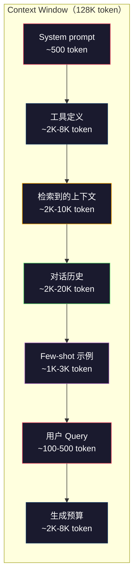
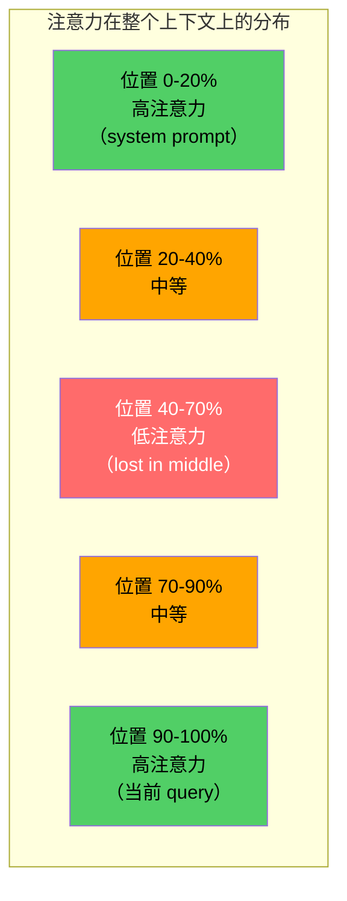
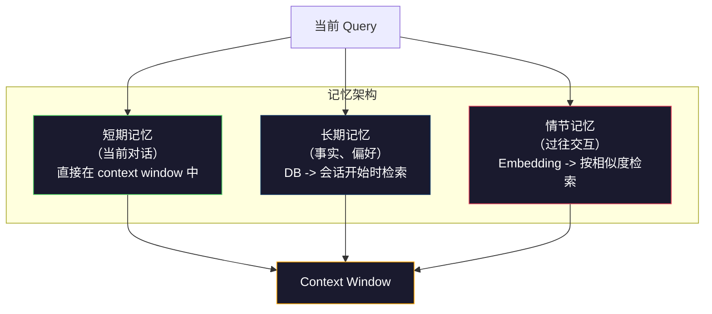

# Context Engineering：窗口、预算、记忆与检索

> Prompt engineering 只是一个子集。Context engineering 才是全局。prompt 是你敲进去的一串字符。context 是进入模型窗口的一切：系统指令、检索到的文档、工具定义、对话历史、few-shot 示例，以及 prompt 本身。2026 年最好的 AI 工程师是 context 工程师。他们决定什么进、什么不进、以什么顺序进。

**Type:** Build
**Languages:** Python
**Prerequisites:** Phase 10 (LLMs from Scratch), Phase 11 Lesson 01-02
**Time:** ~90 分钟
**Related:** Phase 11 · 15（Prompt Caching）——适合缓存友好的布局是 context engineering 的延伸。Phase 5 · 28（Long-Context Evaluation）讲如何用 NIAH/RULER 度量 lost-in-the-middle。

## Learning Objectives

- 计算跨所有 context window 组成部分的 token 预算（system prompt、工具、历史、检索到的文档、生成余量）
- 实现 context window 管理策略：截断、摘要，以及针对对话历史的滑动窗口
- 对上下文组成部分做优先级排序与编排，让模型的注意力最大化地落在最相关的信息上
- 构建一个 context assembler，根据 query 类型和可用窗口空间动态分配 token

## 问题场景

Claude Opus 4.7 有 200K token 的窗口（beta 中 1M）。GPT-5 有 400K。Gemini 3 Pro 有 2M。Llama 4 宣称 10M。这些数字听起来巨大，直到你把它填满。

这是一个编码助手的真实拆分。System prompt：500 token。50 个工具的定义：8,000 token。检索到的文档：4,000 token。对话历史（10 轮）：6,000 token。当前用户 query：200 token。生成预算（最大输出）：4,000 token。合计：22,700 token。这只占 128K 窗口的 18%。

但注意力并不随上下文长度线性扩展。128K token 上下文的模型要付二次方注意力成本（原生 transformer 里是 O(n^2)，尽管大多数生产模型使用高效的注意力变体）。更重要的是，retrieval 准确率会下降。“Needle in a Haystack”测试显示，模型很难找到放在长上下文中段的信息。Liu 等（2023）的研究表明，LLM 检索长上下文开头和结尾的信息时准确率近乎完美，但对放在中段（上下文 40-70% 的位置）的信息，准确率下降 10-20%。这种“lost-in-the-middle”效应因模型而异，但影响所有当前架构。

实践教训：有 200K token 可用，并不意味着用满 200K token 就有效。一个精心策展的 10K token 上下文，往往胜过一股脑塞进去的 100K token 上下文。Context engineering 是在 context window 内最大化信噪比的学科。

你放进窗口的每一个 token，都在挤掉一个本可以承载更相关信息的 token。每一个无关的工具定义、每一轮过时的对话、每一段不能回答问题的检索文本——每一个都让模型在任务上稍微变差一点。

## 核心概念

### Context Window 是稀缺资源

把 context window 想成 RAM，而不是磁盘。它快、可直接访问，但容量有限。你装不下所有东西。你必须选择。



每个组成部分都在争抢空间。加入更多工具定义，就意味着更少的对话历史空间。加入更多检索上下文，就意味着更少的 few-shot 示例空间。Context engineering 是把这份预算分配到任务表现最大化的艺术。

### Lost-in-the-Middle

这是 context engineering 中最重要的实证发现。模型对上下文开头和结尾的信息关注得更好。中段的信息得到更低的注意力分数，更容易被忽略。

Liu 等（2023）系统性地测试了这一点。他们把一篇相关文档放在 20 篇无关文档中的不同位置，测量答案准确率。相关文档在第一位或最后一位时，准确率是 85-90%。在中段（20 篇中的第 10 位）时，准确率降到 60-70%。

这对工程有直接影响：

- 把最重要的信息放在最前面（system prompt、关键指令）
- 把当前 query 和最相关的上下文放在最后（近因偏置会帮忙）
- 把上下文中段当作优先级最低的区域
- 如果必须把信息放在中段，就在结尾重复关键点



### 上下文组成部分

**System prompt**：设定人设、约束和行为规则。它放在最前面，并在各轮之间保持不变。Claude Code 的 system prompt 大约用 6,000 token，包括工具定义和行为指令。保持精简。system prompt 里的每个词都会在每次 API 调用中重复。

**工具定义**：每个工具增加 50-200 token（名称、描述、参数 schema）。50 个工具、每个 150 token，在任何对话发生之前就是 7,500 token。动态工具选择——只包含与当前 query 相关的工具——可以把它减少 60-80%。

**检索上下文**：来自 vector database 的文档、搜索结果、文件内容。retrieval 的质量直接决定响应的质量。糟糕的 retrieval 比没有 retrieval 更糟——它用噪声填满窗口，并主动误导模型。

**对话历史**：每一条先前的用户消息和助手响应。随对话长度线性增长。一个 50 轮、每轮 200 token 的对话就是 10,000 token 的历史。其中大部分与当前 query 无关。

**Few-shot 示例**：展示期望行为的输入/输出对。两到三个精心挑选的示例，往往比几千 token 的指令更能提升输出质量。但它们要占空间。

**生成预算**：为模型响应预留的 token。如果你把窗口填到容量上限，模型就没有空间回答。至少预留 2,000-4,000 token 用于生成。

### 上下文压缩策略

**历史摘要**：不逐字保留所有先前的轮次，而是定期总结对话。用 100 token 的“我们讨论了 X，决定了 Y，用户想要 Z”替换花掉 2,000 token 的 10 轮对话。当历史超过阈值（例如 5,000 token）时运行摘要。

**相关性过滤**：对每篇检索到的文档针对当前 query 打分，丢弃低于阈值的文档。如果你检索了 10 个 chunk 但只有 3 个相关，就丢掉另外 7 个。3 个高度相关的 chunk 胜过 10 个平庸的。

**工具裁剪**：对用户 query 的意图分类，只包含与该意图相关的工具。代码问题不需要日历工具。日程问题不需要文件系统工具。这可以把工具定义从 8,000 token 减到 1,000。

**递归摘要**：对非常长的文档分阶段总结。先总结每一节，再总结这些摘要。一份 50 页的文档变成一个 500 token 的摘要，抓住了关键点。

### 记忆系统

Context engineering 横跨三个时间尺度。

**短期记忆**：当前对话。直接存在 context window 里。随每一轮增长。通过摘要和截断管理。

**长期记忆**：跨对话持久的事实和偏好。“用户偏好 TypeScript。”“项目使用 PostgreSQL。”存在数据库里，会话开始时检索。Claude Code 把它存在 CLAUDE.md 文件里。ChatGPT 把它存在记忆功能里。

**情节记忆**：可能相关的具体过往交互。“上周二我们在 auth 模块里调过一个类似的问题。”以 embedding 形式存储，当当前对话与某个过往情节匹配时检索。



### 动态上下文组装

关键洞见：不同的 query 需要不同的上下文。静态 system prompt + 静态工具 + 静态历史是浪费。最好的系统按 query 动态组装上下文。

1. 对 query 意图分类
2. 选择相关的工具（不是全部工具）
3. 检索相关文档（不是一个固定集合）
4. 包含相关的历史轮次（不是全部历史）
5. 加入与任务类型匹配的 few-shot 示例
6. 按重要性排列所有内容：关键的最前，重要的最后，可选的居中

这就是好的 AI 应用与伟大的 AI 应用之间的分界。模型是一样的。上下文才是差异点。

```figure
lost-in-the-middle
```

## Build It

### 第 1 步：Token 计数器

你无法预算你无法度量的东西。构建一个简单的 token 计数器（用空白切分做近似，因为精确计数取决于 tokenizer）。

```python
import json
import numpy as np
from collections import OrderedDict

def count_tokens(text):
    if not text:
        return 0
    return int(len(text.split()) * 1.3)

def count_tokens_json(obj):
    return count_tokens(json.dumps(obj))
```

### 第 2 步：上下文预算管理器

核心抽象。预算管理器跟踪每个组成部分用了多少 token，并强制执行上限。

```python
class ContextBudget:
    def __init__(self, max_tokens=128000, generation_reserve=4000):
        self.max_tokens = max_tokens
        self.generation_reserve = generation_reserve
        self.available = max_tokens - generation_reserve
        self.allocations = OrderedDict()

    def allocate(self, component, content, max_tokens=None):
        tokens = count_tokens(content)
        if max_tokens and tokens > max_tokens:
            words = content.split()
            target_words = int(max_tokens / 1.3)
            content = " ".join(words[:target_words])
            tokens = count_tokens(content)

        used = sum(self.allocations.values())
        if used + tokens > self.available:
            allowed = self.available - used
            if allowed <= 0:
                return None, 0
            words = content.split()
            target_words = int(allowed / 1.3)
            content = " ".join(words[:target_words])
            tokens = count_tokens(content)

        self.allocations[component] = tokens
        return content, tokens

    def remaining(self):
        used = sum(self.allocations.values())
        return self.available - used

    def utilization(self):
        used = sum(self.allocations.values())
        return used / self.max_tokens

    def report(self):
        total_used = sum(self.allocations.values())
        lines = []
        lines.append(f"Context Budget Report ({self.max_tokens:,} token window)")
        lines.append("-" * 50)
        for component, tokens in self.allocations.items():
            pct = tokens / self.max_tokens * 100
            bar = "#" * int(pct / 2)
            lines.append(f"  {component:<25} {tokens:>6} tokens ({pct:>5.1f}%) {bar}")
        lines.append("-" * 50)
        lines.append(f"  {'Used':<25} {total_used:>6} tokens ({total_used/self.max_tokens*100:.1f}%)")
        lines.append(f"  {'Generation reserve':<25} {self.generation_reserve:>6} tokens")
        lines.append(f"  {'Remaining':<25} {self.remaining():>6} tokens")
        return "\n".join(lines)
```

### 第 3 步：Lost-in-the-Middle 重排序

实现重排序策略：最重要的项放首尾，最不重要的放中间。

```python
def reorder_lost_in_middle(items, scores):
    paired = sorted(zip(scores, items), reverse=True)
    sorted_items = [item for _, item in paired]

    if len(sorted_items) <= 2:
        return sorted_items

    first_half = sorted_items[::2]
    second_half = sorted_items[1::2]
    second_half.reverse()

    return first_half + second_half

def score_relevance(query, documents):
    query_words = set(query.lower().split())
    scores = []
    for doc in documents:
        doc_words = set(doc.lower().split())
        if not query_words:
            scores.append(0.0)
            continue
        overlap = len(query_words & doc_words) / len(query_words)
        scores.append(round(overlap, 3))
    return scores
```

### 第 4 步：对话历史压缩器

总结旧的对话轮次，回收 token 预算。

```python
class ConversationManager:
    def __init__(self, max_history_tokens=5000):
        self.turns = []
        self.summaries = []
        self.max_history_tokens = max_history_tokens

    def add_turn(self, role, content):
        self.turns.append({"role": role, "content": content})
        self._compress_if_needed()

    def _compress_if_needed(self):
        total = sum(count_tokens(t["content"]) for t in self.turns)
        if total <= self.max_history_tokens:
            return

        while total > self.max_history_tokens and len(self.turns) > 4:
            old_turns = self.turns[:2]
            summary = self._summarize_turns(old_turns)
            self.summaries.append(summary)
            self.turns = self.turns[2:]
            total = sum(count_tokens(t["content"]) for t in self.turns)

    def _summarize_turns(self, turns):
        parts = []
        for t in turns:
            content = t["content"]
            if len(content) > 100:
                content = content[:100] + "..."
            parts.append(f"{t['role']}: {content}")
        return "Previous: " + " | ".join(parts)

    def get_context(self):
        parts = []
        if self.summaries:
            parts.append("[Conversation Summary]")
            for s in self.summaries:
                parts.append(s)
        parts.append("[Recent Conversation]")
        for t in self.turns:
            parts.append(f"{t['role']}: {t['content']}")
        return "\n".join(parts)

    def token_count(self):
        return count_tokens(self.get_context())
```

### 第 5 步：动态工具选择器

只包含与当前 query 相关的工具。先分类意图，再过滤。

```python
TOOL_REGISTRY = {
    "read_file": {
        "description": "Read contents of a file",
        "tokens": 120,
        "categories": ["code", "files"],
    },
    "write_file": {
        "description": "Write content to a file",
        "tokens": 150,
        "categories": ["code", "files"],
    },
    "search_code": {
        "description": "Search for patterns in codebase",
        "tokens": 130,
        "categories": ["code"],
    },
    "run_command": {
        "description": "Execute a shell command",
        "tokens": 140,
        "categories": ["code", "system"],
    },
    "create_calendar_event": {
        "description": "Create a new calendar event",
        "tokens": 180,
        "categories": ["calendar"],
    },
    "list_emails": {
        "description": "List recent emails",
        "tokens": 160,
        "categories": ["email"],
    },
    "send_email": {
        "description": "Send an email message",
        "tokens": 200,
        "categories": ["email"],
    },
    "web_search": {
        "description": "Search the web for information",
        "tokens": 140,
        "categories": ["research"],
    },
    "query_database": {
        "description": "Run a SQL query on the database",
        "tokens": 170,
        "categories": ["code", "data"],
    },
    "generate_chart": {
        "description": "Generate a chart from data",
        "tokens": 190,
        "categories": ["data", "visualization"],
    },
}

def classify_intent(query):
    query_lower = query.lower()

    intent_keywords = {
        "code": ["code", "function", "bug", "error", "file", "implement", "refactor", "debug", "test"],
        "calendar": ["meeting", "schedule", "calendar", "appointment", "event"],
        "email": ["email", "mail", "send", "inbox", "message"],
        "research": ["search", "find", "what is", "how does", "explain", "look up"],
        "data": ["data", "query", "database", "chart", "graph", "analytics", "sql"],
    }

    scores = {}
    for intent, keywords in intent_keywords.items():
        score = sum(1 for kw in keywords if kw in query_lower)
        if score > 0:
            scores[intent] = score

    if not scores:
        return ["code"]

    max_score = max(scores.values())
    return [intent for intent, score in scores.items() if score >= max_score * 0.5]

def select_tools(query, token_budget=2000):
    intents = classify_intent(query)
    relevant = {}
    total_tokens = 0

    for name, tool in TOOL_REGISTRY.items():
        if any(cat in intents for cat in tool["categories"]):
            if total_tokens + tool["tokens"] <= token_budget:
                relevant[name] = tool
                total_tokens += tool["tokens"]

    return relevant, total_tokens
```

### 第 6 步：完整的上下文组装流水线

把所有东西串起来。给定一个 query，动态组装最优上下文。

```python
class ContextEngine:
    def __init__(self, max_tokens=128000, generation_reserve=4000):
        self.budget = ContextBudget(max_tokens, generation_reserve)
        self.conversation = ConversationManager(max_history_tokens=5000)
        self.system_prompt = (
            "You are a helpful AI assistant. You have access to tools for "
            "code editing, file management, web search, and data analysis. "
            "Use the appropriate tools for each task. Be concise and accurate."
        )
        self.knowledge_base = [
            "Python 3.12 introduced type parameter syntax for generic classes using bracket notation.",
            "The project uses PostgreSQL 16 with pgvector for embedding storage.",
            "Authentication is handled by Supabase Auth with JWT tokens.",
            "The frontend is built with Next.js 15 using the App Router.",
            "API rate limits are set to 100 requests per minute per user.",
            "The deployment pipeline uses GitHub Actions with Docker multi-stage builds.",
            "Test coverage must be above 80% for all new modules.",
            "The codebase follows the repository pattern for data access.",
        ]

    def assemble(self, query):
        self.budget = ContextBudget(self.budget.max_tokens, self.budget.generation_reserve)

        system_content, _ = self.budget.allocate("system_prompt", self.system_prompt, max_tokens=1000)

        tools, tool_tokens = select_tools(query, token_budget=2000)
        tool_text = json.dumps(list(tools.keys()))
        tool_content, _ = self.budget.allocate("tools", tool_text, max_tokens=2000)

        relevance = score_relevance(query, self.knowledge_base)
        threshold = 0.1
        relevant_docs = [
            doc for doc, score in zip(self.knowledge_base, relevance)
            if score >= threshold
        ]

        if relevant_docs:
            doc_scores = [s for s in relevance if s >= threshold]
            reordered = reorder_lost_in_middle(relevant_docs, doc_scores)
            doc_text = "\n".join(reordered)
            doc_content, _ = self.budget.allocate("retrieved_context", doc_text, max_tokens=3000)

        history_text = self.conversation.get_context()
        if history_text.strip():
            history_content, _ = self.budget.allocate("conversation_history", history_text, max_tokens=5000)

        query_content, _ = self.budget.allocate("user_query", query, max_tokens=500)

        return self.budget

    def chat(self, query):
        self.conversation.add_turn("user", query)
        budget = self.assemble(query)
        response = f"[Response to: {query[:50]}...]"
        self.conversation.add_turn("assistant", response)
        return budget


def run_demo():
    print("=" * 60)
    print("  Context Engineering Pipeline Demo")
    print("=" * 60)

    engine = ContextEngine(max_tokens=128000, generation_reserve=4000)

    print("\n--- Query 1: Code task ---")
    budget = engine.chat("Fix the bug in the authentication module where JWT tokens expire too early")
    print(budget.report())

    print("\n--- Query 2: Research task ---")
    budget = engine.chat("What is the best approach for implementing vector search in PostgreSQL?")
    print(budget.report())

    print("\n--- Query 3: After conversation history builds up ---")
    for i in range(8):
        engine.conversation.add_turn("user", f"Follow-up question number {i+1} about the implementation details of the system")
        engine.conversation.add_turn("assistant", f"Here is the response to follow-up {i+1} with technical details about the architecture")

    budget = engine.chat("Now implement the changes we discussed")
    print(budget.report())

    print("\n--- Tool Selection Examples ---")
    test_queries = [
        "Fix the bug in auth.py",
        "Schedule a meeting with the team for Tuesday",
        "Show me the database query performance stats",
        "Search for best practices on error handling",
    ]

    for q in test_queries:
        tools, tokens = select_tools(q)
        intents = classify_intent(q)
        print(f"\n  Query: {q}")
        print(f"  Intents: {intents}")
        print(f"  Tools: {list(tools.keys())} ({tokens} tokens)")

    print("\n--- Lost-in-the-Middle Reordering ---")
    docs = ["Doc A (most relevant)", "Doc B (somewhat relevant)", "Doc C (least relevant)",
            "Doc D (relevant)", "Doc E (moderately relevant)"]
    scores = [0.95, 0.60, 0.20, 0.80, 0.50]
    reordered = reorder_lost_in_middle(docs, scores)
    print(f"  Original order: {docs}")
    print(f"  Scores:         {scores}")
    print(f"  Reordered:      {reordered}")
    print(f"  (Most relevant at start and end, least relevant in middle)")
```

## Use It

### Harness 管理的上下文

Claude Code 用分层方法管理上下文。system prompt 包含行为规则和工具定义（约 6K token）。当你打开一个文件，其内容作为上下文注入。当你搜索，结果被加入。旧的对话轮次被摘要。CLAUDE.md 提供跨会话持久的长期记忆。

关键工程决策：Claude Code 不会把你的整个代码库倒进上下文。它按需检索相关文件。这就是实践中的 context engineering。

### 动态上下文加载

Cursor 把你的整个代码库索引成 embedding。当你输入 query，它用向量相似度检索最相关的文件和代码块。只有这些片段进入 context window。50 万行的代码库被压缩成最相关的 5-10 个代码块。

这就是那个模式：把一切 embedding，按需检索，只包含要紧的内容。

### 助手长期记忆

ChatGPT 把用户偏好和事实存为长期记忆。每次对话开始时，相关记忆被检索并放进 system prompt。“用户偏好 Python”花 5 个 token，却省下跨对话重复指令的几百个 token。

### RAG 作为 Context Engineering

Retrieval-Augmented Generation 是形式化的 context engineering。与其把知识塞进模型权重（训练）或 system prompt（静态上下文），不如在 query 时检索相关文档并把它们注入 context window。整个 RAG 流水线——chunking、embedding、retrieval、reranking——只为解决一个问题：把正确的信息放进 context window。

## Ship It

本课产出 `outputs/prompt-context-optimizer.md`——一个可复用的 prompt，用来审计上下文组装策略并给出优化建议。把 system prompt、工具数量、平均历史长度和 retrieval 策略喂给它，它会找出 token 浪费并提出改进。

它还产出 `outputs/skill-context-engineering.md`——一个根据任务类型、context window 大小和延迟预算设计上下文组装流水线的决策框架。

## Exercises

1. 给 ContextBudget 类加一个“token 浪费检测器”。它应该标出占用预算超过 30% 的组成部分，并针对每种组成部分类型建议压缩策略（摘要历史、裁剪工具、重排文档）。

2. 为检索上下文实现语义去重。如果两篇检索到的文档相似度超过 80%（按词重叠或 embedding 的 cosine similarity 判断），只保留分数更高的那一篇。测量这能回收多少 token 预算。

3. 构建一个“上下文重放”工具。给定一份对话记录，用 ContextEngine 重放它，并可视化预算分配逐轮如何变化。按时间画出每个组成部分的 token 用量。找出上下文开始被压缩的那一轮。

4. 实现基于优先级的工具选择器。不做二元的包含/排除，而是给每个工具相对当前 query 的相关性分数。按相关性降序加入工具，直到工具预算耗尽。比较包含 5、10、20 和 50 个工具时的任务表现。

5. 构建多策略上下文压缩器。实现三种压缩策略（截断、摘要、抽取关键句），在一组 20 篇文档上做 benchmark。测量压缩比与信息保留之间的权衡（压缩后的版本是否仍然包含 query 的答案？）。

## Key Terms

| 术语 | 人们怎么说 | 它实际是什么意思 |
|------|----------------|----------------------|
| Context window | “模型能读多少” | 模型在一次前向传播中处理的 token 最大数量（输入 + 输出）——GPT-5 是 400K，Claude Opus 4.7 是 200K（beta 1M），Gemini 3 Pro 是 2M |
| Context engineering | “高级 prompt engineering” | 决定什么进入 context window、以什么顺序、什么优先级的学科——涵盖 retrieval、压缩、工具选择和记忆管理 |
| Lost-in-the-middle | “模型会忘掉中间的东西” | 实证发现：LLM 对上下文开头和结尾的关注更好，放在中段的信息准确率下降 10-20% |
| Token budget | “你还剩多少 token” | 把 context window 容量显式分配到各组成部分（system prompt、工具、历史、检索、生成），并为每个组成部分设上限 |
| Dynamic context | “边跑边加载东西” | 根据意图分类、相关工具选择和检索结果，为每个 query 不同地组装 context window |
| History summarization | “压缩对话” | 用简洁摘要替换逐字的旧对话轮次，在保留关键信息的同时降低 token 成本 |
| Tool pruning | “只包含相关工具” | 对 query 意图分类，只包含匹配的工具定义，把工具 token 成本降低 60-80% |
| Long-term memory | “跨会话记住” | 存在数据库里、会话开始时检索的事实和偏好——CLAUDE.md、ChatGPT Memory 及类似系统 |
| Episodic memory | “记住具体的过往事件” | 以 embedding 形式存储的过往交互，当当前 query 与某段过往对话相似时被检索 |
| Generation budget | “留给答案的空间” | 为模型输出预留的 token——如果上下文把窗口完全占满，模型就没有空间响应 |

## Further Reading

- [Liu 等，2023——“Lost in the Middle: How Language Models Use Long Contexts”](https://arxiv.org/abs/2307.03172)——关于位置相关注意力的权威研究，表明模型难以处理长上下文中段的信息
- [Anthropic 的 Contextual Retrieval 博文](https://www.anthropic.com/news/contextual-retrieval)——Anthropic 如何做上下文感知的 chunk 检索，把 retrieval 失败率降低 49%
- [Simon Willison 的“Context Engineering”](https://simonwillison.net/2025/Jun/27/context-engineering/)——为这门学科命名、并把它与 prompt engineering 区分开的博文
- [LangChain 关于 RAG 的文档](https://python.langchain.com/docs/tutorials/rag/)——把 retrieval-augmented generation 作为 context engineering 模式的实践实现
- [Greg Kamradt 的 Needle in a Haystack 测试](https://github.com/gkamradt/LLMTest_NeedleInAHaystack)——揭示所有主流模型都存在位置相关检索失败的 benchmark
- [Pope 等，“Efficiently Scaling Transformer Inference”（2022）](https://arxiv.org/abs/2211.05102)——上下文长度为什么驱动内存与延迟，以及 KV cache、MQA、GQA 如何改变预算的计算。
- [Agrawal 等，“SARATHI: Efficient LLM Inference by Piggybacking Decodes with Chunked Prefills”（2023）](https://arxiv.org/abs/2308.16369)——让长 prompt 在 TTFT 上昂贵、在 TPOT 上便宜的推理两阶段；context-packing 权衡背后的真相。
- [Ainslie 等，“GQA: Training Generalized Multi-Query Transformer Models from Multi-Head Checkpoints”（EMNLP 2023）](https://arxiv.org/abs/2305.13245)——把生产解码器的 KV 内存削减 8 倍且不掉质量的 grouped-query attention 论文。
