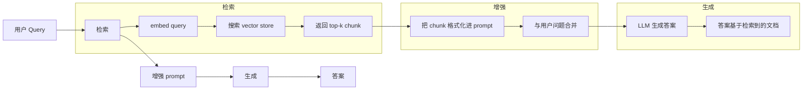
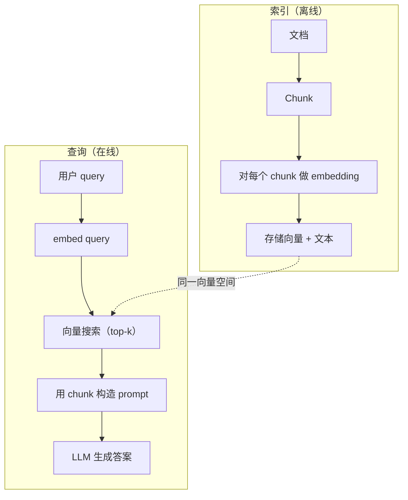

# RAG（Retrieval-Augmented Generation）

> 你的 LLM 只知道自己训练截止日期之前的一切。它对你公司的文档、你的代码库、上周的会议记录一无所知。RAG 通过检索相关文档并把它们塞进 prompt 来解决这个问题。这是生产环境中部署最多的模式。如果这门课只让你动手造一样东西，那就造一条 RAG 流水线。

**Type:** Build
**Languages:** Python
**Prerequisites:** Phase 10 (LLMs from Scratch), Phase 11 Lessons 01-05
**Time:** ~90 分钟
**Related:** Phase 5 · 23（Chunking Strategies for RAG）讲六种 chunking 算法以及各自何时胜出。Phase 5 · 22（Embedding Models Deep Dive）讲如何挑 embedder。Phase 11 · 07（Advanced RAG）讲 hybrid search、reranking 和 query transformation。

## Learning Objectives

- 构建一条完整的 RAG 流水线：文档加载、chunking、embedding、向量存储、retrieval 和生成
- 用 vector database（ChromaDB、FAISS 或 Pinecone）配合正确的索引实现 semantic search
- 解释为什么在知识落地型应用里 RAG 优于 fine-tuning（成本、新鲜度、可归因性）
- 用 retrieval 指标（precision、recall）和生成指标（faithfulness、relevance）评估 RAG 质量

## 问题场景

你给公司建了一个聊天机器人。客户问“企业版的退款政策是什么？”LLM 回了一个关于典型 SaaS 退款政策的泛泛答案。真正的政策埋在一份 200 页的内部 wiki 里：企业客户有 60 天窗口，按比例退款。LLM 从没见过这份文档。它不可能知道它没被训练过的东西。

fine-tuning 是一种解法。拿这个 LLM，在你的内部文档上训练，然后部署更新后的模型。这可行，但有严重问题。fine-tuning 在算力上要花几千美元。文档一变，模型立刻过时。你无从知道模型是从哪个来源得出结论的。而且如果公司下个月收购了另一条产品线，你又得再 fine-tune 一次。

RAG 是另一种解法。让模型保持不动。问题来了，就在你的文档库里搜索相关段落，把它们粘贴到 prompt 里问题的前面，让模型用这些段落作为上下文来回答。文档库可以在几分钟内更新。你能准确看到检索了哪些文档。模型本身从不改变。这就是 RAG 成为生产主流模式的原因：它更便宜、更新鲜、更可审计，而且适用于任何 LLM。

## 核心概念

### RAG 模式

整个模式就四步：



Query -> 检索 -> 增强 prompt -> 生成。每个 RAG 系统都遵循这个模式。生产 RAG 系统之间的差异在每一步的细节里：你怎么 chunk、怎么 embedding、怎么搜索，以及怎么构造 prompt。

### 为什么 RAG 胜过 Fine-Tuning

| 关注点 | Fine-tuning | RAG |
|---------|------------|-----|
| 成本 | 每次训练 $1,000-$100,000+ | 每次 query $0.01-$0.10（embedding + LLM） |
| 新鲜度 | 在重新训练之前一直过时 | 重新索引文档，几分钟内更新 |
| 可审计性 | 无法把答案追溯到来源 | 可以展示精确检索到的段落 |
| 幻觉 | 仍然随意产生幻觉 | 根植于检索到的文档 |
| 数据隐私 | 训练数据烘焙进权重 | 文档留在你的 vector store 里 |

fine-tuning 永久改变模型权重。RAG 临时改变模型上下文。对大多数应用来说，临时上下文才是你想要的。

fine-tuning 唯一胜出的场景：当你需要模型采用某种仅靠 prompt 无法达到的特定风格、语气或推理模式时。对事实性知识检索，RAG 每次都赢。

### Embedding 模型

embedding 模型把文本转换成稠密向量。相似的文本在这个高维空间中产生彼此靠近的向量。“How do I reset my password?”和“I need to change my password”尽管共享的词很少，却产生几乎相同的向量。“The cat sat on the mat”产生一个非常不同的向量。

常见 embedding 模型（2026 年阵容——完整分析见 Phase 5 · 22）：

| 模型 | 维度 | 提供方 | 备注 |
|-------|-----------|----------|-------|
| text-embedding-3-small | 1536 (Matryoshka) | OpenAI | 大多数用例的最佳性价比 |
| text-embedding-3-large | 3072 (Matryoshka) | OpenAI | 准确率更高，可截断到 256/512/1024 |
| Gemini Embedding 2 | 3072 (Matryoshka) | Google | MTEB retrieval 最高；8K 上下文 |
| voyage-4 | 1024/2048 (Matryoshka) | Voyage AI | 领域变体（code、finance、law） |
| Cohere embed-v4 | 1024 (Matryoshka) | Cohere | 多语言能力强，128K 上下文 |
| BGE-M3 | 1024 (dense + sparse + ColBERT) | BAAI（open-weight） | 一个模型三种视图 |
| Qwen3-Embedding | 4096 (Matryoshka) | Alibaba（open-weight） | open-weight retrieval 分数最高 |
| all-MiniLM-L6-v2 | 384 | Open-weight（Sentence Transformers） | 原型基线 |

本课我们用 TF-IDF 构建自己的简单 embedding。不是因为 TF-IDF 是生产系统用的东西，而是因为它让概念变得具体：文本进，向量出，相似文本产生相似向量。

### 向量相似度

给定两个向量，怎么衡量相似度？三种选择：

**Cosine similarity**：两个向量夹角的余弦。范围从 -1（相反）到 1（相同）。忽略模长，只关心方向。这是 RAG 的默认选择。

```
cosine_sim(a, b) = dot(a, b) / (||a|| * ||b||)
```

**Dot product**：原始内积。向量越大分数越高。当模长携带信息时有用（更长的文档可能更相关）。

```
dot(a, b) = sum(a_i * b_i)
```

**L2 (Euclidean) distance**：向量空间中的直线距离。距离越小越相似。对模长差异敏感。

```
L2(a, b) = sqrt(sum((a_i - b_i)^2))
```

cosine similarity 是标准。它通过对模长归一化，优雅地处理不同长度的文档。当人们说“vector search”时，几乎总是指 cosine similarity。

### Chunking 策略

文档太长，无法作为单个向量 embedding。一份 50 页的 PDF 可能产生很差的 embedding，因为它包含几十个主题。于是你把文档切成 chunk，逐个 embedding。

**Fixed-size chunking**：每 N 个 token 切一刀。简单可预测。512 token 的 chunk 加 50 token 重叠，意味着 chunk 1 是 token 0-511，chunk 2 是 token 462-973，依此类推。重叠确保你不会在倒霉的边界上切断句子。

**Semantic chunking**：在自然边界切分。段落、章节或 markdown 标题。每个 chunk 是一个连贯的意义单元。实现更复杂，但 retrieval 效果更好。

**Recursive chunking**：先在最大的边界切（章节标题）。如果某一节还是太大，按段落边界切。如果某一段还是太大，按句子边界切。这就是 LangChain 的 RecursiveCharacterTextSplitter 方法，实践中效果很好。

Chunk 大小比人们想的更重要：

- 太小（64-128 token）：每个 chunk 缺乏上下文。“It increased 15% last quarter”如果不知道“it”指什么就毫无意义。
- 太大（2048+ token）：每个 chunk 覆盖多个主题，稀释相关性。当你搜索营收数据，你拿到的是一个 10% 讲营收、90% 讲人头的 chunk。
- 最佳区间（256-512 token）：上下文足够自包含，又足够聚焦而相关。

大多数生产 RAG 系统用 256-512 token 的 chunk，带 50 token 重叠。Anthropic 的 RAG 指南推荐这个范围。

### Vector Database

一旦有了 embedding，你需要一个地方存储和搜索它们。选项：

| 数据库 | 类型 | 最适合 |
|----------|------|----------|
| FAISS | 库（进程内） | 原型、中小数据集 |
| Chroma | 轻量 DB | 本地开发、小型部署 |
| Pinecone | 托管服务 | 无运维负担的生产 |
| Weaviate | 开源 DB | 自托管生产 |
| pgvector | Postgres 扩展 | 已在使用 Postgres |
| Qdrant | 开源 DB | 高性能自托管 |

本课我们构建一个简单的内存向量存储。它把向量存在列表里，做暴力 cosine similarity 搜索。这等价于带 flat 索引的 FAISS。它大约扩展到 100,000 个向量就开始变慢。生产系统用 HNSW 之类的近似最近邻（ANN）算法，在毫秒级搜索数百万个向量。

### 完整流水线



索引阶段每篇文档跑一次（或文档更新时）。查询阶段在每次用户请求时跑。生产环境中，索引可能要花几小时处理数百万文档。查询必须在 1 秒内响应。

### 真实数字

大多数生产 RAG 系统用这些参数：

- **k = 5 到 10** 个检索 chunk / 每次 query
- **Chunk 大小 = 256 到 512 token**，带 50 token 重叠
- **Context 预算**：每次 query 2,500-5,000 token 的检索内容
- **总 prompt**：约 8,000-16,000 token（system prompt + 检索 chunk + 对话历史 + 用户 query）
- **Embedding 维度**：384-3072，取决于模型
- **索引吞吐**：用 API embedding 时每秒 100-1,000 篇文档
- **Query 延迟**：retrieval 50-200ms，生成 500-3000ms

```figure
rag-chunking
```

## Build It

### 第 1 步：文档分块

```python
def chunk_text(text, chunk_size=200, overlap=50):
    words = text.split()
    chunks = []
    start = 0
    while start < len(words):
        end = start + chunk_size
        chunk = " ".join(words[start:end])
        chunks.append(chunk)
        start += chunk_size - overlap
    return chunks
```

### 第 2 步：TF-IDF Embedding

我们构建一个简单的 embedding 函数。TF-IDF（Term Frequency-Inverse Document Frequency）不是神经 embedding，但它以捕捉词重要性的方式把文本转成向量。文档中频繁出现的词得到更高的 TF。整个语料中稀有的词得到更高的 IDF。二者相乘得到一个向量，其中重要、有区分度的词取值高。

```python
import math
from collections import Counter

def build_vocabulary(documents):
    vocab = set()
    for doc in documents:
        vocab.update(doc.lower().split())
    return sorted(vocab)

def compute_tf(text, vocab):
    words = text.lower().split()
    count = Counter(words)
    total = len(words)
    return [count.get(word, 0) / total for word in vocab]

def compute_idf(documents, vocab):
    n = len(documents)
    idf = []
    for word in vocab:
        doc_count = sum(1 for doc in documents if word in doc.lower().split())
        idf.append(math.log((n + 1) / (doc_count + 1)) + 1)
    return idf

def tfidf_embed(text, vocab, idf):
    tf = compute_tf(text, vocab)
    return [t * i for t, i in zip(tf, idf)]
```

### 第 3 步：Cosine Similarity 搜索

```python
def cosine_similarity(a, b):
    dot = sum(x * y for x, y in zip(a, b))
    norm_a = math.sqrt(sum(x * x for x in a))
    norm_b = math.sqrt(sum(x * x for x in b))
    if norm_a == 0 or norm_b == 0:
        return 0.0
    return dot / (norm_a * norm_b)

def search(query_embedding, stored_embeddings, top_k=5):
    scores = []
    for i, emb in enumerate(stored_embeddings):
        sim = cosine_similarity(query_embedding, emb)
        scores.append((i, sim))
    scores.sort(key=lambda x: x[1], reverse=True)
    return scores[:top_k]
```

### 第 4 步：Prompt 构造

这就是 RAG 中“augmented”发生的地方。取检索到的 chunk，把它们格式化进 prompt，让 LLM 基于提供的上下文来回答。

```python
def build_rag_prompt(query, retrieved_chunks):
    context = "\n\n---\n\n".join(
        f"[Source {i+1}]\n{chunk}"
        for i, chunk in enumerate(retrieved_chunks)
    )
    return f"""Answer the question based ONLY on the following context.
If the context doesn't contain enough information, say "I don't have enough information to answer that."

Context:
{context}

Question: {query}

Answer:"""
```

### 第 5 步：完整的 RAG 流水线

```python
class RAGPipeline:
    def __init__(self):
        self.chunks = []
        self.embeddings = []
        self.vocab = []
        self.idf = []

    def index(self, documents):
        all_chunks = []
        for doc in documents:
            all_chunks.extend(chunk_text(doc))
        self.chunks = all_chunks
        self.vocab = build_vocabulary(all_chunks)
        self.idf = compute_idf(all_chunks, self.vocab)
        self.embeddings = [
            tfidf_embed(chunk, self.vocab, self.idf)
            for chunk in all_chunks
        ]

    def query(self, question, top_k=5):
        query_emb = tfidf_embed(question, self.vocab, self.idf)
        results = search(query_emb, self.embeddings, top_k)
        retrieved = [(self.chunks[i], score) for i, score in results]
        prompt = build_rag_prompt(
            question, [chunk for chunk, _ in retrieved]
        )
        return prompt, retrieved
```

### 第 6 步：生成（模拟）

生产环境中，这里就是调用 LLM API 的地方。本课我们通过从检索上下文中抽取最相关的句子来模拟生成。

```python
def simple_generate(prompt, retrieved_chunks):
    query_words = set(prompt.lower().split("question:")[-1].split())
    best_sentence = ""
    best_score = 0
    for chunk in retrieved_chunks:
        for sentence in chunk.split("."):
            sentence = sentence.strip()
            if not sentence:
                continue
            words = set(sentence.lower().split())
            overlap = len(query_words & words)
            if overlap > best_score:
                best_score = overlap
                best_sentence = sentence
    return best_sentence if best_sentence else "I don't have enough information."
```

## Use It

用一个真实的 embedding 模型和 LLM，代码几乎不变：

```python
from openai import OpenAI

client = OpenAI()

def embed(text):
    response = client.embeddings.create(
        model="text-embedding-3-small",
        input=text
    )
    return response.data[0].embedding

def generate(prompt):
    response = client.chat.completions.create(
        model="gpt-4o-mini",
        messages=[{"role": "user", "content": prompt}],
        temperature=0
    )
    return response.choices[0].message.content
```

或者用 Anthropic：

```python
import anthropic

client = anthropic.Anthropic()

def generate(prompt):
    response = client.messages.create(
        model="claude-sonnet-5",
        max_tokens=1024,
        messages=[{"role": "user", "content": prompt}]
    )
    return response.content[0].text
```

流水线是一样的。换掉 embedding 函数。换掉生成函数。retrieval 逻辑、chunking、prompt 构造——无论你用哪个模型，全都相同。

要在规模上做向量存储，用真正的 vector database 替换暴力搜索：

```python
import chromadb

client = chromadb.Client()
collection = client.create_collection("my_docs")

collection.add(
    documents=chunks,
    ids=[f"chunk_{i}" for i in range(len(chunks))]
)

results = collection.query(
    query_texts=["What is the refund policy?"],
    n_results=5
)
```

Chroma 在内部处理 embedding（默认用 all-MiniLM-L6-v2），并把向量存在本地数据库里。同样的模式，不同的管道。

## Ship It

本课产出：
- `outputs/prompt-rag-architect.md`——一个 prompt，用于为具体用例设计 RAG 系统
- `outputs/skill-rag-pipeline.md`——一个 skill，教 agent 如何构建和调试 RAG 流水线

## Exercises

1. 把 TF-IDF embedding 换成简单的 bag-of-words 方法（二值：出现为 1，不出现为 0）。在样例文档上比较 retrieval 质量。TF-IDF 应该胜出，因为它给稀有词更高的权重。

2. 实验 chunk 大小：在同一批文档集上试 50、100、200 和 500 个词。对每种大小运行同样的 5 个 query，统计有多少个在 top-3 里返回了相关 chunk。找出 retrieval 质量达到峰值的最佳区间。

3. 给每个 chunk 加元数据（来源文档名、chunk 位置）。修改 prompt 模板以包含来源标注，让 LLM 引用它的来源。

4. 实现一个简单的评估：给定 10 个问答对，把每个问题跑一遍 RAG 流水线，测量检索到的 chunk 中有多大比例包含答案。这就是 retrieval recall at k。

5. 构建一个对话感知的 RAG 流水线：维护最近 3 次交流的历史，并把它们与检索到的 chunk 一起放进 prompt。在问完定价后用“What about enterprise?”这类追问来测试。

## Key Terms

| 术语 | 人们怎么说 | 它实际是什么意思 |
|------|----------------|----------------------|
| RAG | “能读你文档的 AI” | 检索相关文档，粘贴进 prompt，生成一个根植于这些文档的答案 |
| Embedding | “把文本转成数字” | 文本的稠密向量表示，相似语义产生相似向量 |
| Vector database | “AI 的搜索引擎” | 为存储向量并按相似度寻找最近邻而优化的数据存储 |
| Chunking | “把文档切成块” | 把文档拆成更小的片段（通常 256-512 token），使每一段可以独立 embedding 和检索 |
| Cosine similarity | “两个向量有多像” | 两个向量夹角的余弦；1 = 方向相同，0 = 正交，-1 = 相反 |
| Top-k retrieval | “拿到 k 个最匹配的” | 从向量存储中返回与 query 最相似的 k 个 chunk |
| Context window | “LLM 能看到多少文本” | LLM 在单次请求中能处理的 token 最大数量；检索到的 chunk 必须装得下 |
| Augmented generation | “用给定的上下文作答” | 用检索到的文档作为上下文来生成响应，而不是只依赖训练到的知识 |
| TF-IDF | “词重要性打分” | Term Frequency 乘以 Inverse Document Frequency；按词在语料中的区分度给词加权 |
| Indexing | “为搜索准备文档” | chunking、embedding 并存储文档的离线过程，使它们在 query 时可以被搜索 |

## Further Reading

- Lewis 等，“Retrieval-Augmented Generation for Knowledge-Intensive NLP Tasks”（2020）——Facebook AI Research 的原始 RAG 论文，形式化了 retrieve-then-generate 模式
- Anthropic 的 RAG 文档（docs.anthropic.com）——关于 chunk 大小、prompt 构造和评估的实用指南
- Pinecone Learning Center，“What is RAG?”——对 RAG 流水线清晰的图解说明，并附生产环境考量
- Sentence-BERT：Reimers & Gurevych（2019）——all-MiniLM embedding 模型背后的论文，展示了如何训练 bi-encoder 做语义相似度
- [Karpukhin 等，“Dense Passage Retrieval for Open-Domain Question Answering”（EMNLP 2020）](https://arxiv.org/abs/2004.04906)——DPR 论文，证明了稠密 bi-encoder retrieval 在开放域 QA 上胜过 BM25，并为现代 RAG retriever 定下了范式。
- [LlamaIndex High-Level Concepts](https://docs.llamaindex.ai/en/stable/getting_started/concepts.html)——构建 RAG 流水线时要知道的主要概念：data loader、node parser、index、retriever、response synthesizer。
- [LangChain RAG 教程](https://python.langchain.com/docs/tutorials/rag/)——另一种风格的编排器；把同一个 retrieve-then-generate 模式看作 chain-of-runnables 的视角。
