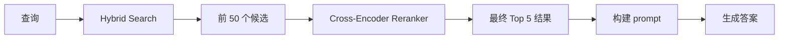
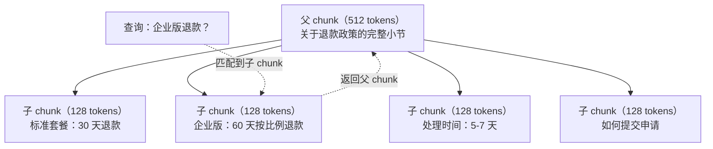
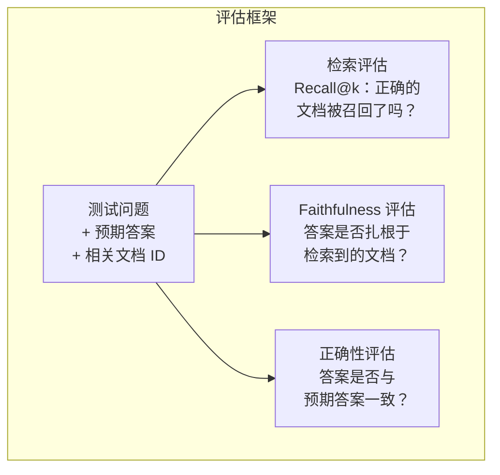

# Advanced RAG（分块、重排序、混合检索）

> 基础 RAG 只取相似度最高的 top-k 个 chunk。这对简单问题够用。一旦遇到 multi-hop 推理、歧义查询和超大规模语料，它就会崩掉。Advanced RAG 是「10 篇文档能跑通的 demo」与「1000 万篇文档能跑通的系统」之间的差别。

**Type:** Build
**Languages:** Python
**Prerequisites:** Phase 11, Lesson 06 (RAG)
**Time:** ~90 分钟
**Related:** Phase 5 · 23（Chunking Strategies for RAG）覆盖全部六种分块算法 —— recursive、semantic、sentence、parent-document、late chunking、contextual retrieval —— 并附带 Vectara/Anthropic 的 benchmark。本课在其之上继续：hybrid search、reranking、query transformation。

## Learning Objectives

- 实现能保留文档结构与上下文的高级分块策略（semantic、recursive、parent-child）
- 构建一条 hybrid search 流水线，把 BM25 关键词匹配、语义向量检索和 cross-encoder reranker 组合起来
- 运用 query transformation 技术（HyDE、multi-query、step-back）来改善歧义或复杂问题上的检索效果
- 诊断并修复常见 RAG 失效：检索到错误的 chunk、答案不在上下文中、multi-hop 推理断裂

## 问题场景

你在第 06 课里搭好了一条基础 RAG 流水线。它在小语料上的直白问题表现良好。现在试试下面这些：

**歧义查询**：「上个季度的 revenue 是多少？」语义检索返回的 chunk 都是关于 revenue 战略、revenue 预测，以及 CFO 对 revenue 增长看法的。它们在语义上都与「revenue」这个词相似。但没有一个包含真实数字。正确的那个 chunk 写的是「$47.2M in Q3 2025」，但它用的是「earnings」而不是「revenue」。embedding 模型认为「revenue strategy」比「Q3 earnings were $47.2M」更接近查询。

**Multi-hop 问题**：「哪个团队的客户满意度分数提升最大？」这需要先找出每个团队的满意度分数，再比较它们，最后确定最大值。没有任何单个 chunk 包含答案。信息散落在各个团队报告里。

**大语料问题**：你有 200 万个 chunk。正确答案在 chunk #1,847,293 里。你的 top-5 检索拉回来的是 #14、#89,201、#1,200,000、#44 和 #901,333。它们在 embedding 空间里都很接近，但没有一个包含答案。在这个规模上，近似最近邻搜索引入的误差足以把相关结果挤出 top-k。

基础 RAG 失效，是因为向量相似并不等于相关性。一个 chunk 可以在语义上接近查询，却对回答问题毫无用处。Advanced RAG 用四项技术来应对：hybrid search（加入关键词匹配）、reranking（更仔细地给候选打分）、query transformation（在检索前修正查询），以及更好的分块（在正确粒度上检索）。

## 核心概念

### Hybrid Search：语义 + 关键词

语义检索（向量相似度）擅长理解含义。「How do I cancel my subscription?」能匹配到「Steps to terminate your plan」，尽管两者没有任何共同词。但它会漏掉精确匹配。「Error code E-4021」可能匹配不到包含「E-4021」的 chunk，因为 embedding 模型把它当成噪声。

关键词检索（BM25）正好相反。它擅长精确匹配。「E-4021」能完美命中。但如果文档写的是「terminate your plan」，那「cancel my subscription」会返回零结果。

Hybrid search 同时跑这两条路，然后合并结果。

**BM25**（Best Matching 25）是标准的关键词检索算法。自 1990 年代以来，它一直是搜索引擎的骨干。公式：

```
BM25(q, d) = sum over terms t in q:
    IDF(t) * (tf(t,d) * (k1 + 1)) / (tf(t,d) + k1 * (1 - b + b * |d| / avgdl))
```

其中 tf(t,d) 是词 t 在文档 d 中的词频，IDF(t) 是逆文档频率，|d| 是文档长度，avgdl 是平均文档长度，k1 控制词频饱和（默认 1.2），b 控制长度归一化（默认 0.75）。

用大白话说：当文档包含查询词（尤其是稀有词）时 BM25 给更高分，但重复出现的词收益递减。一个出现 50 次「revenue」的文档，并不比只出现一次的相关 50 倍。

### Reciprocal Rank Fusion（RRF）

你有两个排序列表：一个来自向量检索，一个来自 BM25。怎么合并？Reciprocal Rank Fusion 是标准做法。

```
RRF_score(d) = sum over rankings R:
    1 / (k + rank_R(d))
```

其中 k 是一个常数（通常是 60），用来防止排名第一的结果压倒一切。

一个在向量检索中排 #1、在 BM25 中排 #5 的文档得分为：1/(60+1) + 1/(60+5) = 0.0164 + 0.0154 = 0.0318

一个在向量检索中排 #3、在 BM25 中排 #2 的文档得分为：1/(60+3) + 1/(60+2) = 0.0159 + 0.0161 = 0.0320

RRF 天然地平衡了这两路信号。在两个列表里都排名靠前的文档拿到最高分。在一个列表里排 #1、但在另一个列表里完全缺席的文档拿到中等分数。这种做法很稳健，因为它用的是排名而非原始分数，所以两个系统之间分数分布的差异无关紧要。

### Reranking

检索（无论向量、关键词还是 hybrid）很快，但不精确。它用的是 bi-encoder：查询和每个文档各自独立地 embedding，然后再比较。embedding 只算一次并缓存。这能扩展到数百万文档。

Reranking 用 cross-encoder：查询和一个候选文档一起送进模型，模型输出一个相关性分数。模型同时看到两段文本，能捕捉它们之间细粒度的交互。cross-encoder 能理解「What were Q3 earnings?」与包含「$47.2M in Q3」的 chunk 高度相关，即使 bi-encoder 漏掉了这层联系。

权衡在于：cross-encoder 比 bi-encoder 慢 100-1000 倍，因为它要联合处理查询-文档对。你不可能为一百万文档预先算好 cross-encoder 分数。解决方案是：先召回一个更大的候选集（从 hybrid search 取 top-50），再用 cross-encoder 重排，得到最终的 top-5。



常见 reranking 模型（2026 年阵容）：
- Cohere Rerank 3.5：托管 API，多语言，在混合语料上召回提升最大
- Voyage rerank-2.5：托管 API，托管方案中延迟最低
- Jina-Reranker-v2 Multilingual：开放权重，支持 100+ 种语言
- bge-reranker-v2-m3：开放权重，强基线
- cross-encoder/ms-marco-MiniLM-L-6-v2：开放权重，可在 CPU 上运行，适合原型验证
- ColBERTv2 / Jina-ColBERT-v2：late-interaction 多向量 reranker —— 打分时是 O(tokens) 而非 O(docs)

### Query Transformation

有时问题不在检索，而在查询本身。「What was that thing about the new policy change?」是个糟糕的搜索查询。它不含任何具体词。embedding 很模糊。没有任何检索系统能从这上面找到正确文档。

**Query rewriting**：把用户的查询改写成更好的搜索查询。LLM 可以做到：

```
User: "What was that thing about the new policy change?"
Rewritten: "Recent policy changes and updates"
```

**HyDE（Hypothetical Document Embeddings）**：不用查询本身去搜索，而是先生成一个假设性答案，把答案 embedding，再去搜索相似的真实文档。

```
Query: "What is the refund policy for enterprise?"
Hypothetical answer: "Enterprise customers are eligible for a full refund
within 60 days of purchase. Refunds are pro-rated based on the remaining
subscription period and processed within 5-7 business days."
```

把假设性答案 embedding，然后搜索与它相似的真实文档。直觉是：假设性答案在 embedding 空间里比原问题更靠近真实答案。问题和答案有不同的语言结构。通过生成一个假设性答案，你在 embedding 中弥合了「问题空间」与「答案空间」之间的鸿沟。

HyDE 在检索前增加一次 LLM 调用。这会让延迟增加 500-2000ms。当原始查询的检索质量很差时，这值得。

### Parent-Child Chunking

标准分块被迫做取舍：小 chunk 检索精确，大 chunk 上下文充足。parent-child chunking 消除了这个取舍。

索引小 chunk（128 tokens）用于检索。当某个小 chunk 被召回时，返回它的父 chunk（512 tokens）用于 prompt。小 chunk 精确匹配查询。父 chunk 提供足够上下文让 LLM 生成好答案。



查询「enterprise refund?」精确匹配子 chunk C2。但 prompt 收到的是完整的父 chunk P，其中包含处理时间和提交流程相关的周边上下文。

### Metadata Filtering

在做向量检索之前，先按元数据过滤语料：日期、来源、类别、作者、语言。这能缩小搜索空间，避免无关结果。

「What changed in the security policy last month?」应该只在 security 类别中搜索最近 30 天的文档。没有 metadata filtering 的话，你会搜索整个语料，可能召回一份两年前的、恰好语义相似的安全文档。

生产级 RAG 系统会在每个 chunk 旁存元数据：来源文档、创建日期、类别、作者、版本。向量数据库支持在相似度搜索之前按元数据做 pre-filtering，这对大规模下的性能至关重要。

### 评估

你搭好了一个 RAG 系统。怎么知道它能不能用？三个指标：

**检索相关性（Recall@k）**：对于一组已知相关文档的测试问题，有多大比例的相关文档出现在 top-k 结果里？如果某问题的答案在 chunk #47 里，chunk #47 会出现在 top-5 里吗？

**Faithfulness**：生成的答案是否扎根于检索到的文档？如果检索到的 chunk 写的是「60-day refund window」，而模型说「90-day refund window」，这就是一次 faithfulness 失败。模型明明拿到了正确上下文，却产生了幻觉。

**答案正确性**：生成的答案是否与预期答案一致？这是端到端指标。它把检索质量和生成质量合在一起。

一个简单的 faithfulness 检查：取生成答案中的每个论断，验证它（在实质上）出现在检索到的 chunk 里。如果答案包含任何 chunk 中都没有的事实，它很可能是幻觉。



```figure
agentic-rag-loop
```

## Build It

### 第 1 步：BM25 实现

```python
import math
from collections import Counter

class BM25:
    def __init__(self, k1=1.2, b=0.75):
        self.k1 = k1
        self.b = b
        self.docs = []
        self.doc_lengths = []
        self.avg_dl = 0
        self.doc_freqs = {}
        self.n_docs = 0

    def index(self, documents):
        self.docs = documents
        self.n_docs = len(documents)
        self.doc_lengths = []
        self.doc_freqs = {}

        for doc in documents:
            words = doc.lower().split()
            self.doc_lengths.append(len(words))
            unique_words = set(words)
            for word in unique_words:
                self.doc_freqs[word] = self.doc_freqs.get(word, 0) + 1

        self.avg_dl = sum(self.doc_lengths) / self.n_docs if self.n_docs else 1

    def score(self, query, doc_idx):
        query_words = query.lower().split()
        doc_words = self.docs[doc_idx].lower().split()
        doc_len = self.doc_lengths[doc_idx]
        word_counts = Counter(doc_words)
        score = 0.0

        for term in query_words:
            if term not in word_counts:
                continue
            tf = word_counts[term]
            df = self.doc_freqs.get(term, 0)
            idf = math.log((self.n_docs - df + 0.5) / (df + 0.5) + 1)
            numerator = tf * (self.k1 + 1)
            denominator = tf + self.k1 * (1 - self.b + self.b * doc_len / self.avg_dl)
            score += idf * numerator / denominator

        return score

    def search(self, query, top_k=10):
        scores = [(i, self.score(query, i)) for i in range(self.n_docs)]
        scores.sort(key=lambda x: x[1], reverse=True)
        return scores[:top_k]
```

### 第 2 步：Reciprocal Rank Fusion

```python
def reciprocal_rank_fusion(ranked_lists, k=60):
    scores = {}
    for ranked_list in ranked_lists:
        for rank, (doc_id, _) in enumerate(ranked_list):
            if doc_id not in scores:
                scores[doc_id] = 0.0
            scores[doc_id] += 1.0 / (k + rank + 1)
    fused = sorted(scores.items(), key=lambda x: x[1], reverse=True)
    return fused
```

### 第 3 步：Hybrid Search 流水线

```python
def hybrid_search(query, chunks, vector_embeddings, vocab, idf, bm25_index, top_k=5, fusion_k=60):
    query_emb = tfidf_embed(query, vocab, idf)
    vector_results = search(query_emb, vector_embeddings, top_k=top_k * 3)
    bm25_results = bm25_index.search(query, top_k=top_k * 3)
    fused = reciprocal_rank_fusion([vector_results, bm25_results], k=fusion_k)
    return fused[:top_k]
```

### 第 4 步：简单的 Reranker

在生产中你会用 cross-encoder 模型。这里我们构建一个 reranker，用词重叠、词重要性和短语匹配来给查询-文档相关性打分。

```python
def rerank(query, candidates, chunks):
    query_words = set(query.lower().split())
    stop_words = {"the", "a", "an", "is", "are", "was", "were", "what", "how",
                  "why", "when", "where", "do", "does", "for", "of", "in", "to",
                  "and", "or", "on", "at", "by", "it", "its", "this", "that",
                  "with", "from", "be", "has", "have", "had", "not", "but"}
    query_terms = query_words - stop_words

    scored = []
    for doc_id, initial_score in candidates:
        chunk = chunks[doc_id].lower()
        chunk_words = set(chunk.split())

        term_overlap = len(query_terms & chunk_words)

        query_bigrams = set()
        q_list = [w for w in query.lower().split() if w not in stop_words]
        for i in range(len(q_list) - 1):
            query_bigrams.add(q_list[i] + " " + q_list[i + 1])
        bigram_matches = sum(1 for bg in query_bigrams if bg in chunk)

        position_boost = 0
        for term in query_terms:
            pos = chunk.find(term)
            if pos != -1 and pos < len(chunk) // 3:
                position_boost += 0.5

        rerank_score = (
            term_overlap * 1.0
            + bigram_matches * 2.0
            + position_boost
            + initial_score * 5.0
        )
        scored.append((doc_id, rerank_score))

    scored.sort(key=lambda x: x[1], reverse=True)
    return scored
```

### 第 5 步：HyDE（Hypothetical Document Embeddings）

```python
def hyde_generate_hypothesis(query):
    templates = {
        "what": "The answer to '{query}' is as follows: Based on our documentation, {topic} involves specific policies and procedures that define how the process works.",
        "how": "To address '{query}': The process involves several steps. First, you need to initiate the request. Then, the system processes it according to the defined rules.",
        "default": "Regarding '{query}': Our records indicate specific details and policies related to this topic that provide a comprehensive answer."
    }
    query_lower = query.lower()
    if query_lower.startswith("what"):
        template = templates["what"]
    elif query_lower.startswith("how"):
        template = templates["how"]
    else:
        template = templates["default"]

    topic_words = [w for w in query.lower().split()
                   if w not in {"what", "is", "the", "how", "do", "does", "a", "an",
                                "for", "of", "to", "in", "on", "at", "by", "and", "or"}]
    topic = " ".join(topic_words) if topic_words else "this topic"

    return template.format(query=query, topic=topic)


def hyde_search(query, chunks, vector_embeddings, vocab, idf, top_k=5):
    hypothesis = hyde_generate_hypothesis(query)
    hypothesis_emb = tfidf_embed(hypothesis, vocab, idf)
    results = search(hypothesis_emb, vector_embeddings, top_k)
    return results, hypothesis
```

### 第 6 步：Parent-Child Chunking

```python
def create_parent_child_chunks(text, parent_size=200, child_size=50):
    words = text.split()
    parents = []
    children = []
    child_to_parent = {}

    parent_idx = 0
    start = 0
    while start < len(words):
        parent_end = min(start + parent_size, len(words))
        parent_text = " ".join(words[start:parent_end])
        parents.append(parent_text)

        child_start = start
        while child_start < parent_end:
            child_end = min(child_start + child_size, parent_end)
            child_text = " ".join(words[child_start:child_end])
            child_idx = len(children)
            children.append(child_text)
            child_to_parent[child_idx] = parent_idx
            child_start += child_size

        parent_idx += 1
        start += parent_size

    return parents, children, child_to_parent
```

### 第 7 步：Faithfulness 评估

```python
def evaluate_faithfulness(answer, retrieved_chunks):
    answer_sentences = [s.strip() for s in answer.split(".") if len(s.strip()) > 10]
    if not answer_sentences:
        return 1.0, []

    grounded = 0
    ungrounded = []
    context = " ".join(retrieved_chunks).lower()

    for sentence in answer_sentences:
        words = set(sentence.lower().split())
        stop_words = {"the", "a", "an", "is", "are", "was", "were", "and", "or",
                      "to", "of", "in", "for", "on", "at", "by", "it", "this", "that"}
        content_words = words - stop_words
        if not content_words:
            grounded += 1
            continue

        matched = sum(1 for w in content_words if w in context)
        ratio = matched / len(content_words) if content_words else 0

        if ratio >= 0.5:
            grounded += 1
        else:
            ungrounded.append(sentence)

    score = grounded / len(answer_sentences) if answer_sentences else 1.0
    return score, ungrounded


def evaluate_retrieval_recall(queries_with_relevant, retrieval_fn, k=5):
    total_recall = 0.0
    results = []

    for query, relevant_indices in queries_with_relevant:
        retrieved = retrieval_fn(query, k)
        retrieved_indices = set(idx for idx, _ in retrieved)
        relevant_set = set(relevant_indices)
        hits = len(retrieved_indices & relevant_set)
        recall = hits / len(relevant_set) if relevant_set else 1.0
        total_recall += recall
        results.append({
            "query": query,
            "recall": recall,
            "hits": hits,
            "total_relevant": len(relevant_set)
        })

    avg_recall = total_recall / len(queries_with_relevant) if queries_with_relevant else 0
    return avg_recall, results
```

## Use It

用真实的 cross-encoder 做 reranking：

```python
from sentence_transformers import CrossEncoder

reranker = CrossEncoder("cross-encoder/ms-marco-MiniLM-L-6-v2")

def rerank_with_cross_encoder(query, candidates, chunks, top_k=5):
    pairs = [(query, chunks[doc_id]) for doc_id, _ in candidates]
    scores = reranker.predict(pairs)
    scored = list(zip([doc_id for doc_id, _ in candidates], scores))
    scored.sort(key=lambda x: x[1], reverse=True)
    return scored[:top_k]
```

用 Cohere 的托管 reranker：

```python
import cohere

co = cohere.Client()

def rerank_with_cohere(query, candidates, chunks, top_k=5):
    docs = [chunks[doc_id] for doc_id, _ in candidates]
    response = co.rerank(
        model="rerank-english-v3.0",
        query=query,
        documents=docs,
        top_n=top_k
    )
    return [(candidates[r.index][0], r.relevance_score) for r in response.results]
```

用真实 LLM 做 HyDE：

```python
import anthropic

client = anthropic.Anthropic()

def hyde_with_llm(query):
    response = client.messages.create(
        model="claude-sonnet-5",
        max_tokens=256,
        messages=[{
            "role": "user",
            "content": f"Write a short paragraph that would be a good answer to this question. Do not say you don't know. Just write what the answer would look like.\n\nQuestion: {query}"
        }]
    )
    return response.content[0].text
```

用 Weaviate 做生产级 hybrid search：

```python
import weaviate

client = weaviate.connect_to_local()

collection = client.collections.get("Documents")
response = collection.query.hybrid(
    query="enterprise refund policy",
    alpha=0.5,
    limit=10
)
```

alpha 参数控制平衡：0.0 = 纯关键词（BM25），1.0 = 纯向量，0.5 = 等权重。大多数生产系统把 alpha 设在 0.3 到 0.7 之间。

## Ship It

本课产出：
- `outputs/prompt-advanced-rag-debugger.md` —— 一个用于诊断和修复 RAG 质量问题的 prompt
- `outputs/skill-advanced-rag.md` —— 一个用 hybrid search 和 reranking 构建生产级 RAG 的 skill

## Exercises

1. 在示例文档上比较 BM25、向量检索和 hybrid search。对 5 条测试查询中的每一条，记录哪种方法把最相关的 chunk 排在 #1 位。hybrid search 应该在 5 条里至少赢 3 条。

2. 实现一个 metadata filter。给每个文档加一个「category」字段（security、billing、api、product）。在跑向量检索之前，把 chunk 过滤到只剩相关类别。用「What encryption is used?」测试，验证它只搜索 security 类别的 chunk。

3. 用第 06 课里那个简单的生成函数，构建一条完整的 HyDE 流水线。在全部 5 条测试查询上，比较直接查询检索与 HyDE 检索的检索质量（top-3 相关性）。HyDE 应该能改善含糊查询的结果。

4. 在示例文档上实现 parent-child chunking 策略。用 child_size=30、parent_size=100。用子 chunk 检索，但在 prompt 里返回父 chunk。把生成的答案与 chunk_size=50 的标准分块做比较。

5. 创建一个评估数据集：10 个问题，带已知的答案 chunk。测量以下四种配置的 Recall@3、Recall@5 和 Recall@10：(a) 只用向量检索，(b) 只用 BM25，(c) hybrid search，(d) hybrid + reranking。把结果画出来，找出 reranking 帮助最大的地方。

## Key Terms

| 术语 | 人们怎么说 | 它实际是什么意思 |
|------|----------------|----------------------|
| BM25 | 「关键词搜索」 | 一种概率排序算法，按词频、逆文档频率和文档长度归一化给文档打分 |
| Hybrid search | 「两全其美」 | 并行跑语义（向量）检索和关键词（BM25）检索，再用 rank fusion 合并结果 |
| Reciprocal Rank Fusion | 「合并排序列表」 | 通过累加每个文档在所有列表中的 1/(k + rank) 来合并多个排序列表 |
| Reranking | 「第二遍打分」 | 用更昂贵的 cross-encoder 模型对初步检索得到的候选集重新打分 |
| Cross-encoder | 「查询-文档联合模型」 | 把查询和文档作为单一输入、输出相关性分数的模型；比 bi-encoder 更准，但对全语料检索来说太慢 |
| Bi-encoder | 「独立 embedding 模型」 | 独立地 embedding 查询和文档的模型；因为 embedding 可以预计算所以很快，但不如 cross-encoder 准确 |
| HyDE | 「用假答案去搜索」 | 为查询生成一个假设性答案，把它 embedding，再搜索与它相似的真实文档 |
| Parent-child chunking | 「小处搜索，大处给上下文」 | 索引小 chunk 做精确检索，但返回更大的父 chunk 以提供足够上下文 |
| Metadata filtering | 「先缩小再搜索」 | 在跑向量检索之前按属性（日期、来源、类别）过滤文档，以缩小搜索空间 |
| Faithfulness | 「它是否站得住脚」 | 生成的答案是否有检索到的文档支撑，而不是模型从训练数据里编出来的 |

## Further Reading

- Robertson & Zaragoza, "The Probabilistic Relevance Framework: BM25 and Beyond" (2009) —— BM25 的权威参考，解释了公式背后的概率论基础
- Cormack et al., "Reciprocal Rank Fusion Outperforms Condorcet and Individual Rank Learning Methods" (2009) —— RRF 的原始论文，证明它优于更复杂的融合方法
- Gao et al., "Precise Zero-Shot Dense Retrieval without Relevance Labels" (2022) —— HyDE 论文，证明假设性文档 embedding 无需任何训练数据即可改善检索
- Nogueira & Cho, "Passage Re-ranking with BERT" (2019) —— 证明在 BM25 之上叠加 cross-encoder reranking 能显著提升检索质量
- [Khattab et al., "DSPy: Compiling Declarative Language Model Calls into Self-Improving Pipelines" (2023)](https://arxiv.org/abs/2310.03714) —— 把 prompt 构造和权重选择当作检索流水线上的优化问题；想「program LLMs」而非「prompt LLMs」就读这篇。
- [Edge et al., "From Local to Global: A Graph RAG Approach to Query-Focused Summarization" (Microsoft Research 2024)](https://arxiv.org/abs/2404.16130) —— GraphRAG 论文：实体-关系抽取 + Leiden 社区发现，用于面向查询的摘要；以及 global 与 local 检索的区分。
- [Asai et al., "Self-RAG: Learning to Retrieve, Generate, and Critique through Self-Reflection" (ICLR 2024)](https://arxiv.org/abs/2310.11511) —— 带 reflection token 的自评估 RAG；静态 retrieve-then-generate 之后的 agentic 前沿。
- [LangChain Query Construction blog](https://blog.langchain.dev/query-construction/) —— 如何把自然语言查询转换为结构化数据库查询（Text-to-SQL、Cypher），作为检索前的一步。
