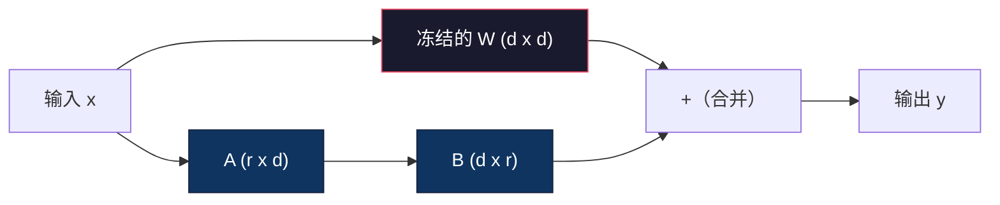
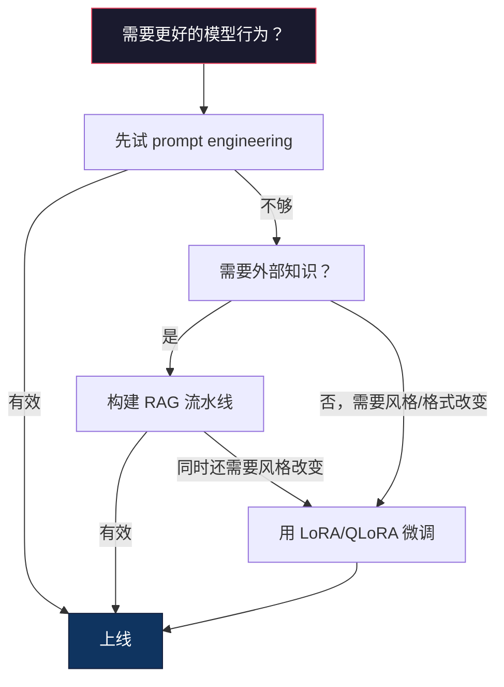

# 用 LoRA 与 QLoRA 微调

> 完整微调一个 7B 模型需要 56GB VRAM。你没有。大多数公司也没有。LoRA 让你只训练不到 1% 的参数，就在 6GB 里微调同一个模型。这不是妥协 —— 在大多数任务上它能追平完整微调的质量。整个开源微调生态都建立在这一个小技巧上。

**Type:** Build
**Languages:** Python
**Prerequisites:** Phase 10, Lesson 06 (Instruction Tuning / SFT)
**Time:** ~75 分钟
**Related:** Phase 10 从零讲了 SFT/DPO 循环。本课把它们接进 2026 年的 PEFT 工具链（PEFT、TRL、Unsloth、Axolotl、LLaMA-Factory）。

## Learning Objectives

- 把低秩 adapter 矩阵（A 和 B）注入预训练模型的注意力层，从而实现 LoRA
- 计算 LoRA 相对完整微调的参数节省：rank 为 r、维度为 d_model 时只训练 2*r*d 个参数，而不是 d^2 个
- 用 QLoRA（4-bit 量化的基座 + LoRA adapter）在消费级 GPU 内存内完成微调
- 把 LoRA 权重合并回基座模型用于部署，并比较有 adapter 与无 adapter 时的推理速度

## 问题场景

你有一个基座模型。Llama 3 8B。你想让它用你公司的口吻回答客服工单。SFT 是答案。但 SFT 有成本问题。

完整微调会更新模型里的每一个参数。Llama 3 8B 有 80 亿参数。在 fp16 下，每个参数占 2 字节。光加载权重就要 16GB。训练过程中你还需要梯度（16GB）、Adam 的优化器状态（动量 + 方差共 32GB），以及激活值。总计：单个 8B 模型大约需要 56GB VRAM。

一张 A100 80GB 勉强装得下。在云厂商那里两张 A100 每小时要 $3-4。在 50,000 条样本上训练 3 个 epoch 需要 6-10 小时。一次实验就是 $30-40。为了调好超参数跑 10 次实验，还没部署你就已经花掉 $400。

把这个规模推到 Llama 3 70B，数字就荒唐了。光权重就要 140GB。你需要一整个集群。每次实验 $100+。

还有一个更深的问题。完整微调会改动模型里的每一个权重。如果你在客服数据上微调，可能会损害模型的通用能力。这叫做灾难性遗忘（catastrophic forgetting）。模型在你的任务上变好，在其他一切上变差。

你需要一种训练更少参数、占用更少内存、且不摧毁模型既有知识的方法。

## 核心概念

### LoRA：Low-Rank Adaptation

Edward Hu 及其微软的同事在 2021 年 6 月发表了 LoRA。论文的洞见是：微调过程中的权重更新具有很低的内在秩。你不需要更新一个 4096x4096 权重矩阵里的全部 1677 万个参数。更新中有用的信息可以用一个 rank 为 16 或 32 的矩阵捕捉。

数学是这样的。标准线性层计算：

```
y = Wx
```

其中 W 是一个 d_out x d_in 矩阵。对于一个 4096x4096 的注意力投影，那就是 16,777,216 个参数。

LoRA 冻结 W，并加入一个低秩分解：

```
y = Wx + BAx
```

其中 B 是 (d_out x r)，A 是 (r x d_in)。rank r 远小于 d —— 通常是 8、16 或 32。

对于 4096x4096 层、r=16：
- 原始参数：4096 x 4096 = 16,777,216
- LoRA 参数：(4096 x 16) + (16 x 4096) = 65,536 + 65,536 = 131,072
- 缩减比例：131,072 / 16,777,216 = 0.78%

你只训练 0.78% 的参数，却拿到 95-100% 的质量。



A 用随机高斯分布初始化。B 初始化为零。这意味着 LoRA 的贡献从零开始 —— 模型从它原本的行为开始训练，逐步学到适应性调整。

### 缩放因子：Alpha

LoRA 引入一个缩放因子 alpha，控制低秩更新对输出的影响程度：

```
y = Wx + (alpha / r) * BAx
```

当 alpha = r 时，缩放是 1 倍。当 alpha = 2r（常见的默认值）时，缩放是 2 倍。这个超参数独立于基础学习率，控制 LoRA 路径的学习率。

实用建议：
- alpha = 2 * rank 是常见的社区惯例（原论文在大多数实验中用 alpha = rank）
- alpha = rank 得到 1 倍缩放，保守但稳定
- 更高的 alpha 意味着每步更新更大，可能加速收敛，也可能导致不稳定

### 在哪里应用 LoRA

一个 transformer 里有很多线性层。你不需要给所有层都加 LoRA。原论文测试了不同组合：

| 目标层 | 可训练参数（7B） | 质量 |
|--------------|----------------------|---------|
| 仅 q_proj | 4.7M | 好 |
| q_proj + v_proj | 9.4M | 更好 |
| q_proj + k_proj + v_proj + o_proj | 18.9M | 注意力部分最佳 |
| 全部线性层（attention + MLP） | 37.7M | 收益很小，参数翻倍 |

大多数任务的最佳落点：q_proj + v_proj。它瞄准自注意力中的 query 和 value 投影，这两个投影控制模型关注什么、提取什么信息。加 MLP 层对代码生成这类复杂任务有帮助，但参数翻倍，在简单任务上收益递减。

### Rank 选择

rank r 控制适应性调整的表达能力：

| Rank | 可训练参数（每层） | 最适合 |
|------|---------------------------|----------|
| 4 | 32,768 | 简单分类、情感分析 |
| 8 | 65,536 | 单领域问答、摘要 |
| 16 | 131,072 | 多领域任务、指令跟随 |
| 32 | 262,144 | 复杂推理、代码生成 |
| 64 | 524,288 | 对大多数任务收益递减 |
| 128 | 1,048,576 | 很少有理由这么做 |

Hu 等人证明，对简单任务 r=4 已能捕捉大部分适应性调整。实践中 r=8 和 r=16 是最常见的选择。超过 r=64 很少能提升质量，还会开始丧失 LoRA 的内存优势。

### QLoRA：4-bit Quantization + LoRA

Tim Dettmers 及其华盛顿大学的同事在 2023 年 5 月发表了 QLoRA。思路是：把冻结的基座模型量化到 4-bit 精度，再在上面挂 fp16 的 LoRA adapter。

这显著改变了内存等式：

| 方法 | 权重内存（7B） | 训练内存（7B） | 所需 GPU |
|--------|-------------------|---------------------|-------------|
| 完整微调（fp16） | 14GB | ~56GB | 1x A100 80GB |
| LoRA（fp16 基座） | 14GB | ~18GB | 1x A100 40GB |
| QLoRA（4-bit 基座） | 3.5GB | ~6GB | 1x RTX 3090 24GB |

QLoRA 有三项技术贡献：

**NF4（Normal Float 4-bit）**：一种专门为神经网络权重设计的新数据类型。神经网络权重大致服从正态分布。NF4 把它的 16 个量化层级放在标准正态分布的分位数上。对正态分布的数据来说，这在信息论上是最优的。它比均匀 4-bit 量化（INT4）或标准 Float4 丢失的信息更少。

**Double quantization**：量化常数本身也占内存。每 64 个权重一块，需要一个 fp32 的 scale factor（4 字节）。对一个 7B 模型来说，这要多占 0.4GB。Double quantization 把这些常数再量化到 fp8，把开销降到 0.1GB。不多，但积少成多。

**Paged optimizers**：训练时，优化器状态（Adam 的动量和方差）在长序列上可能超出 GPU 内存。Paged optimizers 利用 NVIDIA 的统一内存，在 GPU 内存耗尽时自动把优化器状态换页到 CPU RAM，需要时再换回来。这能以牺牲部分吞吐为代价避免 OOM 崩溃。

### 质量问题

减少参数或量化基座会损害质量吗？多篇论文的结果：

| 方法 | MMLU (5-shot) | MT-Bench | HumanEval |
|--------|--------------|----------|-----------|
| 完整微调（Llama 2 7B） | 48.3 | 6.72 | 14.6 |
| LoRA r=16 | 47.9 | 6.68 | 14.0 |
| QLoRA r=16 (NF4) | 47.5 | 6.61 | 13.4 |
| QLoRA r=64 (NF4) | 48.1 | 6.70 | 14.2 |

在大多数 benchmark 上，r=16 的 LoRA 与完整微调差距在 1% 以内。r=16 的 QLoRA 再损失零点几个百分点。r=64 的 QLoRA 基本追平完整微调，而内存占用少 90%。

### 真实成本

在 50,000 条样本（3 个 epoch）上微调 Llama 3 8B：

| 方法 | GPU | 时间 | 成本 |
|--------|-----|------|------|
| 完整微调 | 2x A100 80GB | 8 小时 | ~$32 |
| LoRA r=16 | 1x A100 40GB | 4 小时 | ~$8 |
| QLoRA r=16 | 1x RTX 4090 24GB | 6 小时 | ~$5 |
| QLoRA r=16 (Unsloth) | 1x RTX 4090 24GB | 2.5 小时 | ~$2 |
| QLoRA r=16 | 1x T4 16GB | 12 小时 | ~$4 |

在一张消费级 GPU 上跑 QLoRA，成本比一顿午饭还便宜。这就是为什么 2023 年开放权重微调社区会爆发，也是为什么 2026 年下面每个训练框架都默认支持 QLoRA。

### 2026 年的 PEFT 技术栈

| 框架 | 它是什么 | 什么时候选它 |
|-----------|-----------|-----------|
| **Hugging Face PEFT** | 最正统的 LoRA/QLoRA/DoRA/IA3 库 | 你想要底层控制，而且训练循环已经在 `transformers.Trainer` 上 |
| **TRL** | HF 的基于反馈的强化学习训练器（SFT、DPO、GRPO、PPO、ORPO） | SFT 之后还需要 DPO/GRPO；构建在 PEFT 之上 |
| **Unsloth** | 用 Triton kernel 重写的前向/反向传播 | 你想要 2-5 倍加速 + 一半 VRAM 且不掉精度；Llama/Mistral/Qwen 系列 |
| **Axolotl** | 在 PEFT + TRL + DeepSpeed + Unsloth 之上的 YAML 配置封装 | 你想要可复现、可版本控制的训练运行 |
| **LLaMA-Factory** | 在 PEFT + TRL 之上的 GUI/CLI/API | 你想要零代码微调；支持 100+ 模型系列 |
| **torchtune** | 原生 PyTorch 配方，不依赖 `transformers` | 你想要最少的依赖，且你的组织已经把 PyTorch 标准化 |

经验法则：研究用途或一次性实验 → PEFT。可重复的生产流水线 → Axolotl 并启用 Unsloth kernel。用完即弃的原型 → LLaMA-Factory。

### 合并 Adapter

训练之后，你有两样东西：冻结的基座模型，和一个小小的 LoRA adapter（通常 10-100MB）。你可以：

1. **保持分离**：加载基座模型，在上面加载 adapter。为不同任务切换 adapter。这就是如何用一个基座模型服务多个微调变体。

2. **永久合并**：计算 W' = W + (alpha/r) * BA，把结果保存成一个新的完整模型。合并后的模型与原模型体积相同。没有推理开销。没有 adapter 要管理。

要服务多个任务（客服 adapter、代码 adapter、翻译 adapter），就保持分离。部署单个专用模型，就合并。

合并多个 adapter 的高级技术：

- **TIES-Merging**（Yadav et al. 2023）：裁掉小幅参数，解决符号冲突，然后再合并。减少 adapter 之间的干扰。
- **DARE**（Yu et al. 2023）：合并前随机丢弃 adapter 参数，再对其余部分重新缩放。在组合能力上效果出奇地好。
- **Task arithmetic**：直接加或减 adapter 权重。加一个「代码」adapter 和一个「数学」adapter，往往能得到一个两者都擅长的模型。

### 什么时候不该微调

微调是第三种选项，不是第一种。

**第一：prompt engineering。** 写一个更好的 system prompt。加 few-shot 示例。用 chain-of-thought。这不花钱，几分钟就能做完。如果 prompting 能带你走完 80% 的路，你大概不需要微调。

**第二：RAG。** 如果模型需要了解你的特定数据（文档、知识库、产品目录），检索比把它烤进权重更便宜、更易维护。见第 06 课。

**第三：微调。** 当你需要模型采用某种无法通过 prompting 达到的特定风格、格式或推理模式时用它。当你需要一致的结构化输出时用它。当你需要把大模型蒸馏成小模型时用它。当延迟很重要、你负担不起 few-shot prompting 带来的额外 token 时用它。



```figure
lora-params
```

## Build It

我们用纯 PyTorch 从零实现 LoRA。不用库。没有魔法。你会构建 LoRA 层、把它注入模型、训练它，再把权重合并回去。

### 第 1 步：LoRA 层

```python
import torch
import torch.nn as nn
import math

class LoRALayer(nn.Module):
    def __init__(self, in_features, out_features, rank=8, alpha=16):
        super().__init__()
        self.rank = rank
        self.alpha = alpha
        self.scaling = alpha / rank

        self.A = nn.Parameter(torch.randn(in_features, rank) * (1 / math.sqrt(rank)))
        self.B = nn.Parameter(torch.zeros(rank, out_features))

    def forward(self, x):
        return (x @ self.A @ self.B) * self.scaling
```

A 用缩放后的随机值初始化。B 初始化为零。乘积 BA 从零开始，所以模型以它原本的行为起步。

### 第 2 步：包了 LoRA 的线性层

```python
class LinearWithLoRA(nn.Module):
    def __init__(self, linear, rank=8, alpha=16):
        super().__init__()
        self.linear = linear
        self.lora = LoRALayer(
            linear.in_features, linear.out_features, rank, alpha
        )

        for param in self.linear.parameters():
            param.requires_grad = False

    def forward(self, x):
        return self.linear(x) + self.lora(x)
```

原始线性层被冻结。只有 LoRA 参数（A 和 B）可训练。

### 第 3 步：把 LoRA 注入模型

```python
def inject_lora(model, target_modules, rank=8, alpha=16):
    for param in model.parameters():
        param.requires_grad = False

    lora_layers = {}
    for name, module in model.named_modules():
        if isinstance(module, nn.Linear):
            if any(t in name for t in target_modules):
                parent_name = ".".join(name.split(".")[:-1])
                child_name = name.split(".")[-1]
                parent = dict(model.named_modules())[parent_name]
                lora_linear = LinearWithLoRA(module, rank, alpha)
                setattr(parent, child_name, lora_linear)
                lora_layers[name] = lora_linear
    return lora_layers
```

首先冻结模型里的每个参数。然后遍历模型树，找到名称匹配目标的线性层，把它们替换成包了 LoRA 的版本。LoRA 的 A 和 B 矩阵是整个模型里唯一可训练的参数。

### 第 4 步：统计参数

```python
def count_parameters(model):
    total = sum(p.numel() for p in model.parameters())
    trainable = sum(p.numel() for p in model.parameters() if p.requires_grad)
    frozen = total - trainable
    return {
        "total": total,
        "trainable": trainable,
        "frozen": frozen,
        "trainable_pct": 100 * trainable / total if total > 0 else 0
    }
```

### 第 5 步：把权重合并回去

```python
def merge_lora_weights(model):
    for name, module in model.named_modules():
        if isinstance(module, LinearWithLoRA):
            with torch.no_grad():
                merged = (
                    module.lora.A @ module.lora.B
                ) * module.lora.scaling
                module.linear.weight.data += merged.T
            parent_name = ".".join(name.split(".")[:-1])
            child_name = name.split(".")[-1]
            if parent_name:
                parent = dict(model.named_modules())[parent_name]
            else:
                parent = model
            setattr(parent, child_name, module.linear)
```

合并之后，LoRA 层就消失了。模型与原模型体积相同，适应性调整已经烤进权重里。没有推理开销。

### 第 6 步：模拟 QLoRA 量化

```python
def quantize_to_nf4(tensor, block_size=64):
    blocks = tensor.reshape(-1, block_size)
    scales = blocks.abs().max(dim=1, keepdim=True).values / 7.0
    scales = torch.clamp(scales, min=1e-8)
    quantized = torch.round(blocks / scales).clamp(-8, 7).to(torch.int8)
    return quantized, scales

def dequantize_from_nf4(quantized, scales, original_shape):
    dequantized = quantized.float() * scales
    return dequantized.reshape(original_shape)
```

这通过把权重映射到每 64 个一组的 16 个离散层级里来模拟 4-bit 量化。生产级 QLoRA 在 GPU 上用 bitsandbytes 库实现真正的 NF4。

### 第 7 步：训练循环

```python
def train_lora(model, data, epochs=5, lr=1e-3, batch_size=4):
    optimizer = torch.optim.AdamW(
        [p for p in model.parameters() if p.requires_grad], lr=lr
    )
    criterion = nn.MSELoss()

    losses = []
    for epoch in range(epochs):
        epoch_loss = 0.0
        n_batches = 0
        indices = torch.randperm(len(data["inputs"]))

        for i in range(0, len(indices), batch_size):
            batch_idx = indices[i:i + batch_size]
            x = data["inputs"][batch_idx]
            y = data["targets"][batch_idx]

            output = model(x)
            loss = criterion(output, y)

            optimizer.zero_grad()
            loss.backward()
            optimizer.step()

            epoch_loss += loss.item()
            n_batches += 1

        avg_loss = epoch_loss / n_batches
        losses.append(avg_loss)

    return losses
```

### 第 8 步：完整 demo

```python
def demo():
    torch.manual_seed(42)
    d_model = 256
    n_classes = 10

    model = nn.Sequential(
        nn.Linear(d_model, 512),
        nn.ReLU(),
        nn.Linear(512, 512),
        nn.ReLU(),
        nn.Linear(512, n_classes),
    )

    n_samples = 500
    x = torch.randn(n_samples, d_model)
    y = torch.randint(0, n_classes, (n_samples,))
    y_onehot = torch.zeros(n_samples, n_classes).scatter_(1, y.unsqueeze(1), 1.0)

    data = {"inputs": x, "targets": y_onehot}

    params_before = count_parameters(model)

    lora_layers = inject_lora(
        model, target_modules=["0", "2"], rank=8, alpha=16
    )

    params_after = count_parameters(model)

    losses = train_lora(model, data, epochs=20, lr=1e-3)

    merge_lora_weights(model)
    params_merged = count_parameters(model)

    return {
        "params_before": params_before,
        "params_after": params_after,
        "params_merged": params_merged,
        "losses": losses,
    }
```

这个 demo 创建一个小模型，往两层里注入 LoRA，训练它，再把权重合并回去。参数数从全部可训练，降到 LoRA 训练时的约 1% 可训练，合并后又回到原始架构。

## Use It

在 Hugging Face 生态里，在真实模型上做 LoRA 大约 20 行：

```python
from transformers import AutoModelForCausalLM, AutoTokenizer
from peft import LoraConfig, get_peft_model, TaskType

model = AutoModelForCausalLM.from_pretrained("meta-llama/Llama-3.1-8B")
tokenizer = AutoTokenizer.from_pretrained("meta-llama/Llama-3.1-8B")

lora_config = LoraConfig(
    task_type=TaskType.CAUSAL_LM,
    r=16,
    lora_alpha=32,
    lora_dropout=0.05,
    target_modules=["q_proj", "v_proj"],
)

model = get_peft_model(model, lora_config)
model.print_trainable_parameters()
```

要做 QLoRA，加上 bitsandbytes 量化：

```python
from transformers import BitsAndBytesConfig

bnb_config = BitsAndBytesConfig(
    load_in_4bit=True,
    bnb_4bit_quant_type="nf4",
    bnb_4bit_compute_dtype=torch.bfloat16,
    bnb_4bit_use_double_quant=True,
)

model = AutoModelForCausalLM.from_pretrained(
    "meta-llama/Llama-3.1-8B",
    quantization_config=bnb_config,
    device_map="auto",
)

model = get_peft_model(model, lora_config)
```

就这样。同样的训练循环。同样的数据流水线。基座模型现在活在 4-bit 里，LoRA adapter 用 fp16 训练，整个东西装进 6GB。

用 Hugging Face Trainer 训练：

```python
from transformers import TrainingArguments, Trainer
from datasets import load_dataset

dataset = load_dataset("tatsu-lab/alpaca", split="train[:5000]")

training_args = TrainingArguments(
    output_dir="./lora-llama",
    num_train_epochs=3,
    per_device_train_batch_size=4,
    gradient_accumulation_steps=4,
    learning_rate=2e-4,
    fp16=True,
    logging_steps=10,
    save_strategy="epoch",
    optim="paged_adamw_8bit",
)

trainer = Trainer(
    model=model,
    args=training_args,
    train_dataset=dataset,
)

trainer.train()

model.save_pretrained("./lora-adapter")
```

保存下来的 adapter 是 10-100MB。基座模型保持不动。你可以把 adapter 分享到 Hugging Face Hub，而不用重新分发整个模型。

## Ship It

本课产出：
- `outputs/prompt-lora-advisor.md` —— 一个帮你为特定任务决定 LoRA rank、目标模块和超参数的 prompt
- `outputs/skill-fine-tuning-guide.md` —— 一个教会 agent 何时以及如何微调的决策树 skill

## Exercises

1. **Rank 消融研究。** 用 rank 2、4、8、16、32、64 跑这个 demo。画出最终 loss 对 rank 的曲线。找出收益递减的点 —— 即 rank 翻倍不再让 loss 减半的位置。对于基于 256 维特征的简单分类任务，这个点大约在 r=8-16。

2. **目标模块对比。** 修改 inject_lora，让它只瞄准层「0」、只瞄准层「2」、只瞄准层「4」，以及三层全瞄。每个变体训练 20 个 epoch。比较收敛速度和最终 loss。这对应现实中瞄准 q_proj、v_proj 还是所有线性层的决策。

3. **量化误差分析。** 取训练后模型的权重矩阵，比较 quantize_to_nf4 / dequantize_from_nf4 前后的结果。计算均方误差、最大绝对误差，以及原始权重与重构权重之间的相关性。实验 block_size 取 32、64、128、256 的效果。

4. **多 adapter 服务。** 在数据的不同子集（偶数索引 vs 奇数索引）上训练两个 LoRA adapter。把两个 adapter 都保存下来。加载一次基座模型，然后切换 adapter，验证它们在同一个输入上产生不同输出。这就是生产系统如何用一个基座模型服务多个微调模型。

5. **合并与未合并的推理。** 在同样的 100 个输入上，比较 merge_lora_weights 前后 LoRA 模型的输出。验证输出完全一致（在 1e-5 的浮点容差内）。然后对两者的推理速度做 benchmark —— 合并后应该略快，因为是一次矩阵乘法而不是两次。

## Key Terms

| 术语 | 人们怎么说 | 它实际是什么意思 |
|------|----------------|----------------------|
| LoRA | 「高效微调」 | Low-Rank Adaptation：冻结基座权重，训练两个小矩阵 A 和 B，用它们的乘积近似完整的权重更新 |
| QLoRA | 「在笔记本上微调」 | Quantized LoRA：用 4-bit NF4 加载基座模型，在上面用 fp16 训练 LoRA adapter，让 7B 微调只需 6GB VRAM |
| Rank (r) | 「模型能学多少」 | A 和 B 矩阵的内维度；控制表达能力与参数数量的权衡 |
| Alpha | 「LoRA 学习率」 | 施加在 LoRA 输出上的缩放因子；alpha/r 缩放适应性调整对最终输出的贡献 |
| NF4 | 「4-bit 量化」 | Normal Float 4：一种 4-bit 数据类型，量化层级落在正态分布的分位数上，对神经网络权重最优 |
| Adapter | 「训练出来的那一小部分」 | 保存为单独文件的 LoRA A 和 B 矩阵（10-100MB），可加载到任意一份基座模型之上 |
| Target modules | 「对哪些层做 LoRA」 | 注入 LoRA adapter 的具体线性层（q_proj、v_proj 等） |
| Merging | 「烤进去」 | 计算 W + (alpha/r) * BA 并替换原始权重，从而消除推理时的 adapter 开销 |
| Paged optimizers | 「训练时别 OOM」 | GPU 内存耗尽时把优化器状态（Adam 动量、方差）卸载到 CPU |
| Catastrophic forgetting | 「微调把其他能力都搞坏了」 | 更新所有权重导致模型丧失先前学到的能力 |

## Further Reading

- Hu et al., "LoRA: Low-Rank Adaptation of Large Language Models" (2021) —— 提出低秩分解方法的原始论文，在 GPT-3 175B 上测试，rank 低至 4
- Dettmers et al., "QLoRA: Efficient Finetuning of Quantized Language Models" (2023) —— 引入 NF4、double quantization 和 paged optimizers，让 65B 模型能在单张 48GB GPU 上微调
- PEFT library documentation (huggingface.co/docs/peft) —— Hugging Face 生态里 LoRA、QLoRA 及其他参数高效方法的标准库
- Yadav et al., "TIES-Merging: Resolving Interference When Merging Models" (2023) —— 在不损失质量的前提下组合多个 LoRA adapter 的技术
- [Rafailov et al., "Direct Preference Optimization: Your Language Model is Secretly a Reward Model" (NeurIPS 2023)](https://arxiv.org/abs/2305.18290) —— DPO 推导；SFT 之后的偏好调优阶段，不需要 reward model。
- [TRL documentation](https://huggingface.co/docs/trl/) —— `SFTTrainer`、`DPOTrainer`、`KTOTrainer` 的官方参考，以及与 PEFT/bitsandbytes/Unsloth 的集成界面。
- [Unsloth documentation](https://docs.unsloth.ai/) —— 让微调吞吐翻倍、内存减半的融合 kernel；TRL 下面的性能层。
- [Axolotl documentation](https://axolotl-ai-cloud.github.io/axolotl/) —— YAML 配置的多 GPU SFT/DPO/QLoRA 训练器；手写脚本之外的「配置即代码」替代方案。
