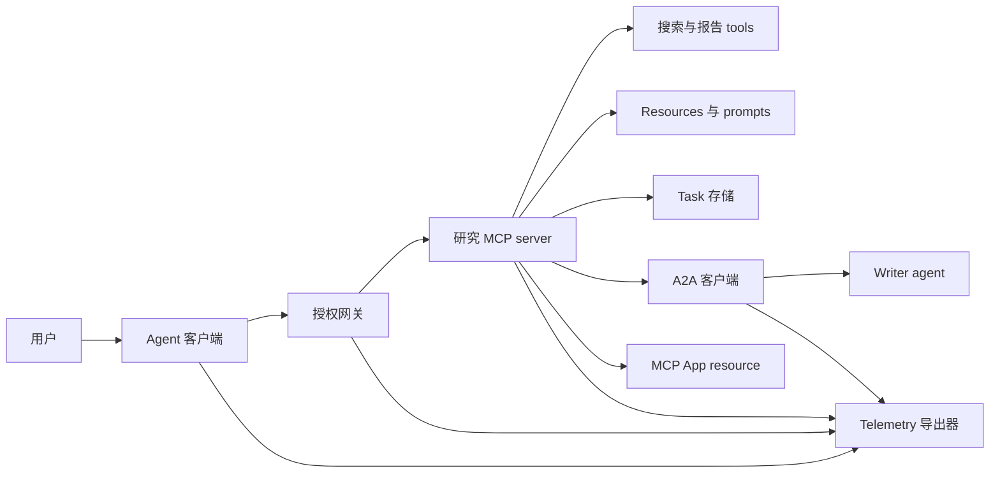
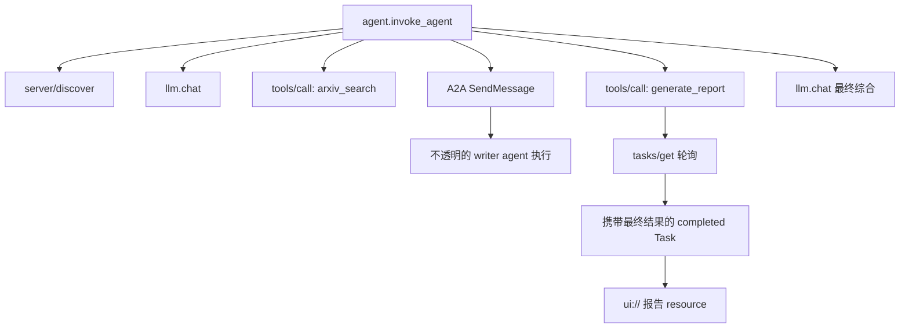
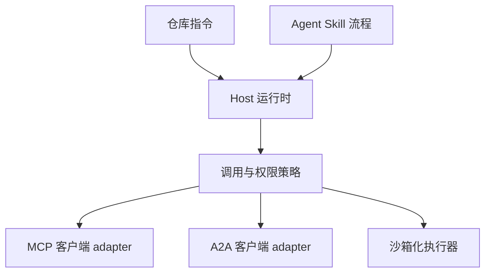

# Capstone：无状态工具生态

> 生产级 agent 系统是一组边界，而不是一堆功能。本 capstone 把可读的进程内模拟，与真实部署仍需要的协议客户端、授权服务器、沙箱和遥测导出器区分开来。

**Type:** Build
**Languages:** Python（stdlib，进程内模拟）
**Prerequisites:** 第 13 阶段，第 01 至 22 课，使用 MCP revision `2026-07-28`
**Time:** ~120 分钟

## Learning Objectives

- 把 tool 调用、task 形态的结果、委派工作、UI 资源、授权策略和 trace 记录组合进同一条流程。
- 在每个 MCP 请求中携带协议版本、客户端身份和 capabilities，而不是依赖连接会话。
- 在使用 server 之前先发现它，并通过官方 Tasks 扩展驱动长时间工作。
- 把协议形态的模拟与 MCP、A2A、OAuth 或 OpenTelemetry 实现区分开。
- 把每个模拟边界映射到必须替换它的生产组件。
- 让 `AGENTS.md`、Agent Skill、运行时 adapter、tools 和安全策略各自处于正确角色。
- 说明哪些主张可以从本地输出验证，哪些需要真实的集成测试。

## 问题场景

设计一个研究与报告系统。用户索要 agent 协议方面的论文。系统搜索论文目录、委派摘要、生成报告、返回一个 UI 资源，并记录穿过系统的路径。

这句话背后藏着若干个彼此独立的契约：

- 面向模型的 tool schema；
- 无状态请求信封和服务端发现契约；
- 针对 actor、scope 和 tool 身份的网关决策；
- 长时间运行操作的契约；
- 委派协议；
- host 到 app 的桥接；
- trace 传播与导出；
- 一套可复用的操作流程。

`code/main.py` 用普通的 Python 函数和字典让这些边界保持可见。它不打开传输、不联系 arXiv、不执行 OAuth、不调用 A2A server、不渲染 MCP App，也不导出遥测。这使得控制流易于检查，同时不会把模拟包装成合规的服务。

## 核心概念

### 目标架构



该架构是对公开协议模式的概念性组合。它并不是对任何产品内部实现的断言。

### 目标 trace



在真实实现中，每一跳都传播 trace 上下文。Span 名称和属性必须遵循所选 instrumentation 版本支持的 OpenTelemetry 语义约定。仅有共享的 trace 标识符，并不能证明父子关系、导出或后端摄取是正确的。

### 当前协议表面

使用当前协议定义的方法名，而不是凭记忆沿用早期草案的名字：

| 边界 | 当前表面 | Capstone 模拟的内容 |
|---|---|---|
| MCP 发现 | 强制的 `server/discover` | 一个直接返回版本、capabilities 和服务端身份的函数 |
| MCP 请求上下文 | 每个 `params._meta` 中的版本、capabilities 和客户端身份 | 传给每次模拟调用的全新请求元数据 |
| MCP tool 调用 | `tools/call` | 直接的 Python 函数分发 |
| MCP task 轮询 | 使用 `tasks/get` 的 `io.modelcontextprotocol/tasks` | 一个进行中的 handle，随后是一个携带最终结果的已完成 task |
| A2A 委派 | gRPC 和 JSON-RPC 中的 `SendMessage`；HTTP+JSON 中的 `POST /message:send` | 一个嵌套 span，没有远程调用或人为延迟 |
| MCP App 调用服务端 tool | `app.callServerTool({ name, arguments })` | 一个没有实时桥接的 HTML 字符串 |
| OAuth 授权 | 授权服务器、受保护资源元数据、audience 和 scope 校验 | 静态 token 查找和 scope 成员判定 |
| OpenTelemetry | SDK、propagator、exporter 以及 collector 或后端 | 内存中的 span 字典 |

协议名只是第一层。生产测试必须在真实 wire 上检验序列化、认证失败、取消、超时、重试和版本兼容性。

### 无状态 MCP 改变了集成边界

Revision `2026-07-28` 移除了协议会话以及 `initialize` / `notifications/initialized` 握手。它还移除了 `Mcp-Session-Id`。每个请求都携带这些带命名空间的 `_meta` 字段：

```json
{
  "io.modelcontextprotocol/protocolVersion": "2026-07-28",
  "io.modelcontextprotocol/clientCapabilities": {
    "extensions": {
      "io.modelcontextprotocol/tasks": {}
    }
  },
  "io.modelcontextprotocol/clientInfo": {
    "name": "capstone-client",
    "version": "1.0.0"
  }
}
```

Server 必须实现 `server/discover`。普通结果使用 `resultType: "complete"`；task handle 使用 `resultType: "task"`。每个结果都应在 `_meta.io.modelcontextprotocol/serverInfo` 中标明该 server。

Task 扩展包含 `tasks/get`、`tasks/update` 和 `tasks/cancel`。tool 可以先返回 `resultType: "task"`；`tasks/get` 本身返回 `resultType: "complete"`，而完成的 `Task` 包含最终结果。旧的 `tasks/result` 和 `tasks/list` 方法不属于当前扩展。客户端必须在可能收到 task handle 的同一个请求中声明 `io.modelcontextprotocol/tasks`。如果没有声明，server 会返回 `-32021`，其 `requiredCapabilities` 形如缺失的客户端能力对象，其中包括 `extensions.io.modelcontextprotocol/tasks`。

### 安全态势

预期部署采用纵深防御：

- 在客户端类型要求时使用带 PKCE 的 OAuth 授权；
- 对签发的访问令牌做资源和 audience 绑定；
- 网关 RBAC 检查所请求的 tool 和 scope；
- 上游凭据保存在模型可见上下文之外；
- 一份固定或经过审查的 tool-description manifest；
- 针对不可信输入、敏感数据和有后果的操作做 Rule of Two 审查；
- 执行沙箱的文件系统、进程、网络、凭据和资源限制在 skill 之外强制执行。

Demo 只实现了静态 token、scope 检查和 description 哈希。它适合演示策略流程，而不是安全验证。

### Skill 是流程，不是传输

Agent Skill 可以告诉运行时如何执行研究流程、应当预期哪些 tool 契约、保存什么证据，以及何时停止。它无法让 MCP server 存在、建立 A2A 兼容性、授予 scope，或创建沙箱。



当流程引用配套文件时，应发布完整的 skill 目录。这个较早 capstone 中的扁平工件是课程蓝图，并不证明某个 host 会保留可移植的 bundle。Lesson 24 到 27 构建并测试完整的 bundle 生命周期。

### 课程工件元数据是本地 adapter

课程 catalog 和安装器识别名为 `skill-*.md` 的扁平文件，但那是本仓库的约定，而不是可移植的 Agent Skills 包契约。它们的最小 frontmatter 解析器只读取顶层键。因此本课把可移植身份字段和课程 catalog 字段放在同一层级：

```yaml
---
name: ecosystem-blueprint
description: Produce a full Phase 13 ecosystem architecture for a product need.
version: "1.0.0"
phase: "13"
lesson: "23"
tags: [mcp, capstone, ecosystem, architecture, a2a, otel]
---
```

`name` 和 `description` 是可移植的身份字段。`version`、`phase`、`lesson` 和 `tags` 是课程特有的 catalog 扩展。课程解析器要求 `tags` 是内联列表，这样 `--tag capstone` 才能匹配到它。

可移植的目录型 skill 可以使用可选的 `metadata` map 存放字符串值的扩展数据。这并不意味着 `metadata` 与本仓库的 catalog schema 可以互换。如果这个扁平文件把 `version` 或 `tags` 嵌套在 `metadata` 之下，最小解析器会跳过这些缩进的键，catalog 记录到一个空的 version，标签过滤也就找不到该工件。生产 host 应使用安全的 YAML 解析器，并校验它自己文档化的 schema。

### 模拟与生产

| 层 | `code/main.py` | 生产替换 | 所需证据 |
|---|---|---|---|
| 发现 | `server_discover()` 加静态 `TOOLS` | `server/discover` 后接缓存感知的 `tools/list` | Wire transcript、确定性顺序和 schema 校验 |
| 认证 | 以 token 为键的字典 | OAuth 授权和资源服务器校验 | Issuer、audience、scope、过期和失败测试 |
| 授权 | Scope 成员判定 | 绑定到 actor、tool、target 和 tenant 的网关策略 | 允许与拒绝的审计用例 |
| 搜索 | 静态论文 fixture | 搜索 API 或 MCP server | 来源溯源、排序和错误测试 |
| Tasks | 本地 handle 加立即 `tasks/get` | 持久的 `io.modelcontextprotocol/tasks` 存储，具备 `tasks/get`、`tasks/update`、`tasks/cancel` 和 TTL | 状态转换、输入、取消和恢复测试 |
| 委派 | Sleep 加嵌套 span | A2A 客户端和远程 Agent Card | 契约、超时、重试和不透明性测试 |
| App | HTML 字符串和 URI | MCP Apps 资源和 `App` 桥接 | CSP、权限、tool 调用和浏览器测试 |
| 遥测 | 内存列表 | OTel SDK 和 exporter | Collector 接收和 trace 父子断言 |
| 沙箱 | 无 | Host 强制执行的隔离执行器 | 逃逸、出网、密钥和资源限制测试 |

这张表就是交接边界。本地运行变绿只验证了模拟部分。

### Phase 13 地图

| 课程 | 贡献 |
|---|---|
| 01-05 | Tool 接口、调用、schema、结构化结果和确定性校验 |
| 06-14 | 无状态 MCP 请求信封、发现、传输、资源、prompts、扩展和 Apps |
| 15-18 | 投毒防御、OAuth、网关、registry 和生产认证 |
| 19 | A2A 消息与任务委派 |
| 20 | OpenTelemetry GenAI trace 设计 |
| 21 | 模型 provider routing |
| 22 | 可移植 skill 契约与运行时边界 |

```figure
t3-capstone-chain
```

## Build It

运行进程内 harness：

```bash
cd phases/13-tools-and-protocols/23-capstone-tool-ecosystem
python3 code/main.py
```

检查五个方面：

1. `server/discover` 声明 revision `2026-07-28` 和 Tasks 扩展。
2. Alice 可以读取并生成报告，而 Bob 的写作用域调用被拒绝。
3. 一次 orchestrator 运行中的每个本地 span 共享同一个 trace 标识符，并记录父 span 标识符。
4. 报告一开始是一个 task handle。`tasks/get` 返回一个已完成的 task，其最终结果包含文本和一个 `ui://` 引用。
5. 被委派的 writer 保持不透明，因为 orchestrator 只记录边界 span。
6. 没有任何输出声称发生了网络连接、OAuth 交换、collector 导出、浏览器渲染或沙箱执行。

该脚本运行两次，因此产出两条 root trace。审计条目是进程本地的，下次运行会重置。

## Use It

一次只提升一层：

1. 把 `server_discover()` 和静态 tool 列表替换为真实的 `server/discover` 和 `tools/list` 调用。在每个请求中发送版本、身份和 capabilities。
2. 把静态 token 替换为授权服务器和受保护资源校验。
3. 实现 `io.modelcontextprotocol/tasks` 扩展，并测试 `tasks/get`、`tasks/update`、`tasks/cancel`、超时、TTL 和重启恢复。不要添加 `tasks/result` 或 `tasks/list`。
4. 把委派 stub 替换为能解析 Agent Card 并发送消息的 A2A 客户端。
5. 用官方 SDK 构建 App，并通过 `app.callServerTool` 调用服务端 tool。
6. 把 span 导出到测试 collector，并在接收端断言父子关系。
7. 在 Lesson 26 的沙箱契约中运行 tool 和脚本执行。
8. 把流程打包为完整的目录 bundle，并通过 Lesson 27 的发布门禁。

每提升一层都需要一个跨过新边界的集成测试。当 wire 变成真实的时候，不要删掉更底层的策略测试。

## Ship It

本课产出 `outputs/skill-ecosystem-blueprint.md`，一个遗留的单文件课程工件。它要求一页架构，涵盖 primitives、安全、委派、遥测、打包以及最棘手的运维风险。它的顶层 catalog 字段由仓库真实的 catalog 和安装器解析器实际检验。

因为它不是目录 bundle，所以无法携带 references、scripts、assets 或 eval fixture。在本课程之外发布可复用 skill 时，请使用 Lesson 22 以及 Lesson 24 到 27 的包格式。

## Exercises

1. 运行 `code/main.py`。把输出中已证明的事实与仍需要集成证据的生产主张区分开。
2. 添加第二个静态后端，并定义两个同名 tool 的冲突规则。然后把两个列表都替换为真实的 `tools/list` 调用。
3. 用 A2A 测试服务器替换 writer stub。记录 Agent Card、消息请求、超时路径和返回的工件。
4. 添加一个能在进程重启后存活的 task 存储。证明客户端可以用 `tasks/get` 恢复、遵守 `pollIntervalMs`，并在不使用 `tasks/result` 的情况下读取已完成 task 的最终结果。
5. 构建一个最小 MCP App，并在带严格 CSP 和显式权限的浏览器中验证 `app.callServerTool`。
6. 通过 OTel SDK 把模拟 span 导出到本地 collector。断言接收、trace 标识符、父子关系和错误状态。
7. 为仓库级维护规则编写 `AGENTS.md`，为可复用的研究流程编写一个独立的 skill bundle。解释为什么这两个文件都不授予 tool 权限。

## Key Terms

| 术语 | 人们怎么说 | 实际含义 |
|---|---|---|
| Capstone | "所有东西接在一起" | 一次分阶段集成，其模拟边界和真实边界保持明确 |
| 协议形态模拟 | "它基本就是 MCP" | 本地数据和调用看起来像某协议，但并未实现其 wire 契约 |
| Tasks 扩展 | "长时间 tool 调用" | 可选的 `io.modelcontextprotocol/tasks` 生命周期，带持久身份、轮询、客户端输入、最终结果和取消语义 |
| 不透明边界 | "另一个 agent 会处理" | 调用方只能看到声明的接口和工件，看不到私有推理或内部状态 |
| 运行时 adapter | "Skill 集成" | 把可移植流程映射到发现、调用、tools、策略和上下文的 host 代码 |
| 集成证据 | "它通过了" | 一段 transcript、工件或接收端观察，证明真实的边界被跨过 |

## Further Reading

- [MCP specification 2026-07-28](https://modelcontextprotocol.io/specification/2026-07-28)，了解无状态请求、发现、tools、授权和传输行为。
- [MCP 2026-07-28 key changes](https://modelcontextprotocol.io/specification/2026-07-28/changelog)，了解会话移除、每请求元数据、MRTR、扩展和弃用。
- [MCP Tasks extension](https://tasks.extensions.modelcontextprotocol.io/specification/draft/tasks)，了解 `tasks/get`、`tasks/update`、`tasks/cancel` 以及由终态 task 携带的最终结果。
- [MCP Apps SDK](https://github.com/modelcontextprotocol/ext-apps/blob/main/docs/overview.md)，了解 `App` 和 `app.callServerTool`。
- [A2A protocol](https://a2a-protocol.org/latest/)，了解 Agent Cards、消息投递、task、artifact 和传输绑定。
- [OpenTelemetry GenAI semantic conventions](https://opentelemetry.io/docs/specs/semconv/gen-ai/)，了解 trace 和属性约定。
- [Agent Skills specification](https://agentskills.io/specification)，了解流程层使用的可移植包契约。
