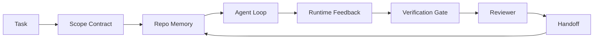

# 智能体工作台工程：为什么有能力的模型仍然会失败

> 一个有能力的模型还不够。可靠的智能体需要一个工作台：instructions、state、scope、feedback、verification、review 和 handoff。把这些剥掉，即使是最前沿的模型产出的成果也不安全、不能交付。

**Type:** Learn + Build
**Languages:** Python (stdlib)
**Prerequisites:** Phase 14 · 01 (Agent Loop), Phase 14 · 26 (Failure Modes)
**Time:** ~45 minutes

## 学习目标

- 把模型能力与执行可靠性区分开。
- 说出决定一个智能体能否交付的七个工作台面。
- 在一个小仓库任务上，对比纯提示词运行与工作台引导的运行。
- 产出一份失败模式报告，把每个缺失的面映射到它所造成的症状。

## 问题

你把一个前沿模型丢进一个真实仓库，让它加输入验证。它打开了四个文件，写了看起来合理的代码，宣布成功，然后停下。你运行测试。两个失败。第三个被改动的文件跟验证毫无关系。没有任何记录说明智能体假定了什么、它先试了什么、还剩下什么要做。

模型对 Python 没有错。它对工作错了。它不知道什么算完成、它被允许在哪里写、哪些测试是权威的、下一次会话该怎么接手。

这不是模型缺陷。这是工作台缺陷。智能体周围的表层缺少了把一次性生成变成可靠、可恢复工程的那些部件。

## 概念

工作台是任务期间包裹模型的运行环境。它有七个面：

| 面 | 它承载什么 | 缺失时的失败 |
|---------|-----------------|----------------------|
| Instructions | 启动规则、被禁止的动作、完成的定义 | 智能体猜测「交付」是什么意思 |
| State | 当前任务、已改动的文件、阻塞项、下一步动作 | 每次会话都从零重新开始 |
| Scope | 允许的文件、禁止的文件、验收标准 | 编辑泄漏到无关代码 |
| Feedback | 把真实命令输出捕获进循环 | 智能体在 400 上宣布成功 |
| Verification | 测试、lint、冒烟运行、scope 检查 | 「看起来不错」直达 main |
| Review | 用不同角色的第二遍检查 | 构建者给自己的作业打分 |
| Handoff | 改了什么、为什么、还剩下什么 | 下一次会话重新发现一切 |

工作台独立于模型。你可以换掉模型而保留这些面。你无法换掉这些面而保留可靠性。



这个循环闭合在状态文件上，而不是聊天历史上。聊天是易失的。仓库是记录的系统（system of record）。

### 工作台 vs 提示词工程

提示词告诉模型这一轮你想要什么。工作台告诉模型如何跨轮次、跨会话地做工作。大多数智能体失败的故事，都是穿着提示词工程外衣的工作台失败。

### 工作台 vs 框架

框架给你一个运行时（LangGraph、AutoGen、Agents SDK）。工作台给智能体一个在这个运行时内部工作的地方。你两者都需要。这个迷你轨道讲的是第二个。

### 从原语推理，而不是从厂商分类法推理

现在有很多关于「harness engineering」的文字。Addy Osmani、OpenAI、Anthropic、LangChain、Martin Fowler、MongoDB、HumanLayer、Augment Code、Thoughtworks、walkinglabs 的 awesome list，以及源源不断的 Medium 和 Hacker News 文章都在讲它。它们对 harness 的边界是什么、什么在范围内、该用哪套词汇，意见不一。我们不必选边站。这七个面是一个 UX 层；在每一个工作台底下，都是支撑任何可靠后端的那同一套分布式系统原语。

先把「智能体」这个标签剥掉一会儿。一次智能体运行是跨越时间、进程和机器的计算。要让它可靠，你需要任何生产系统都需要的同一套原语。

| 原语 | 它是什么 | 它对智能体承载什么 |
|-----------|------------|------------------------------|
| Function | 类型化的处理器。尽可能纯。拥有自己的输入和输出。 | 一次工具调用、一次规则检查、一个验证步骤、一次模型调用 |
| Worker | 拥有一个或多个函数和一个生命周期的长时进程 | 构建者、审查者、验证者、一个 MCP server |
| Trigger | 调用函数的事件源 | 智能体循环 tick、HTTP 请求、队列消息、cron、文件变更、hook |
| Runtime | 决定什么在哪里运行、带什么超时和资源的边界 | Claude Code 的进程、LangGraph 的 runtime、一个 worker 容器 |
| HTTP / RPC | 调用方与 worker 之间的连线 | 工具调用协议、MCP 请求、模型 API |
| Queue | 触发器与 worker 之间的持久缓冲；背压、重试、幂等 | 任务板、反馈日志、审查收件箱 |
| Session persistence | 在崩溃、重启、换模型后仍存活的状态 | `agent_state.json`、checkpoints、KV 存储、仓库本身 |
| Authorization policy | 谁能以什么 scope 调用什么函数 | 允许/禁止的文件、审批边界、MCP 能力列表 |

现在把七个工作台面映射到这些原语上。

- **Instructions**——策略 + 函数元数据。规则是检查（函数）。路由器（`AGENTS.md`）是挂在运行时启动上的策略。
- **State**——session persistence。一个运行时每一步都读取的带键存储。文件、KV 或 DB 都行；持久化语义重要，存储后端不重要。
- **Scope**——每个任务的 authorization policy。允许/禁止的 glob 是一个 ACL。要求的审批是一个权限格。
- **Feedback**——写进队列的调用日志。每一次 shell 调用都是一条记录，持久、可重放。
- **Verification**——一个函数。对输入确定。在任务关闭时触发。失败即关闭（fails closed）。
- **Review**——一个单独的 worker，对构建产物有只读 authz，对审查报告有只写 authz。
- **Handoff**——由会话结束触发器发出的持久记录。下一次会话的启动触发器读取它。

智能体循环本身是一个 worker，它消费事件（用户消息、工具结果、计时器 tick），调用函数（模型，然后是模型选择的工具），写记录（state、feedback），并发出触发器（verify、review、handoff）。没有神秘之处；与作业处理器的形态相同。

### 流传中的模式，翻译成原语

每一种流行的 harness 模式都可以归约为这八个原语。翻译表。

| 厂商或社区模式 | 它实际是什么 |
|------------------------------|--------------------|
| Ralph Loop（Claude Code、Codex、agentic_harness 一书）——当智能体试图过早停止时，把原始意图重新注入一个全新的上下文窗口 | 一个触发器，用干净的上下文重新入队一个任务；session persistence 把目标带向前 |
| Plan / Execute / Verify（PEV） | 三个 worker，每个角色一个，通过 state 和阶段之间的 queue 通信 |
| Harness-compute separation（OpenAI Agents SDK，2026 年 4 月）——把控制面与执行面分开 | 重述 control-plane / data-plane。比「智能体」这个标签早了几十年 |
| Open Agent Passport（OAP，2026 年 3 月）——在执行前，对每一次工具调用按声明式策略签名并审计 | 由预动作 worker 强制执行的 authorization policy，带签名审计队列 |
| Guides and Sensors（Birgitta Böckeler / Thoughtworks）——前馈规则 + 反馈可观测性 | Authorization policy + 验证函数 + 可观测性 trace |
| Progressive compaction，5 阶段（Claude Code 逆向工程，2026 年 4 月） | 一个 state-management worker，以类 cron 方式跑在 session persistence 上，把它控制在预算内 |
| Hooks / middleware（LangChain、Claude Code）——拦截模型和工具调用 | 包裹在运行时调用路径上的触发器 + 函数 |
| Skills as Markdown with progressive disclosure（Anthropic、Flue） | 一个函数注册表，函数元数据在需要时才加载进上下文 |
| Sandbox agents（Codex、Sandcastle、Vercel Sandbox） | 计算面：一个带隔离文件系统、网络和生命周期的运行时 |
| MCP servers | 通过稳定 RPC 暴露函数的 worker，用能力列表作为授权 |

表里的每一条，都是智能体社区抵达了一个在分布式系统中早有名字的原语，然后给它起了个新名字。对营销有用的标签；作为工程词汇没用。

### 收据到底说了什么

「harness 胜过模型」这一主张现在有数字支撑了。值得了解，因为它们也是反对「只要等一个更聪明的模型就行」的唯一诚实论据。

- Terminal Bench 2.0——同样的模型，仅改动 harness，就把一个编码智能体从 30 名开外推到第 5 名（LangChain，《Anatomy of an Agent Harness》）。
- Vercel——删掉了其智能体 80% 的工具；成功率从 80% 跳到 100%（MongoDB）。
- Harvey——法律智能体仅通过 harness 优化就把准确率提升了一倍多（MongoDB）。
- 88% 的企业 AI 智能体项目未能进入生产。失败集中在运行时，而非推理（preprints.org，《Harness Engineering for Language Agents》，2026 年 3 月）。
- 一项 2025 年横跨三个流行开源框架的 benchmark 研究报告了约 50% 的任务完成率；长上下文的 WebAgent 在长上下文条件下从 40-50% 跌到 10% 以下，主要因为死循环和目标丢失（在 2026 年初的大量文章中被广泛报道）。

要点不是「harness 永远赢」。模型确实会随时间吸收 harness 技巧。要点是，今天，承重的工程在模型周围，而不是在模型内部，而承载这份重量的原语，是每个生产系统一直都需要的那一套。

### 厂商文章在哪里止步

这是你不必客气的部分。

- LangChain 的《Anatomy of an Agent Harness》枚举了十一个组件——prompts、tools、hooks、sandboxes、orchestration、memory、skills、subagents，以及一个运行时「dumb loop」。它没有说出 queues、作为部署单元的 worker、trigger 语义、作为独立关注点的 session persistence，或 authorization policy。它把 harness 当作一个你去配置的对象，而不是一个你去部署的系统。
- Addy Osmani 的《Agent Harness Engineering》落定了框架 `Agent = Model + Harness` 和 ratchet 模式，但在说清 harness 由什么构成之前就止步了。读起来像是一种姿态，而不是一份规格。
- Anthropic 和 OpenAI 在这些面上讲得最深，但停留在各自的运行时内部。2026 年 4 月 Agents SDK 中「harness-compute separation」的公告，是第一份明确认可 control-plane / data-plane 拆分的厂商文字。那是一个原语思想，不是新的。
- agentic_harness 一书把 harness 当作一个配置对象（Jaymin West 的《Agentic Engineering》，第 6 章），其中最强的一句是「harness 是智能体系统中的首要安全边界」。那只是 authorization policy 的重述。
- Hacker News 的帖子不断抵达同一个地方。2026 年 4 月的帖子《The agent harness belongs outside the sandbox》主张 harness 应该「更像一个 hypervisor，坐在一切之外，根据上下文和用户来授权访问」。那还是 authorization policy 作为一个独立的面。

你不需要反对任何一篇就能注意到这个缺口。它们是在为一个已经存在的系统写 UX 描述。我们在写那个系统。当系统被正确地构建出来，这七个面就从原语中自然浮现。当它被错误地构建出来，再多的 `AGENTS.md` 打磨也补不上缺失的 queue。

所以当你在别处听到「harness engineering」时，翻译成原语。提示词和规则是策略和函数。脚手架是 runtime。Guardrails 是授权 + 验证。Hooks 是触发器。Memory 是 session persistence。Ralph Loop 是重新入队。Subagents 是 worker。Sandboxes 是计算面。词汇在变；工程不变。工作台是面向智能体的 UX；harness——在能熬过下一次厂商重新定调的那个意义上——是被正确接线起来的函数、worker、触发器、运行时、队列、持久化和策略。

```figure
wb-seven-surfaces
```

## Build It

`code/main.py` 把一个小仓库任务跑两遍。第一遍纯提示词，第二遍接入七个面。同样的模型、同样的任务。脚本统计失败运行中缺失了哪些面，并打印一份失败模式报告。

仓库任务故意设得很小：给一个单文件的 FastAPI 风格 handler 加输入验证，并写一个通过的测试。

运行它：

```
python3 code/main.py
```

输出：两次运行并排的日志、一个总结纯提示词运行的 `failure_modes.json`，以及针对工作台运行的一句裁决。

智能体是一个极小的基于规则的桩；重点在于这些面，而不是模型。在本迷你轨道的其余部分，你会把每个面都重建为一个真实、可复用的工件。

## Use It

工作台面在野外已经存在于三个地方，即便没人这么叫它们：

- **Claude Code、Codex、Cursor。** `AGENTS.md` 和 `CLAUDE.md` 是 instructions 面。斜杠命令是 scope。Hooks 是 verification。
- **LangGraph、OpenAI Agents SDK。** Checkpoints 和 session stores 是 state 面。Handoffs 是 handoff 面。
- **真实仓库上的 CI。** 测试、lint 和类型检查是 verification。PR 模板是 handoff。CODEOWNERS 是 review。

工作台工程是让这些面显式化、可复用的纪律，而不是让每个团队各自重新发现它们。

## Ship It

`outputs/skill-workbench-audit.md` 是一个可移植的 skill，它审计一个现有仓库的七个工作台面，并报告哪些缺失、哪些部分缺失、哪些健康。把它放到任何智能体设置旁边；它会告诉你先修什么。

## 练习

1. 挑一个你已经在运行智能体的仓库。给七个面从 0（缺失）到 2（健康）打分。你最弱的面是什么？
2. 扩展 `main.py`，让纯提示词运行也产出一个假的「成功」声明。验证验证门会抓住它。
3. 为你自己的产品加第八个面。论证它为什么不会坍缩进现有七个之一。
4. 用一个会幻觉出一次额外文件写入的不同桩智能体重新运行脚本。哪个面最先抓住它？
5. 把 Phase 14 · 26 的五种业界反复出现的失败模式映射到七个面上。每个面被设计来吸收哪种模式？

## 关键术语

| 术语 | 人们怎么说 | 它实际是什么意思 |
|------|----------------|------------------------|
| Workbench | 「这套设置」 | 围绕模型的、让工作可靠的工程化表层 |
| Surface | 「一份文档」或「一个脚本」 | 智能体每一轮都读取或写入的、具名、机器可读的输入 |
| System of record | 「那些笔记」 | 聊天历史消失后，智能体当作真相的文件 |
| Definition of done | 「验收」 | 智能体无法伪造的、客观的、由文件支撑的检查清单 |
| Workbench audit | 「仓库就绪检查」 | 在工作开始前，过一遍七个面、标出缺失部件 |

## 延伸阅读

把这些当作数据点来读，而不是当作权威。每一篇都是一个不完整的分类法。在决定采纳任何概念之前，把它翻译回一个原语（function、worker、trigger、runtime、HTTP/RPC、queue、persistence、policy）。

厂商框架：

- [Addy Osmani，Agent Harness Engineering](https://addyosmani.com/blog/agent-harness-engineering/)——`Agent = Model + Harness` 和 ratchet 模式；基础设施方面很单薄
- [LangChain，The Anatomy of an Agent Harness](https://blog.langchain.com/the-anatomy-of-an-agent-harness/)——十一个组件：prompts、tools、hooks、orchestration、sandboxes、memory、skills、subagents、runtime；遗漏了 queues、deployment、authz
- [OpenAI，Harness engineering: leveraging Codex in an agent-first world](https://openai.com/index/harness-engineering/)——Codex 团队对其运行时周围各面的看法
- [OpenAI，Unrolling the Codex agent loop](https://openai.com/index/unrolling-the-codex-agent-loop/)——把智能体循环归约成对函数调用的一个 `while`
- [Anthropic，Effective harnesses for long-running agents](https://www.anthropic.com/engineering/effective-harnesses-for-long-running-agents)——特定运行时内部的长时程各面
- [Anthropic，Harness design for long-running application development](https://www.anthropic.com/engineering/harness-design-long-running-apps)——应用设计笔记
- [LangChain Deep Agents harness capabilities](https://docs.langchain.com/oss/python/deepagents/harness)——运行时配置面

带可用细节的实践者文章：

- [Martin Fowler / Birgitta Böckeler，Harness engineering for coding agent users](https://martinfowler.com/articles/harness-engineering.html)——guides（前馈）+ sensors（反馈）；最干净的控制论框架
- [HumanLayer，Skill Issue: Harness Engineering for Coding Agents](https://www.humanlayer.dev/blog/skill-issue-harness-engineering-for-coding-agents)——「这不是模型问题，而是配置问题」
- [MongoDB，The Agent Harness: Why the LLM Is the Smallest Part of Your Agent System](https://www.mongodb.com/company/blog/technical/agent-harness-why-llm-is-smallest-part-of-your-agent-system)——收据：Vercel 80% 到 100%、Harvey 2 倍准确率、Terminal Bench 从 30 名开外到前 5
- [Augment Code，Harness Engineering for AI Coding Agents](https://www.augmentcode.com/guides/harness-engineering-ai-coding-agents)——约束优先的走查
- [Sequoia podcast，Harrison Chase on Context Engineering Long-Horizon Agents](https://sequoiacap.com/podcast/context-engineering-our-way-to-long-horizon-agents-langchains-harrison-chase/)——运行时关注点高于模型关注点

书籍、论文和参考实现：

- [Jaymin West，Agentic Engineering — Chapter 6: Harnesses](https://www.jayminwest.com/agentic-engineering-book/6-harnesses)——全书长度的处理，把 harness 当作首要安全边界
- [preprints.org，Harness Engineering for Language Agents（2026 年 3 月）](https://www.preprints.org/manuscript/202603.1756)——作为 control / agency / runtime 的学术框架
- [walkinglabs/awesome-harness-engineering](https://github.com/walkinglabs/awesome-harness-engineering)——横跨 context、evaluation、observability、orchestration 的精选阅读清单
- [ai-boost/awesome-harness-engineering](https://github.com/ai-boost/awesome-harness-engineering)——另一份精选清单（tools、evals、memory、MCP、permissions）
- [HKUDS/OpenHarness](https://github.com/HKUDS/OpenHarness)——带内置个人智能体的开源 agent harness

值得为分歧而非共识去读的 Hacker News 帖子：

- [HN: Effective harnesses for long-running agents](https://news.ycombinator.com/item?id=46081704)
- [HN: Improving 15 LLMs at Coding in One Afternoon. Only the Harness Changed](https://news.ycombinator.com/item?id=46988596)
- [HN: The agent harness belongs outside the sandbox](https://news.ycombinator.com/item?id=47990675)——主张授权作为一个独立的面

本课程内部的交叉引用：

- Phase 14 · 23——OpenTelemetry GenAI conventions：sensors 文献所指的可观测性层
- Phase 14 · 26——七个面被设计来吸收的失败模式目录
- Phase 14 · 27——位于 authorization-policy 原语上的 prompt injection 防御
- Phase 14 · 29——生产运行时（queue、event、cron）：本课的原语在部署中的所在
