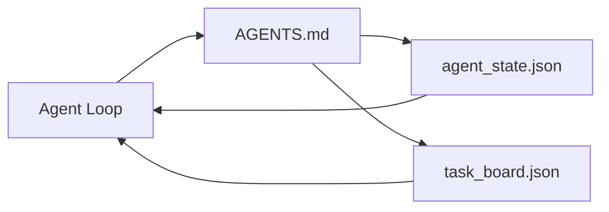

# 最小智能体工作台

> 最小的可用工作台是三个文件：一个根 instructions 路由器、一个状态文件、一个任务板。其余一切都叠在其上。如果一个仓库承载不了这三个，没有模型能救它。

**Type:** Build
**Languages:** Python (stdlib)
**Prerequisites:** Phase 14 · 31 (Why Capable Models Still Fail)
**Time:** ~45 minutes

## 学习目标

- 定义构成最小可行工作台的三个文件。
- 解释为什么一个简短的根路由器胜过一份冗长的、巨石式的 `AGENTS.md`。
- 构建一个智能体每一轮都能读、结束时能写的状态文件。
- 构建一个能在没有聊天历史的情况下跨多会话存活的任务板。

## 问题

大多数团队伸手去拿工作台的方式，是写一份 3000 行的 `AGENTS.md`，然后宣布大功告成。模型加载它，忽略掉自己无法概括的部分，然后在它一直失败的那些面上继续失败。

你需要的是反过来的东西。一个极小的根文件，只在相关内容出现时才把智能体路由进更深层的文件。持久的 state，智能体在行动前读取、行动后写入。一个任务板，说明什么在进行中、什么被阻塞、什么排下一个。

三个文件。每个都有一份职责。每个都足够机器可读，以便日后演化成一个真实系统。

## 概念



### AGENTS.md 是路由器，不是手册

一份好的 `AGENTS.md` 很短。它把智能体指向：

- 状态文件（你在哪里）。
- 任务板（还剩下什么）。
- 更深层的规则（在 `docs/agent-rules.md` 下）。
- 验证命令（如何知道它可用）。

任何更长的东西都放进更深的文档里，只在需要时加载。长手册被忽略。短路由器被遵循。

### agent_state.json 是记录的系统

状态承载：当前任务 id、已改动的文件、已做出的假设、阻塞项，以及下一步动作。智能体每一轮都读它。下一次会话读它，而不是重放聊天。

状态放在文件里，因为聊天历史不可靠。会话会死。对话会被裁剪。文件不会。

### task_board.json 是队列

任务板承载每一个任务，状态为 `todo | in_progress | done | blocked`。它是 state 为空时智能体从中拉取的队列，也是你想知道智能体是否在正轨上时去读的队列。

板上的一个任务有一个 id、一个目标、一个 owner（`builder`、`reviewer` 或 `human`），以及验收标准。板故意做得很小：当它长过一屏，你有的是规划问题，而不是板的问题。

### 三个文件是下限，不是上限

后面的课会加 scope contracts、feedback runners、verification gates、reviewer checklists 和 handoff packets。这里的三个文件是它们全都假定的前提。

```figure
wb-three-files
```

## Build It

`code/main.py` 把最小工作台写进一个空仓库，并演示单次智能体轮次，它：

1. 读取 `agent_state.json`。
2. 如果 state 为空，就从 `task_board.json` 拉取下一个任务。
3. 在 scope 内改动单个文件。
4. 写回更新后的 state。

运行它：

```
python3 code/main.py
```

脚本在其旁边创建 `workdir/`，铺下这三个文件，跑一个轮次，并打印 diff。重新运行它，看第二次轮次如何从第一次停下的地方接手。

## Use It

在生产智能体产品内部，同样的三个文件以不同的名字出现：

- **Claude Code：** 用 `AGENTS.md` 或 `CLAUDE.md` 作路由器，用 `.claude/state.json` 风格的存储作 state，用 hooks 作板。
- **Codex / Cursor：** 用 workspace rules 作路由器，用 session memory 作 state，用聊天侧栏里的排队任务作板。
- **自定义 Python 智能体：** 就是你刚刚写的那些文件。

名字在变。形态不变。

## 现实中的生产模式

当三个模式被叠上去时，最小工作台能经受住真实 monorepo 的考验。它们是相互独立的；只挑你的仓库真正需要的那些。

**带「就近优先」优先级的嵌套 `AGENTS.md`。** OpenAI 在其主仓库中发布了 88 份 `AGENTS.md` 文件，每个子组件一份。Codex、Cursor、Claude Code 和 Copilot 都从工作文件向仓库根目录回溯，并把沿路发现的每一份 `AGENTS.md` 拼接起来。子目录文件扩展根文件。Codex 增加了 `AGENTS.override.md` 来替换而非扩展；这个 override 机制是 Codex 特有的，做跨工具工作时避免它。Augment Code 的测量才是关键的那句：最好的 `AGENTS.md` 文件带来的质量跃升，相当于从 Haiku 升级到 Opus；最差的那一批让输出比完全没有文件还糟。

**即便看起来像「有覆盖」也要拒绝的反模式。** 相互冲突的指令会悄悄把智能体从交互模式掉到贪心模式（ICLR 2026 AMBIG-SWE：48.8% → 28% 的解决率）；给优先级编号，而不是平铺堆叠它们。不可验证的风格规则（「遵循 Google Python Style Guide」）没有强制执行的命令，会让智能体凭空捏造合规；给每一条风格规则配上确切的 lint 命令。把风格排在命令前面会埋掉验证路径；命令在前，风格在后。为人类而非智能体写作会浪费上下文预算；简洁是一种特性。

**跨工具符号链接。** 一个带符号链接的根文件（`ln -s AGENTS.md CLAUDE.md`、`ln -s AGENTS.md .github/copilot-instructions.md`、`ln -s AGENTS.md .cursorrules`）让每个编码智能体都保持在同一个真相源上。Nx 的 `nx ai-setup` 从一份配置出发，在 Claude Code、Cursor、Copilot、Gemini、Codex 和 OpenCode 之间自动化这一过程。

## Ship It

`outputs/skill-minimal-workbench.md` 为任何新仓库生成三文件工作台：一份针对该项目调优过的 `AGENTS.md` 路由器、一个带正确键的 `agent_state.json`，以及一个用当前 backlog 播种的 `task_board.json`。

## 练习

1. 给 `agent_state.json` 加一个 `last_run` 时间戳。除非有操作员确认，否则当文件超过 24 小时就拒绝运行。
2. 给任务板加一个 `priority` 字段，并改拉取器让它始终拉最高优先级的 `todo`。
3. 把 `task_board.json` 迁移到 JSON Lines，让每个任务一行，使版本控制中的 diff 干净。
4. 写一个 `lint_workbench.py`，当 `AGENTS.md` 超过 80 行或引用了一个不存在的文件时就失败。
5. 判定这三个文件里失去哪一个最痛。为它辩护。

## 关键术语

| 术语 | 人们怎么说 | 它实际是什么意思 |
|------|----------------|------------------------|
| Router | `AGENTS.md` | 把智能体指向更深层文档和文件的简短根文件 |
| State file | 「那些笔记」 | 机器可读的、记录智能体位置的记录，每一轮都写 |
| Task board | 「backlog」 | 带状态、owner、验收的 JSON 工作队列 |
| System of record | 「真相源」 | 聊天消失后工作台视为权威的文件 |

## 延伸阅读

- [agents.md — the open spec](https://agents.md/)——被 Cursor、Codex、Claude Code、Copilot、Gemini、OpenCode 采用
- [Augment Code，A good AGENTS.md is a model upgrade. A bad one is worse than no docs at all](https://www.augmentcode.com/blog/how-to-write-good-agents-dot-md-files)——被测量的质量跃升
- [Blake Crosley，AGENTS.md Patterns: What Actually Changes Agent Behavior](https://blakecrosley.com/blog/agents-md-patterns)——经验上什么有效、什么无效
- [Datadog Frontend，Steering AI Agents in Monorepos with AGENTS.md](https://dev.to/datadog-frontend-dev/steering-ai-agents-in-monorepos-with-agentsmd-13g0)——实践中的嵌套优先级
- [Nx Blog，Teach Your AI Agent How to Work in a Monorepo](https://nx.dev/blog/nx-ai-agent-skills)——跨六个工具的单源生成
- [The Prompt Shelf，AGENTS.md Best Practices: Structure, Scope, and Real Examples](https://thepromptshelf.dev/blog/agents-md-best-practices/)——能熬过审查的章节排序
- [Anthropic，Claude Code subagents](https://code.claude.com/docs/en/sub-agents)
- Phase 14 · 31——这个最小值所吸收的失败模式
- Phase 14 · 34——本课所预告的持久 state schema