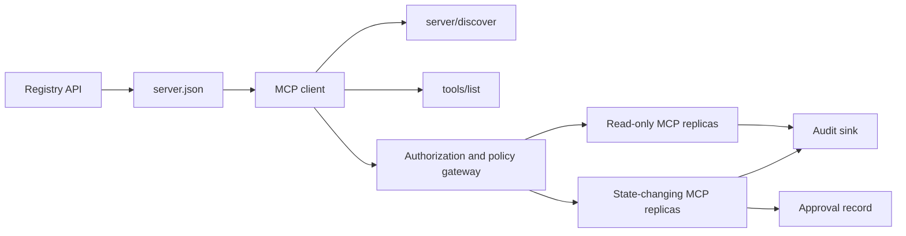

# Capstone 13：带注册表与治理的无状态 MCP Server

> 生产级 MCP 不是一个 server 进程。它是一条契约链：可发布的元数据、实时发现、无状态请求信封、授权、策略、审计，以及部署证据。

**Type:** Capstone
**Languages:** Python 与 TypeScript 参考实现；以及任何生产语言
**Prerequisites:** 第 11 阶段、第 13 阶段、第 14 阶段、第 17 阶段与第 18 阶段
**必读 MCP 深入课程：** [第 28 课：工具契约](../../../13-tools-and-protocols/28-mcp-tool-contracts-and-content/docs/en.md)、[第 29 课：可靠性](../../../13-tools-and-protocols/29-mcp-reliability-cancellation-and-flow-control/docs/en.md)、[第 30 课：注册表供应链](../../../13-tools-and-protocols/30-mcp-registry-supply-chain-and-drift/docs/en.md)，以及 [第 31 课：一致性运维](../../../13-tools-and-protocols/31-mcp-conformance-versioning-and-operations/docs/en.md)
**Protocol target:** MCP `2026-07-28`
**Time:** ~25 小时

## Learning Objectives

- 实现无状态的 MCP 请求与结果信封。
- 把 Registry 元数据与实时协议发现分开维护。
- 构建确定性的、缓存感知的工具发现。
- 为每一次工具调用强制执行 issuer、audience、scope 与审批策略。
- 在无会话亲和性的前提下部署 Streamable HTTP。
- 在线路、授权、策略、注册表与审计各边界上证明行为。

## 必读的 MCP 前置路径

在把这个 capstone 视为生产就绪之前，请按顺序完成四节已链接的第 13 阶段课程：

1. [第 28 课](../../../13-tools-and-protocols/28-mcp-tool-contracts-and-content/docs/en.md) 定义了这台 server 必须暴露的工具、schema、内容、分页、完成、路由与错误契约。
2. [第 29 课](../../../13-tools-and-protocols/29-mcp-reliability-cancellation-and-flow-control/docs/en.md) 定义了取消竞态、deadline、幂等、背压、重试与重连行为。
3. [第 30 课](../../../13-tools-and-protocols/30-mcp-registry-supply-chain-and-drift/docs/en.md) 定义了命名空间、来源追踪、准入 pin、Registry 状态、漂移、账本与回滚证据。
4. [第 31 课](../../../13-tools-and-protocols/31-mcp-conformance-versioning-and-operations/docs/en.md) 定义了黄金与负向 transcript、严格的版本纪元、SDK 差分检查、代理证据、脱敏、健康检查与发布门禁。

这个 capstone 要把这些产物整合起来。它不会用一个 happy-path SDK 测试去替代它们。

## 问题场景

一个内部平台需要只读数据工具，以及少量会改变状态的工具。开发者必须能够发现这台 server、理解如何连接、查看它的实时能力，并且只调用自己被授权使用的操作。

难点不在于注册一个函数。难点在于让六种不同的真相保持对齐：

1. `server.json` 说明这台 server 可以在哪里安装或从哪里访问。
2. `server/discover` 说明当前活跃进程此刻支持什么。
3. 每个请求都说明自己使用哪个协议修订版本与哪些客户端能力。
4. 授权把调用方绑定到正确的 issuer、resource 与 scopes。
5. 策略决定这个具体动作是否允许执行。
6. 审计证据记录越过边界的内容，同时不泄露 secret 或敏感 payload。

只要其中任何一项发生漂移，平台就可能列出无法访问的 server、把不兼容的客户端路由过去、接受为另一个 resource 签发的 token，或者在缺少应有评审的情况下暴露破坏性操作。

## 两层发现

Registry 与活跃的 MCP server 回答的是不同的问题。

| 层 | 契约 | 它回答的问题 |
|---|---|---|
| 发布 | `server.json` 与 Registry API | 这台 server 是什么、它的 package 或远端 endpoint 在哪里、如何配置？ |
| 运行时 | `server/discover` | 这个进程支持哪些协议版本、能力、扩展，以及 server 身份？ |

官方 Registry 使用带版本的 `server.json` schema。一个 remote 条目可以指定一个 Streamable HTTP URL：

```json
{
  "$schema": "https://static.modelcontextprotocol.io/schemas/2025-12-11/server.schema.json",
  "name": "com.example/internal-readonly",
  "title": "Internal Read-Only Tools",
  "description": "Read-only incident and data lookup tools.",
  "version": "1.0.0",
  "remotes": [
    {
      "type": "streamable-http",
      "url": "https://mcp.internal.example.com/readonly"
    }
  ]
}
```

Registry schema 版本与 MCP 协议修订版本是相互独立的。不要改写其中一个日期去迁就另一个。每个文档都要按它自己的契约来校验。

schema 合法并不能证明命名空间归属。一个通过 `example.com` 验证的发布者使用反向 DNS 命名空间 `com.example/*` 或它的某个子命名空间。Registry 的认证流程证明这种归属。把域名标签保持常规顺序会指向另一个命名空间。

标准库参考实现中的 `validate_registry_document` 函数刻意只是一个部分 remote-profile 校验器。它检查官方要求的 `name`、`description` 与 `version` 字段；可选的 `title`；已发布的名称与长度约束；具体版本形状；以及每个 `streamable-http` 或 `sse` remote 的 HTTP(S) URL 形状。它还额外要求 `remotes` 列表非空，因为这个 capstone 总是要对 remote 做实时探测。`validate_publisher_namespace` 单独负责把名称与该发布者已验证的域做核对，而 `validate_runtime_alignment` 则把发布名称与版本和活跃的 `serverInfo` 做比较。官方 schema 还支持仅 package 的记录和更多 remote 字段。在发布之前，请用固定版本的官方 JSON Schema 或 `mcp-publisher` 校验完整文档；不要把这个零依赖子集当成完整的 schema 校验。

server 必须实现 `server/discover`；客户端可以在调用其他方法之前先调用它。这个 capstone 的客户端在解析出 endpoint 之后就这么做，并接收当前的协议修订版本与实时能力：

```json
{
  "resultType": "complete",
  "supportedVersions": ["2026-07-28"],
  "capabilities": {
    "tools": {
      "listChanged": false
    }
  },
  "_meta": {
    "io.modelcontextprotocol/serverInfo": {
      "name": "com.example/internal-readonly",
      "version": "1.0.0"
    }
  },
  "ttlMs": 3600000,
  "cacheScope": "public"
}
```

私有 catalog 可以索引额外的归属、评审或生命周期数据，但不能把这些数据编造成 MCP 线路字段或 `server.json` 的根字段。把组织策略存放在已发布记录的旁边。当确实需要公开的自定义元数据时，使用 Registry 的 `_meta.io.modelcontextprotocol.registry/publisher-provided` 扩展，并保持在其 4 KB 限制之内。

## 无状态 MCP 核心

MCP 修订版本 `2026-07-28` 取消了协议会话以及 `initialize` / `notifications/initialized` 握手。它也取消了 `Mcp-Session-Id`。

每个请求都在 `params._meta` 中携带协议上下文：

```json
{
  "io.modelcontextprotocol/protocolVersion": "2026-07-28",
  "io.modelcontextprotocol/clientCapabilities": {},
  "io.modelcontextprotocol/clientInfo": {
    "name": "internal-platform-client",
    "version": "1.0.0"
  }
}
```

版本与能力是请求本身的事实，而不是连接的事实。负载均衡器可以把连续请求发到不同的健康副本，因为任一副本都能从消息本身校验这个请求。

普通结果包含 `resultType: "complete"`。server 应在每个结果的 `_meta.io.modelcontextprotocol/serverInfo` 中放入自己的身份。缺失或非字符串的协议版本属于 invalid params `-32602`。错误 `-32022` 只用于“提供了字符串但不被支持”的情况，其 data 恰为 `{"supported": ["2026-07-28"], "requested": "..."}`。

### 可缓存的发现

对同一组有效工具，`tools/list` 必须是确定性的。结果包含：

- `ttlMs`，给客户端的新鲜度提示；
- `cacheScope`，取值为 `public` 或 `private`；
- 稳定的工具顺序，使完全相同的列表可以复用 prompt 缓存；
- `resultType: "complete"` 与 server 身份元数据。

按用户授权通常应产生 `cacheScope: "private"`。不要把用户特定的工具可见性放在共享的公共缓存后面。

## Streamable HTTP

一个网络 server 暴露一个接受 POST 的 MCP endpoint。每个 JSON-RPC 请求或通知各自占一个 POST。

对一个请求，server 要么返回一个 JSON 对象，要么返回一条限定在该请求范围内的 SSE 流。一个长生命周期的 `subscriptions/listen` 请求承载已选择加入的变更通知。当前传输中没有独立的 GET 流、session DELETE、session header，也没有 `Last-Event-ID` 重放。

每个请求包含：

- `MCP-Protocol-Version`，与 body 元数据一致；
- `Mcp-Method`，与 JSON-RPC method 一致；
- 对 `tools/call`、`resources/read` 与 `prompts/get` 使用 `Mcp-Name`；
- `Accept: application/json, text/event-stream`。

对不一致的镜像 header，用规定的 `-32020` 错误拒绝。校验 `Origin`，把本地开发 server 绑定到 loopback，对远端客户端做认证，并把已关闭的请求级 SSE 响应视为取消。



```figure
cf-mcp-gate
```

## 授权与策略

传输层元数据不是授权。每次调用都要校验授权。

对远端 server：

1. 发现受保护资源的元数据。
2. 为该 resource 选择授权 server。
3. 客户端注册优先使用 Client ID Metadata Documents。把 Dynamic Client Registration 视为兼容性支持。
4. 在授权过程中发送 resource indicator。
5. 将返回的 `iss` 值与该流程记录的授权 server 做校验。
6. 按 issuer 区分客户端凭据。绝不在不同 issuer 之间复用注册数据。
7. 在 MCP server 上校验 token 的 issuer、audience 或 resource、过期时间与 scopes。
8. 对具体工具与参数施加第二次策略决策。

`readOnlyHint` 与 `destructiveHint` 这类工具注解帮助客户端呈现风险。它们不是可信的授权控制。

### 审批是一条记录，不是一个魔法 scope

会改变状态的调用需要一条审批记录，绑定到 actor、tool、规范化后的参数或摘要、目标环境、过期时间，以及一次性或可重复使用的策略。只有一条聊天消息并不构成审批证明。

Python 参考实现对排序键的规范化 JSON 做哈希，然后把该摘要与 token subject、工具名、server URL 和过期时间绑定。改动哪怕一个参数后再重放该记录，都会在 handler 运行之前失败。审批是独立的证据，而不是加进 access token 的 scope。

当把高风险工具放在可单独评审的面上能实质降低爆炸半径时，就这样做。只有凭据、策略、部署身份与审计控制也彼此分离时，这种分离才有用。

## Build It

### 1. 建模发布元数据

创建 `server.json` 并做 schema 校验。其中包含一个位于发布者已验证命名空间内的稳定名称，再加上版本、描述、适用时的官方 `repository` 或 `packages` 元数据，以及一个 remote 或 stdio 传输。secret 要以声明的环境变量输入形式保留，绝不要写成字面值。

### 2. 实现实时发现

在任何功能 RPC 之前先实现 `server/discover`。公布支持的协议版本、能力、扩展与 server 身份。增加一个使用 `-32022` 的版本拒绝用例。

### 3. 实现无状态信封

要求每个请求都带协议版本与客户端能力。每个结果都返回 `resultType` 与 server 身份。移除初始化状态、连接级能力缓存与 session 标识符。

### 4. 构建工具面

从两个只读工具与一个会改变状态的工具起步。为每个工具给出有界的 JSON Schema、精确的描述、确定性的结果形状与诚实的注解。当客户端依赖结构化结果时，再加上 output schema。

### 5. 增加缓存感知的列表

以稳定顺序返回工具，并带上 `ttlMs` 与 `cacheScope`。分别演练缓存过期与列表变更通知行为。

### 6. 增加授权与策略

校验 issuer、audience、过期时间与 scope。每次工具调用都跑一次策略决策。把审批绑定到精确的高风险动作。在执行 handler 之前拒绝缺失或过期的审批。

### 7. 分离注册表校验与运行时校验

先校验静态的 `server.json` 记录，再用 `server/discover` 探测远端 endpoint。当已发布的 remote、身份、版本或必需能力与活跃进程不一致时，报告漂移。

### 8. 增加审计证据

记录 actor、issuer、resource、tool、策略决策、请求标识符、trace context、latency 与结果。持久化之前对敏感参数与结果做脱敏或摘要。把审计 sink 放在模型可见 context 之外。

### 9. 演练水平扩展

把两个无状态副本放在负载均衡器后面。发送至少 100 个并发请求。证明正确性不依赖亲和性。如果某个工具需要跨调用状态，就签发一个显式的不透明 handle，并存进一个共享的持久化系统。

### 10. 跨越真实线路

对真实的 server 二进制跑一致性检查。捕获请求 header 与 JSON body，而不只是 SDK 对象。演练错误版本、header 不匹配、缺失 scope、错误 audience、畸形参数、handler 失败、取消，以及缓存过期。

## 必需证据包

提交物只有在包含全部五类证据时才算完整：

| 证据 | 最低证明 | 来源课程 |
|---|---|---|
| 线路 | 黄金与负向用例的脱敏原始 header 与 JSON-RPC body，包括元数据类型失败、header 不匹配、不支持的版本、缺失或未知的 `resultType`、通知无响应，以及响应 ID 匹配 | [第 31 课](../../../13-tools-and-protocols/31-mcp-conformance-versioning-and-operations/docs/en.md) |
| 代理 | 同一个稳定用例分别直接运行与经过已部署中间层运行，带 ingress、origin、egress 的状态与 body 摘要；证明协议错误没有被压缩成通用 500 响应，且流式没有被缓冲 | [第 29 课](../../../13-tools-and-protocols/29-mcp-reliability-cancellation-and-flow-control/docs/en.md) 与 [第 31 课](../../../13-tools-and-protocols/31-mcp-conformance-versioning-and-operations/docs/en.md) |
| 准入 | 已验证的发布者命名空间、不可变的 Registry 记录摘要、产物或 remote 的来源追踪、实时 `server/discover` 的身份与能力观测、descriptor pin、当前 Registry 状态，以及准入账本事件 | [第 30 课](../../../13-tools-and-protocols/30-mcp-registry-supply-chain-and-drift/docs/en.md) |
| 重试 | 取消与完成之间的竞态、显式 timeout、安全的读重试、mutation 幂等键、重连后重新拉取，以及证明请求取消不会悄悄变成持久任务取消 | [第 29 课](../../../13-tools-and-protocols/29-mcp-reliability-cancellation-and-flow-control/docs/en.md) |
| 回滚 | 确切的上一版本、准入与产物摘要、descriptor pin、活跃 Registry 状态、当前健康窗口、路由恢复结果，以及脱敏后的决策证据 | [第 30 课](../../../13-tools-and-protocols/30-mcp-registry-supply-chain-and-drift/docs/en.md) 与 [第 31 课](../../../13-tools-and-protocols/31-mcp-conformance-versioning-and-operations/docs/en.md) |

与发布一起保存脱敏证据包的摘要。任何一类缺失就扣住发布。不要从进程内 dispatcher 推断代理行为，不要从 Registry 中存在记录推断准入，不要从一个新的 JSON-RPC id 推断重试安全性，也不要从“上一个部署”推断回滚就绪度。

## 本地参考实现

Python 参考实现演示了注册表元数据、反向 DNS 发布者命名空间校验、发布到运行时的身份核对、实时发现、确定性的工具列表、按请求的元数据、trusted-issuer / audience / 过期时间 / scope 校验、动作绑定的审批、一个已记录其局限的部分 Registry 校验器、策略与审计，且全程不打开网络 socket：

```bash
cd phases/19-capstone-projects/13-mcp-server-with-registry
python3 code/main.py
python3 -m unittest discover -s code/tests -v
```

TypeScript 项目在没有 MCP SDK 的情况下通过 stdio 暴露无状态 JSON-RPC 形状。它的 `tools/call` 路径强制执行由 `tools/list` 公布的那套有界输入 schema；已知工具的非法参数会返回一个 `isError: true` 的完整结果，而不会调用 executor：

```bash
cd phases/19-capstone-projects/13-mcp-server-with-registry/code/ts
npm install
npm run typecheck
npm test
npm run demo
```

这些参考实现证明的是本地契约逻辑。它们不证明 HTTP header、OAuth 交换、Registry 发布、OPA 集成、负载均衡或 collector 接收。

## 线路示例

```http
POST /mcp HTTP/1.1
Host: mcp.internal.example.com
Content-Type: application/json
Accept: application/json, text/event-stream
MCP-Protocol-Version: 2026-07-28
Mcp-Method: tools/call
Mcp-Name: postgres.readonly
Authorization: Bearer REDACTED

{
  "jsonrpc": "2.0",
  "id": 42,
  "method": "tools/call",
  "params": {
    "name": "postgres.readonly",
    "arguments": {"sql": "SELECT 1"},
    "_meta": {
      "io.modelcontextprotocol/protocolVersion": "2026-07-28",
      "io.modelcontextprotocol/clientCapabilities": {},
      "io.modelcontextprotocol/clientInfo": {
        "name": "internal-platform-client",
        "version": "1.0.0"
      }
    }
  }
}
```

## Ship It

交付一个仓库，包含：

- 一份 schema 合法的 `server.json`；
- 只读与会改变状态的 server 面；
- `server/discover`、确定性的 `tools/list`，以及受策略门控的 `tools/call`；
- 一个带两个可互换副本的 Streamable HTTP 部署；
- 授权与审批的集成；
- 一个 Registry 发布器或私有 Registry API 适配器；
- 策略定义与动作绑定的审批记录；
- 脱敏的审计输出与 trace 传播；
- 线路与代理的失败证据；
- 准入、重试、健康与回滚证据，并附脱敏证据包的摘要。

| 权重 | 标准 | 证据 |
|---:|---|---|
| 25 | 协议正确性 | 无状态请求元数据、发现、结果、header 与负向用例 |
| 20 | 授权 | issuer、audience、过期时间、scope 与动作绑定审批的用例 |
| 15 | Registry 完整性 | 合法的 `server.json`、发布记录、实时发现探测与漂移报告 |
| 15 | 策略与安全 | 允许、拒绝、畸形、过期审批与敏感数据的用例 |
| 15 | 规模与可靠性 | 两个副本、无亲和依赖、取消、timeout 与恢复 |
| 10 | 可审计性 | 接收端脱敏后的审计与 trace 证据 |

## Exercises

1. 改动已发布的 remote URL，同时让活跃 server 保持不变。让注册表校验报告出确切的漂移。
2. 用完全相同的输入发送两次 `tools/list`，证明工具顺序在字节级稳定。然后让 `ttlMs` 过期并刷新。
3. 发送一个 body 合法但 `MCP-Protocol-Version` header 不同的请求。返回 `-32020`，且不触发策略或工具。
4. 为只读 server 签发一个 token，然后拿它去访问会改变状态的 server。证明 audience 校验在 handler 运行之前就失败。
5. 把一条审批绑定到一个规范化参数摘要。改掉一个字段，证明该审批无法重放。
6. 把连续调用轮流路由到不同副本。凡是工作流需要持久化的地方，都用显式共享 handle 取代隐藏的进程内存。
7. 断开一条请求级 SSE 连接，并用新的 JSON-RPC 请求 ID 重试。确认没有走任何 `Last-Event-ID` 恢复路径。

## Key Terms

| 术语 | 人们常怎么说 | 实际含义 |
|---|---|---|
| Stateless MCP | “任何地方都没有状态” | 没有协议会话；跨调用状态是显式的、由 server 管理的 |
| `server.json` | “工具清单” | 用于命名、打包、配置与传输的 Registry 元数据 |
| `server/discover` | “握手” | 一个用于获取实时版本与能力的普通强制 RPC，不是会话初始化器 |
| Cache scope | “我能缓存它吗？” | 一个可缓存结果是否可安全地用于共享或私有复用 |
| Policy decision | “token 允许这么做” | 针对 actor、tool、target、参数与 context 的独立决策 |
| Approval record | “有人点了同意” | 在过期策略下绑定到某个 actor 与某个有后果动作的证据 |
| Explicit handle | “一个 session ID” | 用于具名 server 管理状态的普通应用数据，而不是协议连接状态 |

## Further Reading

- [MCP 2026-07-28 关键变更](https://modelcontextprotocol.io/specification/2026-07-28/changelog)
- [Streamable HTTP](https://modelcontextprotocol.io/specification/2026-07-28/basic/transports/streamable-http)
- [Server 发现](https://modelcontextprotocol.io/specification/2026-07-28/server/discover)
- [MCP 授权](https://modelcontextprotocol.io/specification/2026-07-28/basic/authorization)
- [官方 Registry 的 server.json 要求](https://github.com/modelcontextprotocol/registry/blob/main/docs/reference/server-json/official-registry-requirements.md)
- [官方 Registry 的 OpenAPI 契约](https://registry.modelcontextprotocol.io/openapi.yaml)
