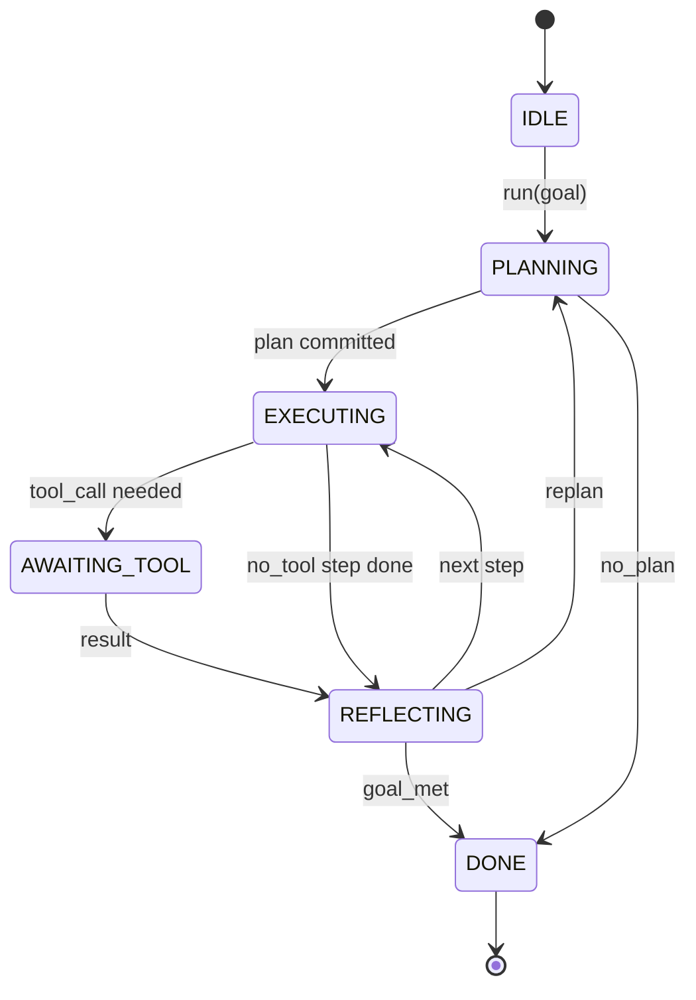

# Agent Harness 循环契约

> harness 就是 agent。模型只是协处理器。本课冻结一套循环契约，任何模型都可以接入其中。

**Type:** Build
**Languages:** Python
**Prerequisites:** 第 13 阶段，第 01 至 07 课；第 14 阶段，第 01 课
**Time:** ~90 分钟

## Learning Objectives
- 把 agent harness 循环描述为带显式转移的确定性状态机。
- 实现十个生命周期钩子主题，供运维方接入策略、遥测与 guardrail。
- 定义两个拉取点：循环在此把控制权交还调用方，并在新的输入上恢复。
- 在不因超限而泄漏半途状态的前提下，强制每会话预算（轮次、tool call、实际耗时）。
- 发出包含十一种事件类型的带类型事件流，让下游 UI 与 tracer 无需直接检查循环即可订阅。

```figure
cf-loop-contract
```

## 整体框架

一个无人值守连续运行四十轮编码任务的 agent，不是聊天循环。它是一个状态机：节点可被运维方拦截，边可被审计。一旦你把契约写下来，更换模型、工具或策略就不再是一次重构，而变成一次注册调用。

本课构建这份契约。我们命名六个状态、十个钩子主题、两个拉取点、十一种事件类型和一个预算边界。harness 中的其他一切（tool registry、JSON-RPC transport、dispatcher、planner）都插入这个形状。

## 状态

循环有六个状态。五个是活动状态，一个是终止状态。



`IDLE` 是唯一合法的入口。`DONE` 是唯一合法的出口。`AWAITING_TOOL` 是唯一会产生拉取点的状态。其余转移都在内部完成。

状态机是确定性的。给定同一份事件日志，harness 会重新进入同一状态。正因如此，你在调试时可以重放会话，而无需再次调用模型。

## 钩子主题

钩子是运维方切入循环的接缝。harness 会触发十个主题。每个主题接受任意数量的订阅者。订阅者按注册顺序触发。订阅者可以修改 payload、抛出异常以中止本轮，或返回哨兵值以跳过下一步。

```text
before_plan         after_plan
before_tool_call    after_tool_call
before_step         after_step
on_error
on_pause
on_budget_exceeded
on_complete
```

这个形状映射了 Claude Code、Cursor 与 OpenCode 到 2025 年中都已收敛到的做法。名称是功能性的，不带品牌。拦截 `rm -rf` 的钩子住在 `before_tool_call`。上报 OpenTelemetry span 的钩子住在 `after_step`。在暂停会话上恢复的钩子住在 `on_pause`。

## 拉取点

循环两次交出控制权。第一次在 `AWAITING_TOOL`：没有工具结果就无法推进。第二次在 `on_pause`：预算耗尽，或某个钩子明确要求人工复核。

拉取点不是异常，而是一次返回。调用方检查 harness 状态，取来 harness 索要的东西，然后调用 `resume(payload)`。harness 从停下之处继续。这与 Python 生成器的形状相同。拉取点上跑什么 transport 由你决定。在 TUI 里是按键。走 MCP 时是 `tools/call`。走队列时是一次 job 轮询。

## 事件流

循环在契约中的特定位置把事件追加到带类型的流。该流只追加，订阅者可以从任意偏移重放。已实现的十一种事件类型是：

- `session.start` —— 调用 `run(goal)` 时发出一次
- `plan.draft` —— planner 返回草案计划时发出
- `plan.commit` —— 草案被提交为当前计划之后发出
- `step.start` —— 每个执行步骤开始时发出
- `step.end` —— 每个执行步骤结束时发出
- `tool.call` —— 需要工具的步骤把控制权交还调用方时发出
- `tool.result` —— 携带工具结果恢复时发出
- `tool.error` —— 携带错误恢复、或某个钩子中止调用时发出
- `budget.warn` —— 触及某项预算上限时发出
- `session.pause` —— 循环因暂停（预算或钩子）而让出时发出
- `session.complete` —— 循环抵达 `DONE` 时发出一次

事件不重复钩子的 payload。钩子是命令式的（修改、中止）。事件是观察式的（记录、上报）。把它们视为正交。

## 预算边界

一个会话携带三项限制：轮次数、tool call 次数、实际耗时秒数。每进行一轮，轮次数加一。每发生一次 tool call，tool call 次数加一。每次状态转移都检查实际耗时。任一限制触达时，循环触发 `on_budget_exceeded`、发出 `budget.warn`，然后在下一个拉取点以超出预算为由转入 `IDLE`。

预算不是急停开关，而是一次让出。调用方决定是延长预算并恢复，还是关闭会话。

## 本课不做什么

它不调用模型。它不注册真实工具。它不实现 transport。那些是接下来四课的事。本课把契约钉死，好让后四课无需重写即可插入。

`main.py` 里的确定性 planner 只是一个替身。它返回一个硬编码的三步计划，其中两步需要工具结果。重点在循环，不在计划。

## 如何阅读代码

`HarnessLoop` 是主类。它持有状态、触发钩子、发出事件。`Budget` 跟踪限制。`Event` 是流上的带类型信封。`HookRegistry` 是分发表。`_transition` 是唯一改变状态的函数，因此状态机的不变量集中在一处。

从头到尾读 `main.py`。再读 `code/tests/test_loop.py`。测试钉住了每一次转移和每一个钩子的触发顺序。

## 延伸探索

在生产环境构建 harness，最难的部分不是状态机，而是让契约真正可被强制执行。契约必须能经受 planner 的热重载，必须能经受返回畸形 JSON 的工具，必须能经受在四十轮会话进行到三分之二时于 `before_tool_call` 里抛异常的钩子。本课的测试演练了这些失败模式。运行它们。破坏它们。补充用例。

下一课加入 tool registry。再之后是 JSON-RPC transport。再之后是 dispatcher。到第二十四课时，这个文件里的循环将针对真实工具、在真实预算约束下运行真实计划。
