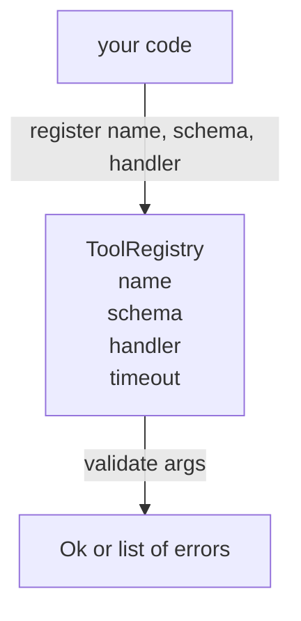

# 带 Schema 校验的工具注册表

> agent 无法校验的工具，就是 agent 无法调用的工具。在动手写工具之前，先把注册表和 schema 校验器建好。

**Type:** Build
**Languages:** Python
**Prerequisites:** 第 13 阶段，第 01 至 07 课；第 14 阶段，第 01 课
**Time:** ~90 分钟

## Learning Objectives
- 维护一个类型化的注册表，把工具名映射到 schema 再到 handler，使 dispatcher 只问一次，之后都能信任。
- 实现 JSON Schema 2020-12 的一个子集，覆盖工具调用实际用到的九成关键字。
- 返回精确的、json pointer 形式的错误路径，让模型能在一次往返中自我修正。
- 在没有显式 override 的情况下拒绝重复注册，因为静默覆盖正是生产环境工具目录漂移的根源。
- 让校验器保持纯净（无 I/O、无时间、无全局状态），以便在 replay 日志上重跑。

```figure
cf-registry-validate
```

## 为什么先有注册表，再有工具

2026 年的编码 agent 注册的工具数量，已经超出模型单个 context window 能装下的范围。一个不简单的 harness 会注册两百个工具，并在任意一轮中暴露十到四十个。注册表是"有哪些工具""它们的参数长什么形状""该调用哪个 handler"这三个问题的真相来源。这三个答案一旦钉死，harness 的其余部分就不必再猜。

我们要避免的错误，是交付 handler 却没有 schema，或者交付 schema 却不做校验。两者都很常见。两者都会把下一层（第二十三课的 dispatcher）变成一场猜谜游戏，而唯一的失败模式就是 handler 抛出的堆栈。

## 一条工具记录长什么样

```text
ToolRecord
  name        : str          (unique, lowercase alphanumeric and underscore segments separated by dots, e.g., snake_case.segment.case)
  description : str          (one line, shown to the model)
  schema      : dict         (JSON Schema 2020-12 subset)
  handler     : Callable     (async or sync, returns Any)
  idempotent  : bool         (dispatcher uses this for retry decisions)
  timeout_ms  : int          (override per-tool dispatcher default)
```

schema 是校验器唯一触碰的字段。handler 对它是不透明的。我们刻意把它们分开。schema 是数据。handler 是代码。把它们混在一起，就会诱使你把校验逻辑塞进 handler 里，而这正是我们要阻止的 bug。

## JSON Schema 2020-12 子集

完整的 2020-12 规范是一篇论文。我们只需要八个关键字。

```text
type           string / number / integer / boolean / object / array / null
properties     map of property name -> schema
required       list of property names
enum           list of allowed primitive values
minLength      integer, applies to strings
maxLength      integer, applies to strings
pattern        ECMA-262-compatible regex, applies to strings
items          schema applied to every array element
```

这足以覆盖工具 API 真正需要的部分。我们没有加入的关键字（oneOf、anyOf、allOf、$ref、条件分支）在生产 schema 中完全合法，但会把校验器变成一个带环的树遍历器。我们是在建注册表，不是建 JSON Schema 引擎。

## json pointer 错误路径

校验失败时，校验器返回一个错误列表。每个错误都带有一条指向输入的 json pointer 路径。pointer 是一串以斜杠开头、由属性名和数组下标组成的序列。

```text
{"a": {"b": [1, 2, "x"]}}
                    ^
                    /a/b/2
```

模型读错误路径比读句子更准。如果 schema 要求 `args.user.email`，而模型传了整数，错误应当是带 `expected_type: string` 的 `/user/email`。模型在下一次调用里就能改对，不需要一轮自然语言解释。

## 注册与 override

`register(name, schema, handler, **opts)` 默认拒绝重复注册。调用方必须传入 `override=True` 才能替换。这是运维卫生。代码库的两个部分悄悄注册同一个工具名，是那种在生产环境要花一周才能定位的 bug。

注册表暴露三个读方法。`get(name)` 返回记录或抛异常。`validate(name, args)` 返回一个 `Ok` 或一个错误列表。`names()` 按注册顺序返回工具名。

## 校验器是什么，不是什么

它是对 schema 树的一次递归遍历。它是纯函数。它不调用 handler。它不做类型转换（字符串 `"42"` 通不过 number schema）。它不静默截断。

它不是安全边界。恶意的 handler 在校验通过后依然可能乱来。第二十三课的 dispatcher 会加上 timeout 和 sandbox 层。注册表只负责形状。

## 结构



## 如何读这份代码

`code/main.py` 定义了 `ToolRegistry`、`ToolRecord`、`ValidationError` 和八个校验函数。校验器按 `schema["type"]` 分派（或者把带 `enum` 的 schema 当作无类型枚举检查）。每个类型校验器返回一个空列表或一个 `ValidationError` 列表。顶层的遍历器在向下递归时拼接错误，并前置路径片段。

`code/tests/test_registry.py` 覆盖注册、override、校验成功、带路径的校验失败，以及子集里的每一个关键字。

## 更进一步

这一课落地后，你会想要两个扩展：针对本地 definitions 块的 `$ref` 解析，以及用于严格形状的 `additionalProperties: false`。两者都很小。随着工具目录增长到五十个以上，两者都是常见的补充。我们把它们留在了课程之外，好让文件保持一次读完。

下一课（第二十二课）构建 JSON-RPC stdio 传输层，把这个注册表暴露给模型客户端。再下一课（第二十三课）把两者一起包在一个带 timeout 和重试的 dispatcher 之后。
