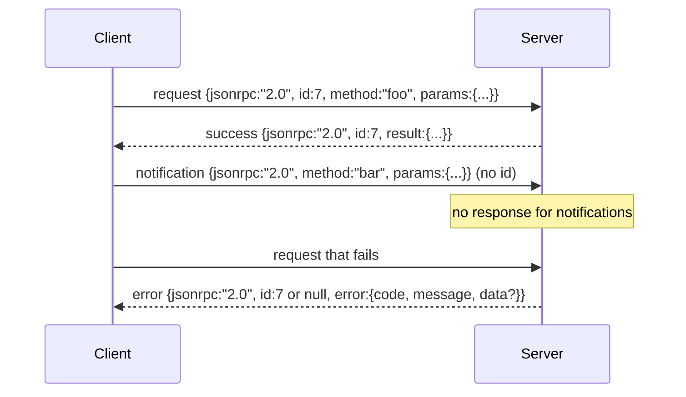

# 基于换行分隔 stdio 的 JSON-RPC 2.0

> 模型客户端与工具服务器之间的传输层，是跑在 stdio 上的 JSON-RPC。亲手写一遍，你就能弄清每一层分帧到底在为哪些东西买单。

**Type:** Build
**Languages:** Python
**Prerequisites:** 第 13 阶段，第 01 至 07 课；第 14 阶段，第 01 课
**Time:** ~90 分钟

## Learning Objectives
- 用换行分隔的 JSON 分帧，在 stdin 与 stdout 上说 JSON-RPC 2.0。
- 映射五个标准错误码（-32700、-32600、-32601、-32602、-32603），并以正确的语义暴露它们。
- 区分 request、response、notification 和 batch，而不发明新的信封字段。
- 每行的 parse error 单独处理，不污染后续的流。
- 用 io.BytesIO 构建一个自终止的演示，让这一课无需派生 subprocess 也能跑起来。

```figure
cf-jsonrpc-frames
```

## 为什么 JSON-RPC 仍是通用语

2026 年的编码 agent 在一次会话里大概要和十二个工具服务器打交道。每个服务器是一个独立进程或一个远端端点。线格式从 2013 年起就没变过。JSON-RPC 2.0 是两页规范。它能活下来，是因为替代方案（gRPC、每次调用一个 HTTP、自定义二进制）都强加了一个 JSON-RPC 没有的取舍：它们要么选流式，要么选批量，要么选与传输耦合。JSON-RPC 在 stdio、socket、websocket 和 HTTP 上都是对称的，只要双方遵守规范，客户端就能驱动一个它从未见过的服务器。

这一课构建 stdio 变体。换行分隔的 JSON。每个请求一行。每个响应一行。传输边界是 `\n`。

## 线上格式

信封有四种形状。两种由客户端说。两种由服务器说。



notification 没有 `id`。服务器绝不能对它响应。如果服务器对 notification 返回了响应，客户端就无法把它挂到任何调用点上。就这一条规则，让分帧的算术保持简单。

batch 是一个由 request 或 notification 组成的 JSON 数组。服务器回一个响应数组，顺序任意，每个非 notification 条目对应一个。如果 batch 里每个条目都是 notification，服务器就什么都不回。

## 五种错误码

```text
-32700  Parse error      JSON could not be parsed
-32600  Invalid Request  Envelope shape is wrong
-32601  Method not found
-32602  Invalid params
-32603  Internal error
```

-32000 到 -32099 之间的码保留给服务器自定义错误。其余的都是应用自定义的。这一课只用这五个。如果你的 handler 抛了异常，传输层会把它包成 -32603，并把异常类名放进 `data.exception`。

parse error 有一条特殊规则。响应里的 `id` 是 `null`，因为请求根本没解析出足够的信息来提取 id。

## 换行分帧与 BytesIO 演示

传输层一次读一行。一行是指直到并包含 `\n` 的字节。如果某一行解析不了，传输层就写一个 `id: null` 的 -32700 响应，然后继续。流不会被污染。下一行照常从头解析。

对这一课，我们把一对 `io.BytesIO` 包成 stdin 与 stdout。服务器一直读到 EOF，为每个请求写出响应，然后返回。客户端再把这些响应读回来。不派生进程。不设 timeout。传输行为与真实的子进程管道完全一致，因为 Python 的 `io` 接口呈现的是同样的 `.readline()` 与 `.write()` 契约。

## 方法分派

传输层不知道有哪些方法存在。它把工作交给一个由 harness 提供的可调用对象 `handler(method, params)`。handler 返回结果或抛异常。三个异常类会暴露出特定的错误码。

```text
MethodNotFound -> -32601
InvalidParams  -> -32602
Anything else  -> -32603 with exception name in data
```

传输层从不见到工具注册表。注册表位于 handler 之后。这正是我们想要的层次划分。传输层说 JSON-RPC。注册表说工具形状。dispatcher（第二十三课）把它们缝合在一起。

## 出错时的流行为

```text
client writes              server reads             server writes
---------------            -----------              -------------
{...valid request...}      parses ok                {...response, id matches...}
{...broken json...         parse fails              {id:null, error: -32700}
{...valid request...}      parses ok                {...response, id matches...}
{...missing method...}     invalid envelope         {id:X, error: -32600}
```

一行坏掉的 JSON 不会让循环停下。缺一个 `method` 字段不会让循环停下。handler 抛异常不会让循环停下。传输层会一直读到 EOF。

## 通知与非对称流程

notification 是发了就不管的。harness 用 notification 来传进度事件、取消信号和日志行。notification 让一个长时间运行的工具可以持续流出状态更新，而不必每次都做一次往返。

这一课实现了一个出站通知辅助函数 `write_notification`。服务器在一个请求进行中时用它发出进度。演示展示了这个模式：一个请求进来，handler 发出两条进度 notification，然后写出最终响应。

## 如何读这份代码

`code/main.py` 定义了 `StdioTransport`、解析辅助函数（`parse_request`）、三个写辅助函数（`write_response`、`write_error`、`write_notification`），以及分派循环 `serve`。错误码常量放在模块作用域。

`code/tests/test_transport.py` 覆盖五个错误码、notification（不写响应）、batch（数组进、数组出、跳过 notification）、坏掉的 JSON（parse error 后继续），以及 handler 在调用中途写 notification 的非对称流程。

## 更进一步

这个传输层已经够后续几课用了。生产环境的传输层会加三样东西。一个在转发中保持不变的关联 id 字段（你的 `id` 已经是这个，但在 mesh 里你还需要一个外层 trace id）。一个取消通道（一条形如 `$/cancelRequest` 的 notification，带上在途调用的 id）。以及一次 content-type 协商握手，让同一个 socket 既可以说 JSON-RPC 又可以说 Streamable HTTP。这些都不改变线格式。它们只是加元数据。
