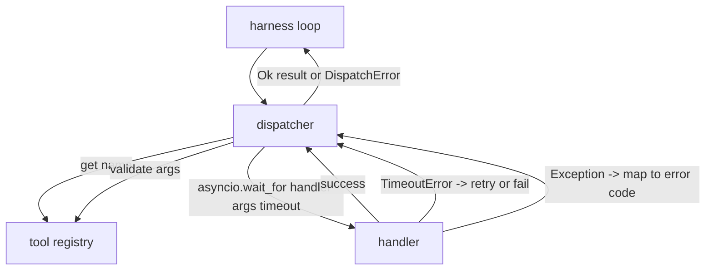
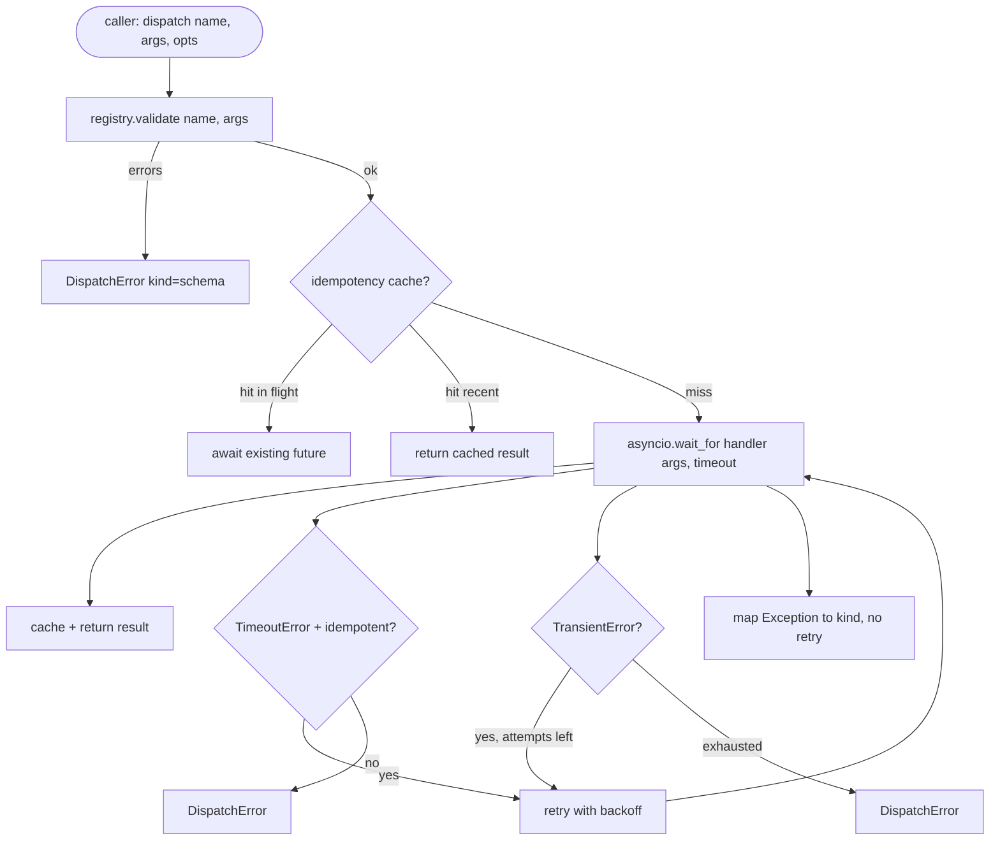

# 函数调用 Dispatcher

> dispatcher 是 harness 为 schema 许下的每个承诺买单的地方。超时、重试、去重、错误映射，全在这一个接缝上。

**Type:** Build
**Languages:** Python
**Prerequisites:** 第 13 阶段，第 01 至 07 课；第 14 阶段，第 01 课
**Time:** ~90 分钟

## Learning Objectives
- 用每次调用的 timeout 包裹工具 handler，返回一个类型化错误，而不是让循环挂住。
- 应用带抖动的指数退避重试，并设最大尝试次数。
- 按 idempotency key 对重试去重，使与慢原始调用赛跑的重试不会执行两次。
- 将 handler 异常和传输故障映射到同一个错误信封，harness 循环已经认识它。
- 用并发上限约束并行分派，使四十个工具调用的扇出不会耗尽事件循环。

```figure
cf-dispatch-retry
```

## dispatcher 的位置

在 harness 循环（第二十课）与工具注册表（第二十一课）之间。传输层（第二十二课）喂给循环。循环把一次工具调用交给 dispatcher。dispatcher 调用注册表、运行 handler，然后返回结果或一个 JSON-RPC 形状的错误信封。



dispatcher 是唯一知道定时器、重试和幂等的层。循环不知道。注册表不知道。handler 也不知道。这种隔离正是重点。

## 超时

每个工具都有一个默认 timeout。注册表记录携带 `timeout_ms`。当 harness 传入逐次调用的 override 时，dispatcher 用它覆盖默认值。我们使用 `asyncio.wait_for`。超时后，handler 任务被取消，dispatcher 返回 `DispatchError(kind="timeout")`。

对非幂等工具来说，timeout 默认不是可重试错误。一次超时的 `db.write` 可能提交了，也可能没提交。重试会造成重复写入。dispatcher 遵从注册表记录里的 `idempotent` 标志。幂等工具重试。非幂等工具不重试。

## 带指数退避的重试

重试策略最多三次尝试。退避是指数式的，带抖动。

```text
attempt 1  -> delay 0
attempt 2  -> delay 0.1s * (1 + random[0..0.5])
attempt 3  -> delay 0.4s * (1 + random[0..0.5])
```

只有 `timeout` 和 `transient` 错误会重试。`schema` 错误、`not_found` 或 `internal` 错误不重试。schema 错误是确定性的。重试不改变结果，只会烧掉预算。

重试循环尊重来自 harness 的预算。如果调用方的预算里剩余工具调用为零，dispatcher 在第一次尝试时就快速失败，返回 `kind="budget_exceeded"`。

## idempotency key 去重

在原始调用还在飞的时候触发重试，是真实的生产 bug。第一次调用在四点九秒处挂住（刚好低于 timeout）。重试在五秒时触发。现在两个请求对着同一个后端赛跑。如果工具是 `payments.charge`，你就收了两遍钱。

dispatcher 接受一个可选的 `idempotency_key`。如果调用到达时同一个 key 已在飞，dispatcher 就等待那个在途 future 并返回它的结果。缓存会在完成后继续保留 key 六十秒，以吸收迟到重试。

key 是调用方的责任。harness 从 planner 派生它：`f"{step_id}:{tool_name}:{hash(args)}"`。dispatcher 不自己发明 key，因为只从参数派生 key 会让两个语义不同的调用看起来一样。

## 错误信封

一次失败的分派返回单一形状。

```text
DispatchError
  kind        : "timeout" | "transient" | "schema" | "not_found" | "internal" | "budget_exceeded"
  message     : str
  attempts    : int
  jsonrpc_code: int   (one of -32601, -32602, -32603)
```

harness 循环把 `kind` 映射到下一个状态。`schema` 和 `not_found` 进入 `on_error` 并触发重新规划。`timeout` 和 `transient` 进入 `on_error`，是否重新规划取决于尝试次数。`budget_exceeded` 触发 `on_budget_exceeded`。

## 扇出时的并发上限

`gather(*calls)` 同时运行所有协程。四十个工具调用，就是四十个打开的 socket 或四十个子进程管道。大多数后端都不喜欢一个客户端发来四十个并行连接。

dispatcher 把 `gather` 包在一个 semaphore 里。默认并发上限是八。每次调用在分派前获取 semaphore，完成后释放。调用方看到的是 `gather` 形状的输出，但实际的调度是有界的。

## 单次调用的流程



## 如何读这份代码

`code/main.py` 定义了 `Dispatcher`、`DispatchError` 和 `TransientError`。dispatcher 在构造时接收一个注册表。异步的 `dispatch(name, args, ...)` 是唯一的入口。每次尝试的 timeout 在 `_run_with_retries` 内部用 `asyncio.wait_for` 就地施加。`gather_bounded(calls)` 在并发上限下运行多次分派。

`code/tests/test_dispatcher.py` 覆盖 timeout 触发、transient 错误重试、schema 错误不重试、幂等去重（两个并发调用用同一个 key 会合并成一次 handler 执行），以及并发限制（semaphore 起作用）。

测试使用 `asyncio.sleep(0)` 和确定性的基于 `Counter` 的 handler，所以它们几毫秒就跑完，不依赖墙上时钟计时。

## 更进一步

生产 dispatcher 会加两个扩展。第一，在每次状态转换处做结构化日志（循环的事件流已经给了你这些，但 dispatcher 还应发出 `dispatch.attempt` 和 `dispatch.retry` 事件）。第二，熔断器：在时间窗口内失败 N 次后，某个工具进入冷却期，期间分派立即返回 `kind="circuit_open"`，而不是去尝试 handler。两者都能加在这个 dispatcher 之上，而不改变契约。

第二十四课把 dispatcher 粘到一个 plan-and-execute agent 上，让你看到四块拼图同时运转。
