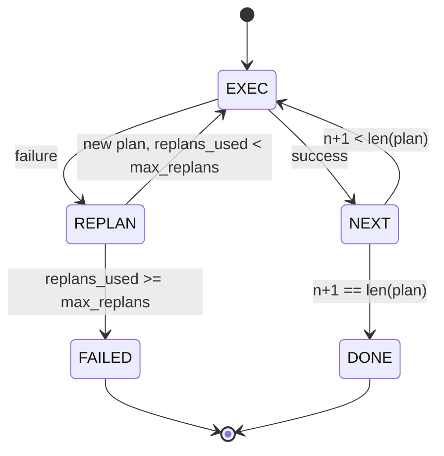

# Plan-Execute 控制流

> 一个扛不住失败的 plan 只是脚本。一个能重新规划的脚本才是 agent。先建重新规划器。

**Type:** Build
**Languages:** Python
**Prerequisites:** 第 13 阶段，第 01 至 07 课；第 14 阶段，第 01 课
**Time:** ~90 分钟

## Learning Objectives
- 把 plan 表示成一个有序的类型化步骤列表，使 executor 能推理进度和结果。
- 顺序执行步骤，并把失败受控地交还给 planner。
- 从当前游标处重新规划，并把先前的错误放进 context，使下一个 plan 是有依据的。
- 每次修订时发出一个 plan diff，让下游的 tracer 或 UI 能展示 plan 为何改变。
- 强制两个预算：一个硬性的步数上限和一个硬性的重新规划次数上限。

```figure
cg-plan-replan
```

## 先规划再执行，而非 chain-of-thought

chain-of-thought agent 吐出 token，让循环去猜工具调用在哪里结束。plan-and-execute agent 先吐出一个结构化的 plan，然后确定性地执行每一步。plan 是 harness 可以内省的数据。执行就是 harness 让这些数据穿过一个 dispatcher。

两块。一个产生 plan 的 planner。一个运行 plan 的 executor。有意思的部分是 executor 撞到失败时会发生什么。三个选项：

```text
1. Abort         (return failed, surface the error)
2. Skip          (mark step failed, continue with the rest)
3. Replan        (hand the error to the planner, get a new plan from the cursor)
```

Replan 就是那个把脚本变成 agent 的选项。

## Step 结构

```text
Step
  id              : int           (monotonic within a plan revision)
  tool_name       : str
  args            : dict
  expected_outcome: str           (planner's stated success condition)
  result          : Any | None
  error           : str | None
```

`expected_outcome` 是 planner 随步骤一起吐出的一句短话。executor 不强制它。它有两个用处：重新规划器在修订 plan 时读它；事件流发出它，让 tracer 能显示"这一步本来是要做 X"。

## planner 的形状

```python
def planner(goal: str, history: list[Step], last_error: str | None) -> list[Step]:
    ...
```

一个纯函数。`goal` 是用户目标。`history` 是已经执行过的步骤（结果和错误都填好了）。`last_error` 在第一次调用时为 None，之后每次都是最近一次的失败消息。planner 返回从游标处开始的下一份 plan。

planner 不知道 executor。它不知道重试。它不知道 timeout。它产出一个 plan。仅此而已。

## executor

executor 是一个小的状态机。每一步都穿过 dispatcher。结果有三种之一：成功、可重新规划的失败、致命失败。可重新规划的失败交还给 planner。致命失败（预算耗尽、触及重新规划上限）返回一个 `FAILED` 的会话结果。



## 修订时的 plan diff

当 planner 在一次失败后返回新 plan 时，executor 发出一个带三个字段的 `plan.diff` 事件。

```text
removed: list of step ids that were in the old plan and are not in the new
added  : list of step ids in the new plan that were not in the old
revised: list of step ids whose tool_name or args changed
```

tracer 或 UI 可以把它渲染成对已移除步骤的删除线，以及对已添加步骤的高亮。重点不是 diff 的格式。重点是修订是一个可见的事件，而不是一次静默的重写。

## 两个预算是硬上限

`max_steps` 限制整个会话中步骤执行的总次数，包括重新规划产生的步骤。默认是十二。一个线性的五步 plan，重新规划两次、每次增加三步，会达到十六次执行，就会超出预算。executor 会拒绝这次重新规划并返回 FAILED。

`max_replans` 限制第一份 plan 之后调用 planner 的次数。默认是五。这是更重要的限制。一个连续五次返回同一份坏 plan 的 planner，否则会一直循环，直到步数预算把它拦下。给重新规划设上限，能让失败来得更快、原因也更清楚。

## 本课的确定性 planner

这一课我们不调用模型。本课附带一个确定性的 planner，它根据 `last_error` 挑选 plan。

```text
last_error is None    -> emit a four-step plan
last_error matches X  -> emit a three-step plan that routes around X
last_error matches Y  -> emit a two-step plan that gives up gracefully
otherwise             -> return [] (signals nothing to replan)
```

这足以测试 executor 在每条转换路径上的行为：成功、重新规划一次、重新规划两次、重新规划耗尽，以及步数预算耗尽。

## 结果结构

```text
SessionResult
  status      : "completed" | "failed"
  reason      : str     ("goal_met" | "step_budget" | "replan_budget" | "no_plan")
  history     : list[Step]
  revisions   : list[PlanDiff]
  events      : list[Event]
```

第二十课的 harness 循环可以直接读它。第二十三课的 dispatcher 负责执行每一步。第二十一课的注册表校验每一步的 args。第二十二课的传输层会把这整套流程通过 JSON-RPC 暴露给模型客户端。

## 如何读这份代码

`code/main.py` 定义了 `PlanExecuteAgent`、`Step`、`PlanDiff`、`SessionResult` 以及那个确定性 planner。executor 是一个 `run(goal)` 方法，返回 `SessionResult`。plan diff 通过比较 step id 和 `(tool_name, args)` 元组来计算。

`code/tests/test_agent.py` 覆盖一次线性成功、一次在 plan 中途失败并重新规划一次、返回 `failed:replan_budget` 的重新规划耗尽、步数预算耗尽，以及 plan-diff 事件的格式。

## 更进一步

等你把它接到真实模型上，会想要两个扩展。第一，部分 plan 缓存：当一个六步 plan 的前三步成功、随后失败时，你不想重跑前三步。executor 已经保留了 history；planner 只需要读它。第二，并行分支：当前的 executor 严格串行。一个发出独立分支的 planner（用 `gather_step` 而不是 `next_step`）可以通过 dispatcher 并发地跑两个工具调用。

两者都增加了实打实的复杂度。两者在串行 executor 钉死之后都更容易添加。这就是这一课做的事。
