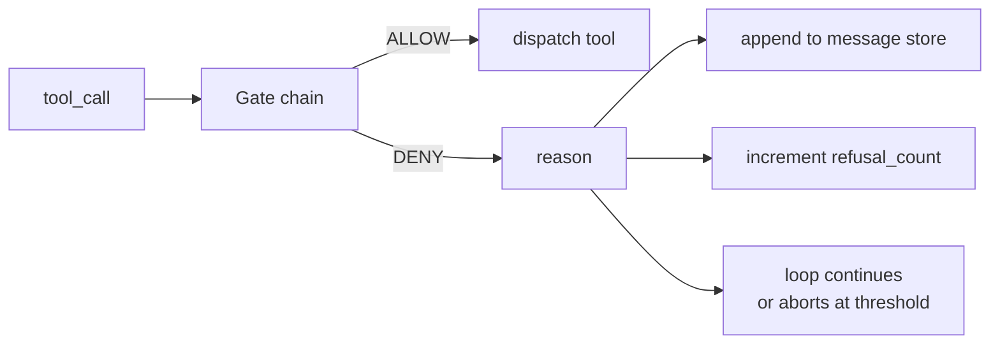
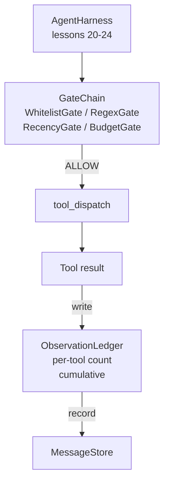

# 结业课第 25 课：校验闸门与观测预算

> 没有校验层的 agent harness 只是一件披着风衣的愿望。这一课构建那条确定性的闸门链，由它决定一次工具调用是否允许触发、agent 允许看到它多少输出，以及当 agent 读得太多、循环必须停下时该怎么办。这条链是由若干小的、具名闸门，外加一本记录模型看过的每一个 token 的观测账本组合而成的函数。

**Type:** Build
**Languages:** Python (stdlib)
**Prerequisites:** 第 19 阶段，第 20 至 24 课（Track A1：agent loop、tool registry、message store、prompt builder、model router）、第 14 阶段，第 33 课（instructions as constraints）、第 14 阶段，第 36 课（scope contracts）、第 14 阶段，第 38 课（verification gates）
**Time:** ~90 分钟

## Learning Objectives

- 构建一个 `VerificationGate` 协议，带确定性的 `evaluate(call)` 方法。
- 把 budget、recency、whitelist 和 regex 四个闸门组合成一条带短路语义的链。
- 通过一个以工具和轮次为键的 `ObservationLedger` 追踪每一次观测。
- 当累计观测预算将被超出时，拒绝这次工具调用。
- 暴露一个结构化的 `GateDecision` 记录，供下游可观测性系统摄取。

## 问题场景

当 agent harness 放任模型随意调用工具时，真实使用不到一小时就会出现三类 bug。

第一类是无界观测。对二十万行仓库做一次 grep，会把五十万个 token 的输出倾泻进下一轮。模型每一千字节只能看到一个匹配，context 的其余部分全被浪费。token 账单很高，而 agent 在任务上变得更差，而不是更好。

第二类是新鲜度过期。一个长时间运行的任务会累积五十次工具调用。模型把第三轮里第一次 `read_file` 的结果当成实时状态来重读。第四十七轮里做的编辑永远不会出现，因为 prompt builder 把最早的观测排在了最前面。

第三类是权限蔓延。一个研究任务开始时调用 `web_search`，不知怎么最后跑起了 `shell`，因为模型编了一个工具名，而 harness 默认是宽松的。等到有人去读 trace 时，一个垃圾文件已经躺在 /tmp 里，还有一个 curl 打到了私有 API。

校验闸门就是那个说"不"的 harness 组件。它不是模型。它不是裁判。它是 `(call, history, ledger)` 的一个确定性函数，返回 ALLOW 或 DENY 外加一个理由。理由被记录下来。模型会被告知。循环继续或中止。

## 核心概念



闸门是任何带有 `evaluate(call, ctx) -> GateDecision` 方法的东西。链是一个有序列表。求值在第一次拒绝时短路。顺序很重要：廉价的结构性闸门先跑，昂贵的 token 计数闸门后跑。

这一课附带四个闸门：

- `WhitelistGate`。允许的工具名是一个显式集合。任何集合之外的工具都被拒绝。这是最廉价的闸门，最先运行。
- `RegexGate`。工具参数与一个正则匹配。适合用来拒绝带 `rm -rf` 的 shell 调用，或指向内网 IP 的 HTTP 调用。纯粹基于调用载荷。
- `RecencyGate`。模型只看到最近 N 轮的观测。更早的观测被遮蔽。对于那种结果会延长一个已经过期的观测窗口的工具调用，闸门予以拒绝。
- `BudgetGate`。模型在整个会话中读过的累计 token 有一个上限。当账本表明已达上限时，之后每一次工具调用都被拒绝。

观测账本是那本账。每一次成功的工具调用写一行：工具名、轮次、发出的 token 数、累计值。账本回答两个问题：模型总共看了多少，以及它看了工具 X 多少。budget 闸门读第一个。而一个按工具的预算闸门——你会把它作为练习写出来——读第二个。

```figure
cg-gate-chain
```

## 架构



harness 问这条链。链要么点头，要么拒绝。如果点头，工具就跑，账本记一笔，结果被追加到 message store。如果拒绝，模型会收到拒绝，作为一条 system message，然后循环决定是重试还是中止。

## 你将构建什么

实现是一个 `main.py` 加上测试。

1. `Observation` 和 `ToolCall` 两个 dataclass 定义线上形状。
2. `ObservationLedger` 记录 `(turn, tool, tokens)` 行，并回答 `cumulative()` 和 `per_tool(name)`。
3. `GateDecision` 携带 `(allow, reason, gate_name)`。
4. `VerificationGate` 是协议。每个闸门实现 `evaluate(call, ctx)`。
5. `GateChain` 包装一个有序列表。它依次调用每个闸门，返回第一个拒绝；如果每个闸门都通过，则返回允许。
6. 演示跑一个很小的合成 agent 循环。三轮。第三轮触发 budget 闸门，循环报告一次干净的拒绝，拒绝计数非零。

token 计数器故意用一个笨拙的 `len(text) // 4` 启发式。这一课的重点是闸门管道，不是 tokenizer。生产环境里换成真正的 tokenizer。

## 为什么链的顺序重要

一次拒绝比一次允许更廉价。`WhitelistGate` 以 O(1) 哈希查找运行。`RegexGate` 以 O(pattern * argv) 运行。`RecencyGate` 读 message store 的一小片。`BudgetGate` 读整本账本。你按成本递增来排序，让被拒绝的调用在做昂贵工作之前就短路。

你也按影响范围来排序。whitelist 是最强的断言：这个工具不在契约里。regex 闸门其次：这个参数不在契约里。recency 在其后：harness 仍然在意，但调用在结构上是合法的。budget 排最后，因为按定义，它只在其他一切都通过时才触发。

## 它如何与 Track A 的其余部分组合

前面几课给了你循环、工具注册表、message store、prompt builder 和 model router。这一课加的是模型与工具之间的那一层。第 26 课附带的 sandbox，是闸门链说 ALLOW 之后 dispatcher 把工具调用交给它的地方。第 27 课附带的 eval harness 把拒绝计数记录为一种质量信号。第 28 课把闸门决策接到 OpenTelemetry span 上。第 29 课把这一切缝合成一个能用的编码 agent。

## 运行它

```bash
cd phases/19-capstone-projects/25-verification-gates-observation-budget
python3 code/main.py
python3 -m pytest code/tests/ -v
```

演示逐轮打印 trace，包括每一次闸门决策，并以零退出。测试覆盖账本、每个闸门的单独行为、链的短路，以及合成循环的端到端行为。
