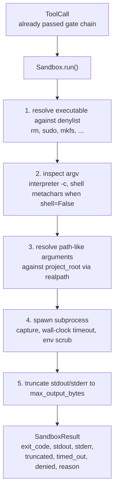
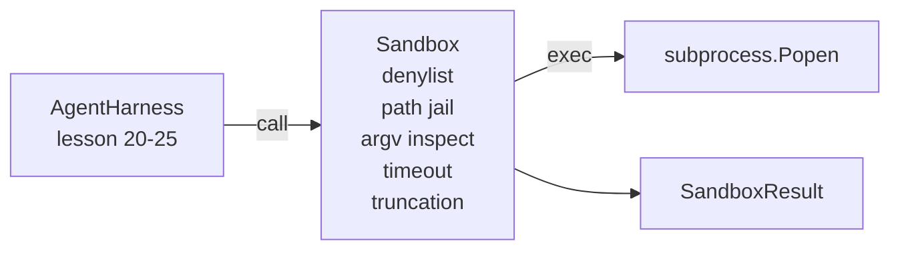

# 结业课第 26 课：带 Denylist 与路径监狱的 Sandbox Runner

> 校验闸门决定一次工具调用是否应该运行。sandbox 决定它运行起来会发生什么。这一课附带一个 subprocess runner：它拒绝危险的 executable，拒绝危险的 argv 形状，把每个文件路径囚禁在项目根目录之内，截断过大的输出，并在墙上时钟超时时杀掉失控的进程。它是坐在模型与操作系统之间的两层中的第二层。

**Type:** Build
**Languages:** Python (stdlib)
**Prerequisites:** 第 19 阶段，第 25 课（verification gates and observation budget）、第 14 阶段，第 33 课（instructions as constraints）、第 14 阶段，第 38 课（verification gates）
**Time:** ~90 分钟

## Learning Objectives

- 构建一个 `Sandbox` 类，包裹 `subprocess.run`，带 timeout、捕获和截断。
- 按名字对照 denylist 拒绝命令，按结构对照 argv 检查器拒绝命令。
- 拒绝任何解析到声明的项目根目录之外的路径参数。
- 在 shell 模式关闭时拒绝 shell 元字符。
- 返回一个结构化的 `SandboxResult`，供下游可观测性和 eval harness 摄取。

## 问题场景

一个能 shell 出去的编码 agent，可以在一轮里安后门、窃取密钥、把开发者的笔记本搞砖，并刷爆云账单。最省事的防御是不给它 shell。第二省事的，是一个对一份精确的模式清单说"不"的 sandbox。

agent trace 里反复出现三类失败。

第一类是危险的 executable。一个被逼着修路径问题的模型会去试 `sudo`、`chmod -R 777`、`rm -rf`、`mkfs`、`dd`。这些没有一个该出现在 agent 运行里。denylist 按名字和别名把它们抓住。

第二类是 argv 花招。一个被告知不许用 shell 的模型，会通过解释器把攻击管道送出去：`python3 -c "import os; os.system('rm -rf /')"`、`bash -c '...'`、`node -e '...'`、`perl -e '...'`。sandbox 需要知道，任何带 `-c` 类标志运行的解释器，只是一个多绕几步的 shell 调用。

第三类是路径逃逸。模型被告知读 `./src/main.py`，却读了 `../../etc/passwd`。sandbox 通过 `os.path.realpath` 解析每个路径参数并断言前缀，把每个路径参数都囚禁起来。

sandbox 不是操作系统意义上的安全边界。一个拿到代码执行权的坚定攻击者仍然能逃出去。sandbox 是开发期的护栏：它让常见的失败模式大声暴露，阻止 agent 纯粹出于笨拙造成破坏。

## 核心概念



sandbox 有四条拒绝轴：名字、argv、路径、结构。每条轴都是调用的纯函数，此时还没有 subprocess。只有在每条轴都通过之后，才派生子进程。

`SandboxResult` 的退出码是约定俗成的那些：0 成功，非零失败，另加三个哨兵码表示 denied（-100）、timed_out（-101）和 truncated（退出码是真实的那个，同时置一个标志）。下游课程读这个结构化结果，而不是去解析 stderr。

```figure
cg-path-jail
```

## 架构



denylist 是一个由 executable basename 组成的 frozenset。别名（`/bin/rm`、`/usr/bin/rm`）都解析到同一个 basename。argv 检查器认识解释器的形状：任何 argv 若 argv[0] 是一个解释器、且后面某个参数以 `-c` 或 `-e` 开头，就拒绝。当调用没有明确请求 shell 时，shell 元字符（`;`、`|`、`&`、`>`、`<`、反引号、`$()`）会导致拒绝。

路径监狱是最微妙的一块。sandbox 在构造时接受一个 `project_root`。任何看起来像路径的参数（含 `/`，或匹配到一个已存在的文件）都会经过 `os.path.realpath` 规范化，然后对照项目根目录的 realpath 检查。如果解析后的目标不在根目录之下，就拒绝。符号链接逃逸尝试（项目根目录内一个指向外部的符号链接）会被阻断，因为检查的是 realpath，而不是字面路径。

## 你将构建什么

实现是 `main.py` 加上一个测试目录。

1. `SandboxResult` dataclass：exit_code、stdout、stderr、truncated、timed_out、denied、reason、duration_ms。
2. `SandboxConfig` dataclass：project_root、max_output_bytes、timeout_seconds、denylist、interpreter_block。
3. `Sandbox` 类：`run(argv, *, shell=False, cwd=None)` 返回一个 `SandboxResult`。
4. 内部的拒绝辅助函数：`_check_executable_denylist`、`_check_argv_interpreter`、`_check_shell_metachars`、`_check_path_jail`。
5. 输出截断，带一个清晰的 `truncated` 标志和捕获流里的一行标记。
6. 底部的演示：一串合法调用与对抗性调用。每一个都连同结果一起展示。

sandbox 默认用 `shell=False` 和 `capture_output=True` 调用 `subprocess.run`。墙上时钟超时使用 `timeout` 参数；在 `TimeoutExpired` 时，sandbox 杀掉进程组并合成一个 SandboxResult。

## 为什么这不是真正的 sandbox

本课的 sandbox 不使用 namespace、cgroup、seccomp、gVisor、Firecracker，或任何内核级隔离。子进程能做的事，sandbox 也能做。保护是结构性的：agent 被拒绝最常用的危险调用，而那声响亮的拒绝会进入可观测性，而不是悄无声息地执行。

对生产 agent，你在上面叠加：跑在无特权的 Docker 容器里、跑在 microVM 里、丢弃 capabilities、把项目根目录只读挂载、把 scratch 目录读写挂载、对内存和 CPU 设 ulimit、把环境精简到一份已知安全的白名单。第 29 课做了其中的一部分。操作系统级隔离不在本课范围内。

## 运行它

```bash
cd phases/19-capstone-projects/26-sandbox-runner-denylist
python3 code/main.py
python3 -m pytest code/tests/ -v
```

演示创建一个临时目录，往里面放一个干净的文件，然后跑一连串调用。合法调用成功。被拒绝的调用返回 `denied=True` 的 SandboxResult 并带上理由。超时返回 `timed_out=True`。截断置 `truncated=True`。演示打印一张结果的 JSON 表并以零退出。

## 它如何与 Track A 的其余部分组合

第 25 课产出了闸门链。第 26 课是闸门 ALLOW 之后运行的 executor。第 27 课的 eval harness 把 sandbox 结果与每个任务的预期退出码作比较。第 28 课在每次 `Sandbox.run` 调用周围发出一个 `gen_ai.tool.execution` span。第 29 课的端到端演示把一个真实的编码 agent 接上这两层。
