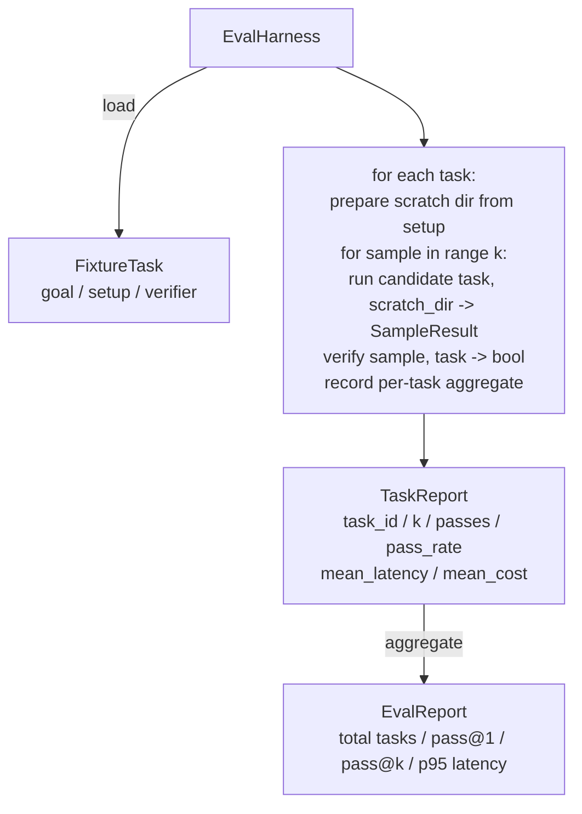

# 结业课第 27 课：带 Fixture 任务的 Eval Harness

> 一个编码 agent 的好坏，只取决于你用来衡量它的那套任务。这一课构建一个评估 harness：它接收一个放满 fixture 任务的文件夹，让每个任务跑过一个候选 agent，通过确定性的校验器判出 pass 或 fail，再把结果聚合成 pass@1、pass@k、平均 latency 和平均 cost。这个 harness 是真相来源，让你能分清一次回归和一次重构。

**Type:** Build
**Languages:** Python (stdlib)
**Prerequisites:** 第 19 阶段，第 25 课（verification gates）、第 19 阶段，第 26 课（sandbox runner）、第 14 阶段，第 30 课（eval-driven agent development）、第 14 阶段，第 19 课（SWE-bench and GAIA benchmarks）
**Time:** ~90 分钟

## Learning Objectives

- 把 fixture 任务定义为 goal、setup、verifier 的三元组。
- 对每个任务多次采样运行并打分，计算 pass@1 和 pass@k。
- 把 latency 和 cost 聚合成均值和 95 百分位指标。
- 把确定性的校验器（文件 diff、退出码、正则匹配）接入可复用的函数。
- 发出一个结构化的 JSON 报告，供回归追踪脚本摄取。

## 问题场景

有三种失败模式困扰着那些没有 eval harness 就搭起来的 agent benchmark。

第一种是未经校验的通过。agent 说它修好了 bug，人扫了一眼 diff，套件被标绿，三周后回归测试又暴露出同一个 bug。agent 只是推理得看似合理，实际什么都没修。

第二种是未被察觉的回归。对 prompt 模板的一次改动，让 agent 在显眼的那个任务上好了 4%，在安静的那个任务上差了 14%。没有 goldset 和逐任务打分，这次回归就一路进了 main，直到客户投诉才浮现。

第三种是逐任务漂移。eval 周一跑了一百个任务，周五只跑了其中九十五个，因为有人重命名了五个 fixture。通过率看起来像是提升了 5%。其实不是。

harness 就是把这类失败变成事实的程序。它每次运行每一个 fixture，按可复现的顺序，对照一个在确定性检查上返回真或假的校验器。

## 核心概念

```mermaid
flowchart LR
  F1[fixtures/task_001/<br/>task.json + expected/] --> Harness
  F2[fixtures/task_002/<br/>...] --> Harness
  Harness[Harness<br/>for each task:<br/>setup / run agent k samples /<br/>verify each sample /<br/>record latency, cost]
  Harness --> Report[EvalReport<br/>pass@1 / pass@k<br/>mean ms / p95 ms<br/>mean cost]
```

一个 `FixtureTask` 是一个小 JSON 文件加上一个可选的 `expected/` 目录。JSON 声明一个 `id`、一个 `goal`（喂给 agent 的 prompt）、一个 `setup` 块（要放进 scratch 目录的文件），以及一个 `verifier` 块。verifier 块指名 harness 校验器注册表里的一个函数，并提供它的参数。

三种校验器形状覆盖了大多数有用的任务。

第一种是 `file_equals`。agent 跑完后，把一个具名文件与预期内容作比较。这能抓住"以这种确切方式修好这个 bug"的任务。

第二种是 `regex_match`。把具名文件的内容与一个正则匹配。这能抓住"函数必须存在且返回 X"这类有很多可接受解法的任务。

第三种是 `shell_exit_zero`。harness 运行一条 shell 命令（经由第 26 课的 sandbox），只有命令以零退出时才判任务通过。这能抓住"测试必须通过"的任务。

harness 把每个任务跑 `k` 次。pass@k 是 `1 - (1 - p)^k`，其中 p 是经验通过率；harness 同时报告原始计数，好让你发现方差。latency 是每个样本的墙上时钟时间。cost 是 agent 自报的任何东西（token 数、美元，或两者都有）；harness 把它跨样本累加，并给出逐任务与汇总的数字。

```figure
pass-at-k
```

## 架构



候选是一个可调用对象：`Callable[[FixtureTask, str], SampleResult]`。harness 通过 `tempfile.mkdtemp()` 创建 scratch 目录，并把它的路径作为普通字符串传入。harness 不关心候选是如何工作的。候选可以是一个确定性的补丁应用器（对 harness 自测有用）、一个真实的 LLM agent、一个 fuzzer。契约就是 SampleResult。

## 你将构建什么

`main.py` 附带：

1. `FixtureTask` dataclass。
2. `SampleResult` dataclass：success_self_reported、latency_ms、cost_units、edits。
3. `TaskReport`、`EvalReport` 两个 dataclass，带 `to_dict()`。
4. `VerifierRegistry`，把校验器名字映射到函数。内置校验器：file_equals、regex_match、shell_exit_zero。
5. `EvalHarness` 类。让一个任务目录跑过某个候选。返回 EvalReport。
6. 五个 fixture 任务，打包在 `tasks/` 里：
   - `fizzbuzz` 里的差一错误
   - `factorial` 里缺失的 return
   - 错误信息里的拼写错误
   - 空的函数体
   - 链表遍历里的差一错误
7. 一个确定性的参考候选（`apply_known_fixes`），harness 用它演示一个干净的 pass@1 = 1.0。
8. 演示打印 EvalReport 的 JSON 并以零退出。

fixture 任务打包为 `tasks/` 里的 JSON 文件，外加 `tasks/<id>/buggy/` 和 `tasks/<id>/expected/` 里成对的源文件。harness 把 buggy 复制到一个 scratch 目录，交给候选，再对照 expected 校验。

## 为什么用 pass@k 而不只是 pass@1

真实的 LLM agent 是随机的。pass@1 为 0.6 看起来像失败。pass@5 为 0.95 说明 agent 大多数时候能得到正确答案，只是在早期样本上选错了。解法是采样加排序，并不总是更多的训练。pass@k 让这一点可见。

pass@k 与 pass@1 一起报告，因为 pass@k 会掩盖一个真实的失败：如果模型二十次里只做对一次，你就没有一个有用的 agent。harness 两个都显示。

## 它如何与 Track A 的其余部分组合

第 25 课产出了闸门链。第 26 课产出了 sandbox。harness 对任何 `shell_exit_zero` 校验器都使用 sandbox。第 28 课把每次 harness 运行包进一条 OTel trace。第 29 课拿打包的 fixture 之一跑端到端演示，并断言参考候选的 pass@1 = 1.0。

## 运行它

```bash
cd phases/19-capstone-projects/27-eval-harness-fixture-tasks
python3 code/main.py
python3 -m pytest code/tests/ -v
```

演示以 JSON 打印 EvalReport，包括 pass@1、pass@5、平均 latency 和逐任务明细。退出码为零。测试覆盖校验器函数、pass@k 的算法、fixture 加载，以及 harness 对照打包的参考候选的端到端行为。
