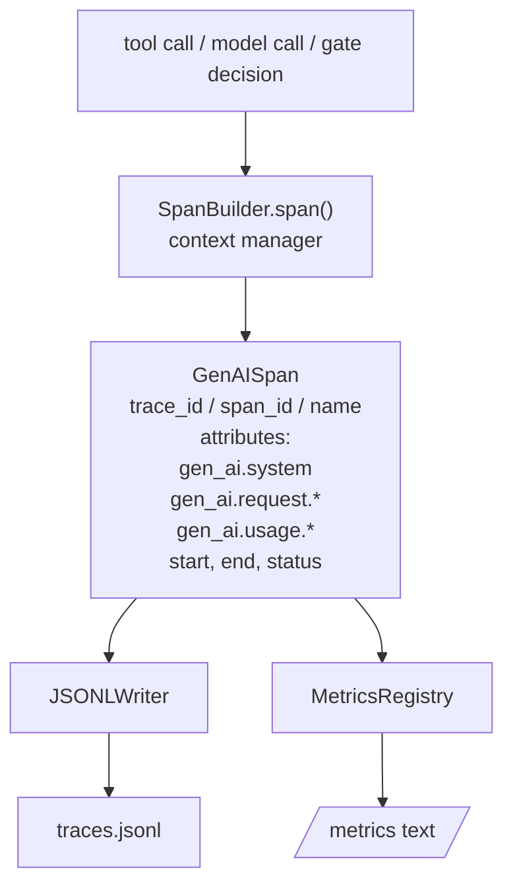
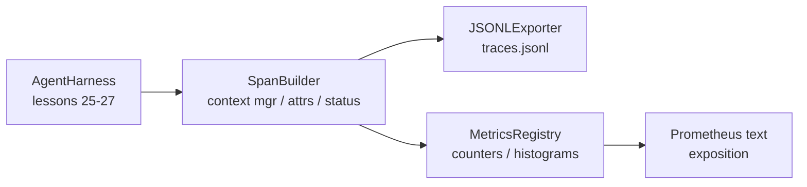

# 结课项目第 28 课：用 OTel GenAI span 与 Prometheus 指标实现可观测性

> 没有可观测性的 agent harness 就是一个会烧钱的黑盒。本课手写一个 span builder，它输出符合 OpenTelemetry GenAI 语义约定的记录，把这些记录写入 JSON-Lines 文件（每行一个 span），并以 Prometheus 文本格式暴露计数器和直方图。整套实现只用 stdlib Python，离线即可运行。

**Type:** Build
**Languages:** Python (stdlib)
**Prerequisites:** 第 19 阶段，第 25 课（verification gates）、第 26 课（sandbox）、第 27 课（eval harness）；第 13 阶段，第 20 课（OpenTelemetry GenAI）；第 14 阶段，第 23 课（OTel GenAI conventions）
**Time:** ~90 分钟

## Learning Objectives

- 构建一个按 OpenTelemetry GenAI 语义约定塑造的 span 数据类。
- 实现一个 JSONL 导出器，每行写入一个自包含的 span。
- 构建带标签的计数器与直方图，并按 Prometheus 文本格式曝光。
- 用 span 上下文管理器包裹任意可调用对象，记录耗时、状态与异常。
- 验证输出的 span 能通过 `json.loads` 往返解析，并符合规范形状。

## 问题场景

生产环境中的编码 agent 每一轮都会产出三类工件：一次模型调用、一次工具执行、一次验证门禁决策。没有结构化遥测，这些都派不上用场。

第一种失败模式是 trace 缺失。周二出了问题，但唯一的记录是一段 500 行的聊天日志。没有任何记录告诉你跑了哪个工具、花了多久、有多少 token 进了 prompt，或者门禁是否拒绝过什么。agent 的作者只能靠猜。

第二种失败模式是 trace 无法解析。harness 写了 span，但用的是自己临时想出来的字段名。Grafana、Honeycomb、Jaeger 或本地 CLI 里没有任何东西能读懂它们。团队技术栈里无论有什么工具都白费，因为这些 span 不合标准。

第三种失败模式是未聚合的指标。你能在 trace 里看到一次缓慢的工具调用，却回答不了“过去一小时 read_file 调用的 p95 延迟是多少？”，因为没有指标，只有 trace。

OpenTelemetry GenAI 语义约定正是为此而存在。它们定义了一小组标准属性，供跨 LLM 框架的 span emitter 共用。只要你的 harness 写入这些属性，任何兼容 OTel 的后端都能读取。

## 核心概念



harness 中的每个操作都会产生一个 span。一个 span 有 trace id（整次 agent 调用）、span id（这单个操作）、name（例如 `gen_ai.chat`、`gen_ai.tool.execution`）、遵循 GenAI 约定的 attributes、起止时间，以及 status。

GenAI 约定把这些属性键标准化：`gen_ai.system`（哪个提供方，例如 `anthropic`、`openai`）、`gen_ai.request.model`（模型 id）、`gen_ai.request.max_tokens`、`gen_ai.usage.input_tokens`、`gen_ai.usage.output_tokens`、`gen_ai.response.model`、`gen_ai.response.id`、`gen_ai.operation.name`，再加上工具专用的键 `gen_ai.tool.name` 与 `gen_ai.tool.call.id`。

导出器写出 JSONL。每行一个 JSON 对象。这是下游工具能够流式读取、grep 和导入的最简格式。真正的 OTel 导出器会说 OTLP gRPC；本课的 JSONL 导出器是离线等价物，在任何工作站上都能以退出码 0 结束。

指标与 trace 并存。每次工具调用都会让一个计数器自增：`tools_called_total{tool="read_file"}`。直方图记录观测到的延迟：`tool_latency_ms{tool="read_file"}`。两者都序列化为 Prometheus 文本曝光格式，这是拉取式指标的事实标准。

```figure
trace-spans
```

## 架构



span builder 是一个小类，带有一个 `span(name, attrs)` 方法，返回上下文管理器。上下文管理器在进入时记录开始时间，在退出时记录结束时间，若有异常则附加到 span 上，并把定稿的 span 推送给导出器。

指标注册表是两个字典。计数器是 `{(name, frozen_labels): int}`。直方图把原始样本保存在列表里，在曝光时序列化为 Prometheus 的直方图桶。

## 你将构建什么

`main.py` 包含以下内容：

1. `GenAISpan` 数据类：trace_id、span_id、parent_span_id、name、attributes、start_unix_nano、end_unix_nano、status、status_message、events。
2. `SpanBuilder` 类，提供 `span(name, attrs, parent=None)` 上下文管理器。
3. `JSONLExporter` 类，其 `export(span)` 追加一行。
4. `Counter` 与 `Histogram` 类，外加 `MetricsRegistry`。
5. `prometheus_exposition(registry)`，产出文本格式输出。
6. `wrap_tool_call(name)` 装饰器，发出 span 并更新指标。
7. demo：合成一次完整的 agent 调用（用 gen_ai.chat span 包住若干工具 span），写入 traces.jsonl，打印 Prometheus 曝光，以退出码 0 结束。

span id 与 trace id 是 16 字节的十六进制字符串，由 `os.urandom` 生成。这与 OTel 的 W3C trace context 一致。导出器从不抛异常；IO 错误会被暴露出来，但 harness 继续运行。

直方图有一组固定的桶（OTel 对毫秒级延迟的默认值：5、10、25、50、100、250、500、1000、2500、5000、10000、+Inf）。样本以列表形式存储；曝光时按需计算每个桶的计数。

## 为什么手写而不用 opentelemetry-sdk

OTel Python SDK 是一个实打实的依赖。它还有几千行代码、为 OTLP 导出器启动的多个进程，以及足以吞掉一节课预算的运行时开销。手写版本教的是线上格式。在生产环境中，你把同样的属性接入真正的 SDK，就能免费获得 OTLP 导出器、批处理与资源探测。

这些约定是稳定的。本课输出的线上格式到 2030 年依然能被解析，因为 OTel 从不破坏 GenAI 属性名；它们只会新增。

## 本节如何与 Track A 的其余部分组合

第 25 课产出了门禁链。第 26 课产出了沙箱。第 27 课产出了 eval harness。第 28 课让这三者变得可观测。第 29 课把端到端 demo 的每一步都包进 span，并在最后打印 Prometheus 文本。

## 运行方式

```bash
cd phases/19-capstone-projects/28-observability-otel-traces
python3 code/main.py
python3 -m pytest code/tests/ -v
```

demo 会在本课的工作目录里生成一个 `traces.jsonl`（结束时清理掉），然后打印三个 span 的样本，再打印计数器与直方图的 Prometheus 曝光。测试验证 span 能往返序列化、标准的 GenAI 属性都在、计数器正确自增，以及直方图曝光包含预期的桶计数。
