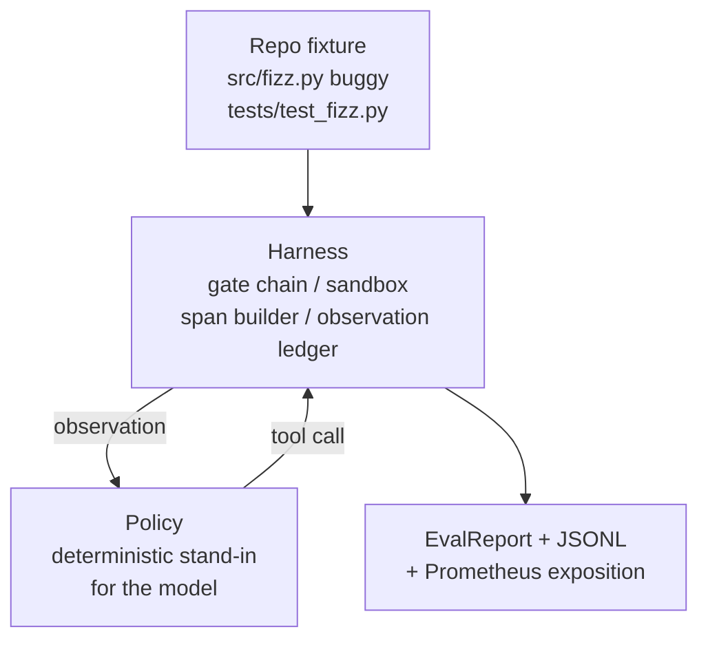
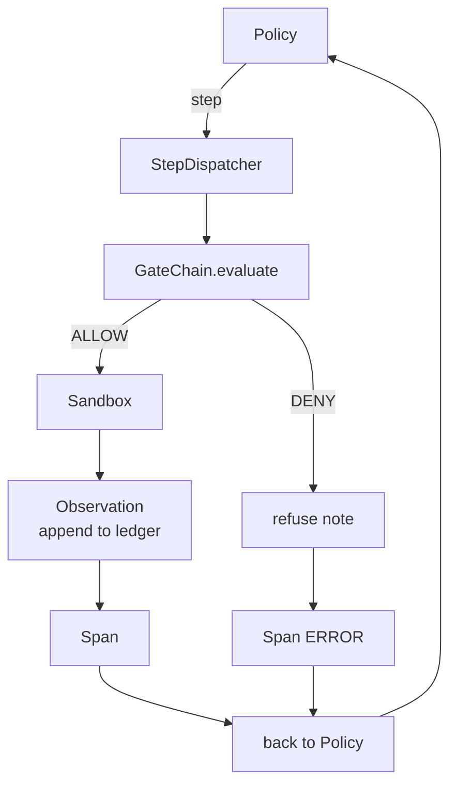

# 结课项目第 29 课：在 harness 上运行的端到端编码 agent

> Track A 的收获时刻。本课把门禁链、沙箱、eval harness 与 OTel span 缝合进一个可工作的编码 agent，让它在多文件 Python 项目里修复一个真实（小型、fixture 规模）的 bug。这个 agent 是确定性策略，而不是 LLM；这一替换让本课可复现，也说明 harness 才是始终有趣的那部分。接口契约完全相同：真实模型从策略这一接缝处接入即可。

**Type:** Build
**Languages:** Python (stdlib)
**Prerequisites:** 第 19 阶段，第 25 课（verification gates）、第 26 课（sandbox）、第 27 课（eval harness）、第 28 课（observability）；第 14 阶段，第 38 课（verification gates）、第 41 课（workbench for real repos）、第 42 课（agent workbench capstone）
**Time:** ~90 分钟

## Learning Objectives

- 把门禁链、沙箱、eval harness 与 span builder 组合进单个 agent 循环。
- 实现一个确定性策略，用 read_file、run_tests、write_file 修复一个 fixture bug。
- 在端到端运行中同时执行全局步数预算与观测 token 预算。
- 为完整运行发出完整的 OTel GenAI trace 与 Prometheus 指标。
- 验证 agent 在少于 12 步内解决该 fixture，且对合法工具零次触发门禁拒绝。

## 问题场景

大多数 agent demo 都是孤立运行的：单独的沙箱、单独的 eval harness、单独的 span emitter。它们看起来都没问题。可一旦组合起来，接缝就露出来了。

门禁链说 ALLOW，但沙箱却因为链没预料到的原因拒绝。eval harness 记录为通过，但 OTel span 说门禁拒绝了 agent 声称用过的某个工具。Prometheus 计数器本该自增一次，却自增了两次。观测预算已经超了，但 agent 还在继续，因为预算是在门禁链里跟踪的，沙箱并不知道。

本课是整个 Track 的集成测试。agent 必须按顺序完成四件事：读项目、跑测试、从测试失败中定位 bug、写出修复、重跑测试、然后停下。每个操作都经过门禁链。每次工具执行都经过沙箱。每一步都被包进 span。最后由 eval harness 给整件事打分。

## 核心概念



agent 的策略是一台状态机。共五个状态。

`SURVEY`：agent 读取项目目录清单。下一个状态是 RUN_TESTS。

`RUN_TESTS`：agent 运行测试命令。如果测试通过，状态机以成功终止。否则下一个状态是 INSPECT。

`INSPECT`：agent 读取失败的源文件。下一个状态是 FIX。

`FIX`：agent 写入修正后的文件。下一个状态是 VERIFY。

`VERIFY`：agent 再次运行测试命令。如果测试通过，以成功终止。否则以失败终止。

每个状态对应一次工具调用。每次工具调用都经过门禁链。若某次工具调用被拒绝，agent 会在 trace 中报告这次拒绝并终止。

这个 fixture bug 是 `fizz.py` 里的一个差一错误（off-by-one）。确定性策略通过正则从测试失败消息中识别出该 bug，并输出修正后的文件。把策略换成 LLM 并不会改变 harness 的契约。

```figure
cg-harness-weave
```

## 架构



本课是自包含的。前几课的每个原语都在 `main.py` 里以最小规模重新实现（gate、sandbox、ledger、span），因此本课无需导入同批课程即可运行。名称与第 25 至 28 课完全一致，概念映射毫无歧义。

## 你将构建什么

`main.py` 包含以下内容：

1. 最小化的 harness 原语，沿用与第 25 至 28 课相同的名称：`GateChain`、`Sandbox`、`ObservationLedger`、`SpanBuilder`、`MetricsRegistry`。
2. `CodingAgentPolicy` 类：含五个状态的状态机。
3. `Repo` 辅助类：准备一个临时目录，放入随包提供的带 bug fixture。
4. `AgentRun` 类：驱动策略，经 harness 派发，返回 `AgentRunReport`。
5. 一个随包提供的 fixture（`fixture_repo/`），含 src/fizz.py、tests/test_fizz.py，以及供 eval harness 使用的 expected/ 目录树。
6. demo：端到端运行策略，打印逐步 trace，断言通过，打印指标。

随包提供的 fixture 与第 27 课的任务结构形状相同：一个带 bug 的文件加一个测试文件。测试失败消息包含足够信息，让确定性策略识别出修复方案。真正的 LLM 会做同样的事，只是更慢、回忆面更广，但不会改变 harness 的预期。

## 为什么策略不是 LLM

真正的 LLM 需要 API key、一次网络调用，以及无法验证的随机性。本课关心的是 harness 这一部分。换入确定性策略后，本课能在任何开发者笔记本上零外部依赖运行，也让测试套件可以断言精确的步数。

本课的策略是 LLM agent 所做之事的严格子集。策略读取仓库、看到失败的测试、定位到那一行、输出修复。LLM 走的是同一个循环、同一份 harness 契约；记账方式完全相同。

## demo 验证了什么

端到端 demo 在退出时断言五件事，测试套件则以编程方式重新断言它们。

策略在少于 12 步内解决了该 fixture。

观测预算从未超限。

对合法工具零次触发门禁拒绝。（agent 从未编造出会被拒绝的工具名。）

每一步在 traces.jsonl 里都有对应的 span。

Prometheus 曝光中包含 `tools_called_total{tool="read_file"}` 条目与 `tool_latency_ms` 直方图。

## 本节如何与 Track A 的其余部分组合

本课是集成。第 25 课写了门禁链。第 26 课写了沙箱。第 27 课写了 eval harness。第 28 课写了可观测性。第 29 课证明它们能作为一个系统工作。真正的 agent harness 从这里延伸：把确定性策略换成模型，把随包 fixture 换成真实仓库任务，把 JSONL 导出器换成 OTLP。

## 运行方式

```bash
cd phases/19-capstone-projects/29-end-to-end-coding-task-demo
python3 code/main.py
python3 -m pytest code/tests/ -v
```

demo 打印逐步 trace、最终 eval 报告与 Prometheus 曝光。退出码为零。测试覆盖策略状态转移、对合成工具调用的门禁拒绝、在随包 fixture 上的端到端运行，以及步数预算不变量。
