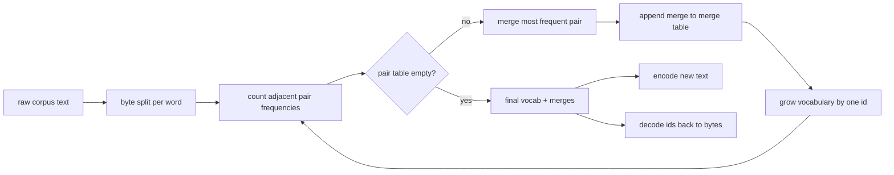
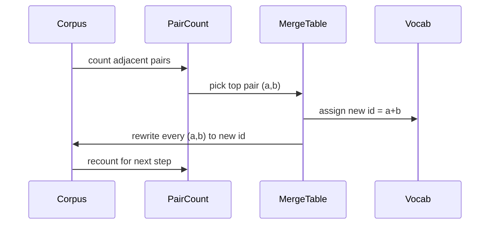

# 从零实现 BPE Tokenizer

> 字节进，id 出，id 又能还原成同样的字节。构建每一个现代文本模型仍然以其为起点的 tokenizer。

**Type:** Build
**Languages:** Python
**Prerequisites:** 第 04 阶段课程、第 07 阶段 transformer 课程
**Time:** ~90 分钟

## Learning Objectives
- 从原始文本语料训练一个 Byte-Pair Encoding 词表，做法是反复合并出现最频繁的相邻符号对。
- 实现确定性的 merge 表，并把它应用于新文本，产出子词 id 流。
- 让任意 UTF-8 输入往返于 id 之间而不丢失信息。
- 预留并保护特殊 token（`<|endoftext|>`、`<|pad|>`），使其在训练与解码中都能保留。
- 推理为什么字节级字母表是通用 tokenizer 的合适下限。

```figure
cap-bpe-merge
```

## 背景框架

语言模型从不看文本。它看的是整数。从字符串到整数列表再回到字符串的映射，就是 tokenizer。这一层弄错了，训练过程里的每条 loss 曲线都在度量错误的东西。

通用文本模型中最主流的子词 tokenizer 家族是 Byte-Pair Encoding。想法很简单。从一个已知字母表开始。找出训练语料中出现最频繁的相邻符号对。把它合并成一个新符号。重复直到词表达到目标大小。编码新文本时，以相同顺序复用同一份 merge 列表。

我们将构建字节级变体。字母表是 256 个原始字节，而不是 Unicode 码点。正是这一选择让 tokenizer 能处理任意 UTF-8 输入，而不必退回到未知 token。

## 流水线



训练侧与推理侧共享 merge 表。这种共享就是契约。如果你在推理时改变 merge 顺序，解码出来的 id 流就会不同。

## 字节字母表

前 256 个 id 保留给 0x00 到 0xFF 的原始字节。这保证任何输入字符串在发生任何合并之前都能被词表表示。字节块之后，我们保留一小段范围给特殊 token。训练循环从不把这些 id 提为合并目标，因为我们完全把它们排除在预分词流之外。

预分词器在训练看到语料之前，先按空白与标点边界切分语料。没有这个切分，BPE 合并步骤会乐此不疲地学到跨越词边界的合并，词表里塞满整个常见短语。有了切分，合并只留在词内部，结果才能泛化。

## 训练循环

每个训练步骤，循环做三件事。它遍历语料中的每个词，统计当前符号的每个相邻对出现得多频繁，并以该词本身出现的频率加权。它挑出计数最高的对。它把该对的每一处出现改写成一个新符号，其 id 是词表中的下一个空位。然后记录这次合并。



每一步的开销与以符号序列列表表示的语料规模成线性。对于一百万词、目标词表一万个 id，循环几秒内就能跑完，因为随着合并落地，符号序列会缩短。

## 编码新文本

推理不调用合并计数器。它按学习时的相同顺序应用 merge 表。对于新词，编码器从字节切分开始。它扫描当前序列，找出排名最低的 merge（即最早适用的一条）。它执行这次合并。再扫描一次。当表中没有任何 merge 适用于当前序列时，循环结束。

按排名排序这一性质，使编码具备确定性，并与训练时对相同输入的行为一致。最早学到的 merge 位于表顶，最先被应用。如果两条 merge 能在同一位置适用，排名更低的那条胜出。

## 特殊 token

特殊 token 是字节流永远无法产生的 id。我们手工预留它们。本课有两个就够。

- `<|endoftext|>` 在预训练时分隔文档。它告诉模型“这里开始一个新文档，不要让前一个文档的 context 泄漏进来。”
- `<|pad|>` 填充较短的序列，让一个 batch 能成为矩形张量。训练时 loss mask 会把它隐藏。

编码器接受一个标志，用于允许输入中出现特殊 token。标志关闭时，字符串 `<|endoftext|>` 与 `<|pad|>` 被按拼出它们的字节来分词。标志开启时，这些字面字符串被映射到各自预留的 id，且不受任何合并影响。

## 往返保证

先编码再解码必须精确还原输入字节。解码器按顺序拼接每个 id 的字节展开。由于每个 id 要么是原始字节，要么是两个此前已知 id 的拼接，递归展开总是终止于原始字节。解码随后返回这些字节拼出的 UTF-8 字符串。

本课的测试套件在一句未见的句子、一句带 Unicode emoji 的句子，以及一句包含字面 `<|endoftext|>` token 的句子上检查该性质。

## 本课不做什么

它不构建大型生产级 tokenizer 那种由正则驱动的预分词器。这里的预分词器只是一个小的空白与标点切分。它足以在小训练语料上产生合理的合并，且与后续课程链的契约保持不变。下一课把 tokenizer 当作黑盒，在其之上构建滑动窗口数据集。

它不并行化符号对计数器。在 Python 里对一个几千词的语料循环，远不到一秒就结束。对于更大的语料，显而易见的做法是并行统计每个词的对再做归约。

## 如何阅读代码

`main.py` 定义了四个对象。`BPETokenizer` 持有词表、merge 表与特殊 token 表。`train` 是训练循环。`encode` 是推理路径。`decode` 是字节拼接。底部的 demo 在内置语料上训练一个小 tokenizer，编码一句留出句，再把 id 解码回来，并打印两者。`code/tests/test_bpe.py` 里的测试钉住了往返性质、特殊 token 预留与 merge 顺序。

运行 demo。然后把 demo 里的目标词表大小从 300 改成 600，观察留出句的编码长度如何下降。那条曲线就是 BPE 压缩曲线。
